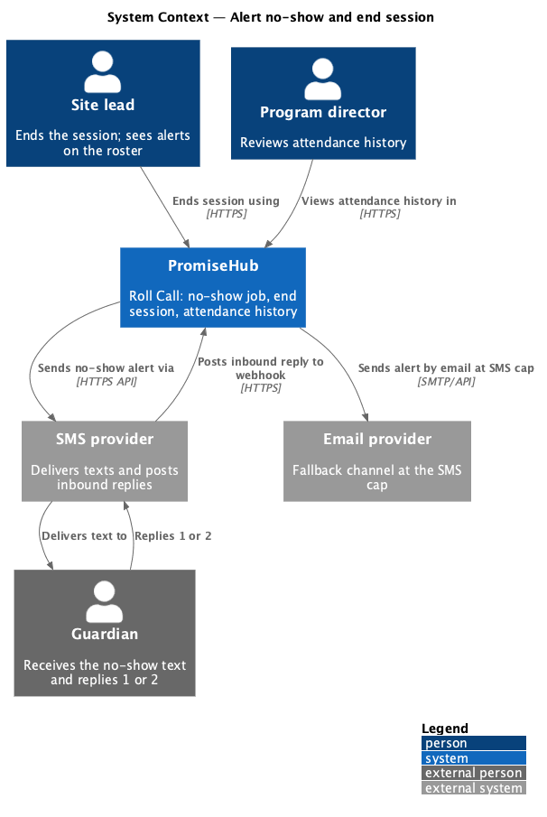
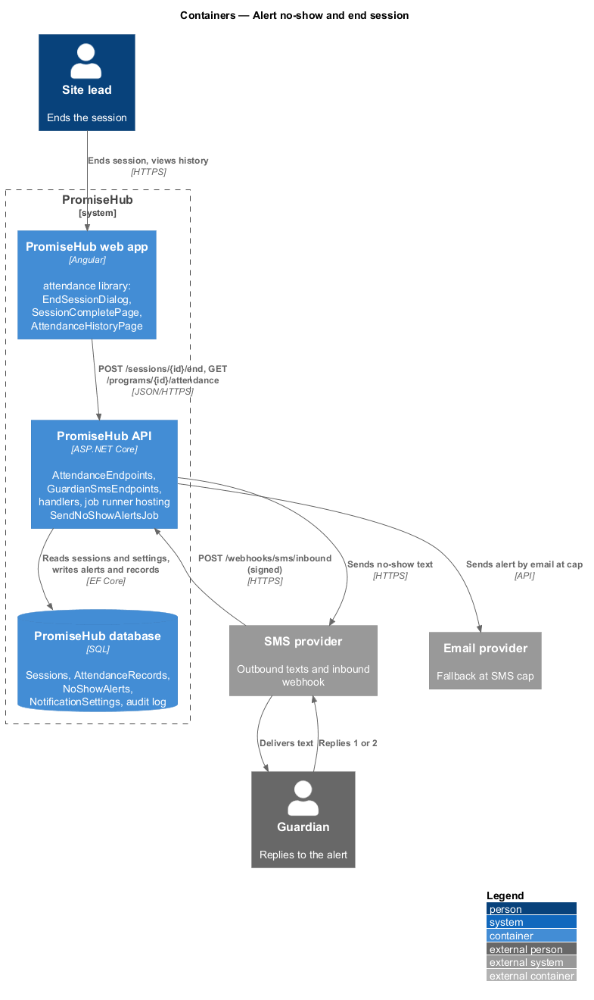
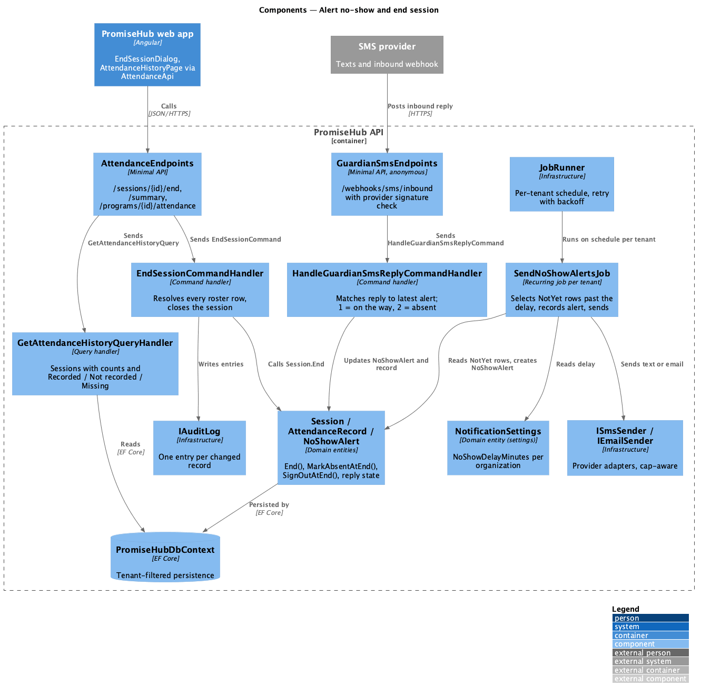
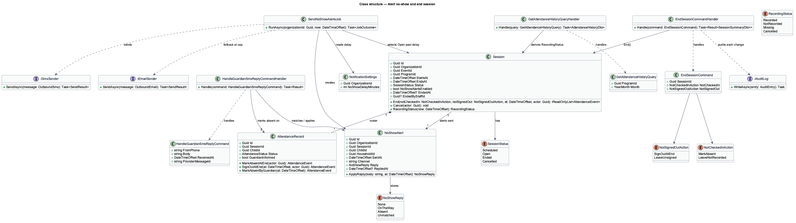
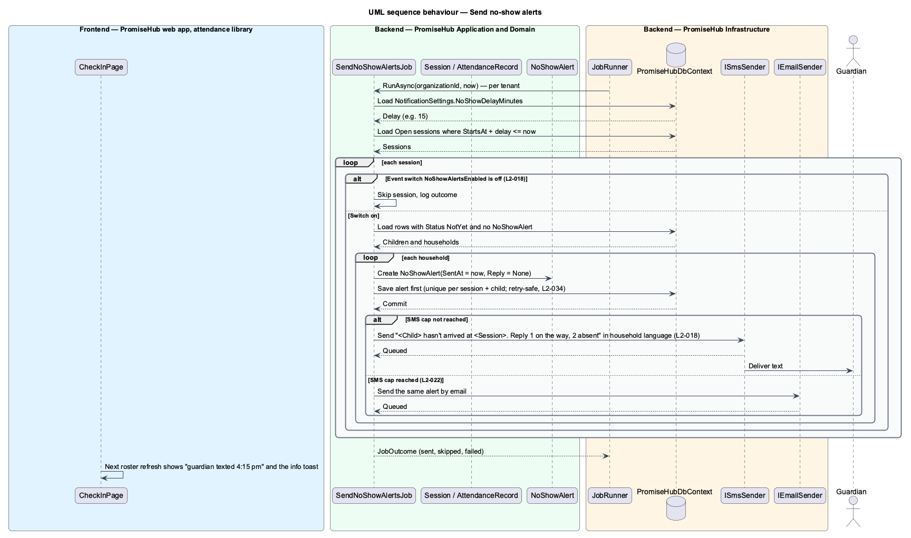
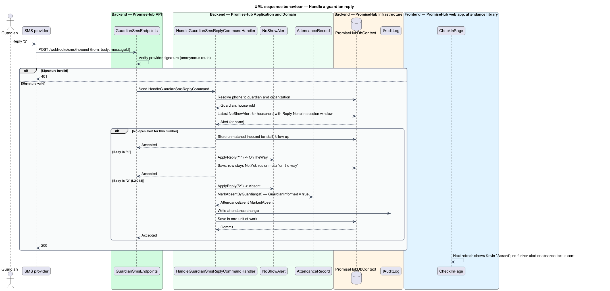
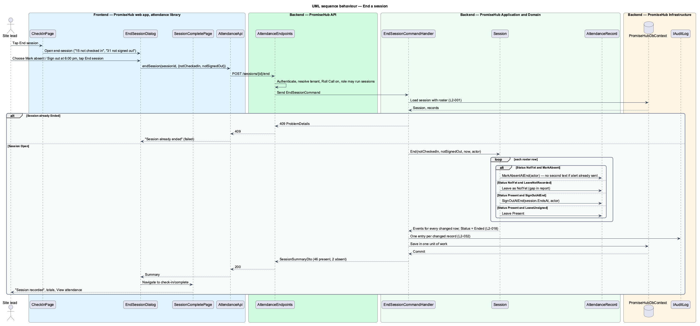

# Alert no-show and end session

## Overview

PromiseHub is a phone-first system of record for small youth-serving organizations. The Roll Call module records who attends each session. This feature covers the two moments that bracket a session: the automatic no-show alert that goes to a guardian when a child has not arrived, and the end of the session, when attendance is closed and rolled into program totals.

A no-show alert is a text sent to a child's guardian when the child is not checked in a configurable number of minutes after the session starts. The delay is an organization setting (`settings-notifications`); each event also has a switch that turns the alert off for that event. The guardian can reply with "1" (on the way) or "2" (absent), and the reply updates the roster without staff involvement.

Ending a session is the moment the site lead closes attendance. The end-session dialog asks what to do with children not checked in (mark absent, or leave as not recorded) and children not signed out (sign out to a guardian at the session end time, or leave unsigned). The server then writes an attendance record for every child on the roster, the completion page shows the totals, and the program's attendance history gains one recorded session. A session that was never opened appears in the history as "Not recorded" and a session that was opened but never ended appears as "Missing", each with actions to record from memory or mark cancelled.

Local terms:

- **no-show delay** — number of minutes after session start at which children not checked in trigger an alert
- **no-show alert** — one text per household naming the child, the session and the reply options
- **guardian reply** — inbound SMS from the guardian's number containing "1" or "2", matched to the most recent alert for that number
- **end session** — command that closes a session and resolves every roster row to a final status
- **attendance history** — per-program list of sessions with present, absent and excused counts and a recording status
- **not recorded** — status of a past session that was never opened for check-in
- **missing** — status of a past session that was opened but never ended

The feature belongs to the `attendance` subsystem and the Roll Call module. The alert text uses the Messages infrastructure (`ISmsSender`, SMS cap) but does not require the Messages module to be on. `<TO SUPPLY>`: whether the no-show alert is suppressed when the Messages module is off for the organization.

## Built so far

Slice 22 delivered `SendNoShowAlertsHandler` in the per-tenant send job, `NoShowAlert`, `MessageSource.NoShow`, `POST /webhooks/sms/inbound` with `NoShowReplyHandler`, and the no-show badge on `CheckInPage` rows (ADR 0022). The delay is fixed at 15 minutes. Ending a session, the completion page, attendance history and unmatched replies are not built yet.

## Description

### Frontend — `frontend/projects/attendance/`

- **`CheckInPage`** — the check-in screen shows a per-row note "Absent · guardian texted 4:15 pm" once an alert is sent, and the info toast "No-show texts sent" at the moment of sending (screen `toast/info`). The roster refreshes the alert state from the server response of each poll or action.
- **`EndSessionDialog`** — bottom-sheet dialog (screen `end-session`) with two radio groups: "The N not checked in" (`Mark absent`, `Leave as not recorded`) and "The M not signed out" (`Sign out to a guardian at <end time>`, `Leave unsigned`). States: `default`, `busy`, `failed`.
- **`SessionCompletePage`** — the `complete` state of screen `check-in`: "Session recorded", the totals, and actions **Back to Today**, **View attendance** and **Report an incident**.
- **`AttendanceHistoryPage`** — page at `/programs/:id/attendance` (screen `attendance`) with the breadcrumb, a summary line (sessions, average, last recorded), view and month selectors, a warning alert for an unrecorded session with **Record now** and **Mark cancelled**, and a table of sessions with present, absent, excused and status badge (`Recorded`, `Not recorded`, `Missing`). States: `default`, `loading`, `empty`, `error`, `no-results`, `long`. The route is declared in the `attendance` library and lazy-loaded by the shell; the Programs pages link to it.
- Components come from `frontend/projects/components/`: CDK dialog, radio group, alert, badge, table, select, toast, empty state.

### Frontend — `frontend/projects/settings/`

- **`NotificationSettingsPage`** (screen `settings-notifications`) owns the no-show delay field. It is designed in the `settings` subsystem; this feature reads the saved value only.

### Frontend — `frontend/projects/api/`

- **`AttendanceApi`** — adds `endSession(sessionId, request)`, `getSessionSummary(sessionId)` and `getAttendanceHistory(programId, month)`.
- **`EventsApi`** — exposes the per-event `noShowAlertsEnabled` switch (owned by the `events` subsystem).

### Backend — `PromiseHub.Api`

- **`AttendanceEndpoints`** — adds `POST /sessions/{sessionId}/end`, `GET /sessions/{sessionId}/summary`, `GET /programs/{programId}/attendance?month=`, `POST /sessions/{sessionId}/record-from-memory` and `POST /sessions/{sessionId}/cancel`.
- **`GuardianSmsEndpoints`** — anonymous webhook `POST /webhooks/sms/inbound` that receives inbound texts from the SMS provider. The endpoint verifies the provider signature, then dispatches `HandleGuardianSmsReplyCommand`. It is the only anonymous route in the slice.

### Backend — `PromiseHub.Application/Attendance/`

- **`SendNoShowAlertsJob`** — recurring job run by the job runner once per tenant. For each `Open` session whose `StartsAt + NoShowDelay` has passed and whose event has `NoShowAlertsEnabled`, it selects roster rows with `Status = NotYet` and no `NoShowAlert`, builds one text per household in the household's language, and sends it through `ISmsSender`. It records a `NoShowAlert` per child before the send so a retry never sends twice (`L2-034`). When the SMS cap is reached, the alert goes by email instead (`L2-022`). `<TO SUPPLY>`: the job's polling interval.
- **`HandleGuardianSmsReplyCommand`** / **`HandleGuardianSmsReplyCommandHandler`** — resolves the sender's phone to a guardian, finds the most recent unanswered `NoShowAlert` for that guardian within the session window, and applies the reply: "1" stores `OnTheWay` and keeps the row at `NotYet`; "2" marks the child `Absent` with `GuardianInformed = true` so no further alert or absence text is sent. Any other content is stored as an unmatched reply for staff follow-up.
- **`EndSessionCommand`** / **`EndSessionCommandHandler`** — closes the session. The command carries `NotCheckedInAction` (`MarkAbsent`, `LeaveNotRecorded`) and `NotSignedOutAction` (`SignOutAtEnd`, `LeaveUnsigned`). The handler applies the chosen action to every roster row, sets the session to `Ended` with `EndedAt` and `EndedBy`, writes one audit entry per changed record, and saves in one unit of work. A child marked absent at end of session is not texted again if a no-show alert was already sent.
- **`GetSessionSummaryQuery`** / **`GetSessionSummaryQueryHandler`** — present, absent, excused and not-recorded counts for the completion page.
- **`GetAttendanceHistoryQuery`** / **`GetAttendanceHistoryQueryHandler`** — sessions of a program for a month with counts and the derived recording status. A past session with `Status = Scheduled` is `NotRecorded`; a past session with `Status = Open` is `Missing`; `Ended` is `Recorded`; `Cancelled` is `Cancelled`.
- **`RecordSessionFromMemoryCommand`** / **`CancelSessionCommand`** — the two actions offered for an unrecorded session. The first opens the session for after-the-fact check-in; the second sets `Cancelled`.
- **`AttendancePermissions`** — ending a session requires a role allowed to run sessions. Attendance history requires program director, admin or site lead.

### Backend — `PromiseHub.Domain/Attendance/`

- **`Session`** — gains `NoShowAlertsEnabled` (copied from the event at creation), `EndedAt`, `EndedByStaffId`, and the method `End(notCheckedIn, notSignedOut, at, actor)` that iterates the roster and returns the list of `AttendanceEvent` produced.
- **`AttendanceRecord`** — gains `GuardianInformed` (true after a "2" reply or an excused absence) and `MarkAbsentAtEnd(actor)`, `SignOutAtEnd(at, actor)`.
- **`NoShowAlert`** — entity with `SessionId`, `ChildId`, `HouseholdId`, `SentAt`, `Channel` (`Sms`, `Email`), `Reply` (`None`, `OnTheWay`, `Absent`, `Unmatched`) and `RepliedAt`.
- **`NotificationSettings`** — organization-level entity (owned by the `settings` subsystem) with `NoShowDelayMinutes`.

### Backend — `PromiseHub.Infrastructure`

- **`JobRunner`** — schedules `SendNoShowAlertsJob` per tenant with retry and backoff (`L2-034`) and records job outcomes for observability (`L2-041`).
- **`ISmsSender`** / **`IEmailSender`** — provider adapters. The SMS adapter exposes the inbound webhook signature check used by `GuardianSmsEndpoints`.
- **`PromiseHubDbContext`** — adds `NoShowAlerts`; a unique index on (`SessionId`, `ChildId`) prevents a second alert for the same child in the same session.
- **`IAuditLog`** — one entry per attendance record changed by `EndSessionCommand`.

### Behavioural rules

- The alert text reads, in the household's language, "<Org short name>: <Child> hasn't arrived at <Session> (<start>). Reply 1 on the way, 2 absent, or call <site lead number>." (screen `guardian-sms/warning`).
- Exactly one alert goes out per child per session. A child checked in after the alert keeps the alert on record and the row shows "Checked in · alert sent".
- When the per-event switch is off, the job skips the session.
- Ending a session writes a status for every roster row. Rows left as "not recorded" count in neither present nor absent and are shown as a gap in reports.
- The completion page and the attendance history reflect the ended session on the next load with no re-entry (`L2-024`).

## Requirements

The feature realizes the following level-2 (L2) requirements. Each L2 requirement refines a level-1 (L1) requirement, cited by identifier.

| L2 ID | Refines (L1) | Requirement |
|-------|--------------|-------------|
| `L2-018` | `L1-007` | Guardians are alerted when a child is not checked in N minutes after start; ending a session closes attendance and rolls it into totals. |
| `L2-034` | `L1-018` | Uptime target, backups and resilient jobs. |

## Diagrams

### System context

The site lead ends the session in PromiseHub. PromiseHub texts the guardian through the SMS provider, and the guardian's reply returns through the same provider.

### Containers

The no-show job runs inside the API process on a per-tenant schedule. Inbound replies arrive on a webhook, and the web app ends the session and reads the history.

### Components

`SendNoShowAlertsJob` reads open sessions and settings, records `NoShowAlert` rows and sends through `ISmsSender`. `GuardianSmsEndpoints` dispatches replies, and `AttendanceEndpoints` dispatches `EndSessionCommand` and the history query.

### Class structure

`Session.End` resolves every `AttendanceRecord`; `NoShowAlert` ties a sent text to a child and session and stores the reply.

### Behaviour — send no-show alerts

The job wakes per tenant, skips sessions whose switch is off, records the alert before sending so a retry is safe, and falls back to email at the SMS cap.

### Behaviour — handle a guardian reply

The provider posts the inbound text. The handler matches it to the latest alert for that number and applies "1" or "2" to the roster.

### Behaviour — end a session

The end-session dialog collects the two choices. The handler resolves every roster row, audits each change, and the completion page and attendance history show the result.

