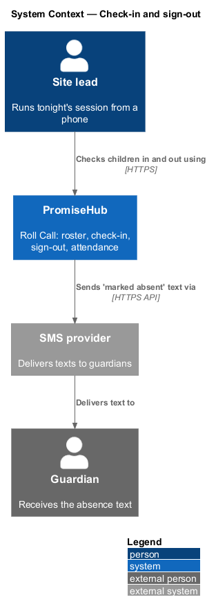
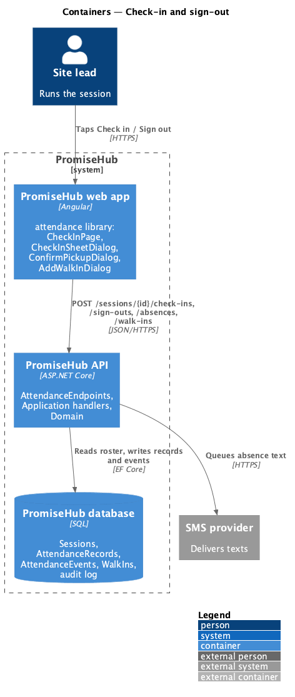
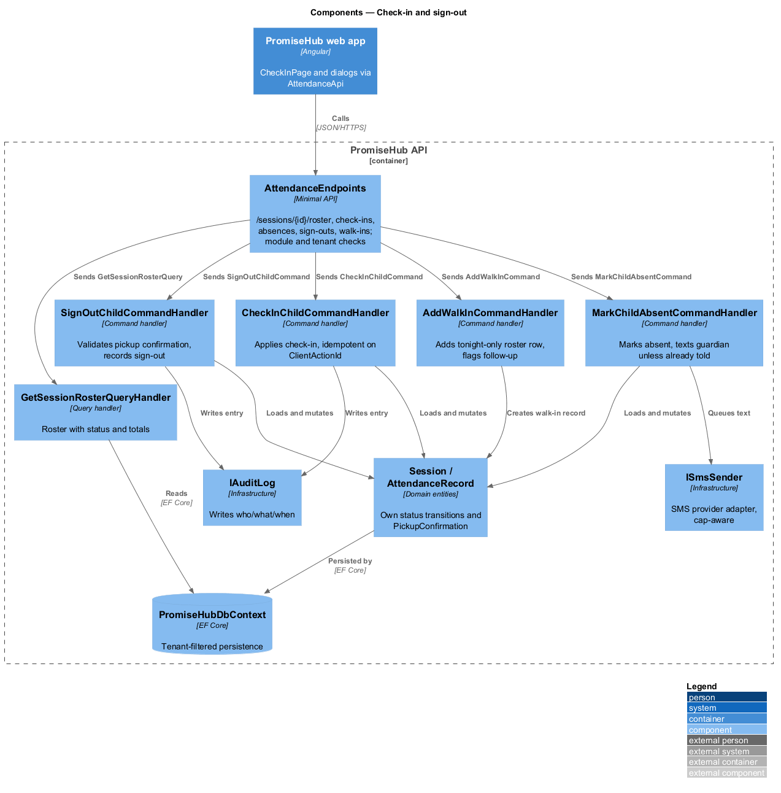
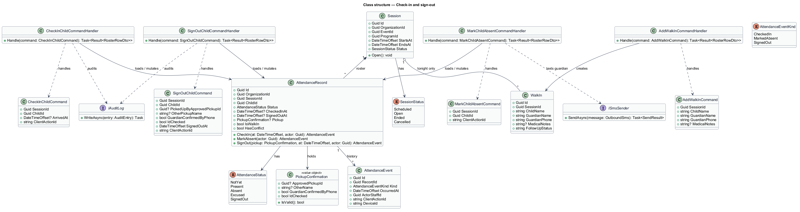
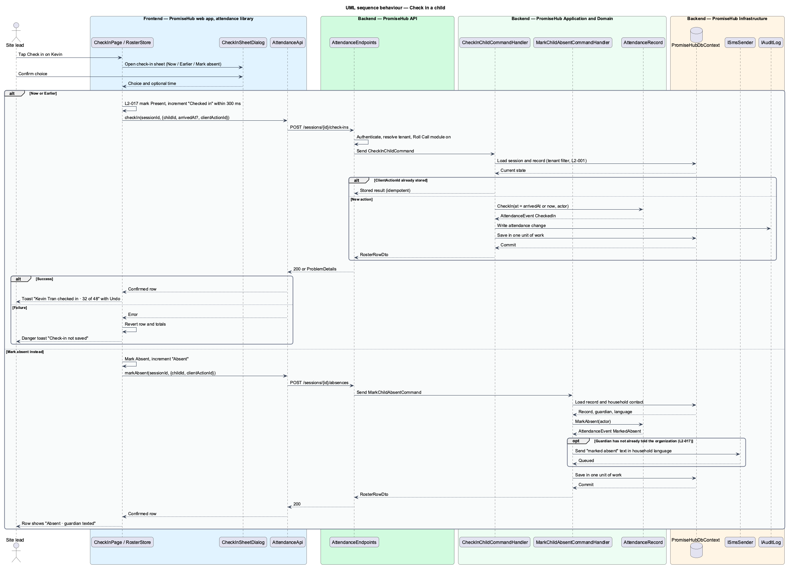
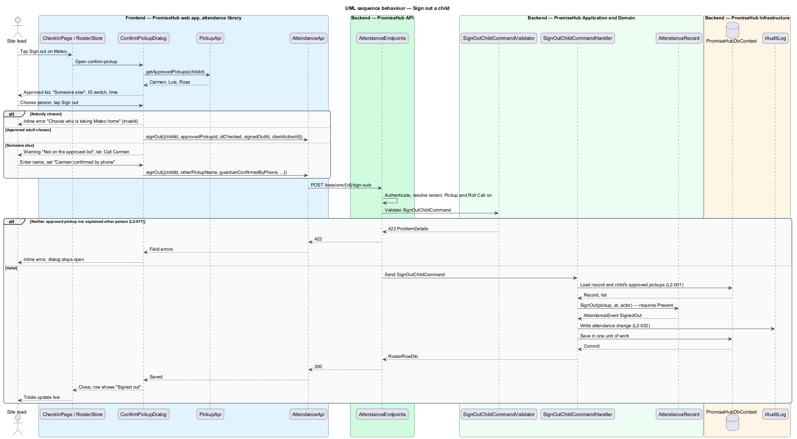
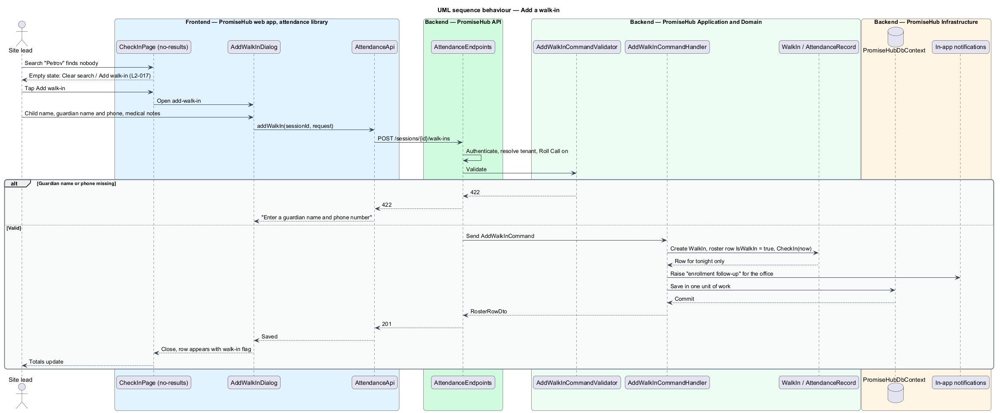

# Check-in and sign-out

## Overview

PromiseHub is a phone-first system of record for small youth-serving organizations. The Roll Call module lets a site lead run a session from a phone: one tap checks a child in, one tap signs the child out, and session totals update live. This feature covers that core loop for a single session, from the roster screen to the attendance record in the database.

A session is an occurrence of an event for which attendance is taken, for example "Tutoring night, Thursday 5 November, 4:00–6:00 pm". When the site lead taps **Check in** on a child, the roster marks the child present at once and sends the change to the server in the background. The site lead sees the result in under 300 ms, before the server confirms it. Sign-out is the mirror action with one extra step: the person collecting the child shall be an approved adult or an explained exception, because sign-out is where child safety is decided.

Local terms:

- **session** — scheduled occurrence of an event for which attendance is recorded
- **roster** — list of children expected at a session, drawn from the program enrollment plus any walk-ins
- **attendance record** — per-child, per-session row holding arrival status, arrival time, departure time and who collected the child
- **optimistic check-in** — client-side status change rendered before the server acknowledges it and reverted if the server rejects it
- **walk-in** — child who attends a session without being on the roster and is recorded for that session only
- **approved pickup** — adult named by a guardian or staff member as allowed to collect a child
- **client action id** — identifier generated on the device for each attendance action so the server treats a repeated send as the same action

The feature belongs to the `attendance` subsystem and the Roll Call module. Sign-out with pickup confirmation also depends on the Pickup module. `<TO SUPPLY>`: the sign-out behaviour when Roll Call is on and Pickup is off (time only, or a free-text name).

## Description

The feature is a vertical slice from the check-in screen on a phone to the `AttendanceRecord` table.

### Frontend — `frontend/projects/attendance/`

- **`CheckInPage`** — page component at `/check-in`. It renders the session header with the sync chip, the totals group (Checked in, Absent, Not yet, Cleared), the search field and filter chips, and the roster list. It owns the states `default`, `loading`, `empty`, `error`, `no-results` and `long` of screen `check-in`. The `no-results` state offers **Clear search** and **Add walk-in**.
- **`RosterStore`** — signal-based store used by `CheckInPage`. It holds the roster, applies an optimistic status change on tap, recomputes totals, and reverts the change when the server answers with an error. It assigns a client action id to every action.
- **`CheckInSheetDialog`** — bottom-sheet dialog (screen `check-in-sheet`) opened from a roster row. It shows the child, guardian and phone, an **Arrived** radio group with `Now`, `Earlier` (with a time picker) and `Mark absent instead`, and a link to the child's Quick Card. States: `default`, `busy`, `failed`.
- **`ConfirmPickupDialog`** — bottom-sheet dialog (screen `confirm-pickup`) opened by **Sign out**. It lists the approved adults as a radio group plus **Someone else**, a switch "I checked photo ID or know this person", and a time field. Choosing **Someone else** reveals the `confirm` state: a warning with a `tel:` button to the primary guardian, a name field, and the switch "Guardian confirmed by phone". States: `default`, `busy`, `invalid`, `failed`, `confirm`.
- **`AddWalkInDialog`** — dialog (screen `add-walk-in`) with the child's name, the guardian's name and phone, and free-text medical notes as told by the guardian. States: `default`, `busy`, `invalid`, `failed`.
- Components come from `frontend/projects/components/`: roster list and roster item, stat, chip, CDK dialog, form field, switch, toast, sync chip and empty state.

### Frontend — `frontend/projects/api/`

- **`AttendanceApi`** — typed client behind the `ATTENDANCE_API` injection token. Methods: `getSessionRoster(sessionId)`, `checkIn(sessionId, request)`, `markAbsent(sessionId, request)`, `signOut(sessionId, request)`, `addWalkIn(sessionId, request)`. Each write carries a `clientActionId`.
- **`PickupApi`** — typed client behind `PICKUP_API`, used by `ConfirmPickupDialog` to read the approved adults for a child.

### Backend — `PromiseHub.Api`

- **`AttendanceEndpoints`** — minimal-API group under `/sessions/{sessionId}`. Routes: `GET /roster`, `POST /check-ins`, `POST /absences`, `POST /sign-outs`, `POST /walk-ins`. The endpoints authenticate, resolve the active organization from the membership, answer 404 when Roll Call is off, and dispatch a command or query. They hold no business logic.

### Backend — `PromiseHub.Application/Attendance/`

- **`GetSessionRosterQuery`** / **`GetSessionRosterQueryHandler`** — returns the roster with each child's status, time and flags for the signed-in person's organization.
- **`CheckInChildCommand`** / **`CheckInChildCommandHandler`** — records a check-in. The command carries `SessionId`, `ChildId`, `ArrivedAt` (optional, for **Earlier**) and `ClientActionId`. The handler loads the session and record, applies the check-in on the entity, appends an `AttendanceEvent`, writes an audit entry and saves in one unit of work. A repeated `ClientActionId` returns the stored result without a second write.
- **`MarkChildAbsentCommand`** / **`MarkChildAbsentCommandHandler`** — marks a child absent. The handler queues an SMS to the primary guardian through `ISmsSender` unless the record already shows the guardian told the organization (an `Excused` status or a guardian SMS reply of "2").
- **`SignOutChildCommand`** / **`SignOutChildCommandHandler`** — records a sign-out. The command carries `PickedUpByApprovedPickupId` or `OtherPickupName` with `GuardianConfirmedByPhone`, plus `IdChecked` and `SignedOutAt`. The handler verifies the approved pickup against the child's current list.
- **`AddWalkInCommand`** / **`AddWalkInCommandHandler`** — creates a `WalkIn` for the session, adds a roster row for that session only, checks the child in, and raises an in-app notification for enrollment follow-up.
- **`CheckInChildCommandValidator`**, **`SignOutChildCommandValidator`**, **`AddWalkInCommandValidator`** — validators. `SignOutChildCommandValidator` rejects a request with neither an approved pickup nor an explained other person (422). `AddWalkInCommandValidator` requires the child's name and the guardian's name and phone.
- **`AttendancePermissions`** — permission checks. Check-in, sign-out and walk-in require a role allowed to run sessions (site lead, youth worker, program director, admin). The roster query is open to every staff role when Roll Call is on.

### Backend — `PromiseHub.Domain/Attendance/`

- **`Session`** — entity with `Id`, `OrganizationId`, `EventId`, `ProgramId`, `StartsAt`, `EndsAt`, `Status` (`Scheduled`, `Open`, `Ended`, `Cancelled`) and a collection of `AttendanceRecord`.
- **`AttendanceRecord`** — entity with `Id`, `OrganizationId`, `SessionId`, `ChildId`, `Status` (`NotYet`, `Present`, `Absent`, `Excused`, `SignedOut`), `CheckedInAt`, `SignedOutAt`, `Pickup`, `IsWalkIn` and `HasConflict`. The methods `CheckIn(at, actor)`, `MarkAbsent(actor)` and `SignOut(pickup, at, actor)` enforce the transitions. Sign-out requires `Present`. Check-in from `Absent` is allowed and clears the absence.
- **`PickupConfirmation`** — value object with `ApprovedPickupId`, `OtherName`, `GuardianConfirmedByPhone` and `IdChecked`. `IsValid()` is true when an approved pickup is referenced, or when an other name is given and the phone confirmation is recorded.
- **`AttendanceEvent`** — append-only entity with `RecordId`, `Kind` (`CheckedIn`, `MarkedAbsent`, `SignedOut`), `OccurredAt`, `ActorStaffId`, `ClientActionId` and `DeviceId`. Every status change writes one event; the record is the current view.
- **`WalkIn`** — entity with `SessionId`, `ChildName`, `GuardianName`, `GuardianPhone`, `MedicalNotes` and `FollowUpStatus`.

### Backend — `PromiseHub.Infrastructure`

- **`PromiseHubDbContext`** — EF Core context with `Sessions`, `AttendanceRecords`, `AttendanceEvents` and `WalkIns`. A global query filter applies `OrganizationId`. A unique index on (`OrganizationId`, `ClientActionId`) in `AttendanceEvents` makes repeated sends idempotent.
- **`ISmsSender`** — abstraction over the SMS provider used for the "marked absent" text. The text goes out in the household's language and counts toward the organization's SMS cap (`L2-022`).
- **`IAuditLog`** — writes the attendance change with actor, organization, record, action, before and after values and time (`L2-032`).
- **`IClock`** — supplies the server time used when `ArrivedAt` is absent.

### Built so far

Slice 06 delivered `CheckInPage` (default, empty "No sessions today", no-results with Add walk-in, error), the optimistic roster inside the page, `CheckInSheetDialog` (now, earlier, mark absent), `AddWalkInDialog`, `ATTENDANCE_API` with `today`, `roster`, `checkIn`, `markAbsent` and `addWalkIn`, `GET /sessions/today`, `GET /sessions/{id}/roster`, `POST /check-ins`, `/absences` and `/walk-ins` under Roll Call, `AttendanceRecord`, `AttendanceEvent` and `WalkIn`, and Today's session cards. A session is an event (ADR 0009). Slice 08 added sign-out: `SignOutDialog` (the `confirm-pickup` mock: approved list primary first, someone else with the primary guardian's call link, name and phone okay, photo ID switch, invalid and failed states), the Sign out button on checked-in rows while Pickup is on, `pickups` and `signOut` on `ATTENDANCE_API`, `GET /children/{id}/pickups` and `POST /sessions/{id}/sign-outs` under Pickup, and the collector fields on `AttendanceRecord` (ADR 0011). The absence text and the someone-else notice arrive with Messages, the sync chip with offline check-in.

### Behavioural rules

- The UI updates within 300 ms of a tap; the server confirms within 1 second at the 95th percentile (`L2-033`). On success the page shows a toast "Kevin Tran checked in · 32 of 48 now here" with **Undo**. On failure the row reverts and a danger toast names the child.
- **Earlier** stores the chosen time as `CheckedInAt`. The time shall fall on the session's day and shall not be later than the current time.
- **Mark absent** texts the guardian unless the organization was already told. One text goes to each household, in its language.
- Sign-out saves only when an approved adult is chosen, or when **Someone else** is explained with a name and the phone confirmation switch set. The attendance record stores the choice. The feature `manage-approved-pickups` covers notifying the household and reporting a refusal.
- A walk-in is on tonight's roster only and is flagged for enrollment follow-up. Adding a walk-in creates no household and no enrollment.
- Every write is audited. Every endpoint filters by the membership's organization (`L2-001`).

## Requirements

The feature realizes the following level-2 (L2) requirements. Each L2 requirement refines a level-1 (L1) requirement, cited by identifier.

| L2 ID | Refines (L1) | Requirement |
|-------|--------------|-------------|
| `L2-017` | `L1-007` | From the roster, one tap checks a child in (optimistically), one tap signs them out with pickup confirmation; session totals update live. |
| `L2-033` | `L1-018` | Measured on a mid-range Android phone over simulated 4G and on the CI runner. |

## Diagrams

### System context

The site lead runs the session in PromiseHub, which texts a guardian through the SMS provider when a child is marked absent.

### Containers

The tap travels from the PromiseHub web app to the PromiseHub API, which persists attendance in the PromiseHub database and queues the absence text to the SMS provider.

### Components

Inside the API, `AttendanceEndpoints` dispatches commands to the check-in, absence, sign-out and walk-in handlers, which mutate `Session` and `AttendanceRecord` and persist through `PromiseHubDbContext`.

### Class structure

`AttendanceRecord` owns the status transitions and a `PickupConfirmation`. Each handler depends on its command and appends an `AttendanceEvent`.

### Behaviour — check in a child

The roster store marks the child present at once, then `AttendanceApi` posts the check-in. The handler applies `L2-017`, and the store reverts on failure. The `alt` branches cover **Earlier** and **Mark absent**.

### Behaviour — sign out a child

`ConfirmPickupDialog` loads the approved adults. The validator rejects a sign-out that names nobody, and the handler stores the pickup confirmation.

### Behaviour — add a walk-in

From the `no-results` state, the walk-in dialog creates a roster row for tonight only and flags the child for enrollment follow-up.

