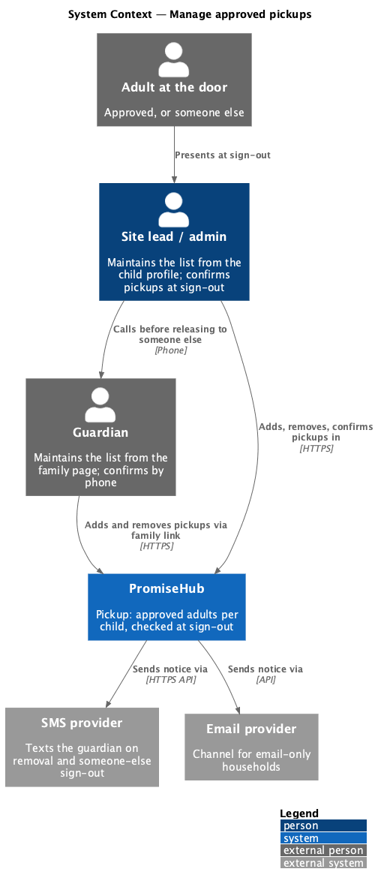
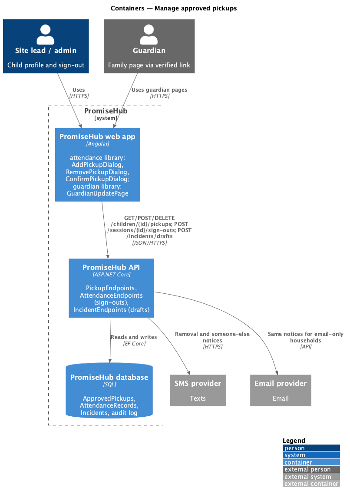
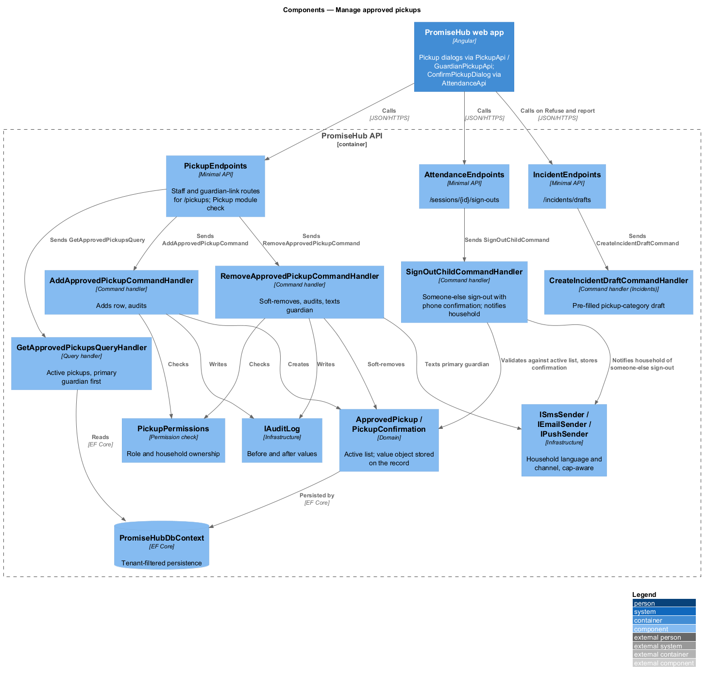
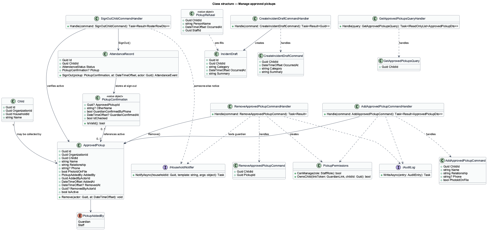
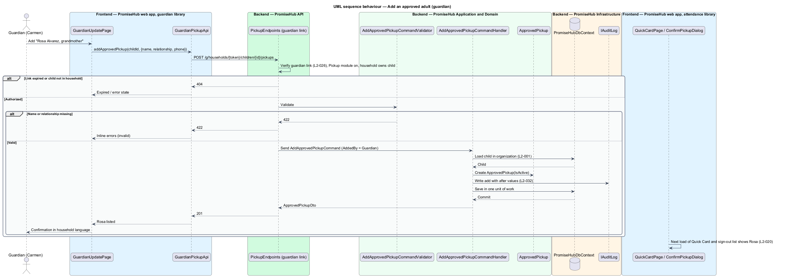
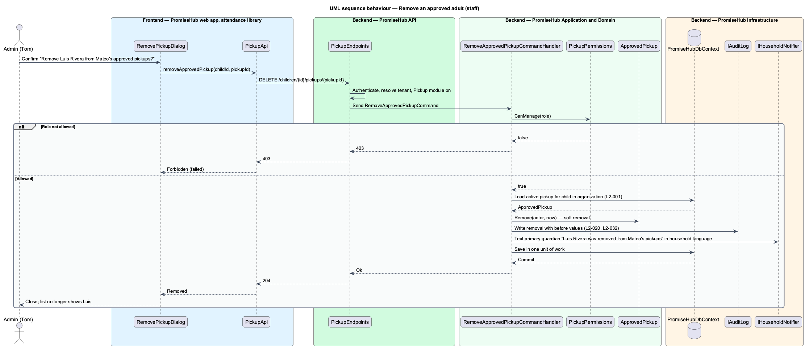
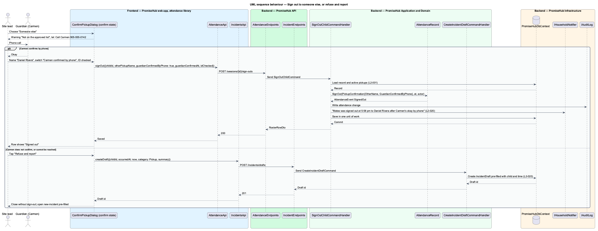

# Manage approved pickups

## Overview

PromiseHub is a phone-first system of record for small youth-serving organizations. The Pickup module keeps, for each child, the list of adults who may collect the child at the end of a session. This feature covers maintaining that list from the staff child profile and from the guardian's own pages, using it at sign-out, recording a sign-out to someone not on the list with the guardian's phone confirmation, and turning a refused pickup into a pre-filled incident report.

An approved pickup is an adult named by a guardian or a staff member. Guardians add and remove adults from their family page without an account; staff do the same from the child profile. The list appears on the child's Quick Card and in the sign-out dialog. When the person at the door is not on the list, the staff member calls the primary guardian, records the person's name and that the guardian confirmed by phone, and the household is notified of the sign-out. When the staff member refuses to release the child, the incident form opens pre-filled with the child, the time and the pickup category.

Local terms:

- **approved pickup** — adult recorded against one child as allowed to collect the child
- **someone else sign-out** — sign-out to a person not on the approved list, saved only with a name and a recorded guardian phone confirmation
- **refusal** — decision by a staff member not to release a child to the person present, recorded as an incident
- **pickup category** — incident category reserved for pickup refusals and disputes

The feature belongs to the `attendance` subsystem and the Pickup module. Pickup depends on Roll Call (`L2-004`); the server rejects a configuration with Pickup on and Roll Call off. The refusal path depends on the Incident log module. `<TO SUPPLY>`: what the refusal action offers when the Incident log module is off.

## Built so far

Slice 26 delivered `ApprovedPickup`, `ApprovedPickupsHandler`, the staff and guardian pickup endpoints, `AddPickupDialog` and `RemovePickupDialog` on `QuickCardPage`, `GuardianPickupDialog` and the pickups section on the guardian home, `PICKUP_API` and the guardian API methods (ADR 0024). Photo ID, refuse and report, and a household-page view are not built yet.

## Description

### Frontend — `frontend/projects/attendance/`

- **`AddPickupDialog`** — dialog (screen `add-pickup`) with the adult's name, relationship, phone and a switch "Photo ID on file". States: `default`, `busy`, `invalid`, `failed`. It is exposed through the library's routes at `/children/:id/pickups/add` so the child profile in the `households` library opens it by navigation, as feature libraries never import each other.
- **`RemovePickupDialog`** — confirmation dialog (screen `remove-pickup`) "Remove Luis Rivera from Mateo's approved pickups?" with the note that the primary guardian is texted. States: `default`, `busy`, `failed`. Route `/children/:id/pickups/:pickupId/remove`.
- **`ConfirmPickupDialog`** — the sign-out dialog designed in `check-in-and-sign-out`. This feature owns its `confirm` state: the warning "Not on the approved list · Call Carmen Rivera before Mateo leaves" with a `tel:` button, the name field, the switch "Carmen confirmed by phone at <time>", the switch "I checked photo ID", and the secondary action **Refuse and report**.
- **`ApprovedPickupsList`** — list section used by the Quick Card and the child profile: avatar, name, relationship, "photo ID on file" or "ask for ID", **Remove** per row and **Add an approved adult** in the footer.
- Components come from `frontend/projects/components/`: CDK dialog, form field, switch, alert with actions, list, avatar, badge, toast.

### Frontend — `frontend/projects/guardian/`

- **`GuardianUpdatePage`** (screen `guardian-update`) — the family page lists "Who may pick <child> up, besides you" with **Remove** per row and an **Add** action. It calls `GuardianPickupApi` with the verified guardian link token. The page follows the guardian page rules: one primary action, household language, footer contact (`L2-027`).

### Frontend — `frontend/projects/api/`

- **`PickupApi`** — typed client behind `PICKUP_API`. Methods: `getApprovedPickups(childId)`, `addApprovedPickup(childId, request)`, `removeApprovedPickup(childId, pickupId)`.
- **`GuardianPickupApi`** — typed client behind `GUARDIAN_PICKUP_API` for the guardian pages. Same operations, authenticated by the guardian link token.
- **`IncidentsApi`** — `createDraft(prefill)` used by **Refuse and report** to open the incident form with the child, time and category set (owned by the `incidents` subsystem).

### Backend — `PromiseHub.Api`

- **`PickupEndpoints`** — minimal-API group `GET /children/{childId}/pickups`, `POST /children/{childId}/pickups`, `DELETE /children/{childId}/pickups/{pickupId}`. Staff routes authenticate by session; the guardian routes under `/g/households/{token}/children/{childId}/pickups` authenticate by the verified guardian link (`L2-026`). Both answer 404 when Pickup is off.
- **`AttendanceEndpoints`** — `POST /sessions/{sessionId}/sign-outs` (designed in `check-in-and-sign-out`) accepts the someone-else fields.
- **`IncidentEndpoints`** — `POST /incidents/drafts` accepts a pre-fill (owned by `incidents`).

### Backend — `PromiseHub.Application/Attendance/`

- **`GetApprovedPickupsQuery`** / **`GetApprovedPickupsQueryHandler`** — active pickups for a child in the caller's organization, primary guardian first.
- **`AddApprovedPickupCommand`** / **`AddApprovedPickupCommandHandler`** — adds an `ApprovedPickup` with `AddedBy` (`Guardian` or `Staff`) and the actor. It writes an audit entry and saves. The Quick Card and sign-out list read the same table, so the new adult appears on both at once (`L2-020`).
- **`RemoveApprovedPickupCommand`** / **`RemoveApprovedPickupCommandHandler`** — sets `RemovedAt` and `RemovedBy` (soft removal keeps history for sign-out records that reference the adult), writes an audit entry, and queues a text to the primary guardian when the removal came from staff.
- **`AddApprovedPickupCommandValidator`** — name and relationship required; phone optional but validated when present.
- **`SignOutChildCommandHandler`** — on a someone-else sign-out it stores `PickupConfirmation` with `OtherName` and `GuardianConfirmedByPhone = true`, appends an `AttendanceEvent`, and queues a notification to the household: "<Child> was signed out at <time> to <name> after <guardian>'s okay by phone" in the household's language and channel (`L2-020`).
- **`PickupPermissions`** — staff add and remove require site lead, program director or admin; youth workers read the list. Guardian routes allow only the household's own children.

### Backend — `PromiseHub.Application/Incidents/`

- **`CreateIncidentDraftCommand`** — accepts `ChildId`, `OccurredAt`, `Category = Pickup` and a summary line "Pickup refused: <name> not on approved list" and returns the draft id. The `new-incident` page opens with those fields filled (`L2-020`, `L2-023`).

### Backend — `PromiseHub.Domain/Attendance/`

- **`ApprovedPickup`** — entity with `Id`, `OrganizationId`, `ChildId`, `Name`, `Relationship`, `Phone`, `PhotoIdOnFile`, `AddedBy`, `AddedAt`, `RemovedAt`, `RemovedBy`. `IsActive` is true while `RemovedAt` is null.
- **`PickupConfirmation`** — value object (designed in `check-in-and-sign-out`) carrying the someone-else fields.
- **`PickupRefusal`** — value object attached to the incident draft: `ChildId`, `PersonName`, `OccurredAt`, `StaffId`.

### Backend — `PromiseHub.Infrastructure`

- **`PromiseHubDbContext`** — `ApprovedPickups` with a filtered index on (`ChildId`) where `RemovedAt` is null.
- **`ISmsSender`** / **`IEmailSender`** / push provider — deliver the removal text and the someone-else sign-out notice in the household's language and channel, within the SMS cap (`L2-022`).
- **`IAuditLog`** — every add and remove is audited with before and after values (`L2-032`).

### Behavioural rules

- An adult added by Carmen appears on Mateo's Quick Card and in the sign-out list on the next load of each.
- Removal is a soft removal and is audited. Past sign-outs that referenced the adult keep the reference.
- A someone-else sign-out saves only with a name and the phone confirmation switch set. The record stores both, and the household is notified.
- **Refuse and report** closes the sign-out dialog without saving a sign-out and opens `new-incident` pre-filled with the child, the time and the pickup category.
- Every endpoint filters by organization and, for guardian routes, by the household behind the link token (`L2-001`, `L2-026`).

## Requirements

The feature realizes the following level-2 (L2) requirements. Each L2 requirement refines a level-1 (L1) requirement, cited by identifier.

| L2 ID | Refines (L1) | Requirement |
|-------|--------------|-------------|
| `L2-020` | `L1-009` | Guardians and staff maintain the list of approved adults per child; sign-out checks against it; refusals are recorded. |

## Diagrams

### System context

Guardians maintain the list through their link, staff through the child profile. PromiseHub texts the guardian when staff remove an adult or sign a child out to someone else.

### Containers

Staff pages and guardian pages are two libraries of the same web app. Both reach the API, which persists `ApprovedPickup` rows and queues notifications.

### Components

`PickupEndpoints` dispatches the list, add and remove operations. `SignOutChildCommandHandler` records the someone-else sign-out, and `CreateIncidentDraftCommand` receives the refusal.

### Class structure

`ApprovedPickup` belongs to a child and is soft-removed. `PickupConfirmation` references an active pickup or carries the someone-else fields.

### Behaviour — add an approved adult

Carmen adds Rosa from the family page. The handler stores the row and audits it, and the Quick Card and sign-out list show Rosa on their next load.

### Behaviour — remove an approved adult

Staff remove Luis from the child profile. The handler soft-removes the row, audits the removal and texts Carmen.

### Behaviour — sign out to someone else or refuse

At the door the person is not on the list. The staff member calls Carmen and either records the sign-out with the phone confirmation or refuses and reports an incident pre-filled with the child and time.

