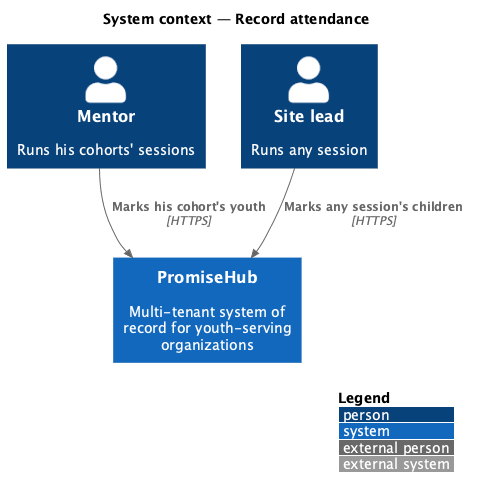
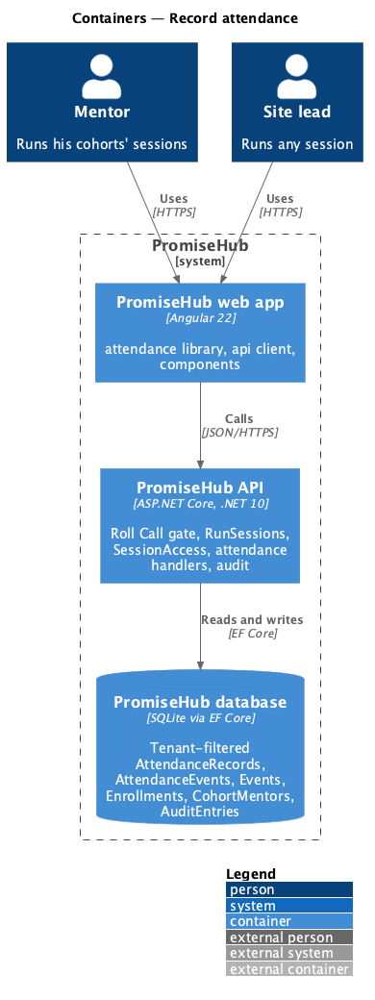
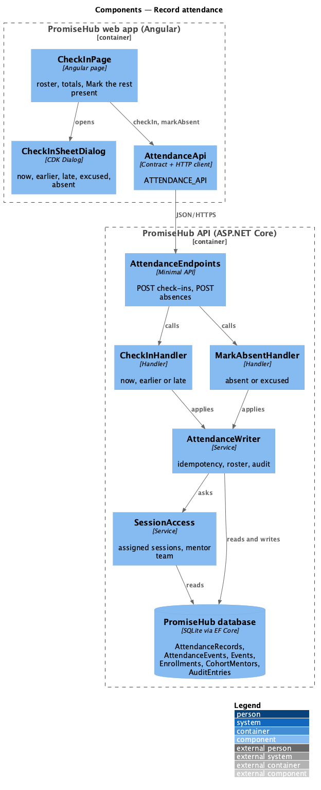
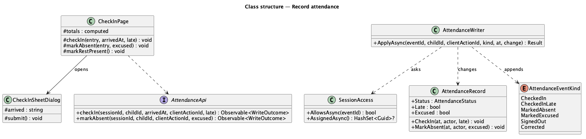
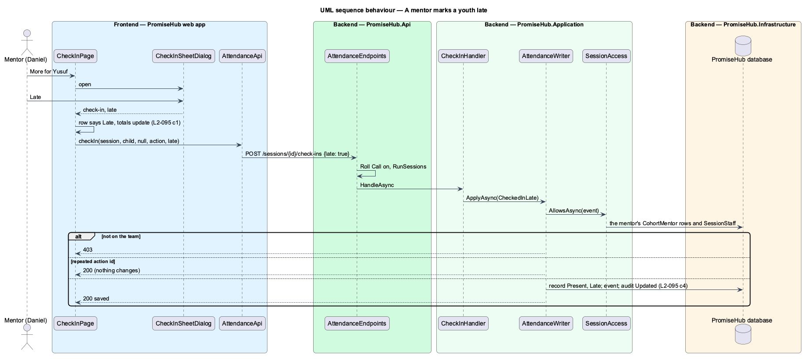
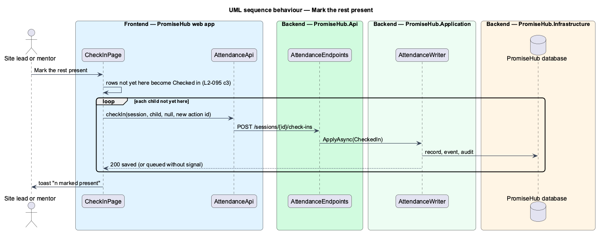

# Record attendance

## Overview

Attendance is both a safety record (who is in the building tonight) and a funder number (how often each youth came). **Record attendance** lets a site lead or a mentor mark each youth on a session's roster Present, Late, Excused or Absent from a phone, and mark everyone not yet marked present in one go. It is Roll Call's existing check-in, extended: there is one attendance system, not two (ADR 0043, ADR 0065).

Terms used in this document:

- **session** — an event of a program (ADR 0009); a cohort is a program (ADR 0043)
- **mark** — one attendance action on one child: check in, check in late, mark absent, mark excused
- **late** — a check-in after the start; the record is Present with `Late` set, kept through sign-out
- **excused** — an absence the organization accepts; the record is Absent with `Excused` set
- **mentor team** — the mentors who lead or support a cohort (`CohortMentor`, L2-062)

Ported from Waypoint `engagement/record-attendance` (`L2-ENGAGE-002` criteria 1, 2 and 5) with tenancy, the Roll Call gate and PromiseHub's check-in model. Waypoint's bulk save with receipts and a concurrency stamp is not carried over: each mark is its own idempotent action keyed by a client action id. Waypoint's per-session note is Roll Call's session notes; its Clear action has no meaning when marks save at once.

## Description

Frontend (`frontend/projects/attendance/`):

- **`CheckInPage`** (mock `check-in`, states `mentor`, `all-marked`) — the roster with Checked in (caption "n late"), Absent (caption "n excused"), Not yet and On roster totals; each row's meta says "Late · checked in 4:21 pm" or "Excused". The header offers Attendance history (staff with `reviewAttendance` and mentors) and Mark the rest present while the session is open and anyone is not yet here. Mark the rest present sends one check-in per remaining child with its own client action id and shows one toast "n marked present". For a mentor, names do not open Quick Cards and rows offer no sign-out.
- **`CheckInSheetDialog`** (mock `check-in-sheet`) — Arrived: Now, Earlier (a time), Late, Excused, Mark absent instead; it closes with `{ kind: 'check-in', arrivedAt, late }` or `{ kind: 'absent', excused }`.
- **Navigation** — Check-in serves the Mentor role while Roll Call is on (`shell/navigation.ts`), and the participant Today shows a Check-in card for mentors.

API client (`frontend/projects/api/`): `AttendanceApi.checkIn(sessionId, childId, arrivedAt, clientActionId, late?)`, `markAbsent(sessionId, childId, clientActionId, excused?)`; `RosterEntry.late`, `RosterEntry.excused`; `SessionSummary.late`, `SessionSummary.excused`; `can(role, 'runSessions')` includes Mentor.

Backend:

- **`AttendanceRecord`** (`PromiseHub.Domain/Attendance/`) — gains `Late` and `Excused`; `CheckIn(at, actor, late)` and `MarkAbsent(at, actor, excused)`.
- **`AttendanceEventKind`** — gains `CheckedInLate`, `MarkedExcused` and `Corrected`.
- **`CheckInCommand`** gains `Late`; **`MarkAbsentCommand`** gains `Excused`; `CheckInHandler` and `MarkAbsentHandler` pass them to `AttendanceWriter`, which audits Updated on `Attendance` with the kind.
- **`SessionAccess`** (`PromiseHub.Application/Attendance/`) — a mentor is scoped to the sessions of programs on whose mentor team they are (not archived) plus assigned sessions; youth workers and volunteers stay scoped to assigned sessions.
- **`RolePermissions`** — `RunSessions` includes Mentor.
- **`GetSessionRosterHandler`** and **`SessionReader`** — rows answer `late` and `excused`; summaries answer `late` and `excused` counts.
- **Persistence** — two boolean columns on `AttendanceRecords`; migration `AttendanceLateExcused`.

Open questions: none. Deferred: volunteers' Present/Absent subset (prompt 72), attendance badge streaks.

## Built so far

<TO SUPPLY: filled in when the slices land.>

## Requirements

| L2 ID | Refines (L1) | Requirement |
|-------|--------------|-------------|
| `L2-095` | `L1-007` | A site lead or mentor marks each youth Present, Late, Excused or Absent from the session’s roster, marks everyone not yet marked present in one go, and a mentor does so only for the sessions of the cohorts he leads or supports. |
| `L2-017` | `L1-007` | Check-in and sign-out (cross-referenced, not repeated). |
| `L2-018` | `L1-007` | No-show alerts and ending a session (cross-referenced, not repeated). |
| `L2-062` | `L1-024` | Mentors for youth and for whole cohorts (cross-referenced, not repeated). |
| `L2-032` | `L1-017` | Audit trail (cross-referenced, not repeated). |
| `L2-007` | `L1-003` | Role-based authorization on the server (cross-referenced, not repeated). |

## Diagrams

### System context

### Containers

### Components

The check-in page and its sheet use the attendance API; the session endpoints ask SessionAccess who may run the session.

### Class structure

### Behaviour — a mentor marks a youth late

The sheet closes with the late flag; the page updates the row at once and the server checks the mentor's team before saving.

### Behaviour — mark the rest present

One check-in per child not yet here, each with its own client action id, then one toast.

