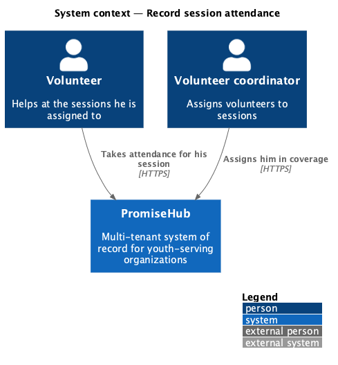
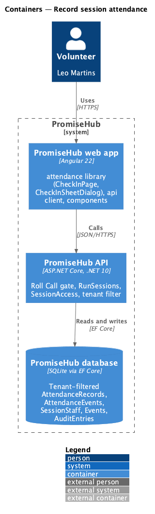
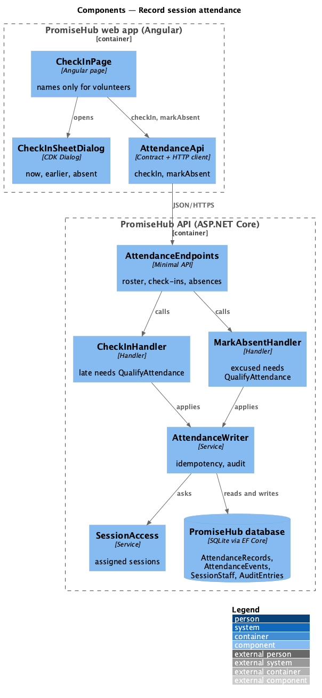
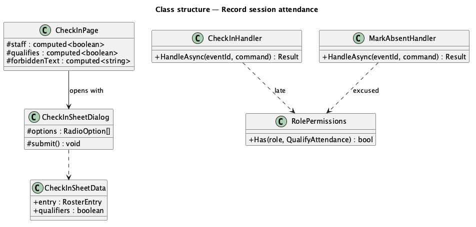
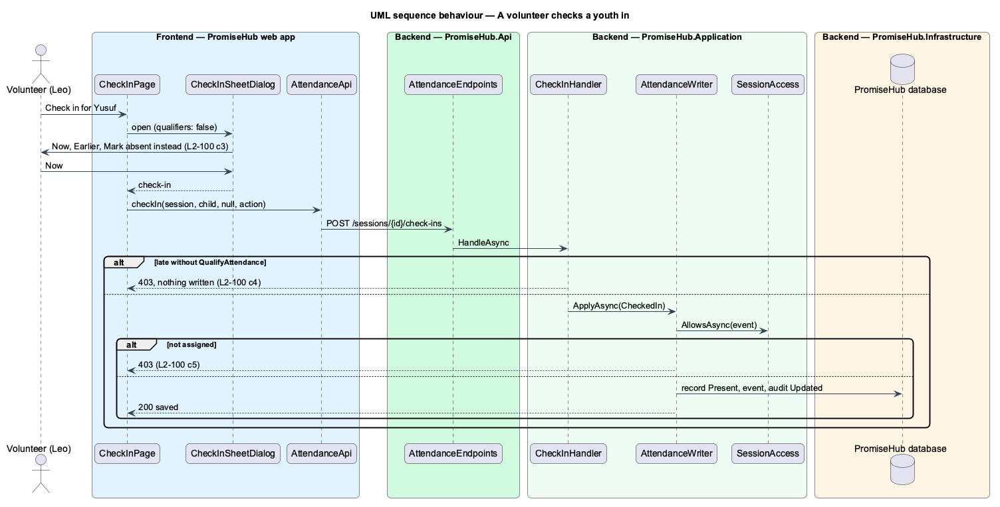

# Record session attendance

## Overview

**Record session attendance** lets a volunteer take attendance for the session he is assigned to, within volunteer permissions: each youth by name, Checked in or Absent, and Mark the rest present. A volunteer never sees medical flags, Quick Cards, approved pickups or attendance history, and cannot mark a youth late or excused; those are for staff and mentors. Every other session answers 403.

Terms used in this document:

- **mark** — one attendance action on one child: check in or mark absent (L2-017)
- **qualifier** — late or excused (L2-095); held by the new permission `QualifyAttendance`
- **scoped role** — a role with `RunSessions` but not `RunAnySession`, limited by `SessionAccess` to assigned sessions

Ported from Waypoint `volunteer-portal/record-session-attendance` (`L2-VOLUNTEER-001` criteria 2 to 4). Waypoint's volunteer roster query and its Present/Absent bulk save are not ported: Roll Call's roster already omits medical fields for roles without `ReadMedical`, each mark is its own idempotent action, and "all present" is Mark the rest present (ADR 0065, ADR 0066).

## Description

Frontend (`frontend/projects/attendance/`):

- **`CheckInPage`** (mock `check-in`, states `volunteer`, `volunteer-forbidden`) — for participant roles names do not open Quick Cards and rows offer no sign-out (ADR 0065); Attendance history shows only to roles with `reviewAttendance`. A 403 on the roster shows `ph-error-page` with words for the role: a volunteer reads "You’re not assigned to this session" and "Volunteers open the sessions they’re assigned to. Ask your volunteer coordinator to add you."
- **`CheckInSheetDialog`** (mock `check-in-sheet`, state `volunteer`) — takes `CheckInSheetData { entry, qualifiers }`; without qualifiers it offers Now, Earlier and Mark absent instead.

API client (`frontend/projects/api/`): `can(role, 'qualifyAttendance')` (every role that runs sessions except Volunteer).

Backend:

- **`Permission.QualifyAttendance`** and **`RolePermissions`** — admins, program directors, site leads, youth workers and mentors.
- **`CheckInHandler`** and **`MarkAbsentHandler`** — a check-in with `late` or an absence with `excused` from a role without `QualifyAttendance` answers 403 before anything is written.
- **`SessionAccess`**, **`GetSessionRosterHandler`**, **`AttendanceWriter`** (unchanged) — a volunteer opens and writes only assigned sessions (403 otherwise, 404 for another organization), the roster carries no medical fields for him, and each mark is audited.

Open questions: none. Deferred: Waypoint's per-session volunteer hours; whether volunteers add walk-ins and end sessions stays as Roll Call has it today (they may, as youth workers do).

## Requirements

| L2 ID | Refines (L1) | Requirement |
|-------|--------------|-------------|
| `L2-100` | `L1-007` | A volunteer sees today's assigned session on Today with its logistics and how many youth are on the roster, and takes attendance for it with names and Present or Absent only, never any youth's progress, medical details or records (criteria 3 to 7). |
| `L2-017` | `L1-007` | Check-in and sign-out (cross-referenced, not repeated). |
| `L2-095` | `L1-007` | Attendance capture with late and excused (cross-referenced, not repeated). |
| `L2-007` | `L1-003` | Role-based authorization on the server (cross-referenced, not repeated). |

## Diagrams

### System context

### Containers

### Components

### Class structure

### Behaviour — a volunteer checks a youth in

The server checks the assignment and, for a qualifier, the permission, before saving.

