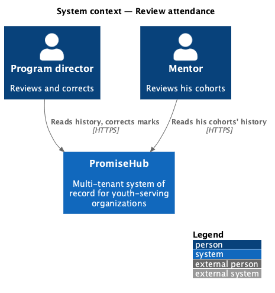
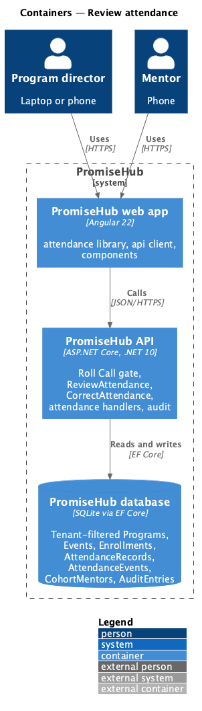
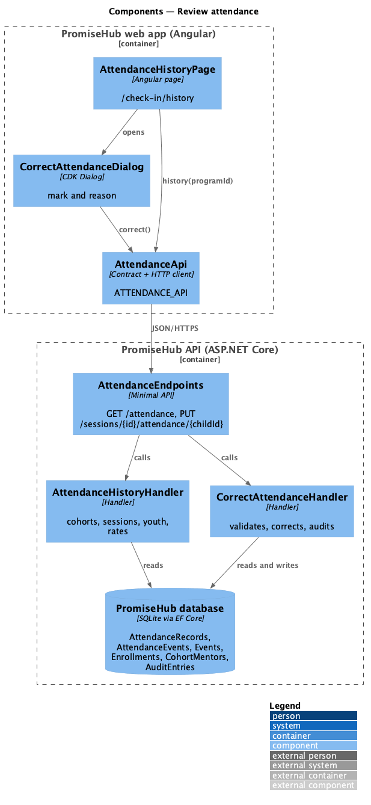
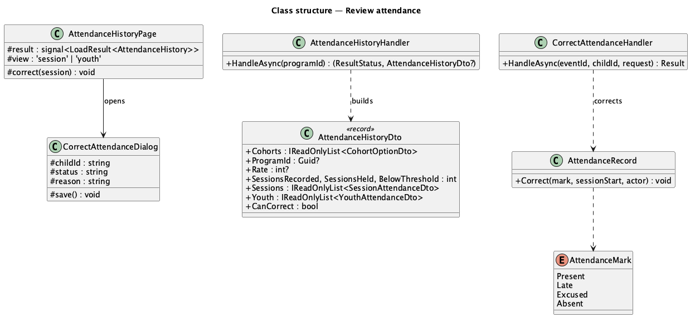
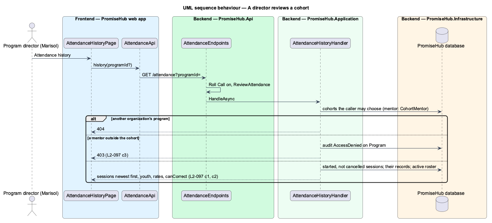
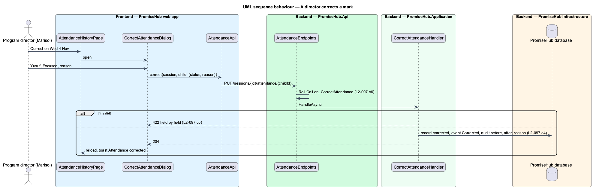

# Review attendance

## Overview

A program director has to answer two questions about a cohort: how well is it attending, and who needs a follow-up. **Review attendance** shows a cohort's sessions so far with present, late, excused and absent counts and a rate, and each youth on its roster with sessions attended of marked and a flag below 70%. Admins and program directors correct a mark after the fact, with a reason the audit log keeps.

Terms used in this document:

- **cohort** — a program (ADR 0043)
- **attended** — present or late; **marked** — present, late, excused or absent
- **rate** — attended of marked, as a whole percent; none when nothing is marked
- **session status** — InProgress (started, not over by the clock and not ended), NotRecorded (nothing marked), Recorded (ended, or everyone on the roster marked) or NeedsReview (over, partly marked, not ended)
- **correction** — a mark an admin or program director sets with a reason, on any started session that was not cancelled, ended or not

Ported from Waypoint `engagement/review-attendance` (`L2-ENGAGE-004` criteria 1 to 3) and the director's edit on a mentor's behalf (`L2-ENGAGE-002` criterion 5), with tenancy, the Roll Call gate and PromiseHub's roles. The date-range filter and the CSV and PDF export are deferred to Reports. The page replaces the program attendance mock (`attendance`).

## Description

Frontend (`frontend/projects/attendance/`):

- **`AttendanceHistoryPage`** (mock `attendance-history`, route `/check-in/history`) — `ph-breadcrumb`, `ph-page-header` with Take attendance, `ph-select` Cohort, `ph-tabs` By session and By youth, three `ph-stat`s (Attendance rate, Sessions recorded, Below 70%), a warning `ph-alert` naming the latest session with no attendance, and a `ph-table` per view; By session rows carry a status `ph-badge` and, when `canCorrect`, a ghost Correct button. Empty, loading, error and forbidden states; after a correction, the toast "Attendance corrected".
- **`CorrectAttendanceDialog`** (mock `correct-attendance`) — `ph-select` Youth (with the current mark), `ph-radio-group` Mark as (Present, Late, Excused, Absent), `ph-textarea` Why are you correcting it? (counter to 500), `ph-error-summary`, busy and failed states.

API client: `AttendanceApi.history(programId?)` answering `LoadResult<AttendanceHistory>` and `correct(sessionId, childId, { status, reason })` answering `WriteOutcome`.

Backend (`PromiseHub.Application/Attendance/`):

- **`AttendanceHistoryHandler`** — the cohorts the caller may choose (staff: active programs by name; mentor: their team's cohorts), the chosen cohort (404 for another organization's, 403 audited as AccessDenied on `Program` for a mentor outside it), its started, not cancelled sessions newest first with counts, rate and status, its active roster with per-youth counts, rate and the below-70% flag, the totals, and `canCorrect`.
- **`CorrectAttendanceHandler`** with **`CorrectAttendanceRequest`** — 404 for an unknown or another organization's session; 422 `status` "Choose a mark.", `reason` "Say why you’re correcting it." or "Keep it to 500 characters.", `session` "This session hasn’t started yet." or "This session is cancelled.", `childId` when the child is neither on the roster nor marked; then `AttendanceRecord.Correct(mark, sessionStart, actor)`, a `Corrected` event and an audit Updated on `Attendance` with before, after and the reason.
- **`AttendanceMark`** (`PromiseHub.Domain/Attendance/`) — Present, Late, Excused, Absent.
- **Permissions** — `ReviewAttendance` (Admin, ProgramDirector, SiteLead, Mentor) and `CorrectAttendance` (Admin, ProgramDirector).
- **Endpoints** — `GET /attendance` and `PUT /sessions/{id}/attendance/{childId}` in `AttendanceEndpoints`, both behind Roll Call.

Open questions: none. Deferred: date ranges, export, badge streaks.

## Built so far

Prompt 71 delivered everything above in two slices: the history (`GET /attendance`, `ReviewAttendance`, `AttendanceHistoryHandler`, `AttendanceHistoryPage` with ph-table's new numeric columns and qualifying badge), then corrections (`PUT /sessions/{id}/attendance/{childId}`, `CorrectAttendance`, `CorrectAttendanceHandler`, `AttendanceRecord.Correct`, `CorrectAttendanceDialog`). A session with nothing marked can also be corrected, to fill it in after the fact. Acceptance tests: `backend/tests/PromiseHub.Api.Tests/AttendanceHistoryTests.cs`, `backend/tests/PromiseHub.Api.Tests/CorrectAttendanceTests.cs` and `e2e/tests/attendance/attendance-history.spec.ts`.

## Requirements

| L2 ID | Refines (L1) | Requirement |
|-------|--------------|-------------|
| `L2-097` | `L1-007` | Site leads, directors, admins and mentors review a cohort’s attendance by session and by youth with rates, and admins and program directors correct a mark with a reason that the audit log keeps. |
| `L2-018` | `L1-007` | No-show alerts and ending a session (cross-referenced, not repeated). |
| `L2-062` | `L1-024` | Mentors for youth and for whole cohorts (cross-referenced, not repeated). |
| `L2-032` | `L1-017` | Audit trail (cross-referenced, not repeated). |
| `L2-007` | `L1-003` | Role-based authorization on the server (cross-referenced, not repeated). |

## Diagrams

### System context

### Containers

### Components

The history page and its dialog use the attendance API; the handlers read the cohort, its sessions and their marks.

### Class structure

### Behaviour — a director reviews a cohort

The handler checks who may choose the cohort, then counts the marks of each session and each youth.

### Behaviour — a director corrects a mark

The correction is checked field by field, applied to an ended session if need be, and audited with its reason.

