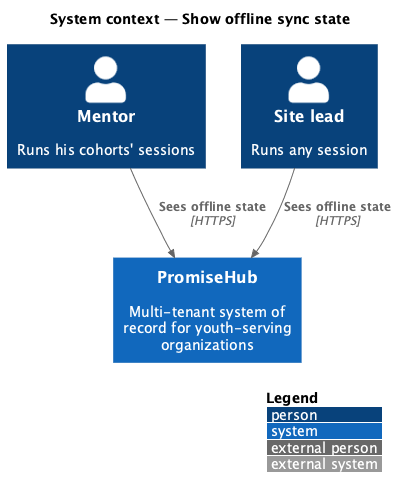
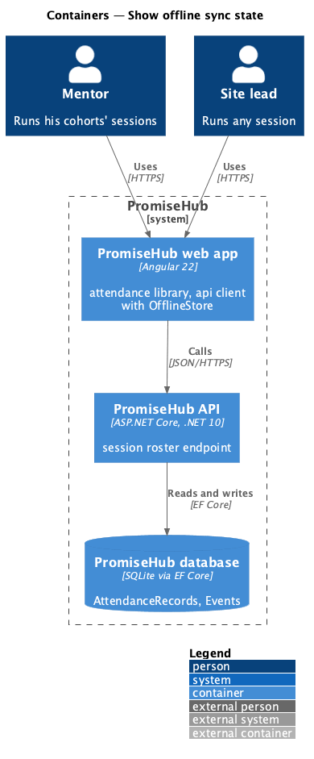
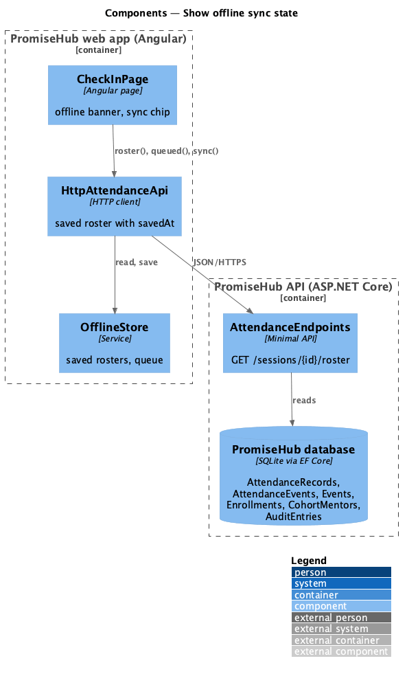
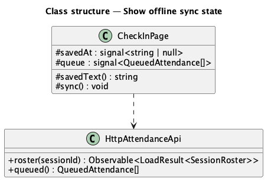
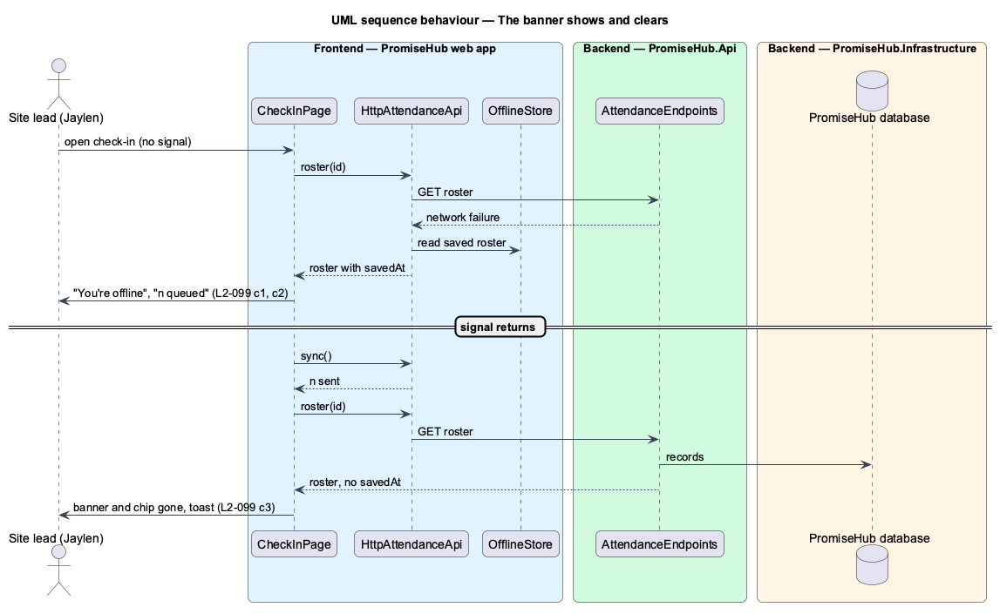

# Show offline sync state

## Overview

A site lead who loses signal needs to know that the marks still count. **Show offline sync state** tells the person on the check-in page that the phone is offline, when the roster was saved, how many marks are waiting, and clears that sign once they are sent.

Terms used in this document:

- **offline banner** — the warning `ph-alert` "You’re offline" with "Roster saved h:mm pm. n waiting to sync."
- **sync chip** — `ph-sync-chip` in the page header saying "n queued"

Ported from Waypoint `platform-services/show-offline-sync-state` (`L2-PLATFORM-012` criteria 1 to 3). PromiseHub's offline page (`offline`) covers a destination that never loaded; this design covers the check-in page that did.

## Description

- **`CheckInPage`** — shows the offline banner when the roster came from the device (`savedAt` set), the sync chip while the queue is not empty, and "waiting to sync" on each queued row; after `sync()` it reloads the roster from the server, so the banner and chip disappear, and shows "n check-ins synced".
- **`HttpAttendanceApi.roster()`** — answers the saved roster with `savedAt` when the request fails for lack of signal.
- **Backend** — nothing new.

Open questions: none.

## Built so far

Prompt 71 proved the banner, the sync chip and their clearing for late and excused marks made by a mentor. Acceptance tests: `e2e/tests/attendance/offline-attendance.spec.ts` and `e2e/tests/attendance/offline.spec.ts`.

## Requirements

| L2 ID | Refines (L1) | Requirement |
|-------|--------------|-------------|
| `L2-099` | `L1-014` | The phone says when it is offline, how many marks are waiting, and clears the sign when they are sent. |
| `L2-028` | `L1-014` | Offline check-in and Quick Cards (cross-referenced, not repeated). |

## Diagrams

### System context

### Containers

### Components

The page reads the roster and the queue through the attendance API.

### Class structure

### Behaviour — the banner shows and clears

The page reads the saved roster while offline and the server's roster once the queue is sent.

