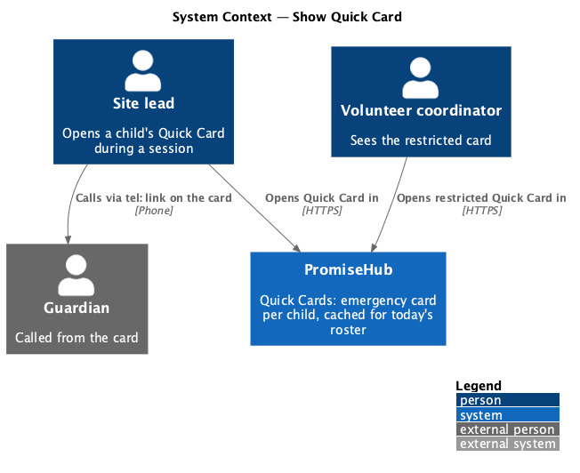
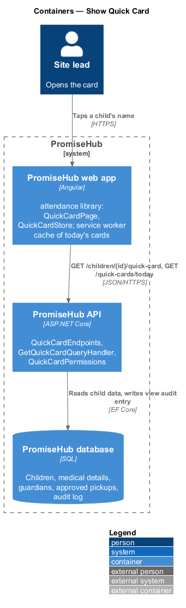
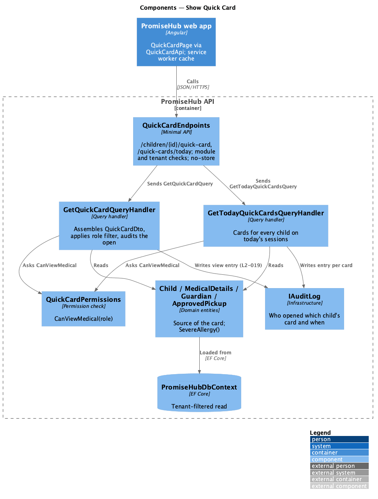
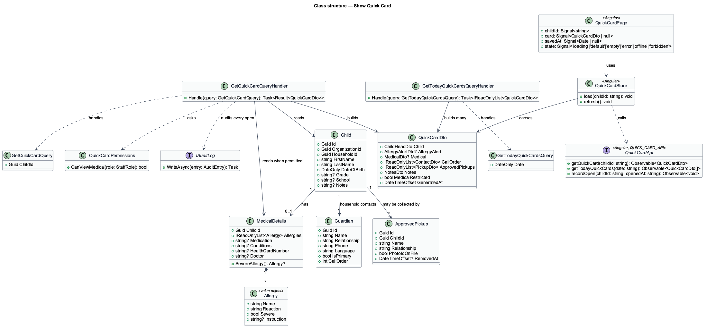
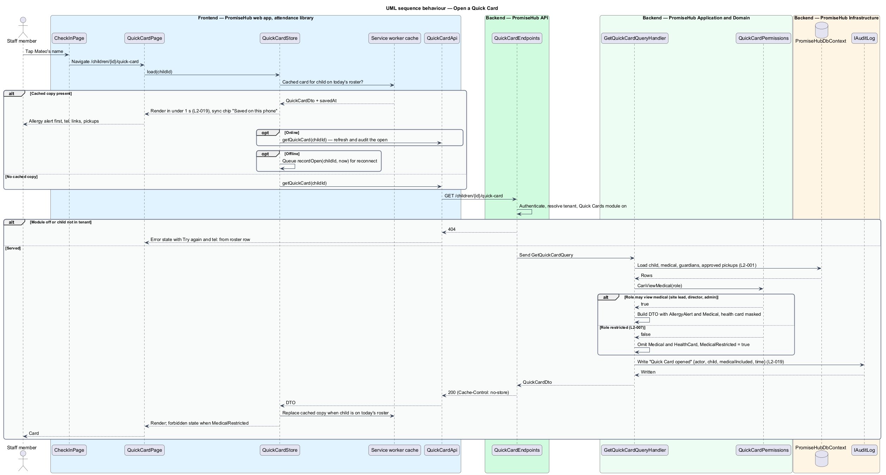

# Show Quick Card

## Overview

PromiseHub is a phone-first system of record for small youth-serving organizations. The Quick Cards module gives every child an emergency card that a staff member can read at arm's length on a phone. This feature covers opening and rendering that card, the role-based restriction of its medical content, the audit entry written on every open, and the cache that lets it open with no signal for every child on today's roster.

A Quick Card is a read model, not a form. It is assembled from the child's record, medical details, household contacts and approved pickups, and ordered by urgency: the allergy alert first, then medical facts, then who to call in order, then who may pick the child up, then notes. Phone numbers are `tel:` links so one tap starts the call. Medical fields are visible only to roles that need them; a volunteer coordinator or youth worker sees the restricted state with contacts and pickups intact. Every open, from any role, writes an audit entry, because a view of medical data is a sensitive action (`L2-032`).

Local terms:

- **Quick Card** — single-screen emergency summary of one child: allergy alert, medical facts, contacts in call order, approved pickups and notes
- **allergy alert** — highlighted first block naming a severe allergy and the action to take, shown only when a severe allergy is recorded
- **call order** — ordered list of household contacts with the primary guardian first
- **restricted state** — rendering of the card for a role without medical permission, with medical and health-card fields absent from the response
- **today's roster cache** — the set of Quick Cards for children on today's sessions stored on the device by the service worker

The feature belongs to the `attendance` subsystem and the Quick Cards module. The caching mechanism is designed in `sync-offline-queue`; this feature defines what is cached and how the page reads from cache.

## Description

### Frontend — `frontend/projects/attendance/`

- **`QuickCardPage`** — page component at `/children/:id/quick-card` (screen `quick-card`). It renders the head (avatar, name, age, grade, programs, sync chip "Saved on this phone · 3:58 pm"), then the sections in order. States: `default`, `loading`, `empty`, `error`, `offline`, `forbidden`, `edge`.
  - `empty` shows "No medical information yet" with **Text Carmen the form** (opens the Messages reminder dialog when Messages is on).
  - `error` shows "Couldn't load Mateo's card" with **Try again** and a `tel:` button for the primary guardian taken from the cached roster row.
  - `forbidden` shows the info alert "Medical details are hidden for your role", the restricted medical card "Staff roles only. Views are logged." and a `tel:` button to the site lead.
  - `offline` renders the cached card with the offline sync chip and no editing actions.
  - `edge` is the same template with the longest content; nothing clips at 360 px and every number stays tappable (`L2-029`).
- **`QuickCardStore`** — reads the card through `QuickCardApi`, serving the cached copy first when present and refreshing from the network when online. It exposes the saved-at time for the sync chip.
- Components come from `frontend/projects/components/`: quick-card layout, alert block, facts list (description list), call list with `tel:` buttons, list with avatars and badges, medical flag, sync chip, empty state, skeleton.

### Frontend — `frontend/projects/api/`

- **`QuickCardApi`** — typed client behind `QUICK_CARD_API`. Methods: `getQuickCard(childId)` and `getTodayQuickCards(date)` (used by the cache). The DTO's medical section is nullable; the restricted state is rendered when it is absent.

### Backend — `PromiseHub.Api`

- **`QuickCardEndpoints`** — minimal-API routes `GET /children/{childId}/quick-card` and `GET /quick-cards/today`. They authenticate, resolve the tenant, answer 404 when Quick Cards is off, and dispatch the query. Responses carry `Cache-Control: private, no-store`; the service worker, not the HTTP cache, holds the offline copy.

### Backend — `PromiseHub.Application/Attendance/`

- **`GetQuickCardQuery`** / **`GetQuickCardQueryHandler`** — assembles `QuickCardDto` for one child in the signed-in person's organization. The handler asks `QuickCardPermissions.CanViewMedical(role)`; when false it omits `Medical` and `HealthCard` from the DTO and sets `MedicalRestricted = true`. It writes one audit entry per call through `IAuditLog` with actor, child, organization, time and whether medical fields were included (`L2-019`, `L2-032`).
- **`GetTodayQuickCardsQuery`** / **`GetTodayQuickCardsQueryHandler`** — returns the cards for every child on today's sessions of the organization, with the same role filtering. It writes one audit entry per card listing the cache fill as the reason. A cache fill is recorded as its own action (ADR 0010).
- **`QuickCardPermissions`** — medical fields are visible to site lead, program director and admin; absent for volunteer coordinator and youth worker (`L2-007`).
- **`QuickCardDto`** — `Child` (name, age, grade, programs), `AllergyAlert` (title, instruction; null when no severe allergy), `Medical` (allergies, medication, conditions, health card masked to the last four digits, doctor; null when restricted or empty), `CallOrder` (contacts with relationship, language, phone), `ApprovedPickups`, `Notes` (school, language at home, notes), `MedicalRestricted`, `GeneratedAt`.

### Backend — `PromiseHub.Domain`

- **`Child`**, **`MedicalDetails`**, **`Guardian`**, **`ApprovedPickup`** — entities owned by `Households/` and `Attendance/`. `MedicalDetails.SevereAllergy()` returns the allergy that drives the alert block. The Quick Card introduces no new entity.

### Backend — `PromiseHub.Infrastructure`

- **`PromiseHubDbContext`** — one query joining child, medical details, guardians and approved pickups, filtered by organization.
- **`IAuditLog`** — writes the view entry. The entry is immutable through the application (`L2-032`).

### Built so far

Slice 07 delivered `QuickCardPage` at `/quick-cards/:childId` (default, empty, forbidden, not-found and error), opened from a check-in name; `QUICK_CARD_API`; `GET /children/{childId}/quick-card` under Quick Cards with `Cache-Control: private, no-store`; `GetQuickCardHandler` with role filtering and a `Viewed` audit entry per open; the alert instruction, masked health card and notes on the child (ADR 0010). `QuickCardStore`, the offline copy, the sync chip and `GET /quick-cards/today` arrive with offline check-in; approved adults beyond guardians with slice 26.

### Behavioural rules

- The allergy alert is the first content block whenever a severe allergy is recorded. When none is recorded the medical section is first.
- Every phone number is an `<a href="tel:">` with the number as visible text.
- The card loads in under 1 second from cache (`L2-019`). On a cold open it loads from the network and is then cached when the child is on today's roster.
- The restricted response omits medical fields on the server. The UI never hides fields it received (`L2-007`).
- Every open is audited, including opens served from cache, which the page reports on the next connection through `QuickCardApi.recordOpen(childId, openedAt)`. `<TO SUPPLY>`: confirmation that offline opens are audited on reconnect rather than dropped.
- Children never have photos; the avatar shows initials.

## Requirements

The feature realizes the following level-2 (L2) requirements. Each L2 requirement refines a level-1 (L1) requirement, cited by identifier.

| L2 ID | Refines (L1) | Requirement |
|-------|--------------|-------------|
| `L2-019` | `L1-008` | A Quick Card shows the allergy alert first, then medical facts, who to call in order, approved pickups and notes; medical fields are role-restricted and every open is audited. |
| `L2-007` | `L1-003` | Permissions are enforced per endpoint and per field by role; the UI reflects them but never substitutes for them. |

## Diagrams

### System context

A staff member opens the Quick Card in PromiseHub and calls a guardian from it with the phone's dialler.

### Containers

The web app serves the card from the service worker cache when present and from the API otherwise. The API reads the child's data and writes the audit entry.

### Components

`QuickCardEndpoints` dispatches `GetQuickCardQuery`. The handler applies `QuickCardPermissions`, assembles `QuickCardDto` and writes the audit entry.

### Class structure

`QuickCardDto` is built from `Child`, `MedicalDetails`, `Guardian` and `ApprovedPickup`; the handler depends on `QuickCardPermissions` and `IAuditLog`.

### Behaviour — open a Quick Card

The store serves the cached card first. The network path shows the role branch that omits medical fields and the audit write that happens on every open.

