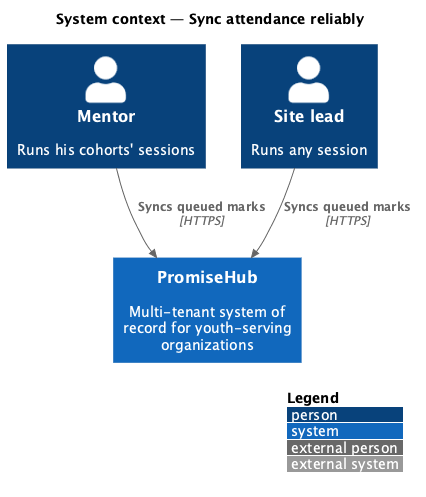
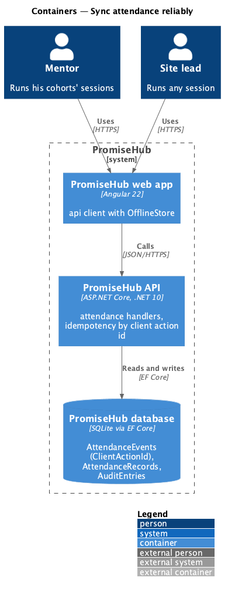
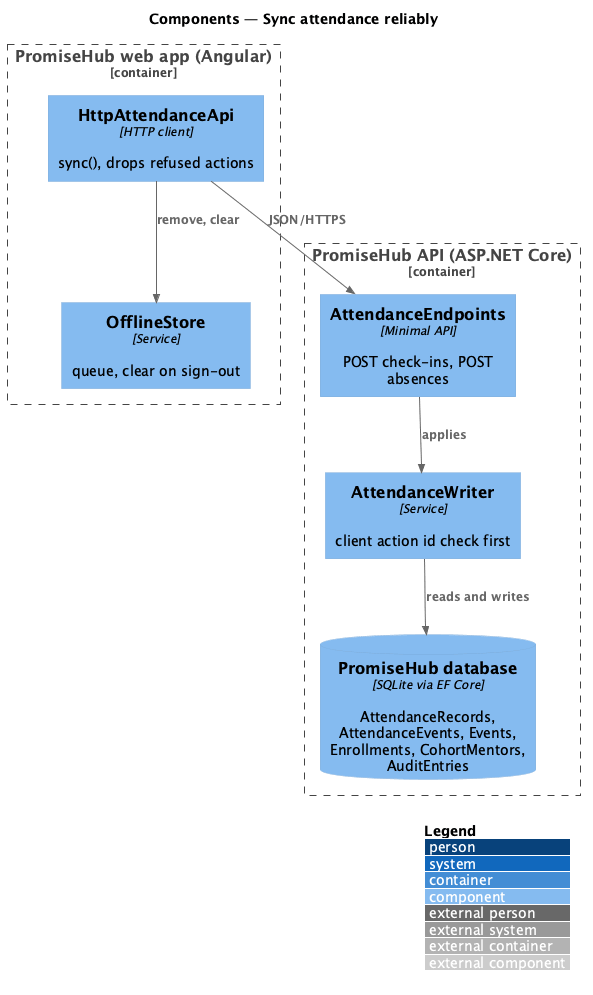
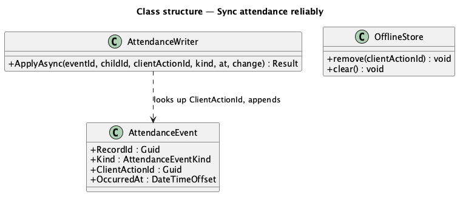
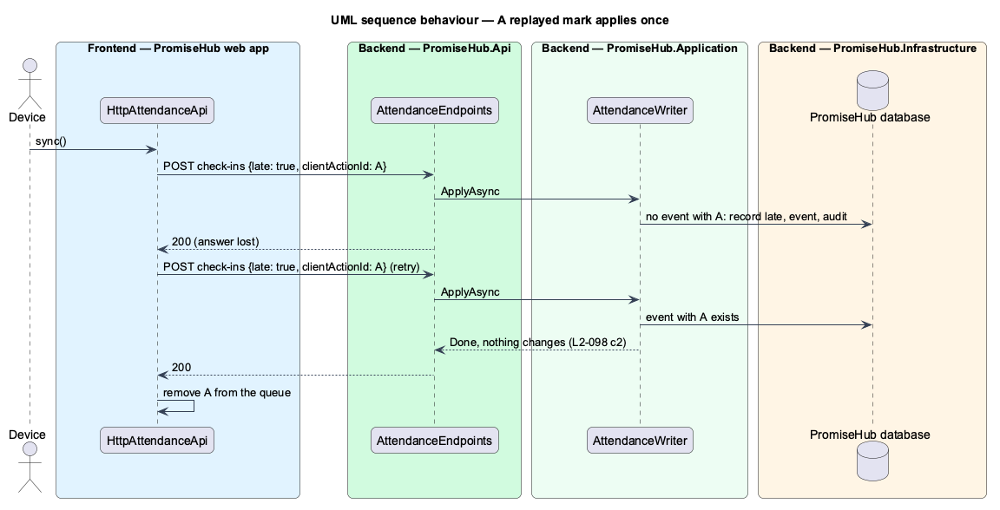

# Sync attendance reliably

## Overview

A mark sent twice must count once, a mark the server refuses must not be retried forever, and a phone handed to someone else must not send the last person's marks. **Sync attendance reliably** states those guarantees for every queued attendance mark, late and excused included.

Terms used in this document:

- **client action id** — a UUID the device gives each mark; `AttendanceEvents.ClientActionId` makes a repeat a no-op
- **refused mark** — a queued mark the server answers with 403, 404 or 422 (the session ended or was cancelled, the child left the roster)

Ported from Waypoint `non-functional/sync-attendance-reliably` (`L2-NFR-004` criteria 1 to 4). Waypoint's receipts table with a request fingerprint is not needed: the client action id is the idempotency key and each action is one mark.

## Description

- **`AttendanceWriter`** — answers 200 without change when the client action id was already applied, before any other check, so a retry after a lost answer is harmless.
- **`HttpAttendanceApi.sync()`** — removes an action once the server answers anything but a network failure: saved actions and refused ones alike leave the queue, and the page reloads the roster so the server's mark stands.
- **`OfflineStore.clear()`** — called on sign-out (L2-048), so a shared phone keeps no queue for the next person.

Open questions: none.

## Built so far

<TO SUPPLY: filled in when the slices land.>

## Requirements

| L2 ID | Refines (L1) | Requirement |
|-------|--------------|-------------|
| `L2-098` | `L1-014` | Every queued attendance mark is applied exactly once and stays private to the person who made it. |
| `L2-028` | `L1-014` | Offline check-in and Quick Cards (cross-referenced, not repeated). |
| `L2-048` | `L1-016` | Shared-device sign-out (cross-referenced, not repeated). |

## Diagrams

### System context

### Containers

### Components

Idempotency lives in the writer; queue hygiene lives in the HTTP client.

### Class structure

### Behaviour — a replayed mark applies once

The second request with the same client action id finds the earlier event and changes nothing.

