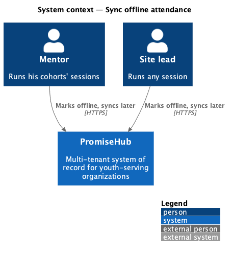
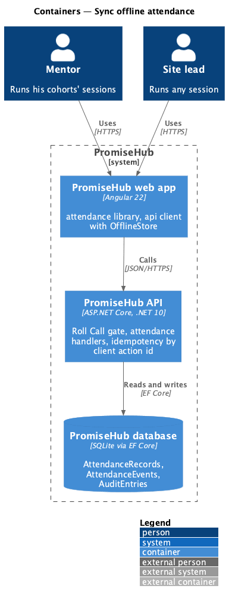
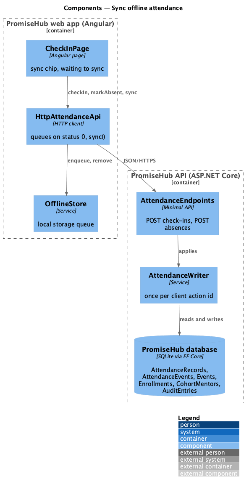
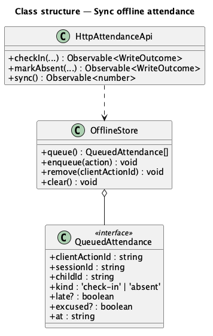
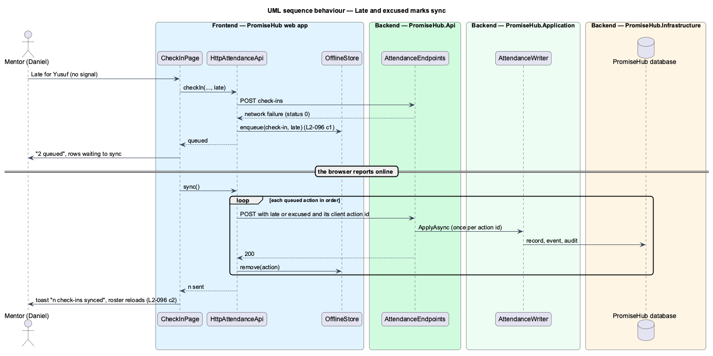

# Sync offline attendance

## Overview

Sessions run in church basements and parks where the signal drops. **Sync offline attendance** keeps late and excused marks made without signal on the device and sends them in order when it returns, for mentors as for site leads. It extends Roll Call's offline queue (`sync-offline-queue`, L2-028) rather than adding a second one.

Terms used in this document:

- **queue** — the device's list of attendance actions waiting to send (`OfflineStore`, local storage under `promisehub.offline.`)
- **queued action** — `QueuedAttendance`: session, child, kind (`check-in` or `absent`), the late or excused flag, when it happened and its client action id

Ported from Waypoint `engagement/sync-offline-attendance` (`L2-ENGAGE-003` criteria 1, 2 and 4). Waypoint's warning before leaving with unsaved changes does not apply: nothing on the roster is unsaved.

## Description

- **`QueuedAttendance`** (`frontend/projects/api/src/lib/offline/`) — gains `late?` and `excused?`.
- **`HttpAttendanceApi`** — `checkIn` and `markAbsent` queue the action with its flag when the request fails for lack of signal; `sync()` sends the queue in order with `late` or `excused` in the body and stops at the first network failure.
- **`CheckInPage`** — shows "n queued" in the sync chip and "waiting to sync" on each queued row, syncs on the browser's `online` event and shows "n check-ins synced".
- **Backend** — nothing new: the check-in and absence endpoints take the flags (`record-attendance`), and `AttendanceWriter` applies each client action id once and keeps the conflict rule (present wins).

Open questions: none.

## Built so far

<TO SUPPLY: filled in when the slices land.>

## Requirements

| L2 ID | Refines (L1) | Requirement |
|-------|--------------|-------------|
| `L2-096` | `L1-014` | Late and excused marks made without signal are kept on the device and sent in order when it returns, for mentors as for site leads. |
| `L2-028` | `L1-014` | Offline check-in and Quick Cards (cross-referenced, not repeated). |
| `L2-095` | `L1-007` | A site lead or mentor marks each youth Present, Late, Excused or Absent from the session’s roster, marks everyone not yet marked present in one go, and a mentor does so only for the sessions of the cohorts he leads or supports. |

## Diagrams

### System context

### Containers

### Components

The page queues through the attendance API, which keeps the queue in the offline store.

### Class structure

### Behaviour — late and excused marks sync

Marks made without signal wait on the device and replay in order when the browser reports the connection is back.

