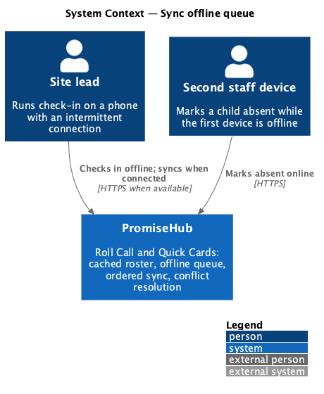
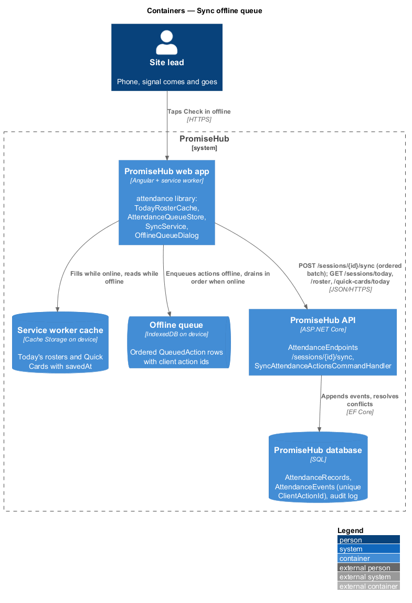
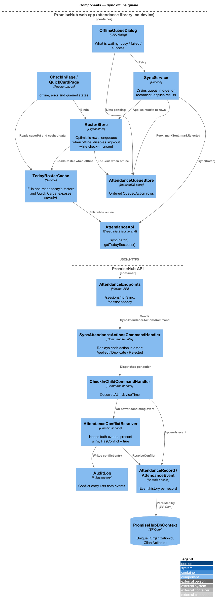
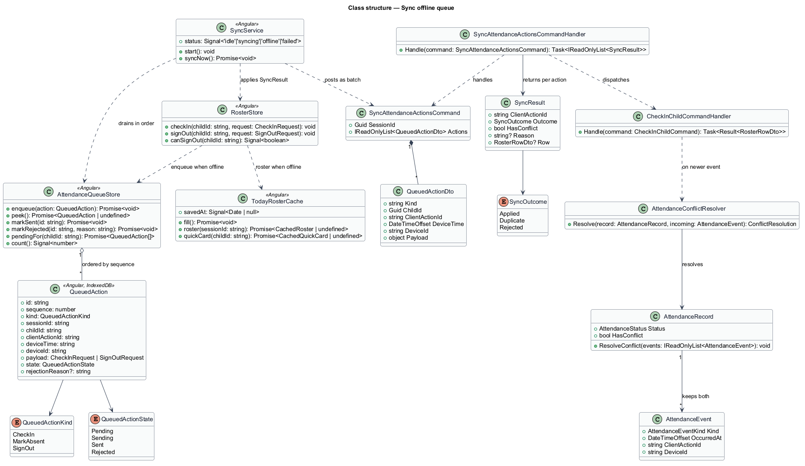
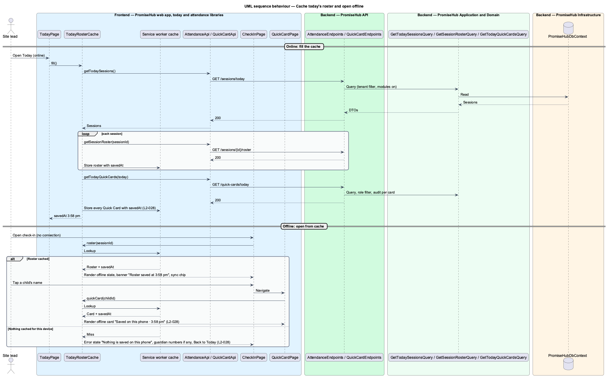
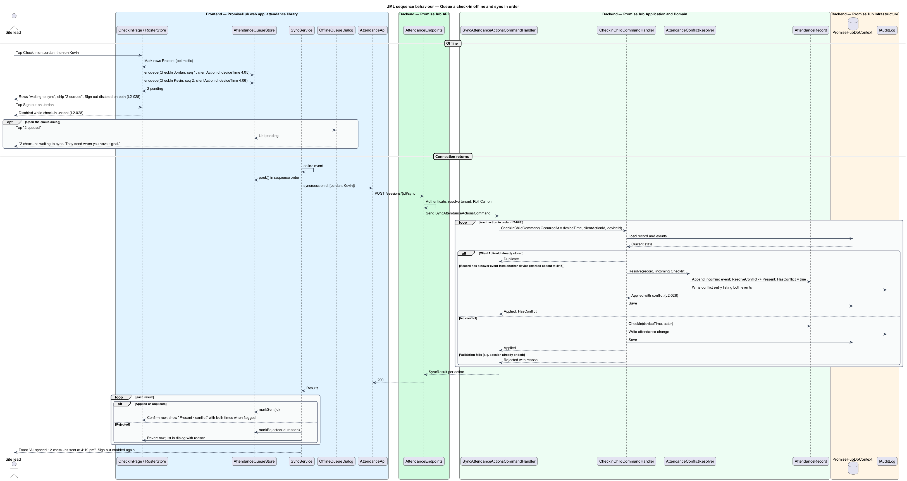

# Sync offline queue

## Overview

PromiseHub is a phone-first system of record for small youth-serving organizations. Sessions run in gyms, basements and buses where the phone signal comes and goes. This feature makes check-in and Quick Cards work with no connection: the roster and the Quick Cards for today's sessions are cached on each staff device while it is online, check-in actions taken offline are queued, and the queue is sent in order when the connection returns. Nothing is lost on a dropped connection (`L1-014`).

The design has three parts. A service worker caches the application shell and holds today's roster and Quick Cards, filled when the staff member opens Today while online. An ordered queue in IndexedDB stores every attendance action taken while offline, each with a client action id and the time it was taken on the device. A sync step drains the queue in order when the browser reports the connection is back, shows "waiting to sync" on the affected rows until the server confirms, and surfaces a toast when the queue is empty. When another device marked a child absent while this device's check-in was queued, the server keeps both events, resolves the record to present and flags the conflict on the roster.

Local terms:

- **today's roster cache** — service worker cache entry holding the roster of each of today's sessions and the Quick Card of every child on them, with the time it was saved
- **offline queue** — ordered, durable list of attendance actions taken on the device while no connection was available
- **queued action** — one check-in, absence or sign-out with its client action id, device time and device id, not yet confirmed by the server
- **sync** — sending the queued actions in order and applying the server's confirmation or rejection to each
- **conflict** — a queued action whose record was changed by another device between the action's device time and its sync
- **waiting to sync** — roster row state shown while the row's action is queued

The feature belongs to the `attendance` subsystem and the Roll Call and Quick Cards modules. The service worker is registered by the shell application (`frontend/projects/promisehub/`); the cache contents and the queue are owned by the `attendance` library.

## Built so far

Slice 25 delivered `OfflineStore` (saved rosters, Quick Cards and the action queue in `localStorage`), the `offline` load status and `queued` write outcome, `AttendanceApi.queued()` and `sync()`, the offline notice, sync chip, waiting-to-sync rows and disabled sign-out on `CheckInPage`, the saved chip on `QuickCardPage`, the nothing-saved state, and `AttendanceRecord.HasConflict` with the conflict badge (ADR 0023). The service worker, the offline-queue dialog and the stale warning are not built yet. Prompt 71 carries the late and excused flags through the queue and opens it to mentors (`sync-offline-attendance`, `sync-attendance-reliably`, `show-offline-sync-state`, ADR 0065).

## Description

### Frontend — `frontend/projects/promisehub/`

- **Service worker registration** — the shell registers the Angular service worker with a configuration that precaches the application shell and declares a data group for `/sessions/*/roster`, `/quick-cards/today` and `/children/*/quick-card` with a freshness strategy. `<TO SUPPLY>`: the maximum age of the cached roster and Quick Cards before the banner warns that they are stale.

### Frontend — `frontend/projects/attendance/`

- **`TodayRosterCache`** — service that fills the cache when Today opens online: it calls `AttendanceApi.getTodaySessions()`, then `getSessionRoster` for each and `QuickCardApi.getTodayQuickCards(today)`, and stores each response in the data-group cache together with `savedAt`. It exposes `savedAt` for the sync chips and the offline banner ("Roster saved at 3:58 pm").
- **`AttendanceQueueStore`** — IndexedDB-backed store of `QueuedAction` rows ordered by `sequence`. Methods: `enqueue(action)`, `peek()`, `markSent(id)`, `markRejected(id, reason)`, `pendingFor(childId)`, `count()`. Every enqueue generates `clientActionId` and records `deviceTime` and `deviceId`.
- **`SyncService`** — listens to `online` and visibility events and drains the queue one action at a time through `AttendanceApi.sync(batch)` or the per-action endpoints, in sequence order. It stops at the first network failure and retries. `<TO SUPPLY>`: the retry interval while the connection stays unavailable.
- **`RosterStore`** (designed in `check-in-and-sign-out`) — when offline or when a request fails with a network error, it enqueues the action instead of reverting, and marks the row `queued`. Sign-out on a row with a pending check-in is disabled (`L2-028`).
- **`CheckInPage`** — the `offline` state: offline banner, sync chip "1 queued", roster from cache with queued rows marked "waiting to sync" and their **Sign out** button disabled. The `error` state when offline and nothing is cached: "Nothing is saved on this phone" with the guardian numbers from the last known roster, if any, and **Back to Today**.
- **`OfflineQueueDialog`** — dialog (screen `offline-queue`) "2 check-ins waiting to sync. They send when you have signal." listing the queued actions with child and device time. States: `default`, `busy` (retrying), `failed` ("Still no signal"), `success` ("All synced · 2 check-ins sent at 4:19 pm").
- **`QuickCardPage`** — the `offline` state renders the cached card with the chip "Saved on this phone · 3:58 pm" and no editing actions.
- Components come from `frontend/projects/components/`: banner, sync chip, roster item with `queued` variant, CDK dialog, list, toast.

### Frontend — `frontend/projects/api/`

- **`AttendanceApi`** — adds `getTodaySessions()` and `sync(batch: QueuedAction[])`. Each queued action carries `clientActionId`, `deviceTime` and `deviceId`.

### Backend — `PromiseHub.Api`

- **`AttendanceEndpoints`** — adds `POST /sessions/{sessionId}/sync` accepting an ordered batch of actions, and `GET /sessions/today`. The per-action endpoints also accept the `deviceTime` and `deviceId` fields so a single queued action can be replayed on its own route.

### Backend — `PromiseHub.Application/Attendance/`

- **`SyncAttendanceActionsCommand`** / **`SyncAttendanceActionsCommandHandler`** — applies the batch in the given order inside one transaction per action, so a rejected action does not undo an earlier accepted one. For each action it dispatches the matching command (`CheckInChildCommand`, `MarkChildAbsentCommand`, `SignOutChildCommand`) with `OccurredAt = deviceTime`. It returns one `SyncResult` per action: `Applied`, `Duplicate` (client action id already stored) or `Rejected` with a reason.
- **`AttendanceConflictResolver`** — domain service called by `CheckInChildCommandHandler` when the record already holds an event newer than the incoming `deviceTime`. It appends the incoming event, resolves the record to `Present` when any check-in event exists for the session, sets `HasConflict = true`, and records both events in the audit entry (`L2-028`).
- **`GetTodaySessionsQuery`** — sessions of the organization scheduled for today for the signed-in person's sites.

### Backend — `PromiseHub.Domain/Attendance/`

- **`AttendanceRecord`** — `HasConflict` and `ResolveConflict(events)` implement the rule "present wins". `AttendanceEvent` already carries `ClientActionId`, `DeviceId` and `OccurredAt` (designed in `check-in-and-sign-out`).

### Backend — `PromiseHub.Infrastructure`

- **`PromiseHubDbContext`** — the unique index on (`OrganizationId`, `ClientActionId`) in `AttendanceEvents` turns a replayed action into `Duplicate` instead of a second write.
- **`IAuditLog`** — the conflict entry lists both events and the resolution.

### Behavioural rules

- Opening Today while online fills the cache for every session of the day; check-in and every Quick Card on those rosters open from cache with the time they were saved (`L2-028`).
- Actions taken offline are sent in the order they were taken. A row shows "waiting to sync" until the server confirms it, and a toast confirms when the queue is empty.
- A queued check-in for a child marked absent by another device syncs as `Applied` with `HasConflict = true`; the roster shows "Present · conflict" with both times.
- When the device is offline and nothing is cached, check-in shows the error state "Nothing is saved on this phone" and offers the guardian numbers.
- Sign-out is disabled for a child whose check-in is still unsent. The queue flushes before sign-out becomes available.
- Queued actions survive a closed tab and a restarted browser. They are removed only after the server answers `Applied` or `Duplicate`; a `Rejected` action stays listed in the dialog with its reason until dismissed.

## Requirements

The feature realizes the following level-2 (L2) requirements. Each L2 requirement refines a level-1 (L1) requirement, cited by identifier.

| L2 ID | Refines (L1) | Requirement |
|-------|--------------|-------------|
| `L2-028` | `L1-014` | The roster and Quick Cards for today's sessions are cached on each staff device; check-in actions queue offline and sync in order. |

## Diagrams

### System context

The site lead uses PromiseHub on a phone whose connection comes and goes. No external system takes part; the SMS provider is reached only after sync, through the actions designed elsewhere.

### Containers

The web app holds a service worker cache and an IndexedDB queue on the device. The API receives the queue in order and persists through the database.

### Components

On the device, `TodayRosterCache`, `AttendanceQueueStore` and `SyncService` sit beside `RosterStore`. In the API, `SyncAttendanceActionsCommandHandler` replays each action and `AttendanceConflictResolver` applies "present wins".

### Class structure

`QueuedAction` carries the client action id and device time. `SyncAttendanceActionsCommand` wraps the ordered batch and returns one `SyncResult` per action.

### Behaviour — cache today's roster and open offline

Opening Today online fills the cache. Later, offline, check-in and Quick Cards open from cache, or show the error state when nothing was cached.

### Behaviour — queue a check-in and sync

A tap offline enqueues the action and marks the row "waiting to sync". When the connection returns, `SyncService` drains the queue in order. The `alt` covers the conflict with another device's absence and a rejected action.

