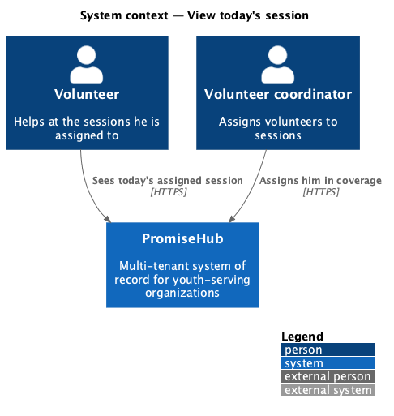
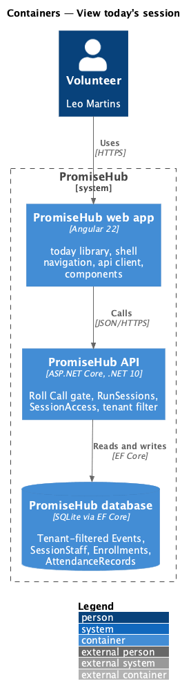
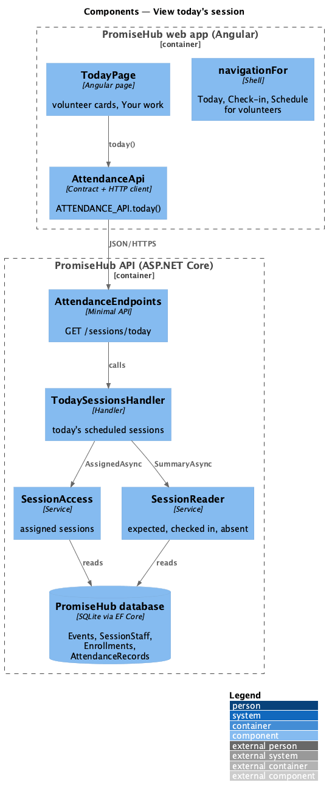
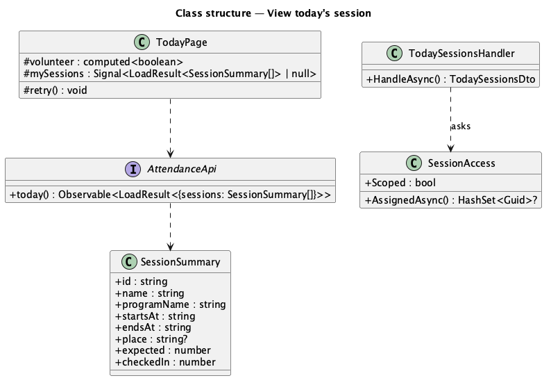
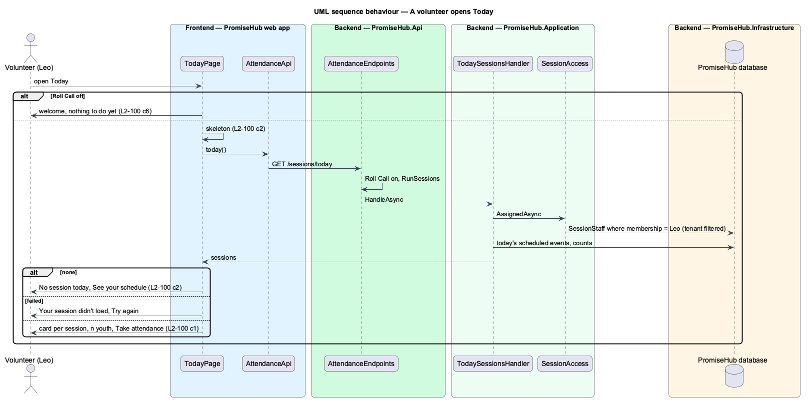

# View today's session

## Overview

A volunteer comes to a session to help, not to manage youth. **View today's session** gives a volunteer a Today that shows only what is theirs: the session they are assigned to today, its time and place, how many youth are on its roster and how many are checked in, with one action, Take attendance. There is no separate volunteer app: the volunteer portal is the PromiseHub shell composed for the Volunteer role (ADR 0043, ADR 0066).

Terms used in this document:

- **volunteer** — the participant role `Volunteer`; it holds `RunSessions` without `RunAnySession` or `UseStaffApp`
- **assigned session** — an event the volunteer is staffed onto in coverage (`SessionStaff`, L2-009 criterion 8)
- **today** — the organization's calendar day in its time zone

Ported from Waypoint `volunteer-portal/view-todays-session` (`L2-VOLUNTEER-001` criterion 1) with tenancy, the Roll Call gate and PromiseHub's session summaries. Waypoint's `GET /api/volunteer/today` is not ported: Roll Call's `GET /sessions/today` already answers a scoped role only its assigned sessions, with the counts this card needs.

## Description

Frontend:

- **`TodayPage`** (`frontend/projects/today/`, mock `today`, states `volunteer`, `volunteer-empty`, `volunteer-loading`, `volunteer-error`) — for the Volunteer role while Roll Call is on, it asks `AttendanceApi.today()` once and shows one `ph-card` per session, titled with the session's name: "Your session today · time · place", "n youth on the roster", "n of n checked in · program" and a Take attendance `ph-button` to `/check-in/{id}`. Below it a Your work card links Your schedule (`/my-schedule`). No session: `ph-empty-state` "No session today" with See your schedule. Loading: `ph-skeleton`. A failed load: an error `ph-empty-state` with Try again, which asks again. While Roll Call is off nothing is requested and Today says there is nothing to do yet.
- **Navigation** (`frontend/projects/promisehub/src/app/shell/navigation.ts`) — volunteers see Today, Check-in and Schedule (both Roll Call) and, in More, Notifications and Your account.

API client (`frontend/projects/api/`): `AttendanceApi.today()` and `SessionSummary` (unchanged).

Backend (unchanged by this slice): `GET /sessions/today` (`TodaySessionsHandler`, Roll Call, `UseStaffApp` or `RunSessions`) filters by `SessionAccess.AssignedAsync`, so a volunteer receives only assigned sessions of his own organization; `SessionReader.SummaryAsync` answers `expected`, `checkedIn`, `absent` and `notYet`. No youth names reach Today.

Open questions: none. Deferred: Waypoint's lead-mentor line ("With Marcus Bello") and room-change notices.

## Built so far

Prompt 72 delivered everything above: the volunteer's session cards, No session today, the skeleton and Try again on `TodayPage`, and Your schedule in Your work. Acceptance tests: `e2e/tests/attendance/volunteer-portal.spec.ts` (A volunteer’s Today) and the volunteer navigation in `e2e/tests/shell/participant-shell.spec.ts`; the server side is proven by `backend/tests/PromiseHub.Api.Tests/ParticipantRoleTests.cs`.

## Requirements

| L2 ID | Refines (L1) | Requirement |
|-------|--------------|-------------|
| `L2-100` | `L1-007` | A volunteer sees today's assigned session on Today with its logistics and how many youth are on the roster, and takes attendance for it with names and Present or Absent only, never any youth's progress, medical details or records (criteria 1, 2, 6 and 7). |
| `L2-038` | `L1-021` | Shell navigation and overflow (cross-referenced, not repeated). |
| `L2-007` | `L1-003` | Role-based authorization on the server (cross-referenced, not repeated). |

## Diagrams

### System context

### Containers

### Components

Today asks the attendance API for today's sessions; the endpoint asks SessionAccess which sessions the volunteer is assigned to.

### Class structure

### Behaviour — a volunteer opens Today

Only while Roll Call is on; the server filters to assigned sessions before counting.

