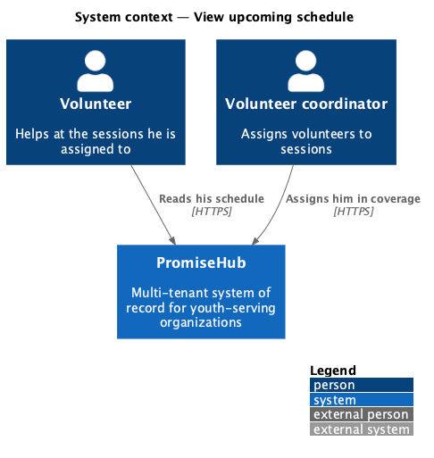
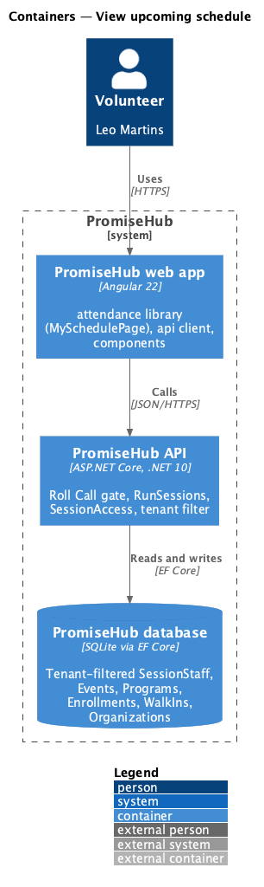
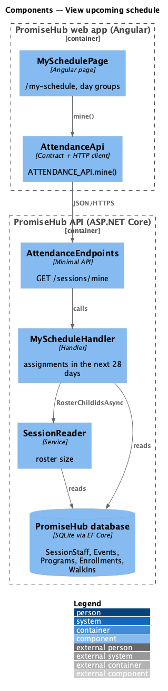
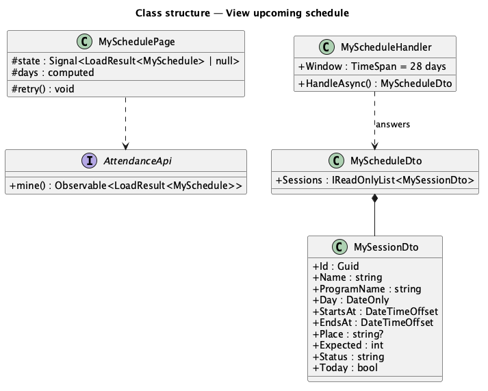
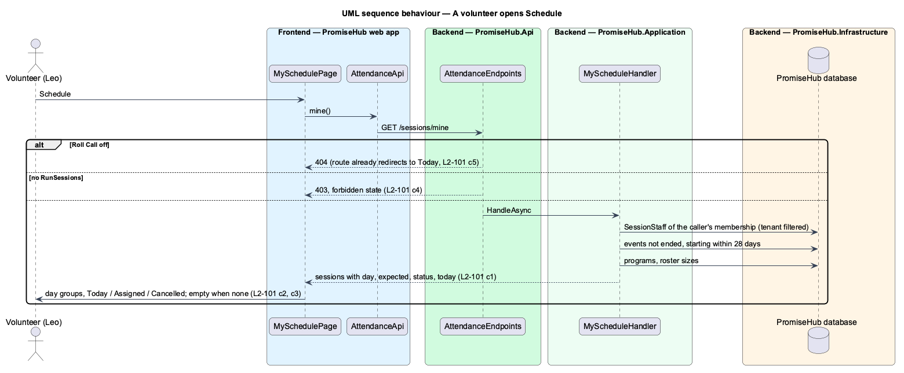

# View upcoming schedule

## Overview

Volunteers plan their week around the sessions they help at. **View upcoming schedule** lists the sessions a volunteer is assigned to in the next four weeks, grouped by day, with each session's time, place, program, how many youth are on its roster and a status: Today (with Take attendance), Assigned or Cancelled.

Terms used in this document:

- **assignment** — a `SessionStaff` row: one person staffed onto one event (L2-009 criterion 8)
- **window** — sessions that have not ended and start within 28 days of now
- **calendar day** — the day of the session's start in the organization's time zone

Ported from Waypoint `volunteer-portal/view-upcoming-schedule` (`L2-VOLUNTEER-002`) with tenancy and the Roll Call gate. Waypoint derived an "attendance taken" status from attendance rows; PromiseHub answers the event's own status (Scheduled, Cancelled or Ended) and whether it is today. Waypoint's hours and profile card are deferred.

## Description

Frontend:

- **`MySchedulePage`** (`frontend/projects/attendance/`, route `/my-schedule` exported as `myScheduleRoutes`, mock `my-schedule`, states default, cancelled, loading, empty, error, forbidden) — groups the sessions by `day` under a heading per day; each `ph-list-item` carries the name, "time · place · program · n youth" and a `ph-badge` (info Today, neutral Assigned, danger Cancelled); today's session that is not cancelled has a small primary Take attendance `ph-button` to `/check-in/{id}`. A 403 shows the forbidden state; any other failure the error state with Try again.
- **App routes** — `moduleRoute('my-schedule', 'RollCall', …)`: lazy-loaded while Roll Call is on, redirected to Today while it is off. Navigation shows Schedule (`/my-schedule`) to volunteers only.

API client (`frontend/projects/api/`): `AttendanceApi.mine(): Observable<LoadResult<MySchedule>>`; `MySchedule { sessions: MySession[] }`; `MySession { id, name, programName, day, startsAt, endsAt, place, expected, status, today }`.

Backend:

- **`MyScheduleHandler`** (`PromiseHub.Application/Attendance/`) — reads the caller's `SessionStaff` rows (by membership, tenant-filtered), the events that have not ended and start within 28 days, soonest first, and answers `MyScheduleDto` of `MySessionDto` with the program's name, the organization's calendar day, `expected` from `SessionReader` (active enrollments plus walk-ins), the event's status and `today`.
- **`GET /sessions/mine`** (`AttendanceEndpoints`) — Roll Call module, `RunSessions`. Youth, volunteer coordinators and guardians get 403; Roll Call off 404.

Open questions: none. Deferred: Waypoint's volunteer hours, the profile card and confirming an assignment.

## Built so far

Prompt 72 delivered everything above: `GET /sessions/mine` (`MyScheduleHandler`, `MyScheduleDto`, `MySessionDto`), `AttendanceApi.mine()`, `MySchedulePage` at `/my-schedule`, Schedule in the volunteer's navigation, and Leo seeded onto Saturday Sports. Acceptance tests: `backend/tests/PromiseHub.Api.Tests/VolunteerScheduleTests.cs` and `e2e/tests/attendance/volunteer-portal.spec.ts` (A volunteer’s schedule, A youth on a volunteer’s schedule).

## Requirements

| L2 ID | Refines (L1) | Requirement |
|-------|--------------|-------------|
| `L2-101` | `L1-007` | A volunteer sees the sessions he is assigned to in the next four weeks with their status. |
| `L2-009` | `L1-003` | Staff coverage and assignments (cross-referenced, not repeated). |
| `L2-007` | `L1-003` | Role-based authorization on the server (cross-referenced, not repeated). |
| `L2-038` | `L1-021` | Shell navigation and overflow (cross-referenced, not repeated). |

## Diagrams

### System context

### Containers

### Components

### Class structure

### Behaviour — a volunteer opens Schedule

The handler starts from the caller's assignments, never from a client-supplied id.

