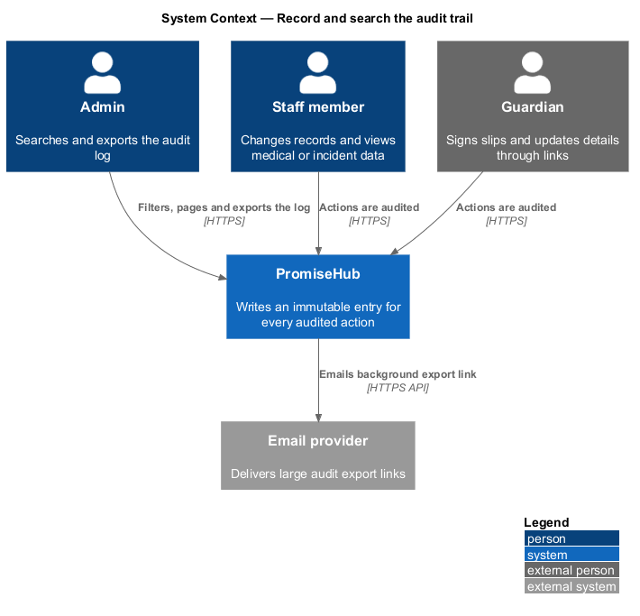
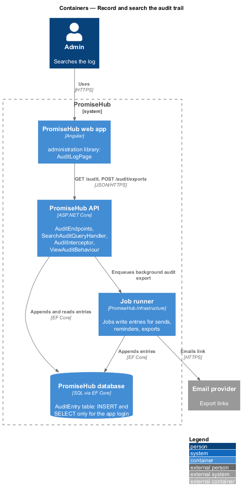
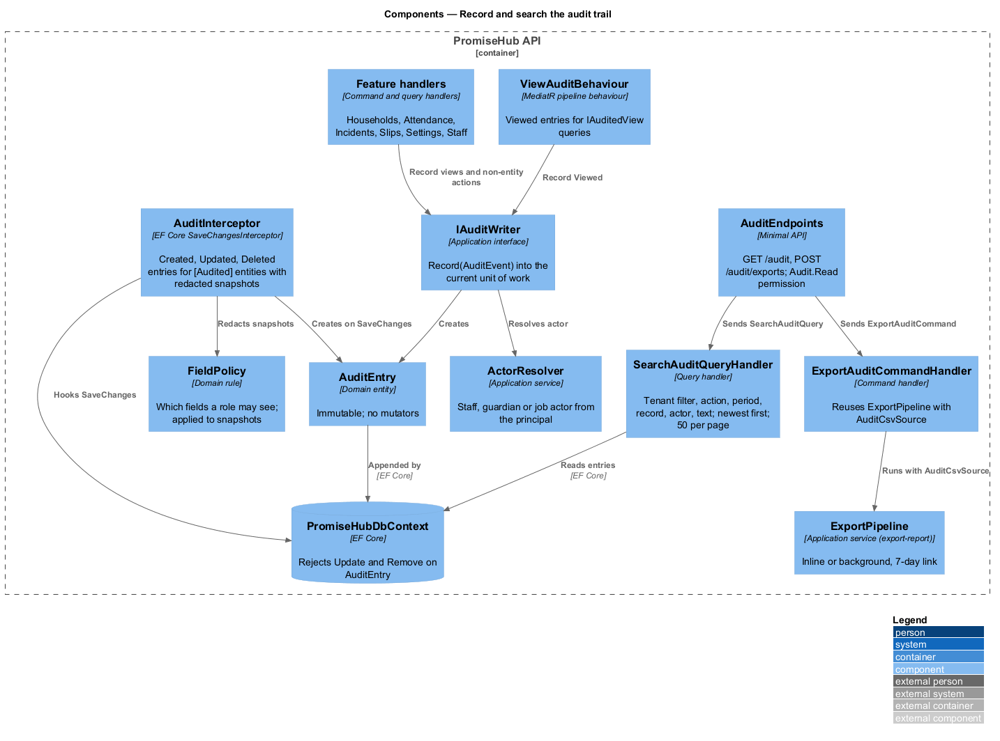
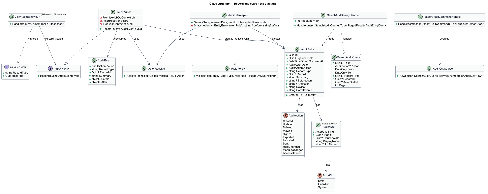
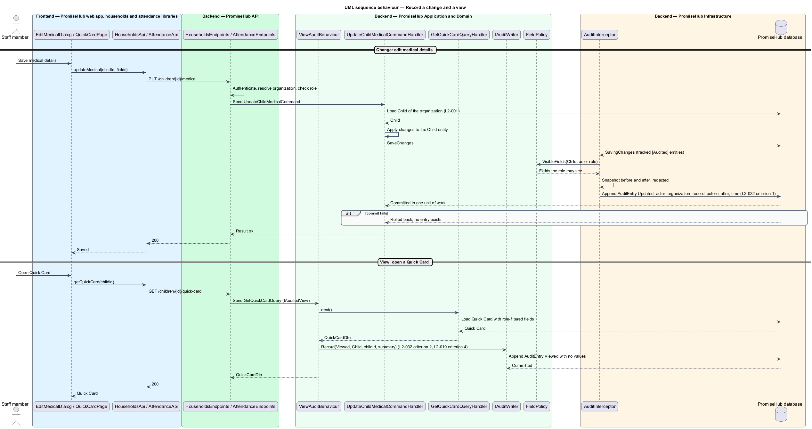
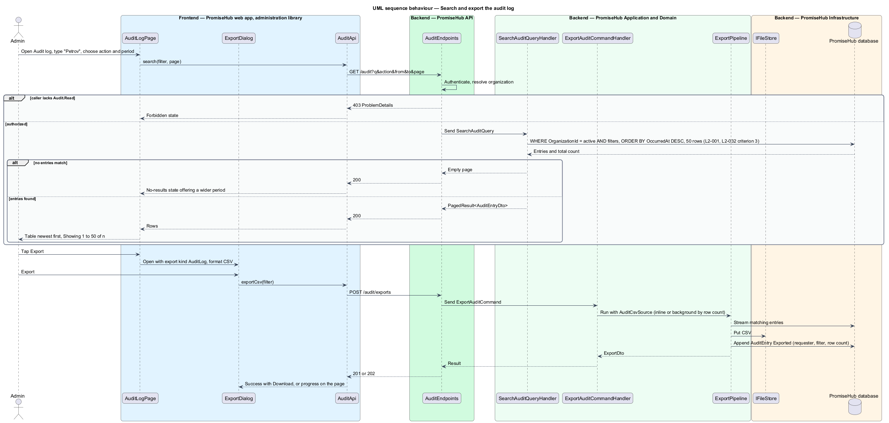

# Record and search the audit trail

## Overview

PromiseHub holds records about children, their medical needs, their guardians and incidents involving them. Organizations that hold such records answer for who touched them. The audit trail is PromiseHub's answer: every change to a sensitive record, every view of medical or incident data and every administrative action is written as an immutable entry with who, what, when and from where, and admins can search that log and export it.

The audit log is append-only. Entries are written in the same unit of work as the change they describe, so a committed change always has its entry and a rolled-back change never does. Entries are never edited or deleted through the application; retention and purge are a platform concern outside this slice. Every entry belongs to one organization, and the log an admin searches is that organization's log alone.

Local terms:

- **audit entry** — immutable record of one action, naming the actor, the organization, the affected record, the action kind, before and after values and the time
- **actor** — staff member, guardian (identified by household and contact) or system job that performed the action
- **audited record** — household, child, guardian, consent, attendance, incident, module configuration or role record whose create, update and delete are logged
- **sensitive view** — read of medical data, a Quick Card or an incident that is logged as an entry with no before or after values
- **before and after values** — JSON snapshots of the audited fields prior to and following a change, with fields the actor's role cannot read omitted from both

The slice spans the `audit-log` screen in its default, loading, empty, error, no-results and long states, and the `export-data` dialog when opened from the audit log.

## Description

### Frontend

The Angular feature library `frontend/projects/administration/` owns the page; it composes `frontend/projects/components/` and calls `AuditApi` from `frontend/projects/api/`.

- **`AuditLogPage`** — the log (`audit-log`). A toolbar holds a search input ("Child, staff member or action"), an action select (all actions, viewed medical, changed record, signed slip, exported, deleted) and a period select (last 7 days, last 30 days, this season). A table lists When, Who, Action, Record and Device, newest first, with 50 rows per page and Previous and Next controls. The Export button opens `ExportDialog` from the reports library's shared pipeline with export kind `AuditLog` and format CSV. States: loading (skeleton), empty (nothing logged yet), error (retry), no-results (offer to widen the period), long (season view, table scrolls inside its wrap on phones).
- **`AuditEntryRow`** — component in `frontend/projects/components/` that renders one entry with a monospace timestamp, actor avatar or system icon, action badge and the record link when the record still exists. Expanding a row shows the before and after values side by side.
- **`AuditApi`** — service behind the `AUDIT_API` injection token with `search(filter, page)` and `exportCsv(filter)`.

### Backend

`PromiseHub.Api` exposes `AuditEndpoints` with `GET /audit` (query: `q`, `action`, `from`, `to`, `recordType`, `recordId`, `actorId`, `page`) and `POST /audit/exports`. Both authenticate, resolve the organization and require the `Audit.Read` permission, held by admins and program directors; other roles receive 403. The audit log is not a module, so no module gate applies; it is always on for every organization.

Application components in `PromiseHub.Application/Audit/`:

- **`IAuditWriter`** — the contract every other feature calls: `Record(AuditEvent)`. It appends an `AuditEntry` to the current `PromiseHubDbContext` unit of work; the entry is committed with the caller's `SaveChanges`. Handlers never save audit entries separately.
- **`AuditEvent`** — the input: `Action` (an `AuditAction` enum), `RecordType`, `RecordId`, `Summary` (one line such as "Mateo Rivera · medication note"), `Before` and `After` (objects serialized to JSON by the writer), `Device` (user agent and coarse location from the request).
- **`AuditInterceptor`** — EF Core `SaveChangesInterceptor` in `PromiseHub.Infrastructure` that produces `Created`, `Updated` and `Deleted` entries automatically for every entity marked `[Audited]` (`Household`, `Child`, `Guardian`, `ConsentRecord`, `AttendanceRecord`, `Incident`, `ModuleConfiguration`, `StaffRole`). It reads the tracked changes, redacts fields the acting role cannot read using `FieldPolicy`, and writes before and after snapshots (`L2-032` criterion 1). Handlers do not call `IAuditWriter` for these; they call it for views and for actions with no entity change.
- **`ViewAuditBehaviour`** — MediatR pipeline behaviour that writes a `Viewed` entry for queries marked `IAuditedView` (`GetQuickCardQuery`, `GetChildMedicalQuery`, `GetIncidentQuery`), with the record identity and no values (`L2-032` criterion 2).
- **`ActorResolver`** — turns the current principal into an `AuditActor`: staff id and name, guardian household and contact (for guardian-link sessions), or job name for system actions.
- **`SearchAuditQuery`** and **`SearchAuditQueryHandler`** — applies the organization filter (`L2-001`), the action, period, record and actor filters and a full-text match on `ActorName`, `Summary` and `RecordType`, orders by `OccurredAt` descending and pages 50 at a time (`L2-032` criterion 3). Searching the log is itself not audited, to keep the log readable.
- **`ExportAuditCommandHandler`** — reuses `ExportPipeline` from `reports/export-report` with an `AuditCsvSource` so audit exports share the inline-or-background rule, the 7-day link and the audit entry for the export.

Domain in `PromiseHub.Domain/Audit/`: `AuditEntry` (`Id`, `OrganizationId`, `OccurredAt`, `Actor`, `Action`, `RecordType`, `RecordId`, `Summary`, `BeforeJson`, `AfterJson`, `Device`, `CorrelationId`), `AuditActor` value object, `AuditAction` enum (`Created`, `Updated`, `Deleted`, `Viewed`, `Signed`, `Exported`, `Imported`, `Sent`, `RoleChanged`, `ModuleChanged`, `AccessDenied`).

Immutability (`L2-032` criterion 4) is enforced in three places: `AuditEntry` has no mutators; `PromiseHubDbContext` marks the entity so `Update` and `Remove` throw `AuditImmutableException` before reaching the database; and the migration grants the application login `INSERT` and `SELECT` only on the audit table. Cross-tenant 404s from `L2-001` criterion 2 write an `AccessDenied` entry through the same writer.

### Undecided details

- Retention period and purge policy for audit entries are `<TO SUPPLY>`.
- Coarse location derivation for the Device column (city from IP or none) is `<TO SUPPLY>`.
- Whether the search is backed by a database full-text index or by `LIKE` on indexed columns is `<TO SUPPLY>`.

## Requirements

The feature realizes the following level-2 (L2) requirement and enforces the cross-cutting ones listed with it.

| L2 ID | Refines (L1) | Requirement |
|-------|--------------|-------------|
| `L2-032` | `L1-017` | Every change and every sensitive view is recorded and searchable by admins. |
| `L2-001` | `L1-001` | Every tenant-owned table carries the organization id; every query, search, export and background job filters by the organization of the signed-in person's active membership, never by a value from the client. |
| `L2-019` | `L1-008` | A Quick Card shows the allergy alert first, then medical facts, who to call in order, approved pickups and notes; medical fields are role-restricted and every open is audited. |
| `L2-023` | `L1-011` | A structured incident form (category, child, time, place, what happened, action taken, guardian contact) routes to supervisors; access is restricted and audited. |

`L2-019` and `L2-023` appear for their view-audit criteria, which `ViewAuditBehaviour` enforces.

## Diagrams

### System context

Admins search and export the log; every other PromiseHub feature writes to it.

### Containers

The administration library's audit page calls the API; the API and the job runner both append entries to the audit table through the same writer.

### Components

`AuditInterceptor` and `ViewAuditBehaviour` produce entries without handler code; `SearchAuditQueryHandler` reads them, and the export reuses the reports pipeline.

### Class structure

`AuditEntry` is immutable; `IAuditWriter`, `AuditInterceptor` and `ViewAuditBehaviour` create entries, and `SearchAuditQueryHandler` reads them.

### Behaviour — record a change and a view

A medical edit is committed with its automatic entry in one unit of work; a Quick Card open writes a view entry through the pipeline behaviour.

### Behaviour — search and export the log

An admin filters the log; the handler applies tenant and filter predicates and pages newest first; export reuses the report export pipeline.

