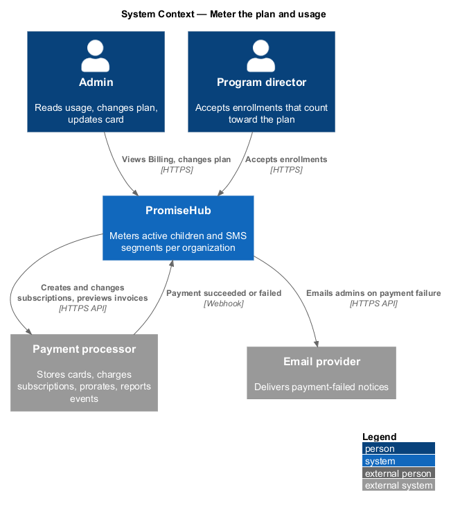
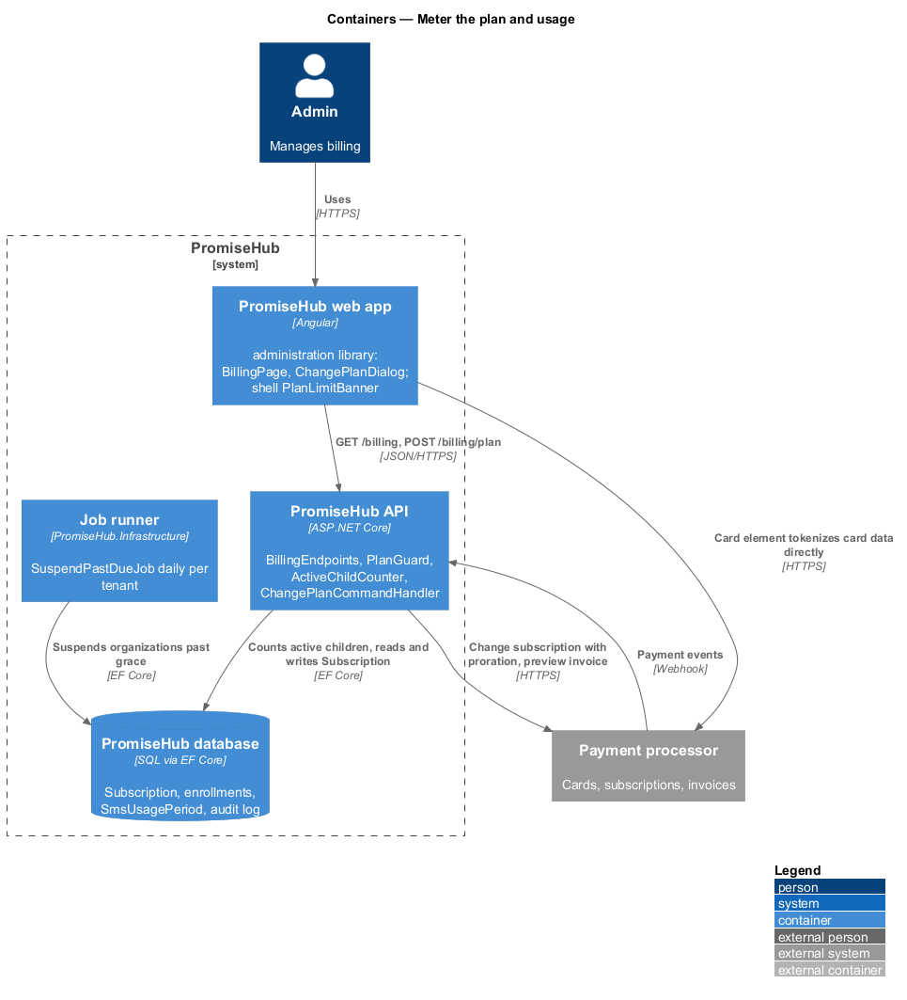
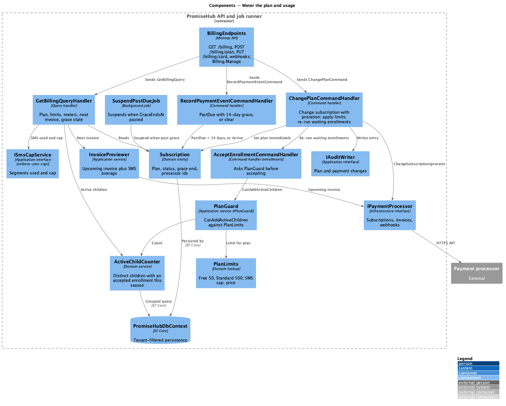
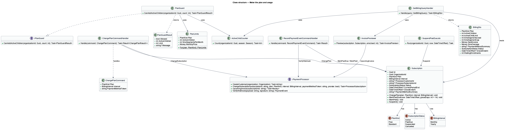
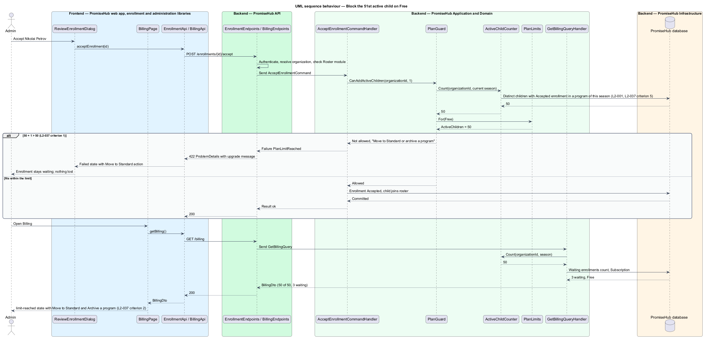
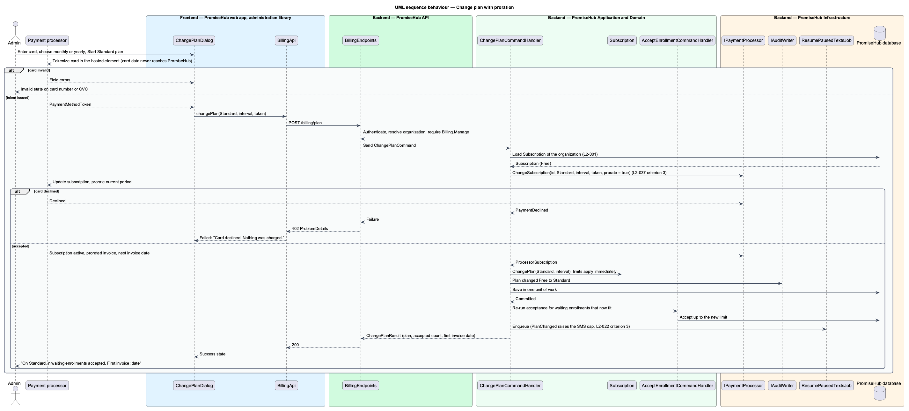
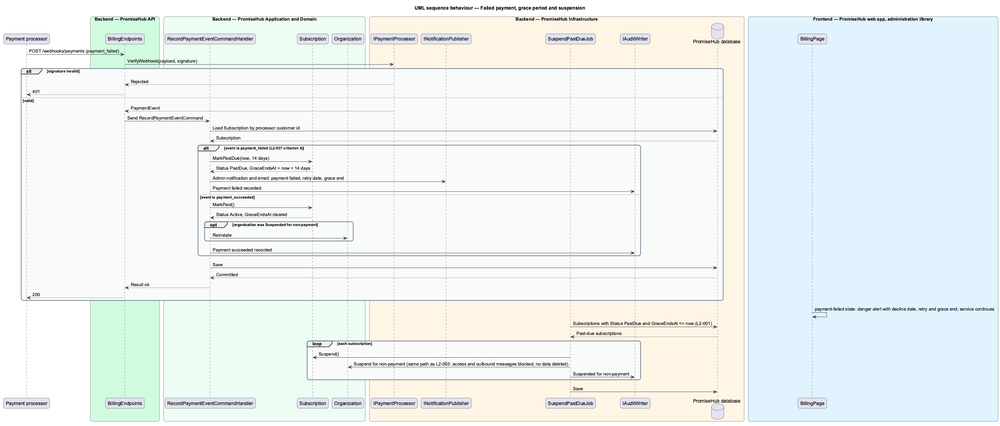

# Meter the plan and usage

## Overview

PromiseHub is priced per organization, not per guardian or volunteer. An organization is on one of two plans: Free, which covers up to 50 active children, and Standard, a flat monthly plan that covers up to 500. Two quantities are metered against the plan: the number of active children and the number of SMS segments sent in the month. This feature keeps those meters, enforces the active-child limit at the moment a child would exceed it, lets an admin change plan with a prorated invoice, and handles a failed payment with a grace period before suspension.

Billing is read by admins on the `billing` page and changed through the `change-plan` dialog. The metering is used elsewhere: enrollment acceptance asks whether one more active child fits the plan, and the SMS cap in `messaging/enforce-sms-cap` reads its default from the plan. Payment itself is delegated to an external payment processor; PromiseHub stores a reference to the customer and subscription, never card details.

Local terms:

- **plan** — commercial tier of an organization, Free or Standard, that sets the active-child limit, the SMS segment cap and the monthly price
- **active child** — child enrolled in at least one program of the organization in the current season
- **season** — organization-configured date range, typically September to June, over which enrollment and reporting are grouped
- **plan limit** — maximum number of active children a plan allows; a 51st active child on Free is blocked
- **proration** — adjustment of the first invoice after a plan change so the organization pays for the remainder of the current billing period only
- **grace period** — 14 days after a failed payment during which service continues before the account is suspended

The slice spans the `billing` screen in its default, loading, error, free, limit-reached and payment-failed states, the `change-plan` dialog in its default, busy, invalid, failed and success states, and the persistent limit banner (`banner/persistent`).

## Description

### Frontend

The Angular feature library `frontend/projects/administration/` owns the page and dialog; it composes `frontend/projects/components/` and calls `BillingApi` from `frontend/projects/api/`.

- **`BillingPage`** — the billing overview (`billing`). A Plan card shows plan name, limit and price, payment method, next invoice amount (base price plus any SMS overage), invoice links and the actions Change plan, Update card and Raise SMS cap. A Usage card shows two meters: active children of the plan limit and SMS segments this month of the cap, using the design-system progress component with warning and danger kinds as the server reports them. The free state shows the Free plan facts and a Move to Standard action. The limit-reached state adds a warning alert with the count of enrollments waiting and actions Move to Standard and Archive a program. The payment-failed state adds a danger alert with the decline date, the next retry and the grace period end, and an Update card action.
- **`ChangePlanDialog`** — CDK dialog (`change-plan`). Hosts the payment processor's card element inside the dialog so card data goes directly to the processor and never through PromiseHub, plus name on card and a monthly or yearly billing choice. States: default, invalid (card number and CVC errors from the processor element), busy, failed ("Card declined. Nothing was charged."), success (new plan, waiting enrollments accepted, first invoice date).
- **`PlanLimitBanner`** — component in `frontend/projects/components/` that the shell renders for admins when the server reports `ActiveChildren >= PlanLimit`, with the waiting-enrollment count and a See plans action.
- **`BillingApi`** — service behind the `BILLING_API` injection token with `getBilling()`, `createPaymentSetup()`, `changePlan(request)`, `updateCard(token)` and `getInvoices()`.

### Backend

`PromiseHub.Api` exposes `BillingEndpoints`: `GET /billing`, `POST /billing/payment-setup`, `POST /billing/plan`, `PUT /billing/card`, `GET /billing/invoices` and `POST /webhooks/payments` for processor events. All but the webhook require authentication and the `Billing.Manage` permission (admins). Billing is not a module and is never gated off.

Application components in `PromiseHub.Application/Billing/`:

- **`PlanLimits`** — domain lookup from `PlanKind` to `ActiveChildren` (Free 50, Standard 500), `SmsSegmentsPerMonth` (`<TO SUPPLY>`, see `enforce-sms-cap`) and `MonthlyPrice` (`<TO SUPPLY>`; the specification says under $100 per month).
- **`ActiveChildCounter`** — domain service that counts distinct children with at least one `Enrollment` in status `Accepted` in a program whose season is the organization's current season. The count is a single grouped query with the organization filter and is the only definition of "active child" in the codebase (`L2-037` criterion 5).
- **`IPlanGuard`** with `PlanGuard` — `CanAddActiveChildren(organizationId, count)` compares `ActiveChildCounter` plus `count` with `PlanLimits`. `AcceptEnrollmentCommandHandler` in `enrollment/enroll-guardian` and `ImportRosterCommandHandler` call it before accepting; a refusal returns a 422 ProblemDetails with the upgrade message and the enrollment stays waiting (`L2-037` criterion 1). Walk-ins on tonight's roster are not enrollments and never count.
- **`GetBillingQueryHandler`** — returns `BillingDto`: plan, limits, active children, SMS segments used and cap (from `ISmsCapService`), next invoice amount from `InvoicePreviewer`, payment method summary, subscription status, grace period end when payment failed, and the waiting-enrollment count.
- **`ChangePlanCommand`** and **`ChangePlanCommandHandler`** — validates the target plan and the payment method token, calls `IPaymentProcessor.ChangeSubscription` with proration enabled so the processor computes the prorated invoice (`L2-037` criterion 3), updates `Subscription.Plan` immediately so limits apply on the next request, raises `PlanChanged` so `enforce-sms-cap` recomputes the cap and `ResumePausedTextsJob` runs, and re-runs acceptance for waiting enrollments that now fit. The change is audited.
- **`InvoicePreviewer`** — asks the processor for the upcoming invoice and adds SMS overage computed from `SmsUsagePeriod` beyond the plan cap when the plan allows overage (`<TO SUPPLY>` whether Standard permits paid overage or hard-stops at the cap; the mocks show both an overage line and a hard pause).
- **`RecordPaymentEventCommandHandler`** — handles processor webhooks. On `payment_failed` it sets `Subscription.Status = PastDue`, `GraceEndsAt = now + 14 days`, notifies admins and shows the banner. On `payment_succeeded` it clears both. `SuspendPastDueJob` runs daily per tenant and, when `GraceEndsAt` has passed, sets the organization status to `Suspended` through the same path `organizations/manage-organizations` uses, so staff and guardian links are refused and outbound messages stop, with no data deleted; payment reinstates (`L2-037` criterion 4).

Domain in `PromiseHub.Domain/Billing/`: `Subscription` (`OrganizationId`, `Plan`, `BillingInterval`, `ProcessorCustomerId`, `ProcessorSubscriptionId`, `Status`, `CurrentPeriodEnd`, `GraceEndsAt`, `PaymentMethodSummary`), enums `PlanKind` (`Free`, `Standard`), `SubscriptionStatus` (`Active`, `PastDue`, `Suspended`, `Cancelled`), `BillingInterval` (`Monthly`, `Yearly`).

`PromiseHub.Infrastructure` provides `PaymentProcessorAdapter` behind `IPaymentProcessor`, webhook signature verification, the `SuspendPastDueJob`, and `PromiseHubDbContext` mappings. Card data never reaches PromiseHub; only processor tokens and a masked summary are stored (`L2-031`).

### Undecided details

- Payment processor identity is `<TO SUPPLY>`.
- Standard plan price and whether SMS overage is billable or hard-stopped are `<TO SUPPLY>`.
- Whether a downgrade from Standard to Free with more than 50 active children is refused or scheduled for the end of the period is `<TO SUPPLY>`.

## Built so far

Slice 41 delivered `PlanTerms`, `PlanLimit` (enforced on enrolling and accepting), `BillingHandler` (`GET /billing`, `PUT /billing/plan` with proration), `Organization.PaymentFailedAt` with the grace period, and `BillingPage` with `ChangePlanDialog` (ADR 0035). The payment processor, invoices and suspension enforcement are not built.

## Requirements

The feature realizes the following level-2 (L2) requirement and enforces the cross-cutting ones listed with it.

| L2 ID | Refines (L1) | Requirement |
|-------|--------------|-------------|
| `L2-037` | `L1-020` | Free up to 50 active children; Standard up to 500 for a flat monthly price; active children and SMS segments are metered. |
| `L2-022` | `L1-010` | Each organization has a monthly SMS segment cap by plan; at the cap, texts pause and email continues. |
| `L2-001` | `L1-001` | Every tenant-owned table carries the organization id; every query, search, export and background job filters by the organization of the signed-in person's active membership, never by a value from the client. |
| `L2-003` | `L1-001` | Platform admins list, add, suspend and reinstate organizations; this list is the only screen that spans tenants. |

`L2-022` appears for its third criterion (a plan change raises the cap and resumes texts); `L2-003` for the suspension semantics that the grace-period expiry reuses.

## Diagrams

### System context

Admins read usage and change plan in PromiseHub; the payment processor holds card data and reports payment events.

### Containers

The administration library's billing page calls the API; the API counts active children in the database, talks to the processor and receives its webhooks; the job runner suspends past-due organizations.

### Components

`ActiveChildCounter` and `PlanGuard` meter and enforce; `ChangePlanCommandHandler` and `RecordPaymentEventCommandHandler` move the `Subscription` through its states.

### Class structure

`Subscription` holds plan and payment state; `PlanGuard` depends on `ActiveChildCounter` and `PlanLimits`; the handlers depend on `IPaymentProcessor`.

### Behaviour — block the 51st active child

Accepting an enrollment asks the plan guard; on Free with 50 active children the acceptance is refused with the upgrade message and Billing shows the limit.

### Behaviour — change plan with proration

The dialog tokenizes the card with the processor, the handler changes the subscription with proration, applies limits immediately and re-runs waiting enrollments.

### Behaviour — failed payment, grace and suspension

A failed-payment webhook starts the 14-day grace period and the banner; the daily job suspends the organization when the grace period ends and payment reinstates it.

