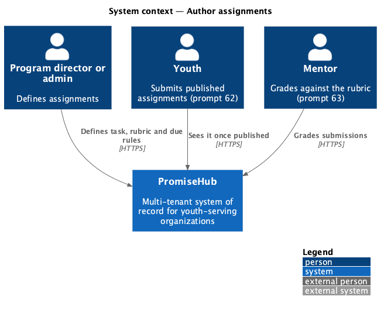
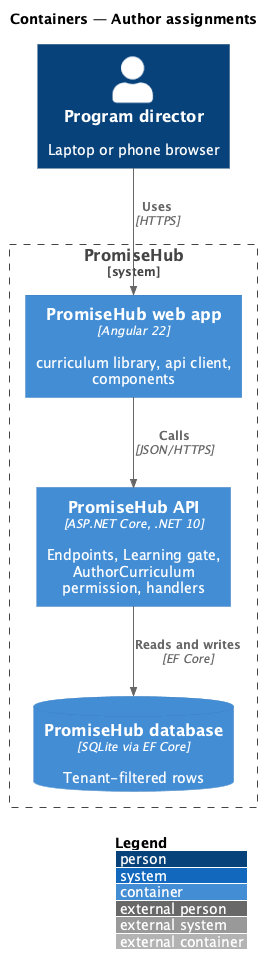
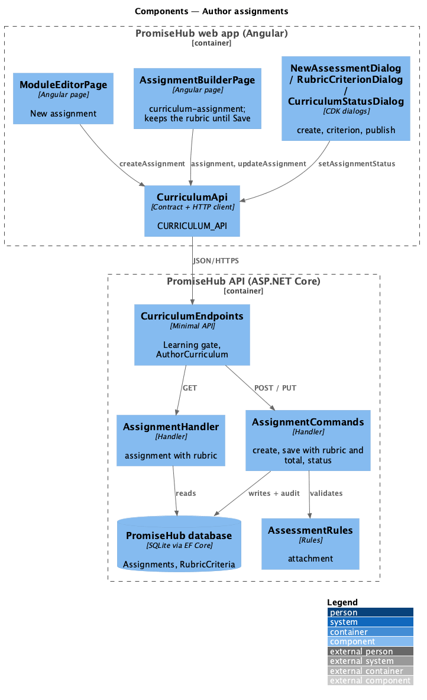
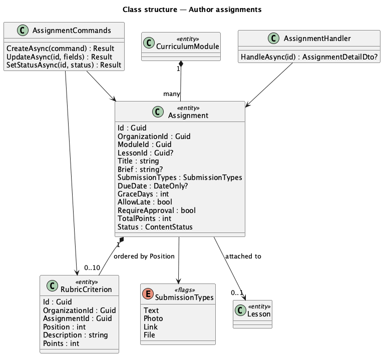
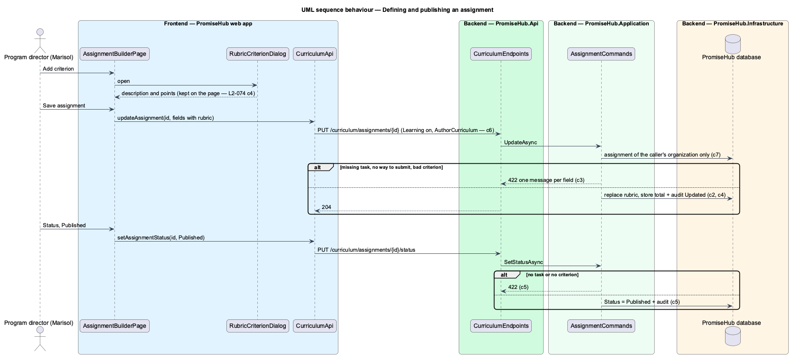

# Author assignments

## Overview

An **assignment** is a task youth do and submit for their mentor to grade. It belongs to one curriculum module and is **attached** to the whole module or one of its lessons. It has a title, a **task** youth read, the **ways to submit** it accepts (text reflection, photo, link, file upload), a **rubric** of criteria each worth points, and **due rules**. Admins and program directors define assignments in the assignment builder and publish or draft them. Submitting is prompt 62 and grading prompt 63.

Terms used in this document:

- **rubric** — up to 10 criteria, each a description (up to 200 characters) and 1 to 100 points; the **total possible points** is their sum, computed and stored by the server
- **due rules** — an optional due date, a grace period of 0 to 14 days, whether late submissions are accepted (flagged for the mentor) and whether a mentor approves before the assignment counts as complete
- **published to cohorts** — a published assignment reaches the youth of the programs that follow the module's track, under the same visibility rule as lessons (ADR 0050)

Ported from Waypoint `curriculum-authoring/author-assignments` (`L2-CURRIC-004`), with tenancy, the Learning gate and PromiseHub types. Decisions are recorded in ADR 0054.

## Description

Frontend (`frontend/projects/curriculum/`):

- **`ModuleEditorPage`** — New assignment opens **`NewAssessmentDialog`** (`new-assessment`, kind assignment), which creates the assignment and opens the builder.
- **`AssignmentBuilderPage`** (`/curriculum/assignments/:assignmentId`, mock `curriculum-assignment`) — one form of three cards: Details (`ph-text-field`, `ph-select` attachment, `ph-textarea` task, `ph-checkbox-group` ways to submit), Rubric (`ph-list` rows with Edit and Remove, the total beneath, Add criterion) and Due rules (`ph-text-field` type date, `ph-select` grace period, two `ph-switch`), plus a Belongs to card. Add criterion and Edit open **`RubricCriterionDialog`** (`rubric-criterion`), which closes with the criterion; the page keeps the list until Save assignment sends it. Status opens **`CurriculumStatusDialog`** with kind `assignment`.

API client (`CURRICULUM_API`): `createAssignment()`, `assignment()`, `updateAssignment()`, `setAssignmentStatus()`; contracts `AssignmentDetail`, `AssignmentFields`, `RubricCriterion`, `SubmissionType`.

Backend:

- **`CurriculumEndpoints`** — `POST /curriculum/assignments`, `GET /curriculum/assignments/{id}`, `PUT /curriculum/assignments/{id}`, `PUT /curriculum/assignments/{id}/status`, under the Learning gate and `AuthorCurriculum`.
- **`AssignmentCommands`** — create (Draft accepting text), update (title 120, task 5,000, at least one way to submit, rubric rules, grace 0 to 14 days, attachment), replacing the rubric as a whole and storing the total; status (publishing needs a task and a criterion).
- **`AssignmentHandler`** — one assignment with every field, the rubric in order, the module's live lessons and the programs following the track.
- Domain (`PromiseHub.Domain/Curriculum/`): **`Assignment`** (with `SubmissionTypes`, a flags enum, `DueDate` as a `DateOnly`) and **`RubricCriterion`** (assignment, position, description, points), both tenant-owned.
- Every write is audited on `Assignment` with before and after values.

Open questions: deleting an assignment, per-youth assigned-work records with their own due dates (prompt 69), and locking an assignment once youth have submitted are deferred.

## Built so far

<TO SUPPLY> after implementation.

## Requirements

| L2 ID | Refines (L1) | Requirement |
|-------|--------------|-------------|
| `L2-074` | `L1-023` | An admin or program director defines an assignment: its title and task, the ways youth may submit, a rubric of criteria with points and its total, its due rules, where it sits in the module, and whether it is published. |

## Diagrams

### System context

### Containers

### Components

The assignment builder keeps the rubric list until Save; the command handler replaces the rubric, stores the total and audits the change.

### Class structure

An assignment owns its ordered rubric criteria and may point at one lesson of its module.

### Behaviour — defining and publishing an assignment

