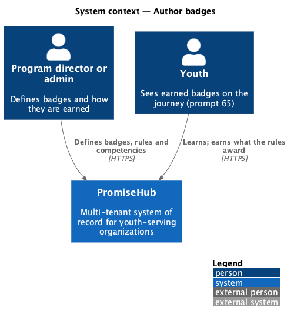
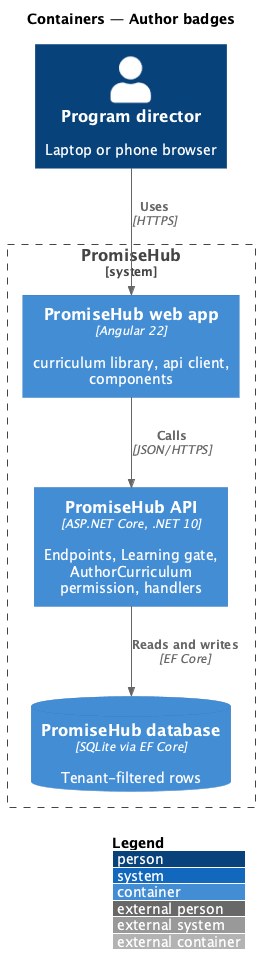
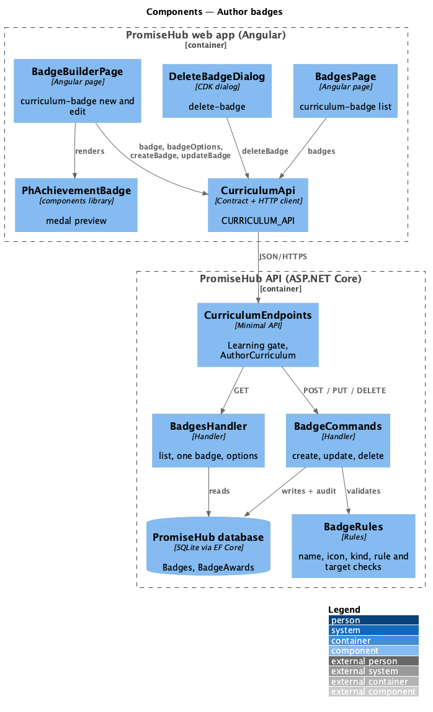
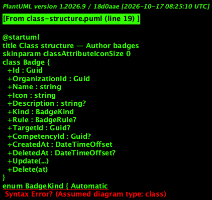
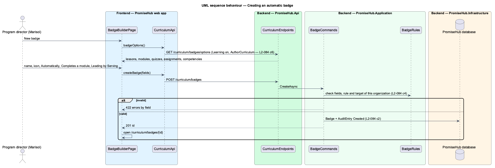

# Author badges

## Overview

A **badge** is a mark of something a youth reached, such as finishing a first lesson or a module. Each organization defines its own badges: a name, an icon, what it celebrates and how it is earned. An **automatic** badge names one **rule** and the **target** it watches; the server awards it when a youth meets the rule ([award-badges](../award-badges/README.md)). A badge **by hand** (`Manual`) has no rule; a program director awards it. A badge may **count toward** one competency of the progression framework ([author-progression-framework](../author-progression-framework/README.md)).

Terms used in this document:

- **rule** — `LessonCompleted`, `ModuleCompleted`, `QuizPassed` or `AssignmentAccepted`
- **target** — the lesson, module, quiz or assignment of the organization the rule watches (`Badge.TargetId`)
- **icon** — one of `star`, `award`, `heart`, `flag`, `book`, `sparkle`, `people`, `check`, drawn by `ph-achievement-badge`
- **deleted** — `Badge.DeletedAt` is set: the badge leaves every list and is never awarded again; its awards stay

Ported from Waypoint `curriculum-authoring/author-badges` (`L2-CURRIC-005`), with tenancy, the Learning gate and PromiseHub types. Decisions are recorded in ADR 0058.

## Description

Frontend (`frontend/projects/curriculum/`):

- **`CurriculumTracksPage`** — Badges and Progression buttons in the page header.
- **`BadgesPage`** (`/curriculum/badges`, mock `curriculum-badge` default, empty, loading, error, deleted, forbidden) — `ph-stat` counts and the list of badges (`ph-list-item` links with the kind as `ph-badge`).
- **`BadgeBuilderPage`** (`/curriculum/badges/new` and `/curriculum/badges/:badgeId`, mock `curriculum-badge` new, edit, automatic, invalid, busy, saved, failed, awarded, not-found) — the Badge and Earning it cards (`ph-text-field`, `ph-textarea`, `ph-select` for icon, rule, target and competency, `ph-radio-group` for the kind), the Preview card with **`ph-achievement-badge`**, and Earned by with Award badge ([award-badges](../award-badges/README.md)). Delete opens **`DeleteBadgeDialog`** (`delete-badge`).
- **`ph-achievement-badge`** (components library) — a medal with icon, name and caption; `locked` and `small` variants. Prompt 65 reuses it for the youth's badges.

API client (`CURRICULUM_API`): `badges()`, `badgeOptions()`, `badge()`, `createBadge()`, `updateBadge()`, `deleteBadge()`; contracts `BadgeList`, `BadgeSummary`, `BadgeDetail`, `BadgeFields`, `BadgeOptions`, `BadgeKind`, `BadgeRule`.

Backend:

- **`CurriculumEndpoints`** — `GET /curriculum/badges`, `GET /curriculum/badges/options`, `GET /curriculum/badges/{id}`, `POST /curriculum/badges`, `PUT /curriculum/badges/{id}`, `DELETE /curriculum/badges/{id}`, under `RequireModule(Learning)` and `RequirePermission(AuthorCurriculum)`.
- **`BadgesHandler`** — the list with counts (badges, automatic, by hand, awards, youth holding one), one badge with its awards and the youth who can still be awarded it, and the options for the builder.
- **`BadgeCommands`** — create, update (before and after audited) and delete (sets `DeletedAt`, audited Deleted). **`BadgeRules`** checks every field and that the target and competency belong to the organization.
- Domain (`PromiseHub.Domain/Curriculum/`): **`Badge`**, **`BadgeKind`**, **`BadgeRule`**, tenant-owned.

Open questions: an attendance-streak rule waits for cohort session attendance (prompt 71); badge artwork uploads are not ported, icons come from the fixed set.

## Built so far

Prompt 64 delivered everything above: the Badges list, the builder with its preview, refusals, delete and the gates (slice 1), and Earned by with Award badge for a badge by hand (slice 3). The builder opens at `/curriculum/badges/new` and, once saved, at its own address. Acceptance tests: `backend/tests/PromiseHub.Api.Tests/CurriculumBadgesTests.cs`, `e2e/tests/curriculum/curriculum-badges.spec.ts`.

## Requirements

| L2 ID | Refines (L1) | Requirement |
|-------|--------------|-------------|
| `L2-084` | `L1-023` | An admin or program director defines the organization's badges: a name, an icon, what it celebrates, how it is earned (automatically by one rule, or by hand) and, optionally, the competency it counts toward. |

## Diagrams

### System context

### Containers

### Components

The badge pages and the delete dialog call the curriculum API client; the endpoints gate on Learning and `AuthorCurriculum` before the handlers validate, save and audit.

### Class structure

A badge has a kind, at most one rule with its target, and an optional competency; its awards outlive it.

### Behaviour — creating an automatic badge

