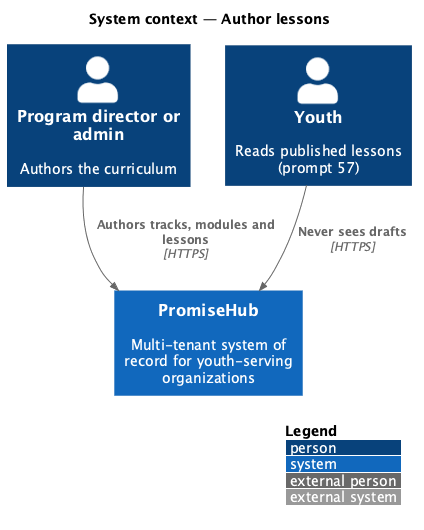
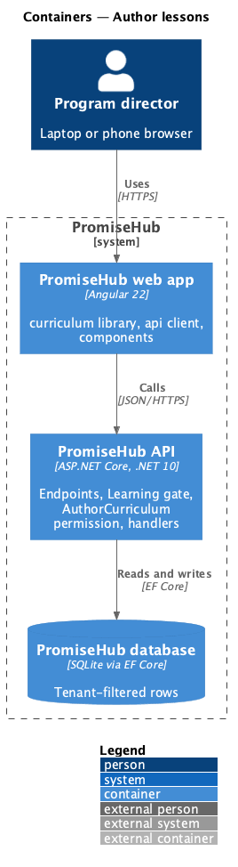
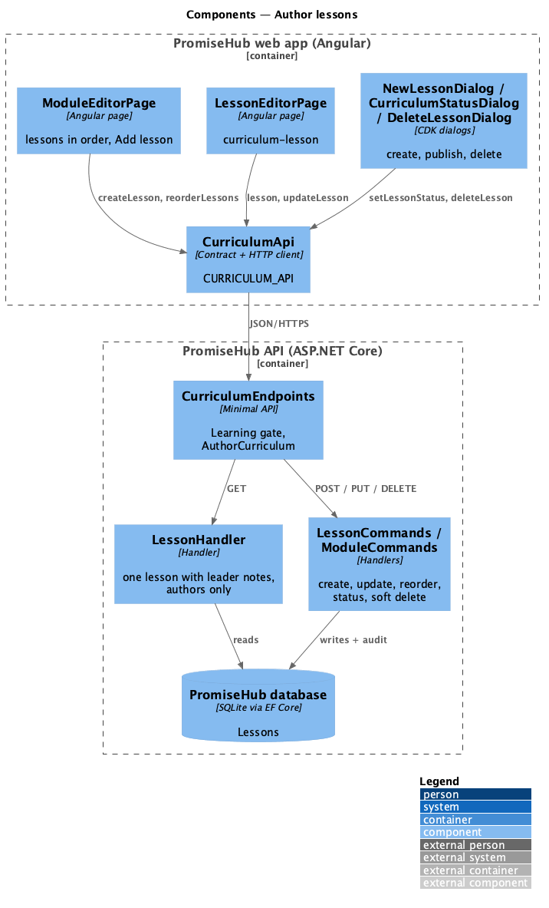
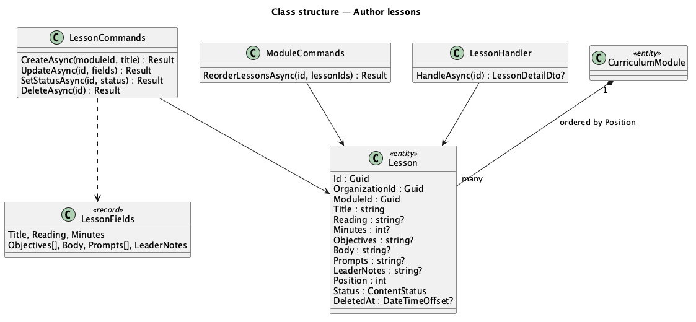
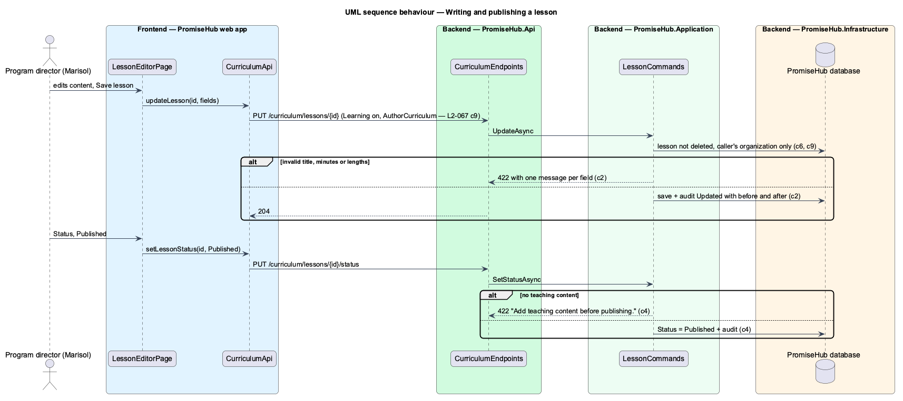

# Author lessons

## Overview

A **lesson** is one reading in a module ([author-tracks-and-modules](../author-tracks-and-modules/README.md)): a title, an optional reading it is built on, an estimated time, learning objectives, the teaching content youth read, reflection prompts, and **leader guide notes** for staff and mentors that youth never see. Admins and program directors write lessons in the lesson editor, order them within the module, publish or draft them, and delete them. Deleting keeps the row (soft delete) so youth progress stays archived.

Terms used in this document:

- **teaching content** — the plain-text body youth read as the lesson; required before publishing
- **leader guide notes** — notes for authors and mentors only; never part of any youth response
- **soft delete** — `Lesson.DeletedAt` is set; the lesson leaves every list, order and read but the row stays

Ported from Waypoint `curriculum-authoring/author-lessons` (`L2-CURRIC-002`), with tenancy, the Learning gate and PromiseHub types. Waypoint's required scripture reference becomes the optional **reading**.

## Description

Frontend (`frontend/projects/curriculum/`):

- **`ModuleEditorPage`** — the Lessons card lists lessons in order with their status and Move up and Move down; Add lesson opens **`NewLessonDialog`** (`new-lesson`), which creates the lesson and opens the editor.
- **`LessonEditorPage`** (`/curriculum/lessons/:id`, mock `curriculum-lesson`) — the Content form (`ph-text-field`, `ph-textarea` for objectives and prompts one per line), the Video card ([upload-lesson-video](../upload-lesson-video/README.md)) and the Belongs to card. Status opens **`CurriculumStatusDialog`** with Draft and Published; Delete opens **`DeleteLessonDialog`** (`delete-lesson`) and returns to the module.

API client: `createLesson()`, `lesson()`, `updateLesson()`, `setLessonStatus()`, `deleteLesson()`, `reorderLessons()`; contracts `LessonDetail`, `LessonFields`, `LessonSummary`.

Backend:

- **`CurriculumEndpoints`** — `POST /curriculum/lessons`, `GET /curriculum/lessons/{id}`, `PUT /curriculum/lessons/{id}`, `PUT /curriculum/lessons/{id}/status`, `DELETE /curriculum/lessons/{id}`, `PUT /curriculum/modules/{id}/lesson-order`, all under the Learning gate and `AuthorCurriculum`.
- **`LessonCommands`** — create (placed last, Draft), update (title 120, reading 200, minutes 1 to 600, body 20,000, up to 10 objectives and 10 prompts of 300 characters, notes 4,000), status (publishing needs teaching content), delete (soft; positions of the remaining lessons close up).
- **`ModuleCommands.ReorderLessonsAsync`** — the full list of the module's live lesson ids, each once.
- **`LessonHandler`** — one live lesson with every field, its module, track, position, the programs following the track and its video.
- Domain: **`Lesson`** (`PromiseHub.Domain/Curriculum/`), tenant-owned; objectives and prompts are stored as newline-separated text.
- Every write is audited on `Lesson` in the same unit of work.

Visibility to youth: a lesson reaches youth only while it, its module and its track are `Published` and the youth's program follows the track. The youth read model is prompt 57; until then `GET /learning/lessons` returns no lesson and every `/curriculum` endpoint answers youth and mentors 403, so leader notes and drafts never leave the authoring endpoints.

Open questions: document attachments other than video, a lesson preview as youth see it, and restoring a deleted lesson from the app are deferred.

## Built so far

Prompt 56 delivered everything above. Acceptance tests: `backend/tests/PromiseHub.Api.Tests/CurriculumLessonsTests.cs`, `e2e/tests/curriculum/curriculum-lessons.spec.ts`.

## Requirements

| L2 ID | Refines (L1) | Requirement |
|-------|--------------|-------------|
| `L2-067` | `L1-023` | An admin or program director writes each lesson of a module: its title, reading, estimated time, objectives, teaching content, reflection prompts and leader guide notes for staff and mentors, attaches one lesson video, publishes or drafts it, and deletes it without losing youth progress. |

## Diagrams

### System context

### Containers

### Components

The module and lesson editors call the curriculum API client; command handlers validate, save and audit.

### Class structure

A module owns its ordered lessons; a deleted lesson keeps its row.

### Behaviour — writing and publishing a lesson

