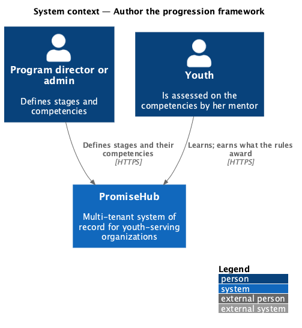
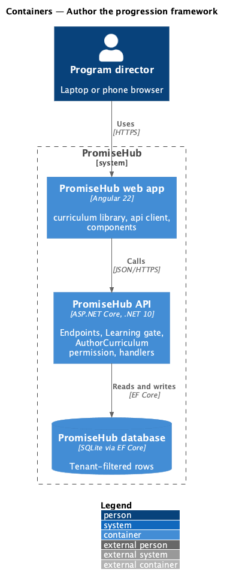
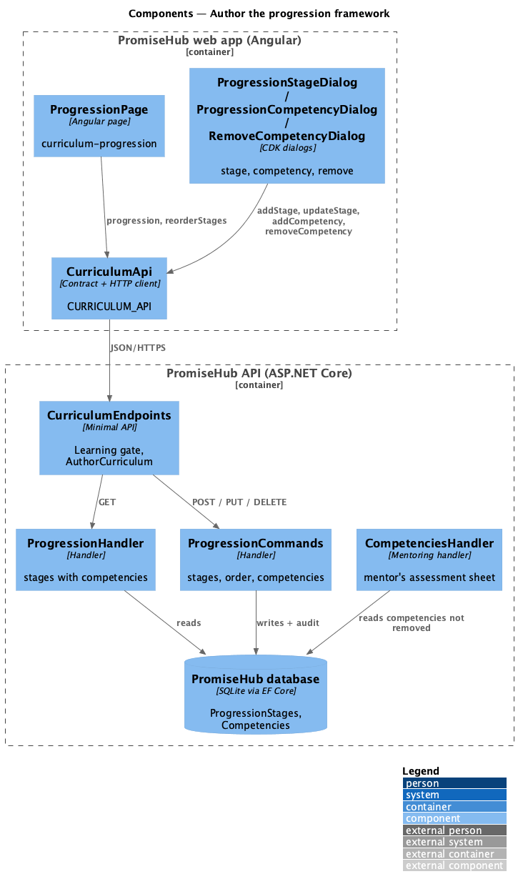
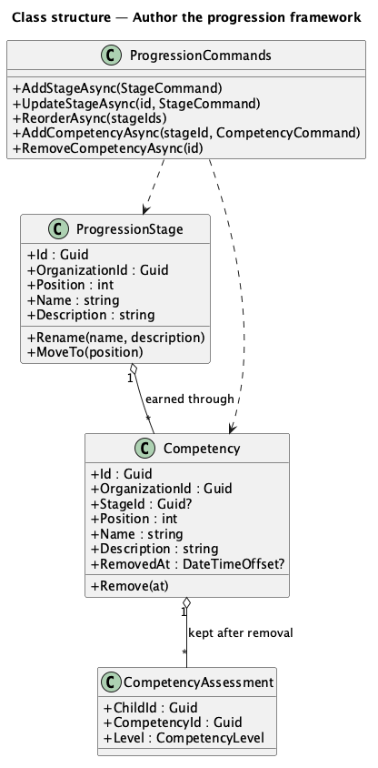
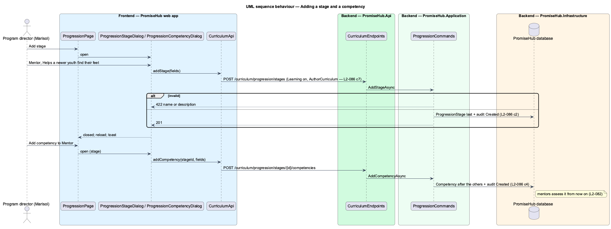

# Author the progression framework

## Overview

The **progression framework** describes how a youth grows: ordered **stages** (levels such as Explorer, Contributor and Leader), each earned through its **competencies**. Mentors assess each competency on a youth's record (L2-082); a youth reaches a stage once every competency in it, and in the stages before it, is Proficient or Mastered. Each organization authors its own framework. Prompt 63 seeded each organization's competencies; this design puts them into stages and lets program directors change them.

Terms used in this document:

- **stage** — `ProgressionStage`: a numbered step with a name (up to 60 characters) and a description (up to 200)
- **competency** — `Competency` (Mentoring domain, ADR 0057): a name (up to 80) and a description (up to 300), now in one stage
- **removed** — `Competency.RemovedAt` is set: mentors no longer see or assess it; its assessments stay

Ported from Waypoint `curriculum-authoring/author-progression-framework` (`L2-CURRIC-006`), with tenancy, the Learning gate and PromiseHub types. Decisions are recorded in ADR 0058.

## Description

Frontend (`frontend/projects/curriculum/`):

- **`ProgressionPage`** (`/curriculum/progression`, mock `curriculum-progression`) — a `ph-card` per stage with its number, name, description, icon-only Edit, Move up and Move down, and its competencies in a `ph-list` with Remove; How youth advance names the stages in order. Add stage and Edit open **`ProgressionStageDialog`** (`progression-stage`); Add competency opens **`ProgressionCompetencyDialog`** (`progression-competency`); Remove opens **`RemoveCompetencyDialog`** (`remove-competency`).

API client (`CURRICULUM_API`): `progression()`, `addStage()`, `updateStage()`, `reorderStages()`, `addCompetency()`, `removeCompetency()`; contracts `Progression`, `ProgressionStage`, `ProgressionCompetency`, `StageFields`, `CompetencyFields`.

Backend:

- **`CurriculumEndpoints`** — `GET /curriculum/progression`, `POST /curriculum/progression/stages`, `PUT /curriculum/progression/stages/{id}`, `PUT /curriculum/progression/stage-order`, `POST /curriculum/progression/stages/{id}/competencies`, `DELETE /curriculum/progression/competencies/{id}`, under `RequireModule(Learning)` and `RequirePermission(AuthorCurriculum)`.
- **`ProgressionHandler`** — the stages in order with their competencies that are not removed.
- **`ProgressionCommands`** — add a stage last, edit it, save the whole order (every stage once), add a competency to a stage (after every competency of the organization, so the mentor's sheet keeps its order) and remove one. Every write is audited.
- Domain: **`ProgressionStage`** (`PromiseHub.Domain/Curriculum/`) and **`Competency`** gaining `StageId` and `RemovedAt`. The migration puts any competency without a stage into a first stage of its organization; the seeder creates Explorer, Contributor and Leader at Harbourview and Explorer and Contributor at Northgate over the seeded competencies.
- **`CompetenciesHandler`** (Mentoring) leaves removed competencies out of the sheet and refuses them on save.

Open questions: deleting a stage, moving a competency between stages and renaming a competency are deferred; computing a youth's current stage belongs to the journey view (prompt 65) and reports (prompt 80).

## Built so far

Prompt 64 delivered everything above (slice 4): the seeded stages, adding, editing and reordering stages, adding and removing competencies, the mentor's sheet leaving removed competencies out, and the migration that puts earlier competencies into a first stage. Acceptance tests: `backend/tests/PromiseHub.Api.Tests/CurriculumProgressionTests.cs`, `e2e/tests/curriculum/curriculum-progression.spec.ts`.

## Requirements

| L2 ID | Refines (L1) | Requirement |
|-------|--------------|-------------|
| `L2-086` | `L1-023` | An admin or program director defines the organization's progression framework: ordered stages, each earned through its competencies, which mentors assess. |

## Diagrams

### System context

### Containers

### Components

The progression page and its dialogs call the curriculum API client; the mentor's competency sheet reads the same competencies.

### Class structure

A stage owns its competencies; a competency keeps its assessments after it is removed.

### Behaviour — adding a stage and a competency

