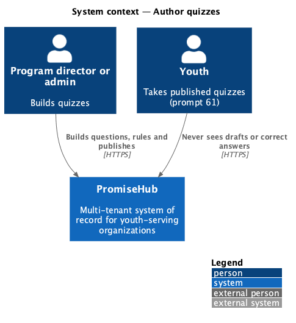
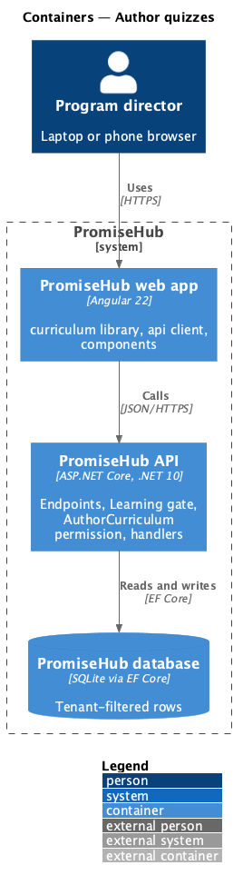
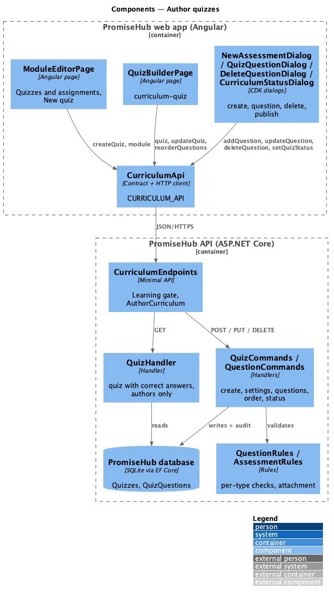
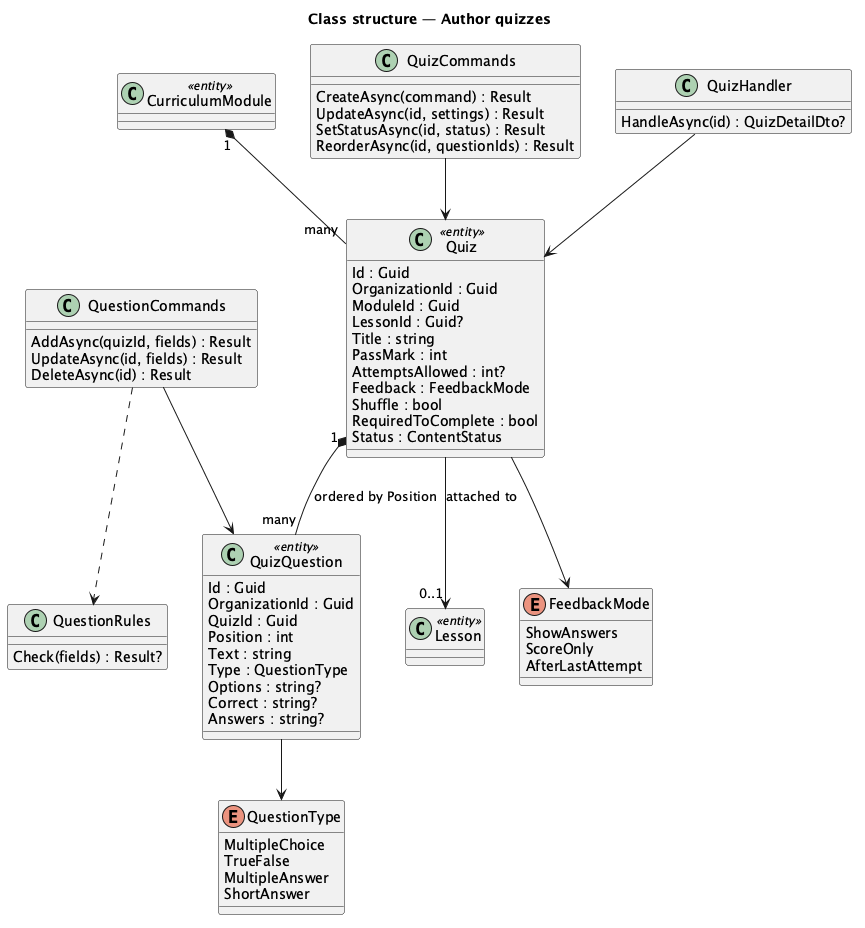
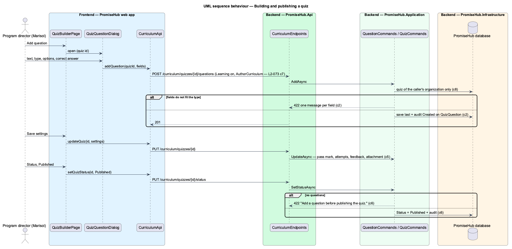

# Author quizzes

## Overview

A **quiz** checks what youth learned in a module ([author-tracks-and-modules](../author-tracks-and-modules/README.md)). It belongs to one module and is **attached** either to the whole module or to one of its lessons ([author-lessons](../author-lessons/README.md)). A quiz holds ordered **questions** of four types, each with its correct answers, and the **rules** youth take it under. Admins and program directors build quizzes in the quiz builder and publish or draft them. Taking a quiz is prompt 61.

Terms used in this document:

- **question type** — Multiple choice (2 to 6 options, one correct), True / false (one correct), Multiple answer (2 to 6 options, one or more correct) or Short answer (1 to 10 accepted answers, matched ignoring capitals and surrounding spaces)
- **pass mark** — the percentage of questions a youth answers correctly to pass, 1 to 100
- **attempts allowed** — 1 to 10, or unlimited (null); the best attempt counts (prompt 61)
- **feedback** — `ShowAnswers` (correct answers after each attempt), `ScoreOnly`, or `AfterLastAttempt`
- **attachment** — `Quiz.LessonId`: null for the whole module, or a live lesson of the same module

Ported from Waypoint `curriculum-authoring/author-quizzes` (`L2-CURRIC-003`), with tenancy, the Learning gate and PromiseHub types. Decisions are recorded in ADR 0054.

## Description

Frontend (`frontend/projects/curriculum/`):

- **`ModuleEditorPage`** — the Quizzes and assignments card lists the module's quizzes and assignments with their attachment, status and size; New quiz opens **`NewAssessmentDialog`** (`new-assessment`, kind quiz), which creates the quiz and opens the builder.
- **`QuizBuilderPage`** (`/curriculum/quizzes/:quizId`, mock `curriculum-quiz`) — the Questions card (`ph-list` rows with the question, its type and correct answers in the meta, and Edit, Move up, Move down and Delete icon buttons) and the Settings form (`ph-text-field`, `ph-select` for attachment, pass mark and attempts, `ph-radio-group` for feedback, two `ph-switch`). Add question and Edit open **`QuizQuestionDialog`** (`quiz-question`); Delete opens **`DeleteQuestionDialog`** (`delete-question`); Status opens **`CurriculumStatusDialog`** with kind `quiz`.

API client (`CURRICULUM_API`): `createQuiz()`, `quiz()`, `updateQuiz()`, `setQuizStatus()`, `addQuestion()`, `updateQuestion()`, `deleteQuestion()`, `reorderQuestions()`; contracts `QuizDetail`, `QuizSettings`, `QuizQuestion`, `QuestionFields`, `QuestionType`, `FeedbackMode`, `AssessmentSummary`, `LessonRef`.

Backend:

- **`CurriculumEndpoints`** — `POST /curriculum/quizzes`, `GET /curriculum/quizzes/{id}`, `PUT /curriculum/quizzes/{id}`, `PUT /curriculum/quizzes/{id}/status`, `POST /curriculum/quizzes/{id}/questions`, `PUT /curriculum/quizzes/{id}/question-order`, `PUT /curriculum/quiz-questions/{id}`, `DELETE /curriculum/quiz-questions/{id}`, all under `RequireModule(Learning)` and `RequirePermission(AuthorCurriculum)`.
- **`QuizCommands`** — create (Draft with the defaults 70%, 2 attempts, `ShowAnswers`), update settings, status (publishing needs a question), and reorder (the full list of question ids, each once).
- **`QuestionCommands`** — add (placed last, at most 50), update in place, delete (the later questions move up); **`QuestionRules`** checks text, type, options, marks and accepted answers per type and normalises them (True / false always stores the options True and False).
- **`QuizHandler`** — one quiz with its module, track, settings, ordered questions with correct answers, the module's live lessons for the attachment choice and the programs that follow the track.
- **`AssessmentRules`** — the shared attachment check: a lesson id must be a live lesson of the same module.
- Domain (`PromiseHub.Domain/Curriculum/`): **`Quiz`**, **`QuizQuestion`**, **`QuestionType`**, **`FeedbackMode`**, all tenant-owned. Options and accepted answers are stored as newline-separated text and correct options as comma-separated indexes.
- **`ModuleHandler`** adds the module's quizzes (`AssessmentSummaryDto`) to the module editor; **`LessonCommands.DeleteAsync`** moves a deleted lesson's quizzes to the whole module.
- Every write is audited on `Quiz` or `QuizQuestion` in the same unit of work.

Visibility to youth: a quiz reaches youth only while it, its module and its track are `Published` and the youth's program follows the track. Correct answers are returned only by `/curriculum` endpoints, which answer every role without `AuthorCurriculum` 403.

Open questions: deleting a whole quiz, locking a quiz once youth have attempted it, and question banks are deferred.

## Built so far

<TO SUPPLY> after implementation.

## Requirements

| L2 ID | Refines (L1) | Requirement |
|-------|--------------|-------------|
| `L2-073` | `L1-023` | An admin or program director builds a module's quiz: its questions of four types with their correct answers, the rules youth take it under, where it sits in the module, and whether it is published. |

## Diagrams

### System context

### Containers

### Components

The quiz builder and its dialogs call the curriculum API client; the endpoints gate on Learning and `AuthorCurriculum` before the handlers validate, save and audit.

### Class structure

A module owns its quizzes; a quiz owns its ordered questions and may point at one lesson of the module.

### Behaviour — building and publishing a quiz

