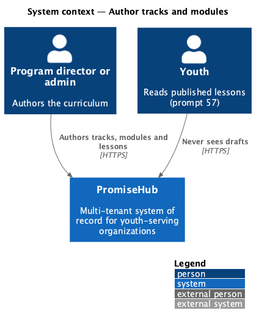
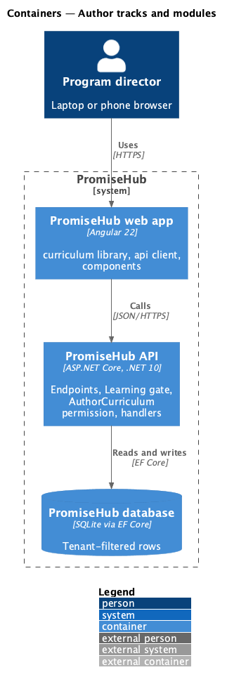
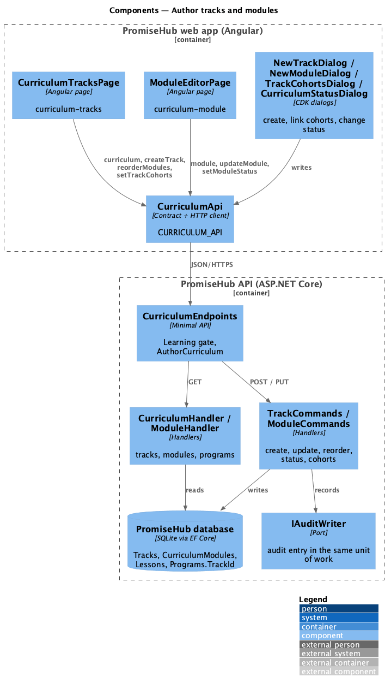
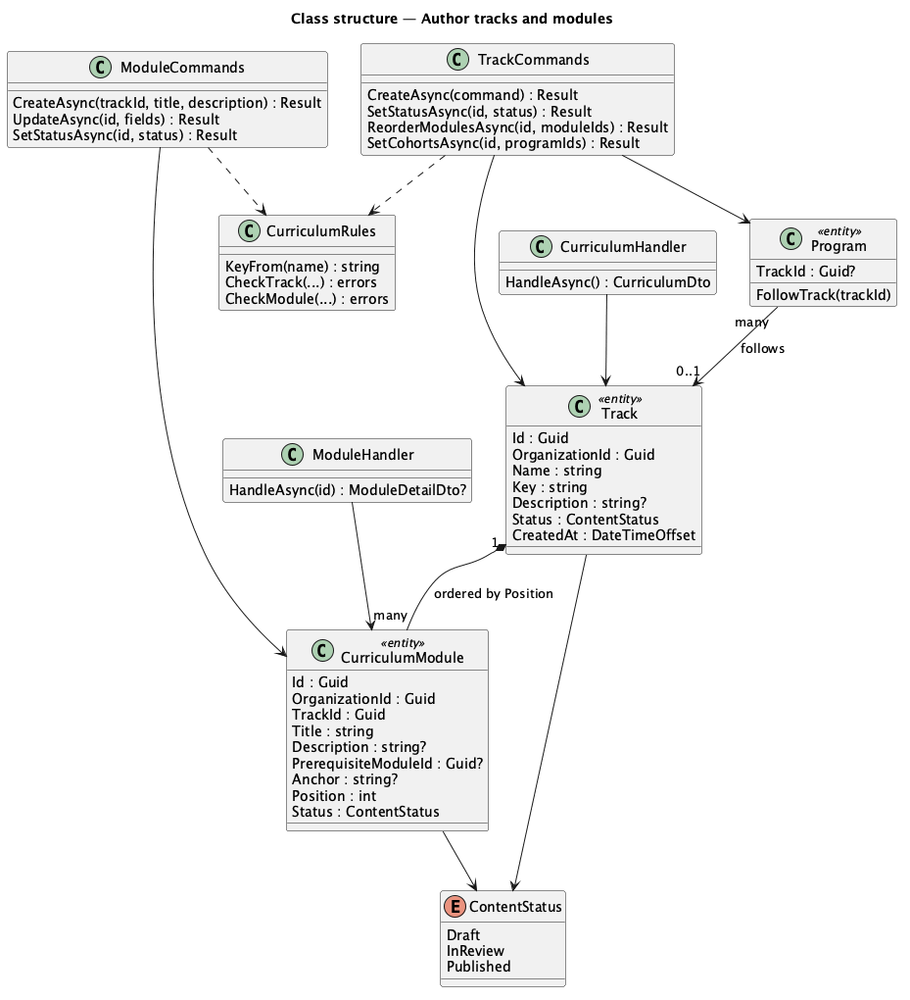
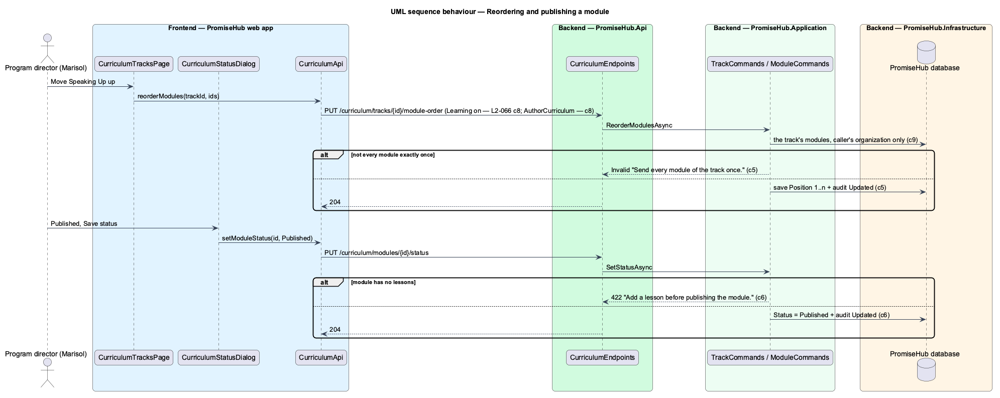

# Author tracks and modules

## Overview

Curriculum is the authoring side of the **Learning** module (ADR 0043, `L1-023`). A **track** is a pathway youth follow, such as Leadership Foundations; it holds **modules** in a fixed order, and each module holds lessons ([author-lessons](../author-lessons/README.md)). Admins and program directors build tracks and modules, move them through a draft, review and publish lifecycle, and choose which cohorts follow each track. In PromiseHub a cohort is a program (ADR 0043), so a track is linked to programs, and a program follows at most one track (ADR 0050).

Terms used in this document:

- **track key** — a short lowercase identifier (`leadership`) used in reports; unique within the organization and made from the name when left blank
- **status** — `Draft` (authors only), `InReview` (modules only: ready for another author to check) or `Published`
- **position** — a module's place in its track, 1 to n, which is the order youth see
- **follows** — a program follows a track when `Program.TrackId` names it; its youth read the track's published content (prompt 57)

Ported from Waypoint `curriculum-authoring/author-tracks-and-modules` (`L2-CURRIC-001`), with tenancy, the Learning module gate and PromiseHub types. Waypoint's scripture anchor is the module's optional **anchor passage**, and drag-to-reorder is Move up and Move down.

## Description

Frontend (`frontend/projects/curriculum/`):

- **`CurriculumTracksPage`** (`/curriculum`, mock `curriculum-tracks`) — three `ph-stat` numbers, one `ph-card` per track with its status `ph-badge`, description, key and the programs that follow it, its modules as numbered `ph-list-item` links with Move up and Move down icon buttons, and the Cohorts, Status and New module buttons. Empty, error and forbidden states use `ph-empty-state`.
- **`ModuleEditorPage`** (`/curriculum/modules/:id`, mock `curriculum-module`) — the Details form (name, description, prerequisite `ph-select` of earlier modules, anchor passage), the Lessons card and the Visibility card naming the programs that follow the track.
- Dialogs, each a CDK dialog opened with `PhDialogs`: **`NewTrackDialog`** (`new-track`), **`NewModuleDialog`** (`new-module`, opens the module editor on success), **`TrackCohortsDialog`** (`track-cohorts`, a `ph-checkbox-group` of active programs) and **`CurriculumStatusDialog`** (`curriculum-status`, a `ph-radio-group` of the statuses the item allows, shared with lessons).

API client (`frontend/projects/api/src/lib/curriculum/`): **`CurriculumApi`** behind `CURRICULUM_API` with `curriculum()`, `createTrack()`, `setTrackStatus()`, `reorderModules()`, `setTrackCohorts()`, `createModule()`, `module()`, `updateModule()` and `setModuleStatus()`; contracts `Curriculum`, `CurriculumTrack`, `CurriculumModuleSummary`, `CurriculumProgram`, `ModuleDetail`, `ModuleFields`, `ContentStatus`.

Backend:

- **`CurriculumEndpoints`** (`PromiseHub.Api`) — a `/curriculum` group with `RequireModule(Learning)` and `RequirePermission(AuthorCurriculum)`: `GET /curriculum`, `POST /curriculum/tracks`, `PUT /curriculum/tracks/{id}/status`, `PUT /curriculum/tracks/{id}/module-order`, `PUT /curriculum/tracks/{id}/cohorts`, `POST /curriculum/modules`, `GET /curriculum/modules/{id}`, `PUT /curriculum/modules/{id}`, `PUT /curriculum/modules/{id}/status`.
- **`CurriculumHandler`** — every track with its modules in position order (lesson counts exclude deleted lessons), the programs following each, and the organization's active programs with the track each follows.
- **`TrackCommands`** — create (key from the name when blank, unique per organization), status, module order (the full list of the track's module ids, each once) and cohorts (active programs of the organization only; a program chosen here leaves its former track; programs not chosen stop following).
- **`ModuleCommands`** — create (placed last, Draft), update (prerequisite must be an earlier module of the same track), status (publishing needs at least one lesson).
- **`ModuleHandler`** — one module with its lessons in order, its track, the earlier modules for the prerequisite choice and the programs following its track.
- **`CurriculumRules`** — lengths and messages: name 80, key 40 and `^[a-z0-9]+(-[a-z0-9]+)*$`, description 500 (track) or 1,000 (module), anchor 500.
- Domain (`PromiseHub.Domain/Curriculum/`): **`Track`**, **`CurriculumModule`**, **`ContentStatus`**; `Program.TrackId` (`PromiseHub.Domain/Programs/`). All tenant-owned and filtered by the query filter (ADR 0002). Migration `Curriculum`.
- Every write is audited (`Created`, `Updated` with before and after) in the same unit of work.

Open questions: Waypoint's export of a track, archiving a track and track-level prerequisites are deferred. A program follows one track; several tracks per cohort waits for a need.

## Built so far

Prompt 56 delivered everything above. Acceptance tests: `backend/tests/PromiseHub.Api.Tests/CurriculumTracksTests.cs`, `e2e/tests/curriculum/curriculum-tracks.spec.ts`.

## Requirements

| L2 ID | Refines (L1) | Requirement |
|-------|--------------|-------------|
| `L2-066` | `L1-023` | An admin or program director builds the organization's tracks, each an ordered list of modules, moves them through draft, review and publish, and chooses which cohorts follow each track. Nothing unpublished reaches youth. |
| `L2-012` | `L1-005` | Programs and events (a cohort is a program; a program follows at most one track). |
| `L2-007` | `L1-003` | Role-based authorization on the server (criterion 12: only admins and program directors author). |

## Diagrams

### System context

Authors build the curriculum; youth only ever read what is published.

### Containers

The web app calls the API, which checks the Learning module and the author permission on every request.

### Components

Pages and dialogs in the curriculum library call one API client; the endpoints dispatch to read handlers and command handlers that audit every write.

### Class structure

A track owns its ordered modules; programs follow at most one track.

### Behaviour — reordering and publishing a module

The order is saved as a whole list; publishing refuses an empty module.

