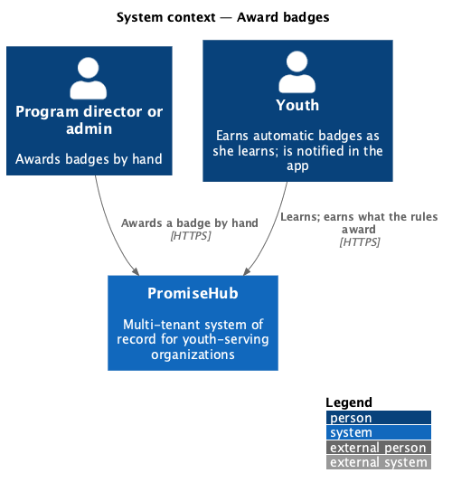
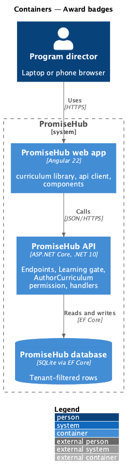
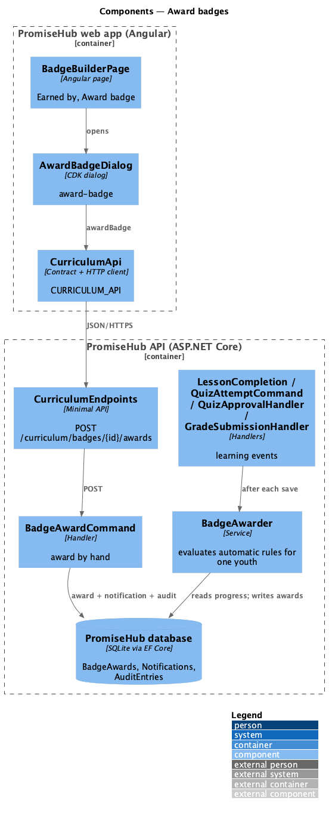
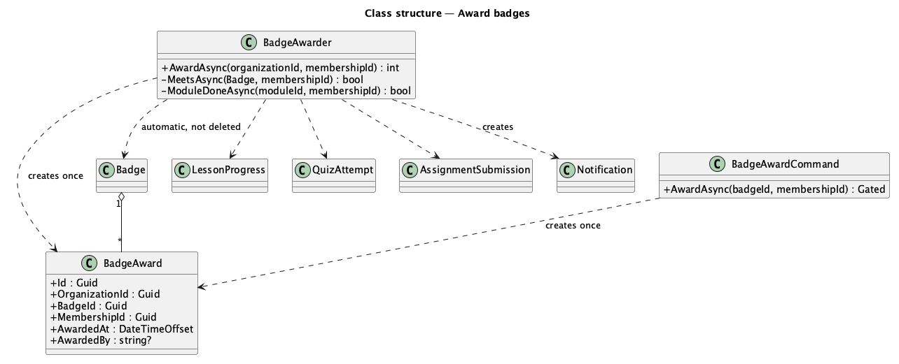
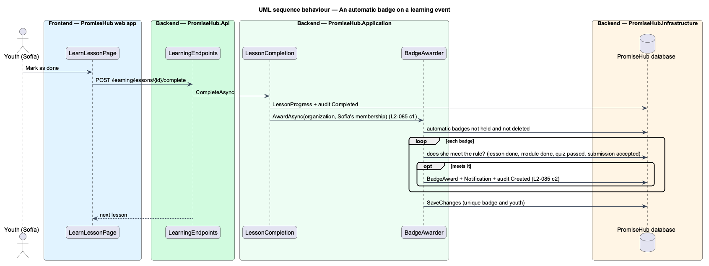
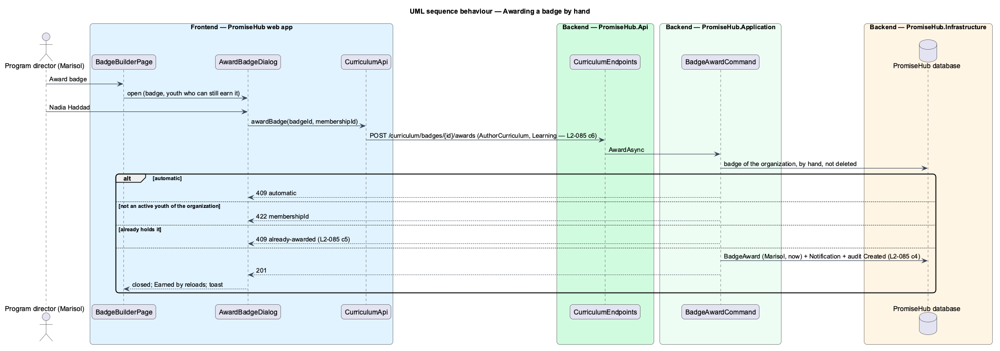

# Award badges

## Overview

Badges ([author-badges](../author-badges/README.md)) reach youth in two ways. An **automatic** badge is awarded by the server when a **learning event** shows that the youth meets its rule. A badge **by hand** is awarded by a program director from the badge builder. Either way a youth holds a badge at most once, is told in the app, and the award is audited.

Terms used in this document:

- **learning event** — a lesson completed (reading, scripture, a finished coding checklist or a project), a quiz attempt scored, a quiz result approved by a mentor (one at a time or all at once), or an assignment submission accepted
- **award** — a `BadgeAward` row: the badge, the youth's membership, when, and who awarded it (null for automatic)
- **module done** — every published lesson of the published module is done and every required published quiz of it is passed, as the youth's module page counts it (ADR 0051, ADR 0055)

Ported from Waypoint `curriculum-authoring/award-badges` and `QuizBadgeAwarder` (`L2-CURRIC-005`), with tenancy and PromiseHub types. Decisions are recorded in ADR 0058.

## Description

Frontend (`frontend/projects/curriculum/`):

- **`BadgeBuilderPage`** — the Earned by card lists who holds the badge, when and how (Automatically, or Awarded by and the name); a badge by hand offers Award badge, which opens **`AwardBadgeDialog`** (`award-badge`) with the youth who can still be awarded it (`ph-select`). The dialog shows the field error for 422 and the already-awarded conflict, and an alert when the call fails.

API client (`CURRICULUM_API`): `awardBadge()`; `BadgeDetail` carries `awards` and `youth`.

Backend:

- **`BadgeAwarder`** (`PromiseHub.Application/Curriculum/`) — `AwardAsync(membershipId)` loads the organization's automatic badges that are not deleted and that the youth does not hold, checks each rule against her `LessonProgress`, scored `QuizAttempt` rows and `AssignmentSubmission` rows, and adds a `BadgeAward`, a `Notification` ("You earned the First Steps badge.", linking to `/learning`) and an audit entry for each one she meets, then saves. A unique index on badge and membership keeps an award single even in a race; a conflict on save is ignored.
- Callers, each after its own save: **`LessonCompletion.RecordAsync`**, **`QuizAttemptCommand.SubmitAsync`**, **`QuizApprovalHandler`** (approve one, approve all) and **`GradeSubmissionHandler`** (approve).
- **`BadgeAwardCommand`** — `POST /curriculum/badges/{id}/awards`: by-hand badges only (409 `automatic`), an active youth membership of the organization (422), not already held (409 `already-awarded`); records the program director's name, notifies the youth and audits Created.
- Domain: **`BadgeAward`** (`PromiseHub.Domain/Curriculum/`), tenant-owned.

Open questions: a mentor awarding by hand (Waypoint allows it) is deferred; push and email for a new badge wait for prompt 75; an award is never revoked.

## Built so far

Not yet built.

## Requirements

| L2 ID | Refines (L1) | Requirement |
|-------|--------------|-------------|
| `L2-085` | `L1-023` | The server awards an automatic badge exactly once when a youth meets its rule, and a program director awards a badge by hand. |

## Diagrams

### System context

### Containers

### Components

The learning handlers hand each event to `BadgeAwarder` after they save; the award dialog calls the award endpoint.

### Class structure

The awarder reads the youth's progress records and writes awards and notifications; a badge keeps its awards.

### Behaviour — an automatic badge on a learning event

### Behaviour — awarding a badge by hand

