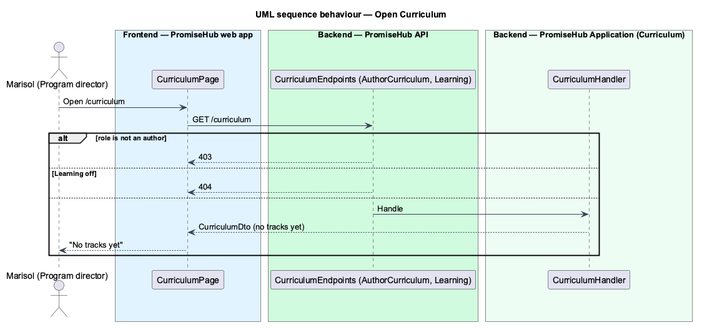

# Open curriculum

## Overview

The first slice of curriculum authoring in the **Learning** module (`L1-023`). Admins and program directors open Curriculum from the More menu while Learning is on; before any track is written the page says so. The server proves the gate and the author-only permission every later authoring endpoint follows.

## Description

- **`CurriculumHandler`** (`PromiseHub.Application/Curriculum/`) returns `CurriculumDto(tracks)`; prompt 56 filled it ([author-tracks-and-modules](../author-tracks-and-modules/README.md)).
- **`GET /curriculum`** (`CurriculumEndpoints`) requires `Permission.AuthorCurriculum` (Admin, Program director) and `RequireModule(ModuleId.Learning)`.
- **`CURRICULUM_API`** with `HttpCurriculumApi.tracks()`.
- **`CurriculumPage`** (`frontend/projects/curriculum/`) was the placeholder; prompt 56 replaced it with `CurriculumTracksPage` (`curriculum-tracks`), loaded by `moduleRoute('curriculum', 'Learning', …)` and listed in More for authors.

## Requirements

| L2 ID | Refines (L1) | Requirement |
|-------|--------------|-------------|
| `L2-005` | `L1-002` | A module that is off is neither served nor rendered. |
| `L2-007` | `L1-003` | Permissions are enforced per endpoint and per field by role; the UI reflects them but never substitutes for them. |

## Diagrams

### Behaviour — open Curriculum

Only authors pass; the gate answers 404 while Learning is off (`L2-007` criterion 12, `L2-005` criterion 6).

