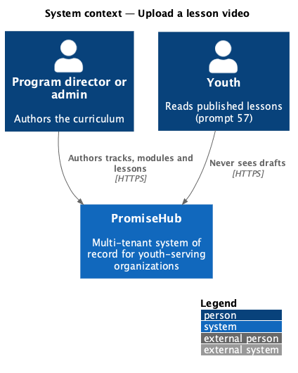
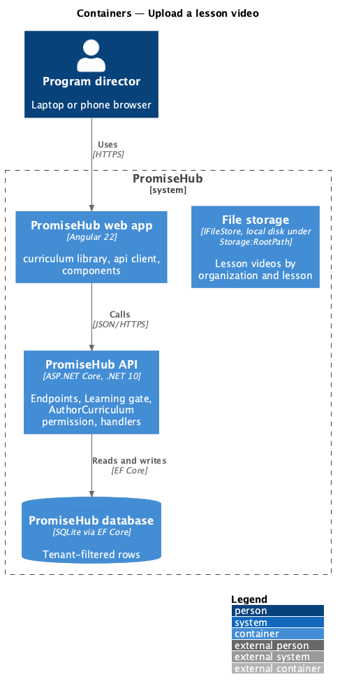
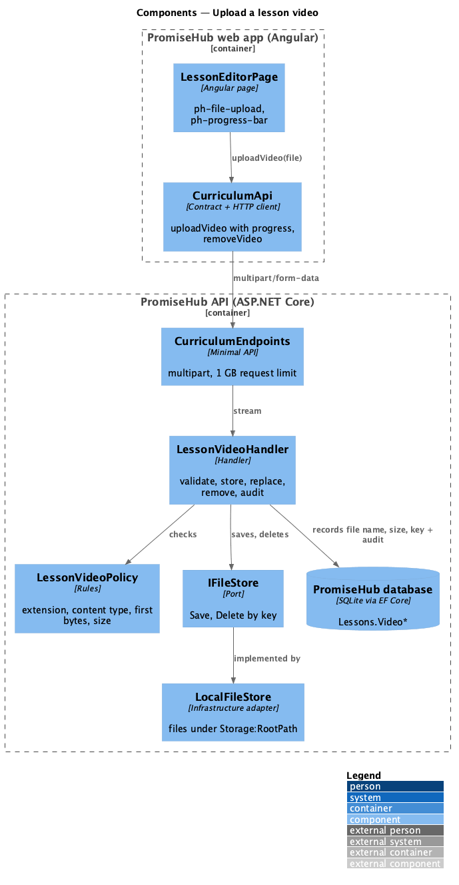
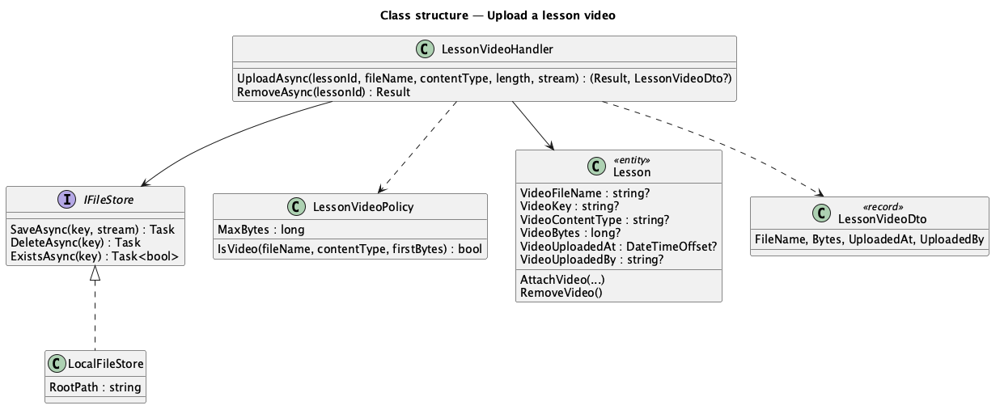
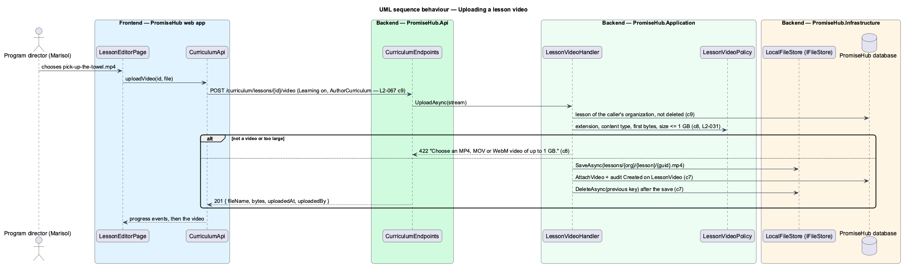

# Upload a lesson video

## Overview

A lesson may carry one **lesson video** that youth watch with the teaching content. The author chooses the file in the lesson editor; the browser sends it in one multipart request with upload progress; the API checks it is a real video of an accepted type and size, stores it through PromiseHub **file storage** and records it on the lesson. Choosing another video replaces the first; Remove deletes it.

Terms used in this document:

- **file storage** — the `IFileStore` port in `PromiseHub.Application`; `LocalFileStore` in `PromiseHub.Infrastructure/Storage/` writes under `Storage:RootPath`; tests use an in-memory fake
- **storage key** — `lessons/{organizationId}/{lessonId}/{guid}{extension}`; never derived from the uploaded file name, so a name cannot escape the folder
- **signature** — the first bytes of the file: `ftyp` at offset 4 for MP4 and MOV, `1A 45 DF A3` for WebM

Ported from Waypoint `curriculum-authoring/upload-lesson-video` (`L2-CURRIC-002` criteria 2, 6 and 7). Waypoint's resumable chunked upload, `ffmpeg` transcoding into an HLS ladder and the Queued, Processing and Failed states are deferred (ADR 0050); the video is stored as uploaded.

## Description

Frontend:

- **`LessonEditorPage`** — the Video card shows `ph-file-upload` (accept `video/mp4,video/quicktime,video/webm`) with no video, `ph-progress-bar` while uploading, the attached video as a `ph-list-item` with Remove, and `ph-alert` for a refused file ("That file isn’t a video we can use") or a failed upload ("The upload didn’t finish").
- **`CurriculumApi.uploadVideo(lessonId, file)`** — `HttpClient` with `reportProgress` and `observe: 'events'`, mapped to `{ status: 'progress', percent }` then the saved outcome; **`removeVideo(lessonId)`**.

Backend:

- **`CurriculumEndpoints`** — `POST /curriculum/lessons/{id}/video` reads the multipart form with a request limit of 1 GB plus form overhead (`RequestSizeLimit` and `FormOptions.MultipartBodyLengthLimit` on that endpoint only) and passes the file stream; `DELETE /curriculum/lessons/{id}/video`. Both under the Learning gate and `AuthorCurriculum`, with antiforgery disabled as for roster import.
- **`LessonVideoPolicy`** — accepts `.mp4`, `.mov`, `.webm` with a matching `video/*` content type and signature, of 1 byte to `Lessons:MaxVideoBytes` (default 1 GB).
- **`LessonVideoHandler`** — finds the live lesson of the caller's organization (404 otherwise, before any file is touched), checks the policy (422 "Choose an MP4, MOV or WebM video of up to 1 GB."), saves the stream under a new key, records file name, content type, size, time and uploader on the lesson, audits `Created` on `LessonVideo`, saves, then deletes the previous file; Remove clears the fields, audits `Deleted` on `LessonVideo` and deletes the file.
- **`IFileStore`** (`SaveAsync`, `DeleteAsync`, `ExistsAsync`) and **`LocalFileStore`**, registered in `Infrastructure/DependencyInjection.cs`; `Storage:RootPath` defaults to `App_Data/files` beside the API.

Security (`L2-031`): the file name is only displayed, never used as a path; nothing is served back from this slice; youth and mentors receive 403 from every endpoint here. Streaming the video to youth is prompt 57.

Open questions: chunked resumable upload, transcoding, a poster image and the duration are deferred (ADR 0050). Object storage in a hosted deployment is `<TO SUPPLY>`; it replaces `LocalFileStore` behind the same port.

## Built so far

Prompt 56 delivered everything above. Acceptance tests: `backend/tests/PromiseHub.Api.Tests/LessonVideoTests.cs`, `e2e/tests/curriculum/lesson-video.spec.ts`.

## Requirements

| L2 ID | Refines (L1) | Requirement |
|-------|--------------|-------------|
| `L2-067` | `L1-023` | An admin or program director writes each lesson of a module: its title, reading, estimated time, objectives, teaching content, reflection prompts and leader guide notes for staff and mentors, attaches one lesson video, publishes or drafts it, and deletes it without losing youth progress. |
| `L2-031` | `L1-016` | Transport, storage and application security (uploads validated for type, size and content; never served as executable content). |

## Diagrams

### System context

### Containers

The API writes the file through file storage and records it in the database.

### Components

### Class structure

### Behaviour — uploading a lesson video

The lesson is found before any file is touched; the old file is deleted only after the new one is recorded.

