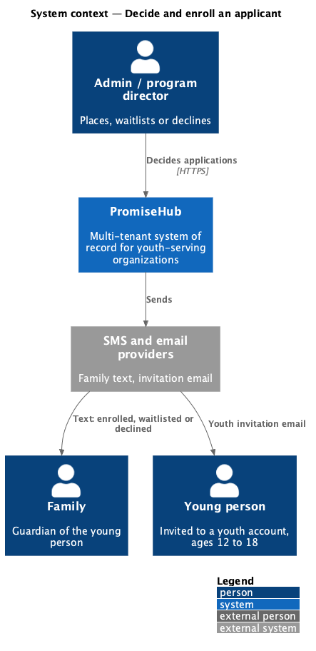
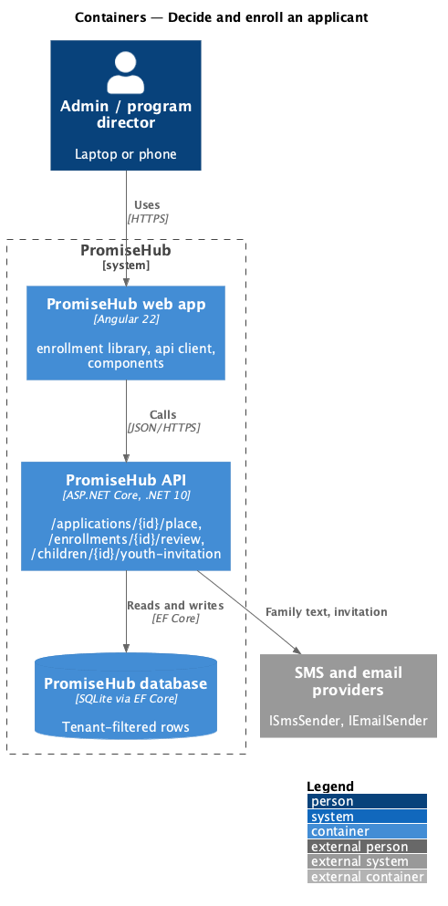
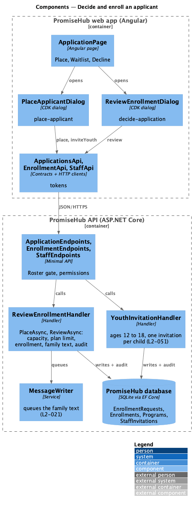
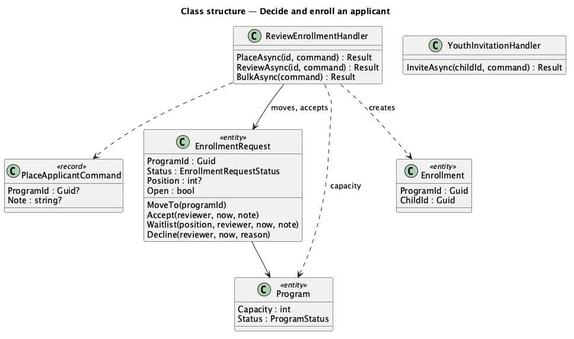
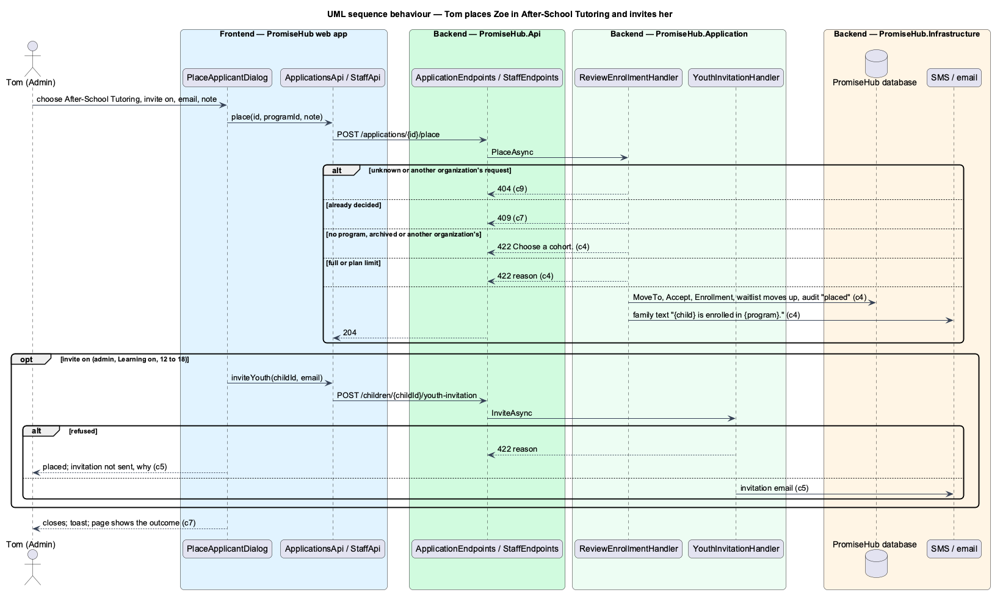

# Decide and enroll an applicant

## Overview

Once an application has been read (see [review an application](../review-application/README.md)), an admin or program director decides it. **Placing** accepts the young person into a **cohort**, which in PromiseHub is a program (ADR 0043): the child joins that program's roster and the family is texted. Placing can also offer the young person a **youth invitation** so they can sign in to Learning. **Waitlisting** and **declining** work exactly as on the roster review (L2-013), with a message the family reads.

Terms used in this document:

- **place** — accept an open enrollment request into a program chosen at that moment, which may differ from the one applied for
- **cohort** — a program that is not archived, with its places taken and its capacity
- **youth invitation** — the staff invitation with the Youth role linked to the child (ADR 0045, L2-051)
- **open** — a request that is Waiting review or Waitlisted; only open requests can be decided

Ported from Waypoint `application-intake/decide-and-enroll-applicant` (`L2-INTAKE-002` criteria 1, 3, 4 and 5). Waypoint provisions a youth user and requires a mentor on approval; PromiseHub creates the household and child at submission (ADR 0052), enrolls the child on placement, offers the existing youth invitation, and assigns mentors from the cohort's roster (ADR 0048, ADR 0053).

## Description

Frontend (`frontend/projects/enrollment/`):

- **`ApplicationPage`** — Place, Waitlist and Decline `ph-button`s while the request is open; after a decision it reloads and shows the outcome.
- **`PlaceApplicantDialog`** (mock `place-applicant`) — a CDK dialog: `ph-radio-group` of the organization's programs that are not archived (`PROGRAMS_API.list()`), each with its places, the one applied for preselected and a full one disabled; while Learning is on, for an admin and an applicant aged 12 to 18, a `ph-switch` "Invite {first} to PromiseHub as a youth" with a `ph-text-field` for the email; `ph-textarea` for the note to the family. Submitting calls `APPLICATIONS_API.place`; a 422 shows its reason in a `ph-alert`. After a placement, an invitation goes through `STAFF_API`'s youth invitation; if it is refused the dialog says the placement stands and why (`place-applicant/invite-failed`).
- **`ReviewEnrollmentDialog`** (mock `decide-application`) — the roster's dialog, given only Waitlist and Decline, posts `ENROLLMENT_API.review`.

Backend:

- **`ApplicationEndpoints`** — `POST /applications/{id}/place` with `PlaceApplicantCommand(ProgramId, Note)`, under Roster and `ReviewEnrollments`.
- **`ReviewEnrollmentHandler`** (`PromiseHub.Application/Enrollment/`) gains `PlaceAsync(id, command)`: the request must exist in the tenant (404) and be open (409); the program must exist in the tenant and not be archived (422 "Choose a cohort."); a waitlisted request leaving its program frees its place (`EnrollmentRequest.MoveTo(programId)` clears the position and moves those behind up); then the shared accept path checks the plan limit and capacity (422 with the reason), adds the `Enrollment`, texts the family "{child} is enrolled in {program}." with the note and a household link, and audits Updated on `EnrollmentRequest` ending "placed".
- Waitlist and decline stay `POST /enrollments/{id}/review` (L2-013).
- Domain: **`EnrollmentRequest.MoveTo(Guid programId)`**.
- Tenancy: every lookup goes through the tenant query filter, so another organization's request or program is not found; the family is resolved from the request's own household.

## Built so far

Prompt 59 delivered everything above in two slices: placing with the optional youth invitation (`POST /applications/{id}/place`, `PlaceApplicantDialog`), and waitlisting or declining from the application with the decided outcome. Acceptance tests: `backend/tests/PromiseHub.Api.Tests/ApplicationReviewTests.cs`, `e2e/tests/enrollment/place.spec.ts` and `e2e/tests/enrollment/decide.spec.ts`. Choosing a mentor at placement and merging a new household into an existing family are deferred (ADR 0053).

## Requirements

| L2 ID | Refines (L1) | Requirement |
|-------|--------------|-------------|
| `L2-072` | `L1-005` | An admin or program director works the organization's applications in one place: filters them by status, opens one to read who applied, why, the referrer and the family, keeps staff-only notes, and places the young person into a cohort (optionally inviting them to a youth account), waitlists them or declines with a message to the family. |
| `L2-013` | `L1-005` | Staff open enrollment and share one link; guardians confirm or enter household details; staff accept or waitlist. |
| `L2-012` | `L1-005` | Programs and events: capacity, archived programs and rosters. |
| `L2-021` | `L1-010` | Composing and sending messages: the family text goes through the message pipeline. |
| `L2-051` | `L1-003` | Youth accounts are invited from the child record with the Youth role. |

## Diagrams

### System context

The admin places the young person; PromiseHub texts the family and, when asked, emails the youth invitation.

### Containers

Placement and the invitation are two calls to the API; the message pipeline sends the family text.

### Components

Placement reuses the review handler's accept path; the invitation reuses the youth invitation handler.

### Class structure

The command names the program; the request moves to it before it is accepted.

### Behaviour — Tom places Zoe in After‑School Tutoring and invites her

