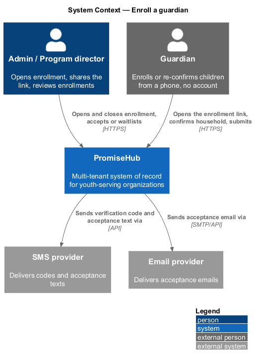
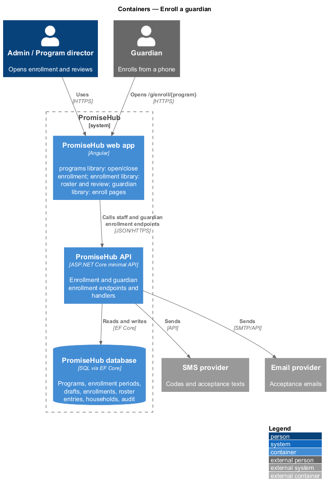
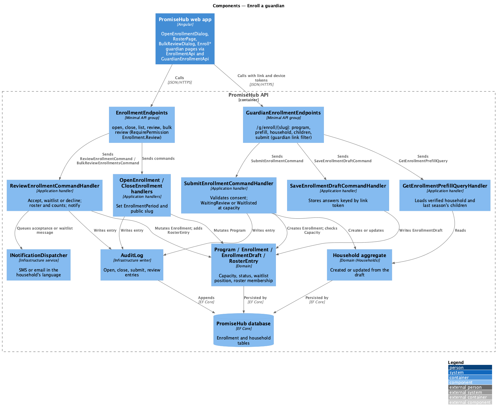
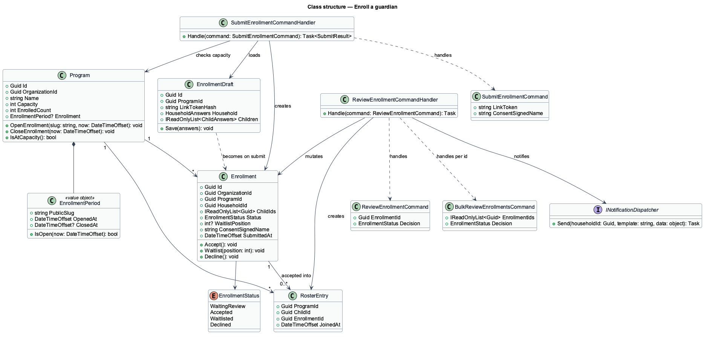
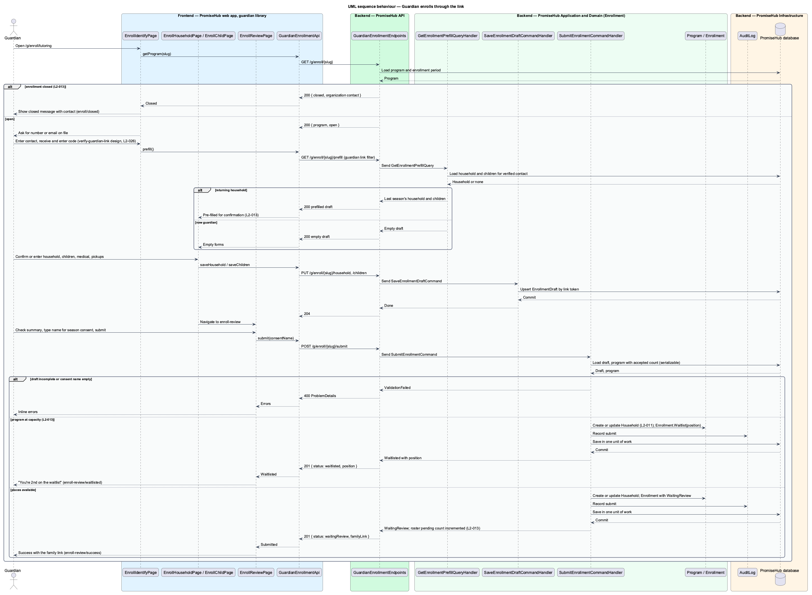
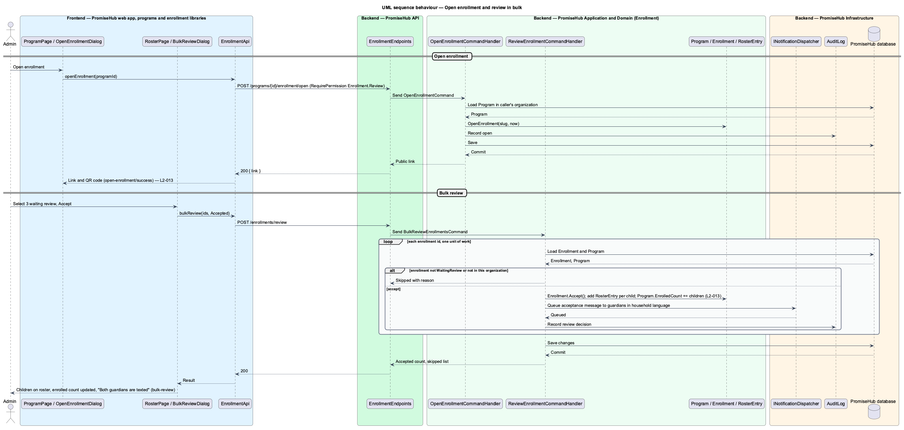

# Enroll a guardian

## Overview

PromiseHub lets a youth-serving organization fill a program roster without paper forms or guardian accounts. Staff open enrollment on a program and share one link; guardians open the link on a phone, confirm or enter their household details, and submit; staff then accept or waitlist each enrollment and the roster is live for slips and attendance. This feature covers that whole cycle: the staff dialogs `open-enrollment` and `close-enrollment`, the guardian pages `enroll`, `enroll-household`, `enroll-child` and `enroll-review`, and the staff review on `roster` with the `review-enrollment` and `bulk-review` dialogs.

A returning guardian who verifies with a code sees last season's household and children pre-filled for confirmation. A new guardian completes household, children, medical details, pickups and a review step with a typed-name season consent; the enrollment is then "waiting review" and the roster's pending count increments. When the program is at capacity, the submission is waitlisted and the guardian sees the waitlist position. Accepting enrollments, singly or in bulk, adds the children to the roster, notifies the guardians and updates the program's enrolled count. A closed enrollment link shows the closed message with the organization's contact.

Code verification of the guardian's device belongs to the verify-guardian-link design and is cited here as a step. Localization of the guardian pages belongs to the localize-guardian-pages design.

Terms used in this document:

- **enrollment period** — interval during which a program accepts enrollments through its shared link
- **enrollment link** — public URL for one program, shown as a link and as a QR code, that leads to the guardian enrollment pages
- **enrollment** — request from one household to place one or more children in one program, with a status of waiting review, accepted, waitlisted or declined
- **waitlist position** — one-based rank of a waitlisted enrollment within a program, ordered by submission time
- **season consent** — typed-name signature that a guardian gives once per enrollment covering the program's standard permissions

## Built so far

Slice 15 delivered `OpenEnrollmentDialog` and `CloseEnrollmentDialog` on the program page with the waiting-review count, `GuardianEnrollPage` at `/g/enroll/:slug` (identify, code, household, children with medical details, review with the season consent, waiting-review, waitlisted and closed states, in English, Spanish and French), `GUARDIAN_ENROLLMENT_API`, the program enrollment endpoints, the `/g/enroll/{slug}` endpoints, `EnrollmentSession` and `EnrollmentRequest` (ADR 0018). Staff review, bulk review, notifications and pickups are not built yet.

## Description

The feature spans the `programs`, `enrollment` and `guardian` frontend libraries and the `Enrollment` application folder.

Frontend:

- **`OpenEnrollmentDialog`**, **`CloseEnrollmentDialog`** — CDK dialogs in `frontend/projects/programs/`, opened from the program page. `OpenEnrollmentDialog` shows the link, a copy button and a QR code in its `success` state.
- **`EnrollIdentifyPage`** (`enroll`), **`EnrollHouseholdPage`**, **`EnrollChildPage`**, **`EnrollReviewPage`** — guardian pages in `frontend/projects/guardian/` for `/g/enroll/:program`. The identify page has `default`, `code` and `closed` states; the review page has `default`, `success` and `waitlisted` states. Each page has one primary action.
- **`RosterPage`**, **`ReviewEnrollmentDialog`**, **`BulkReviewDialog`** — in `frontend/projects/enrollment/`. The roster has tabs for waiting review, enrolled and waitlisted, with per-row Accept and Waitlist actions and a bulk action bar.
- **`EnrollmentApi`** — typed client in `frontend/projects/api/` behind `ENROLLMENT_API` with `openEnrollment`, `closeEnrollment`, `listPending`, `review`, `bulkReview`.
- **`GuardianEnrollmentApi`** — typed client behind `GUARDIAN_ENROLLMENT_API` with `getProgram(slug)`, `prefill()`, `saveHousehold`, `saveChildren`, `submit`. It sends the guardian link token and device token, never a staff session.

Backend:

- **`EnrollmentEndpoints`** — staff group in `PromiseHub.Api`: `POST /programs/{id}/enrollment/open`, `POST /programs/{id}/enrollment/close`, `GET /programs/{id}/enrollments?status=`, `POST /enrollments/{id}/review`, `POST /enrollments/review` (bulk). All require `Enrollment.Review`.
- **`GuardianEnrollmentEndpoints`** — anonymous group under `/g/enroll/{slug}` protected by the guardian link filter from the verify-guardian-link design: `GET`, `GET /prefill`, `PUT /household`, `PUT /children`, `POST /submit`.
- **`OpenEnrollmentCommand`**, **`CloseEnrollmentCommand`** and handlers — set the `EnrollmentPeriod` on the `Program` and generate or disable the public slug. Closing keeps enrollments waiting review.
- **`GetEnrollmentPrefillQuery` / `GetEnrollmentPrefillQueryHandler`** — loads the verified household and its children from last season into the enrollment draft.
- **`SaveEnrollmentDraftCommand` / `SaveEnrollmentDraftCommandHandler`** — stores household, children, medical and pickup answers on an `EnrollmentDraft` keyed by the link token so a guardian can return to the flow.
- **`SubmitEnrollmentCommand` / `SubmitEnrollmentCommandHandler`** — validates the draft and the season consent, creates or updates the `Household` through the household aggregate, creates the `Enrollment` with status `WaitingReview`, or `Waitlisted` with a position when the program's `Capacity` is reached by accepted enrollments. The capacity check and the position assignment run inside one transaction to avoid two guardians receiving the same position.
- **`ReviewEnrollmentCommand` / `ReviewEnrollmentCommandHandler`** — accepts, waitlists or declines one enrollment, adds children to the `ProgramRoster`, updates the enrolled count and queues a guardian notification through `INotificationDispatcher`. **`BulkReviewEnrollmentsCommand`** applies the same handler per id in one unit of work.
- **`Program`**, **`EnrollmentPeriod`**, **`Enrollment`**, **`EnrollmentDraft`**, **`RosterEntry`** — domain types in `PromiseHub.Domain/Enrollment/` and `PromiseHub.Domain/Programs/`.
- **`INotificationDispatcher`** — infrastructure service that sends the acceptance or waitlist message through the SMS or email provider in the household's language; the message text is `<TO SUPPLY>`.
- **`AuditLog`** — records open, close, submit and review actions.

The Roster module gate applies: when Roster is off for the organization, every endpoint above answers 404.

## Requirements

The feature realizes the following level-2 (L2) requirements. Each L2 requirement refines a level-1 (L1) requirement, cited by identifier.

| L2 ID | Refines (L1) | Requirement |
|-------|--------------|-------------|
| `L2-013` | `L1-005` | Staff open enrollment and share one link; guardians confirm or enter household details; staff accept or waitlist. |
| `L2-026` | `L1-013` | Guardian pages are reached by links tied to a phone number or email; a six-digit code verifies the device; no password exists. |
| `L2-011` | `L1-005` | A household holds guardians and children; each child carries medical details, school, language, notes and approved pickups; everything has an audit trail. |

## Diagrams

### System context

Staff open enrollment and review; guardians enroll from a phone through the shared link; acceptance notices go out through the SMS and email providers.

### Containers

The programs, enrollment and guardian libraries of the PromiseHub web app call the PromiseHub API, which persists enrollments and dispatches notifications.

### Components

Staff endpoints dispatch open, close and review commands; guardian endpoints dispatch prefill, draft and submit; the submit handler applies the capacity rule and the review handler updates the roster and notifies.

### Class structure

`Program` holds an `EnrollmentPeriod` and `Capacity`; `Enrollment` carries status and waitlist position; `RosterEntry` links an accepted child to the program.

### Behaviour — guardian enrolls through the link

A verified returning guardian sees pre-filled details; a new guardian enters them; submission is waiting review or waitlisted at capacity; a closed link shows the closed message (`L2-013`).

### Behaviour — staff open enrollment and review in bulk

Opening generates the link; bulk acceptance adds children to the roster, notifies guardians and updates the enrolled count (`L2-013`).

