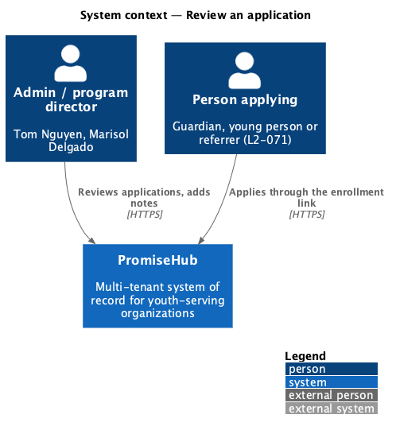
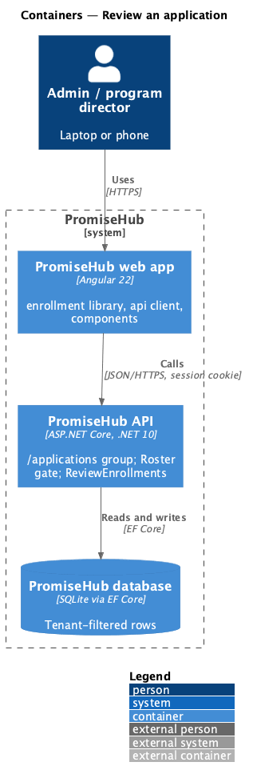
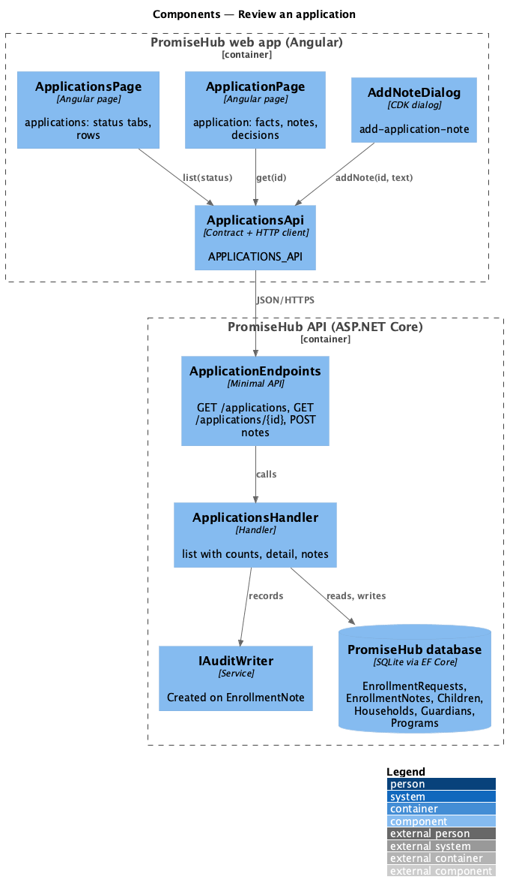
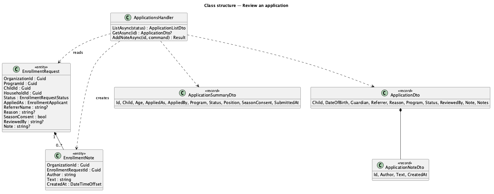
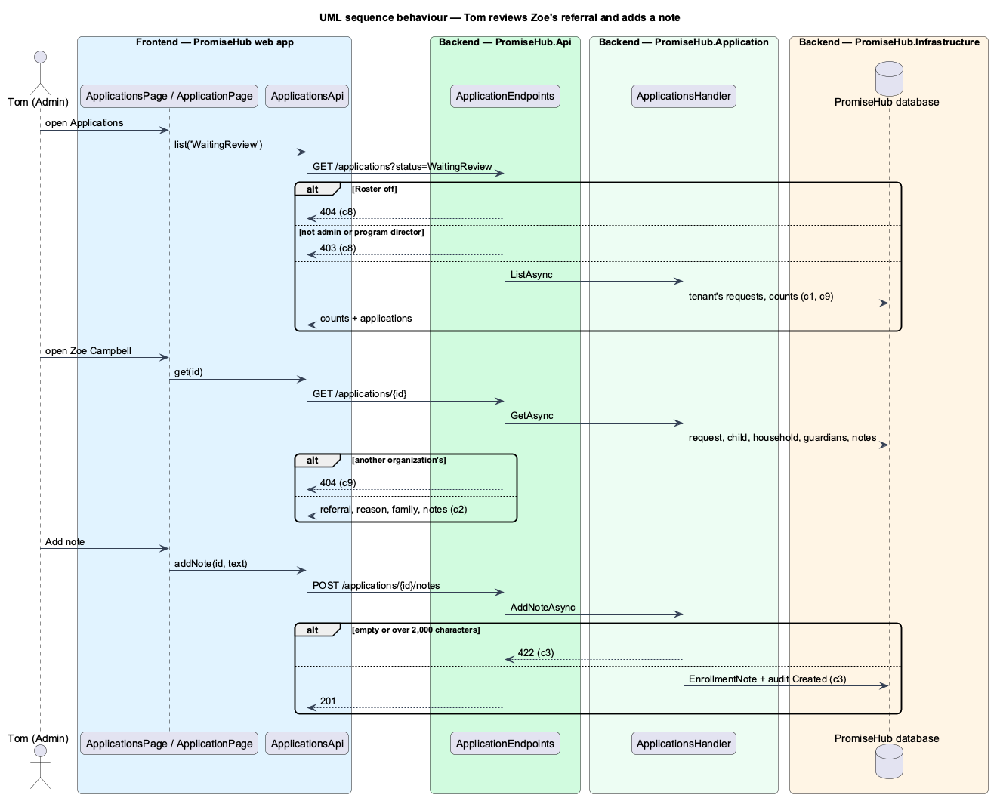

# Review an application

## Overview

An **application** is an enrollment request (ADR 0052): a guardian enrolling a child, a young person applying for themselves, or a referrer referring a young person through a program's enrollment link. Before this feature, staff saw requests one program at a time on the roster page (L2-013) and could not see who applied, why, or who referred them. This feature gives admins and program directors one **pipeline** of the organization's applications, filtered by status, and an **application page** with everything the request holds plus staff **notes**.

Terms used in this document:

- **pipeline** — the list of the organization's enrollment requests with one status at a time: Waiting review, Waitlisted, Accepted or Declined
- **who applied** — `AppliedAs` on the request: `Guardian`, `Youth` or `Referrer`
- **note** — a staff-only remark on an application with its author and time (`EnrollmentNote`)
- **season consent** — whether the consent of L2-013 was given at submission; a young person under 18 and a referral leave it to collect

Ported from Waypoint `application-intake/review-application` (`L2-INTAKE-002` criteria 1 and 2). Waypoint's New, In review and Needs consent statuses become Waiting review plus a Consent needed badge (ADR 0053). Placing, waitlisting and declining are the next feature, [decide and enroll an applicant](../decide-and-enroll-applicant/README.md).

## Description

Frontend (`frontend/projects/enrollment/`, mounted by the app at `/applications` while Roster is on):

- **`ApplicationsPage`** (`/applications`, mock `applications`) — `ph-page-header`, a `ph-tabs` tablist with the four statuses and their counts, and a `ph-list` of `ph-list-item`s linking to each application with a `ph-badge` for a referral or a missing season consent. Loading shows `ph-skeleton`, nothing waiting a `ph-empty-state`, a failure an error `ph-empty-state` with Try again, and a role without `reviewEnrollments` a `ph-error-page`.
- **`ApplicationPage`** (`/applications/:id`, mock `application`) — `ph-breadcrumb`, `ph-page-header` with the decision buttons while the request is open, titled `ph-card`s with `ph-description-list` for the young person, the referral or application, and the family, and a Notes card with `ph-timeline`. A decided application shows a `ph-alert` with who decided and what the family read.
- **`AddNoteDialog`** (mock `add-application-note`) — a CDK dialog with `ph-textarea` (count) that posts the note and closes with it.
- **`ApplicationsApi`** (`frontend/projects/api/src/lib/applications/`, token `APPLICATIONS_API`) — `list(status)`, `get(id)`, `addNote(id, text)`, `place(id, programId, note)`.
- The shell's `NAVIGATION` gains Applications (More, Roster, admins and program directors), and Today's enrollments task links to `/applications`.

Backend:

- **`ApplicationEndpoints`** (`PromiseHub.Api/Endpoints/`) — the `/applications` group with `RequireModule(Roster)` and `RequirePermission(ReviewEnrollments)`: `GET /applications?status=`, `GET /applications/{id}`, `POST /applications/{id}/notes`.
- **`ApplicationsHandler`** (`PromiseHub.Application/Enrollment/`) — `ListAsync` reads the tenant's requests with the status, their children, households, guardians and programs, counts every status, and orders Waiting review newest first, Waitlisted by program and position, decided ones by decision date; `GetAsync` answers `ApplicationDto` with `ApplicationNoteDto`s newest first; `AddNoteAsync` trims, refuses empty or over 2,000 characters (422), stores the note with `ITenantContext.ActorName` and audits Created on `EnrollmentNote`.
- **`ApplicationSummaryDto`**, **`ApplicationDto`**, **`ApplicationNoteDto`**, **`AddApplicationNoteCommand`** — one record per file.
- Domain: **`EnrollmentNote`** (`PromiseHub.Domain/Enrollment/`, `ITenantOwned`): `OrganizationId`, `EnrollmentRequestId`, `Author`, `Text`, `CreatedAt`. Migration `EnrollmentNotes` in `PromiseHub.Infrastructure/Persistence/Migrations/`.
- Tenancy: the tenant query filter on `EnrollmentRequests`, `EnrollmentNotes` and every read table makes another organization's application not found (404) and leaves it out of the list.

## Built so far

Prompt 59 delivered everything above in two slices: the pipeline with status tabs (`GET /applications`), and the application with notes (`GET /applications/{id}`, `POST /applications/{id}/notes`, migration `EnrollmentNotes`). Who applied is written "applied for themselves" for a young person, whatever their gender. Acceptance tests: `backend/tests/PromiseHub.Api.Tests/ApplicationReviewTests.cs`, `e2e/tests/enrollment/applications.spec.ts` and `e2e/tests/enrollment/application.spec.ts`.

## Requirements

| L2 ID | Refines (L1) | Requirement |
|-------|--------------|-------------|
| `L2-072` | `L1-005` | An admin or program director works the organization's applications in one place: filters them by status, opens one to read who applied, why, the referrer and the family, keeps staff-only notes, and places the young person into a cohort (optionally inviting them to a youth account), waitlists them or declines with a message to the family. |
| `L2-013` | `L1-005` | Staff open enrollment and share one link; guardians confirm or enter household details; staff accept or waitlist. |
| `L2-071` | `L1-005` | On a program's enrollment link, the person applying first says who they are: a parent or guardian, the young person applying for themselves, or someone referring a young person. |

## Diagrams

### System context

Admins and program directors review what guardians, young people and referrers submitted.

### Containers

The `/applications` group checks the Roster module and the review permission before any handler runs.

### Components

One handler serves the pipeline, the application and its notes.

### Class structure

A note belongs to one enrollment request; the DTOs carry who applied and the referrer.

### Behaviour — Tom reviews Zoe's referral and adds a note

