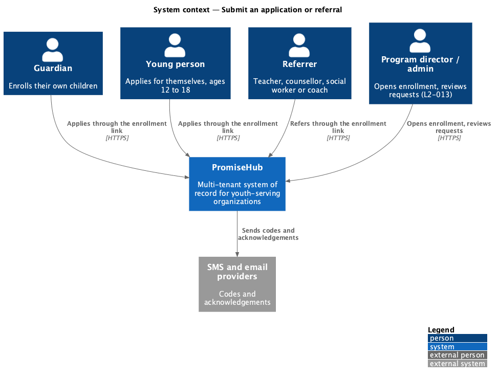
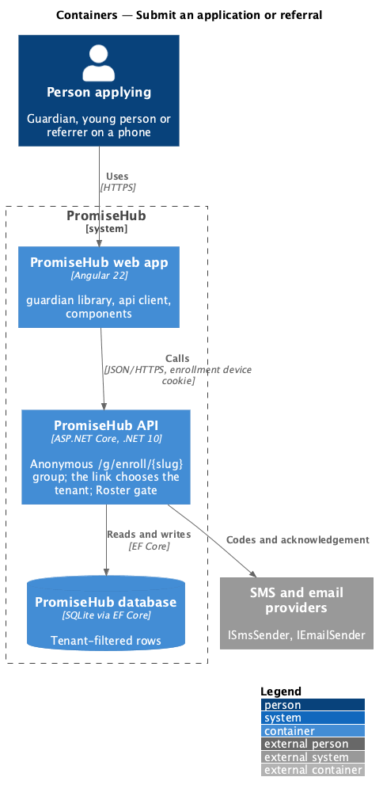
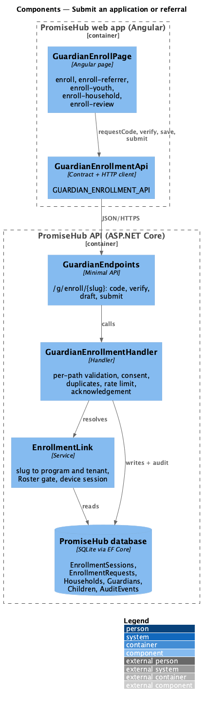
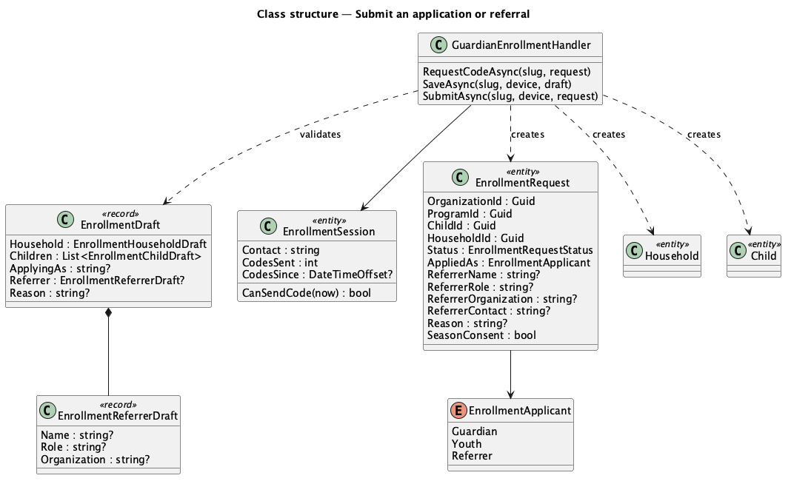
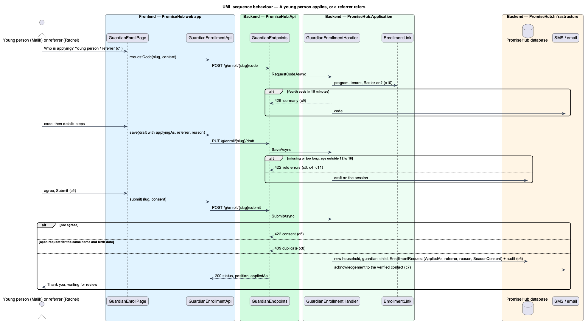

# Submit an application or referral

## Overview

A program's **enrollment link** (L2-013) is also how a young person applies for themselves and how a teacher, counsellor, social worker or coach refers one. The first screen asks **who is applying**: a parent or guardian, the young person, or a referrer. Each path verifies its own phone or email with a code (L2-026), gives the details only that path can give, agrees to what it can agree to, and submits an **enrollment request** that waits for staff review like any other. Review and placement are the next feature (prompt 59).

Terms used in this document:

- **applicant path** — who is applying: `Guardian`, `Youth` or `Referrer` (`EnrollmentApplicant`)
- **referrer** — someone outside the family who refers a young person; their name, role, organization and verified contact are kept on the request
- **reason** — why the young person is interested, or why the referrer refers them
- **season consent** — the agreement L2-013 asks of a guardian; a young person aged 18 gives it themselves, a young person under 18 and a referrer cannot
- **acknowledgement** — the one text or email to the verified contact after a submission is recorded

Ported from Waypoint `application-intake/submit-application` (`L2-INTAKE-001`). Waypoint's separate `YouthApplication` table, public form, neighbourhood, cohort and track of interest are not carried over: the program is the link that was opened, and the application is an enrollment request (ADR 0043, ADR 0052).

## Description

Frontend (`frontend/projects/guardian/`, where guardian enrollment lives since prompt 15):

- **`GuardianEnrollPage`** (`/g/enroll/:slug`) — the contact step gains `ph-radio-group` "Who is applying?" with a hint per option (`enroll`, `enroll/youth`, `enroll/referrer`). After the code, the steps depend on the path:
  - Guardian: household, children, review with the season consent (unchanged).
  - Young person: About you (`enroll-youth`: first and last name, date of birth, school, why), Your parent or guardian (`enroll-household/youth`), Check and submit (`enroll-review/youth`).
  - Referrer: About you (`enroll-referrer`: name, role, organization, the verified contact), The young person (`enroll-youth/referrer`), Their parent or guardian (`enroll-household/referrer`), Check and submit (`enroll-review/referrer`).
  - A 429 on the code shows "Too many codes" (`enroll/too-many`); a 409 duplicate on submit shows "{name} already has an application for {program}" (`enroll-review/duplicate`); the submitted state names the young person, and the guardian to be asked for consent or contacted (`enroll-review/submitted-youth`, `enroll-review/submitted-referrer`).
- Strings live in `enroll-text.ts` in English, Spanish and French (L2-027).
- **`GuardianEnrollmentApi`** (`frontend/projects/api/`, `GUARDIAN_ENROLLMENT_API`) — `EnrollmentDraft` gains `applyingAs`, `referrer` and `reason`; `requestCode` answers `too-many`; `submit` answers `duplicate` with the name; the submitted result carries `appliedAs` and `seasonConsent`.

Backend:

- **`GuardianEndpoints`** — the existing `/g/enroll/{slug}` group: `code` answers 429 `{ code: "too-many" }`; `submit` answers 409 `{ code: "duplicate", name }`.
- **`GuardianEnrollmentHandler`** (`PromiseHub.Application/Enrollment/`):
  - `RequestCodeAsync` asks `EnrollmentSession.CanSendCode(now)`: at most three codes per session in 15 minutes.
  - `SaveAsync` validates per path: the guardian rules of L2-013; for a young person exactly one child with name, date of birth (12 to 18 today) and a reason, plus a guardian name and a mobile or email; for a referrer also the referrer's name and role. Lengths: names and roles 100, organization 120, reason 1,000.
  - `SubmitAsync` requires the agreement, refuses a duplicate open request in the program (same trimmed, case-insensitive first and last name and date of birth), creates a new household with the guardian for a young person or referral (never a matched one), the child and the `EnrollmentRequest` with `AppliedAs`, the referrer, the reason and `SeasonConsent`, audits Created on `Enrollment` naming who applied, saves, then sends the acknowledgement to the session's verified contact.
- **`EnrollmentDraft`**, **`EnrollmentReferrerDraft`**, **`EnrollmentSubmitDto`** — application records; a draft without `ApplyingAs` is a guardian's.
- Domain (`PromiseHub.Domain/Enrollment/`): **`EnrollmentApplicant`**; **`EnrollmentRequest`** gains `AppliedAs`, `ReferrerName`, `ReferrerRole`, `ReferrerOrganization`, `ReferrerContact`, `Reason` and `SeasonConsent`; **`EnrollmentSession`** gains `CodesSent` and `CodesSince`. Migration in `PromiseHub.Infrastructure/Persistence/Migrations/`.
- Tenancy: the organization is the one whose program owns the slug (`EnrollmentLink`), with the Roster gate; every row written carries that organization id, and the duplicate check reads only that organization's children.

## Built so far

Not built yet.

## Requirements

| L2 ID | Refines (L1) | Requirement |
|-------|--------------|-------------|
| `L2-071` | `L1-005` | On a program's enrollment link, the person applying first says who they are: a parent or guardian (the L2-013 flow), the young person applying for themselves, or someone referring a young person (a teacher, counsellor, social worker or coach). A young person gives their own details, why they are interested and their parent or guardian's contact; a referrer also gives their own name and role. Each path agrees to what it can agree to, the submission waits for staff review like any enrollment, and the person applying is acknowledged on screen and by text or email. |
| `L2-013` | `L1-005` | Staff open enrollment and share one link; guardians confirm or enter household details; staff accept or waitlist. |
| `L2-026` | `L1-013` | Guardian pages are reached by links tied to a phone number or email; a six-digit code verifies the device; no password exists. |
| `L2-031` | `L1-016` | TLS everywhere, encryption at rest, OWASP Top 10 defences, secrets outside the repository. |

## Diagrams

### System context

Guardians, young people and referrers all reach PromiseHub through the same enrollment link; staff review what they submit.

### Containers

The anonymous `/g/enroll/{slug}` group chooses the tenant from the link and checks the Roster module before any handler runs.

### Components

One handler serves every path; `EnrollmentLink` resolves the program, the tenant and the device session.

### Class structure

The draft carries the path, the referrer and the reason; the request keeps them once submitted.

### Behaviour — a young person applies, or a referrer refers

