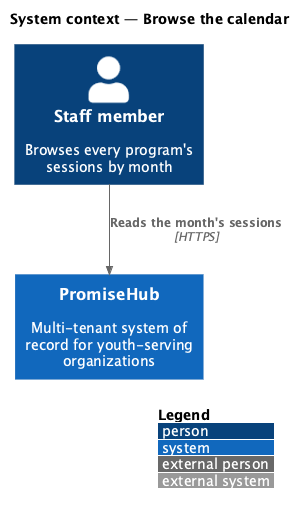
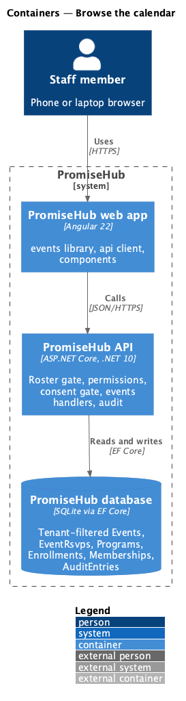
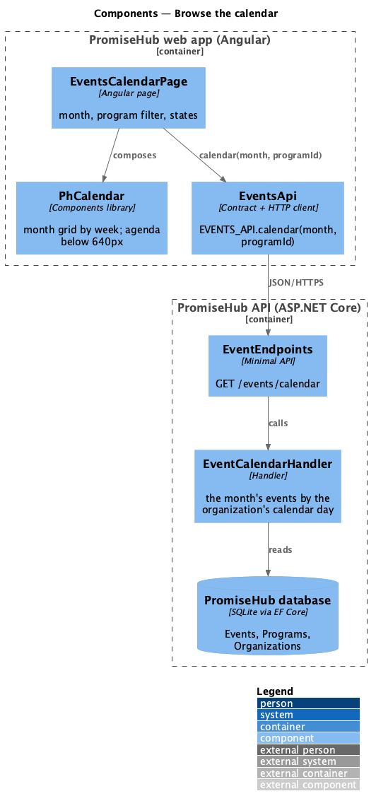
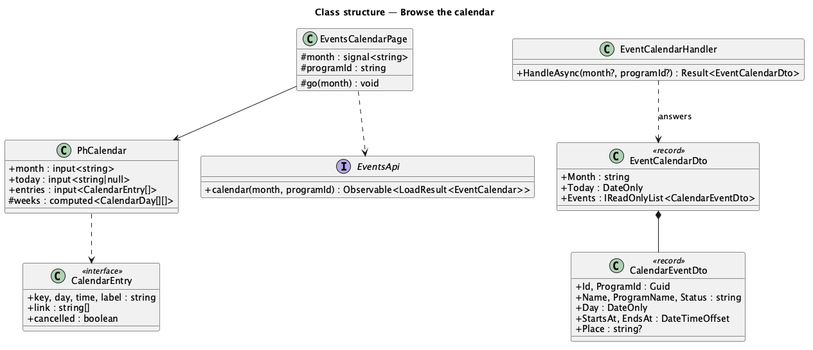
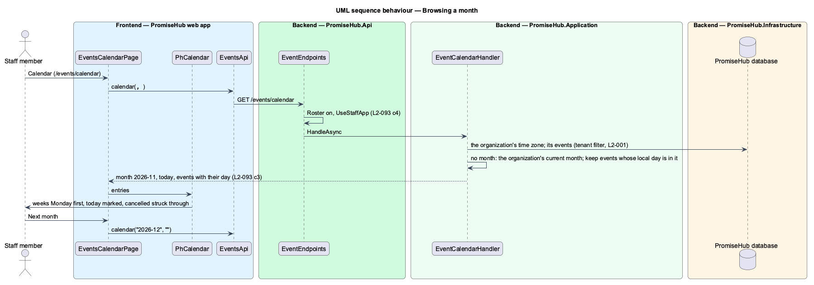

# Browse the calendar

## Overview

A list of upcoming events answers "what is next"; it does not show a month at a glance. **Browse the calendar** shows every program's sessions for a month, by week, so a program director sees that Tutoring night falls every Thursday, that the field trip and Saturday Sports share a Saturday, and which sessions were cancelled. It is a second view of the same events (`manage-events`), not a second calendar.

Terms used in this document:

- **calendar day** — the date of an event's start in the organization's time zone; the server sends it, so the grid never depends on the viewer's clock or time zone
- **month** — a `yyyy-MM` value; with none, the organization's current month

Ported from Waypoint `engagement/browse-calendar` (`L2-ENGAGE-001` criterion 3). Waypoint's month, week and agenda views fold into one month view that becomes an agenda below 640px; its cohort filter is the program filter. Mentors do not use the staff app (ADR 0043), so a mentor's calendar is deferred. Decisions are recorded in ADR 0064.

## Description

Frontend:

- **`PhCalendar`** (`frontend/projects/components/`, design system: calendar) — inputs `month` (`yyyy-MM`), `today` (`yyyy-MM-dd` or null), `label` and `entries` (`CalendarEntry`: key, day, time, label, link, cancelled). It renders a captioned table of the month by week, Monday first, with leading and trailing days of the neighbouring months muted, each day listing its entries as links with the time, today marked with `aria-current="date"`, and a cancelled entry saying "Cancelled ·" and struck through; below 640px an ordered list of only the days with entries. No HTTP and no business logic.
- **`EventsCalendarPage`** (`frontend/projects/events/`, mock `events-calendar`, route `/events/calendar`) — `ph-breadcrumb`, `ph-page-header` (List, New event for `manageEvents`), icon-only Previous month and Next month, This month, `ph-select` Program, and `ph-calendar`; the month and program live in the query string. Loading shows `ph-skeleton`; an empty month says "Nothing scheduled in November 2026" with New event; a failed load offers Try again. The subtitle counts sessions and cancellations.
- **`EventsPage`** — a Calendar `ph-button` link in the header.

API client: `EVENTS_API.calendar(month, programId)` answering `LoadResult<EventCalendar>` (`month`, `today`, `events: CalendarEvent[]`).

Backend:

- **`EventCalendarHandler`** (`PromiseHub.Application/Events/`) — parses `month` (`yyyy-MM`, else 422 `month`), defaults to the organization's current month, reads the organization's events (tenant filter), keeps those whose calendar day is in the month and, when given, of `programId`, and answers `EventCalendarDto` (`Month`, `Today`, `Events`: `CalendarEventDto` with id, name, program id and name, day, start, end, place, status), soonest first.
- **Endpoint** — `GET /events/calendar` in `EventEndpoints`' Roster group; any staff role through the fallback (`UseStaffApp`); participant roles 403.

Open questions: none. Deferred: week and day views, a mentor's calendar, and RSVP counts on calendar entries.

## Requirements

| L2 ID | Refines (L1) | Requirement |
|-------|--------------|-------------|
| `L2-093` | `L1-005` | Staff schedule a cohort's sessions as events, a session that repeats every week in one go, and browse every program's sessions on a month calendar. |
| `L2-005` | `L1-002` | A module that is off is neither served nor rendered (cross-referenced, not repeated). |
| `L2-035` | `L1-019` | Accessibility (cross-referenced, not repeated). |
| `L2-036` | `L1-019` | Responsive layout (cross-referenced, not repeated). |

## Diagrams

### System context

Staff read a month of sessions.

### Containers

### Components

The page asks for one month and hands the entries to the library's calendar.

### Class structure

### Behaviour — browsing a month

The server decides the month and each event's calendar day; the component only lays them out.

