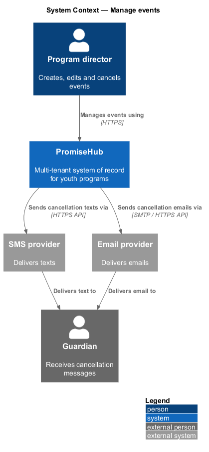
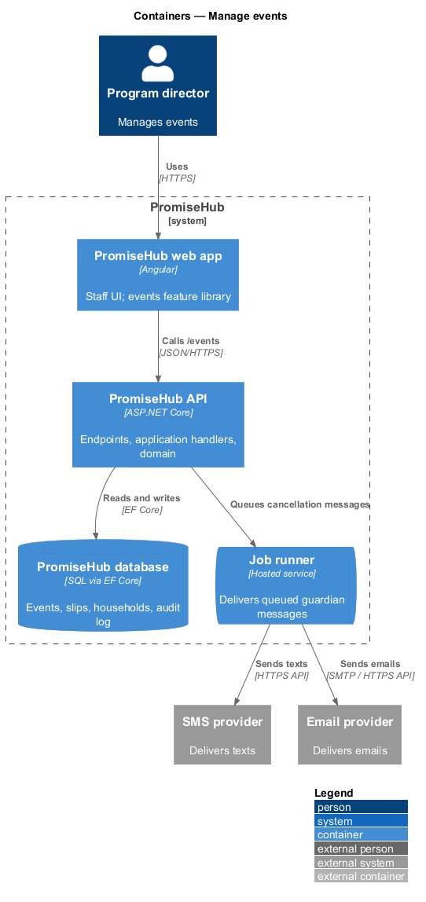
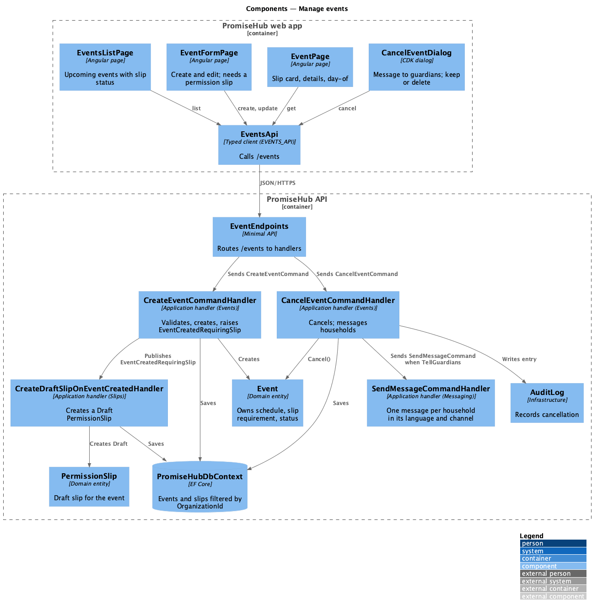
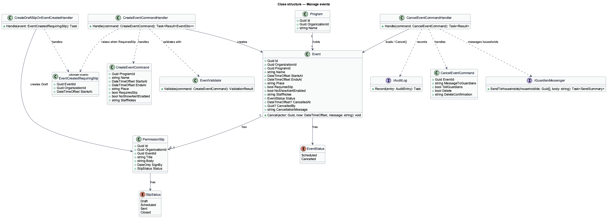
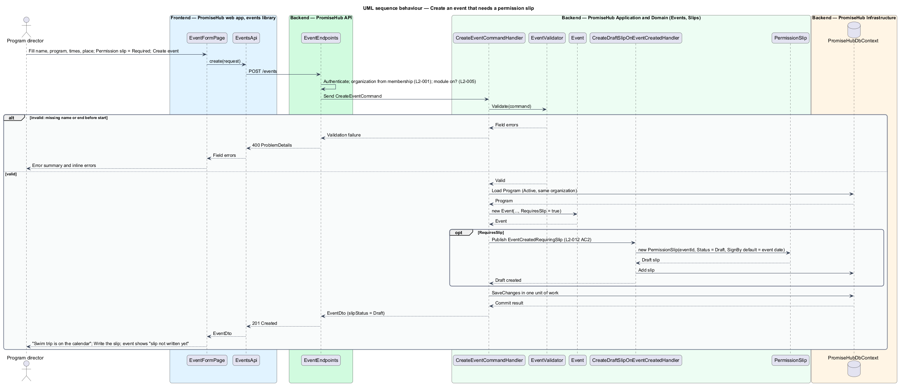
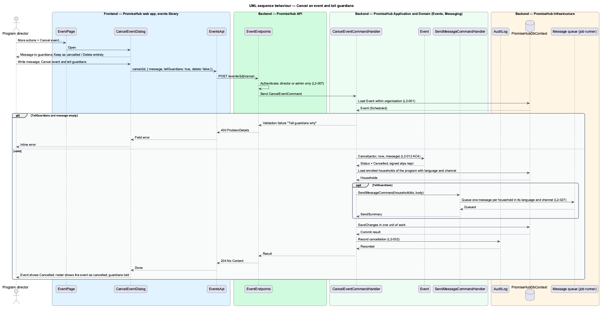

# Manage events

## Overview

PromiseHub is a multi-tenant system of record for youth-serving organizations. An **event** — dated occurrence of a program with a start, an end, a place and the program's roster, such as a tutoring night or a field trip. Events hang off programs: the roster of an event is the roster of its program. This feature covers the event half of `L2-012`: creating and editing an event, listing events with their slip status, and cancelling an event with a message to every enrolled household.

A **permission slip** — consent document a guardian signs for one event. When an event is created with "needs a permission slip" on, the system creates a draft slip for it so the next step is writing the slip. The event shows "slip not written yet" until the slip is sent. Writing and sending the slip is designed in `slips/write-and-send-slip`.

A **cancellation** — terminal state change of an event that keeps the event, its roster and its signed slips, and optionally messages every enrolled household in its language. The roster then shows the event as cancelled and check-in for it does not open.

Local terms used below:

- **needs a permission slip** — event-form choice `Required` under "Permission slip", as opposed to `Not needed` when season consent covers the session
- **enrolled household** — household with at least one child enrolled in the event's program
- **no-show alert** — per-event switch that texts guardians when a child is not checked in a configured number of minutes after start, designed in `attendance/alert-no-show-and-end-session`

Every event belongs to one organization (`L2-001`). The events pages are served when the Permission slips or Roll Call module is on (`L2-005`); the "tell guardians" option on cancellation uses the Messages module and is hidden when that module is off.

## Description

### Frontend (`frontend/projects/events/`)

- **`EventsListPage`** — page component for the `events` screen (`/events`). It shows upcoming events with slip status badges (`41 of 48 signed`, `No slip needed`, `Slip not written yet`), a search box, the `Upcoming` / `Needs slips` / `Past` chips and a program filter. It renders the `empty`, `loading`, `error`, `no-results` and `long` (grouped by month, paged) states.
- **`EventPage`** — page component for the `event` screen (`/events/:id`). It shows the slip card (signed, unsigned, declined tabs), the details card and the day-of card. The `empty` state offers `Create slip` for an event whose slip is still a draft. The `cancelled` state is read-only and shows who cancelled and that guardians were told.
- **`EventFormPage`** — page component for the `event-form` screen (`/events/new`, `/events/:id/edit`). Fields: event name, program, starts, ends, where, permission slip (`Not needed` / `Required`), attendance no-show switch and notes for staff. On an invalid submit it renders the inline errors and the error summary.
- **`EventActionsMenu`** — CDK overlay menu for `event-actions`: edit the slip, message the roster, export the cleared list and `Cancel event…`.
- **`CancelEventDialog`** — CDK dialog for `cancel-event`. It takes the message to guardians and the choice `Keep the event as cancelled` or `Delete it entirely`. The delete choice adds a confirm step that warns how many signatures would be deleted and requires typing `DELETE`.
- Pages compose `page-header`, `list`, `chip`, `tabs`, `badge`, `form-field`, `error-summary`, `dialog`, `menu` and `empty-state` from `frontend/projects/components/`.

### API client (`frontend/projects/api/`)

- **`EventsApi`** — contract behind the `EVENTS_API` injection token with `list(filter)`, `get(id)`, `create(request)`, `update(id, request)` and `cancel(id, request)`. The HTTP implementation calls `/events`.

### Backend

- **`EventEndpoints`** (`PromiseHub.Api`) — minimal-API group under `/events`: `GET /events`, `GET /events/{id}`, `POST /events`, `PUT /events/{id}`, `POST /events/{id}/cancel`.
- **`PromiseHub.Application/Events/`**
  - `GetEventsQuery` / `GetEventsQueryHandler` — lists events of the active organization with roster size and slip summary, filtered by `Upcoming`, `NeedsSlips`, `Past` and program.
  - `GetEventQuery` / `GetEventQueryHandler` — one event with slip status (`NotNeeded`, `Draft`, `Sent` with signed and declined counts).
  - `CreateEventCommand` / `CreateEventCommandHandler` — validates, creates the `Event`, and when `RequiresSlip` is true raises `EventCreatedRequiringSlip`. The handler persists the event and the draft slip in one unit of work (`L2-012` AC 2).
  - `CreateDraftSlipOnEventCreatedHandler` (`PromiseHub.Application/Slips/`) — domain event handler that creates a `PermissionSlip` in `Draft` status for the event with an empty body and the event date as the default sign-by date.
  - `UpdateEventCommand` / `UpdateEventCommandHandler` — edits name, program, times, place, slip requirement and notes.
  - `CancelEventCommand` / `CancelEventCommandHandler` — sets `EventStatus.Cancelled`, records who cancelled and when, writes an audit entry, and when `TellGuardians` is true dispatches `SendMessageCommand` (designed in `messaging/compose-and-send-message`) to every enrolled household in its language and channel (`L2-012` AC 4). With `Delete` chosen, the handler removes the event and its signature records after the `DELETE` confirmation.
  - `EventValidator` — rules: name required, start before end, program belongs to the organization and is `Active`, cancellation message required when `TellGuardians` is true.
  - `EventPermissions` — program directors, admins and site leads may create and edit; program directors and admins may cancel (`L2-007`).
- **`PromiseHub.Domain/Events/`**
  - `Event` — entity with `Id`, `OrganizationId`, `ProgramId`, `Name`, `StartsAt`, `EndsAt`, `Place`, `RequiresSlip`, `NoShowAlertEnabled`, `StaffNotes`, `Status`, `CancelledAt`, `CancelledBy`, `CancellationMessage`. `Cancel(actor, now, message)` enforces the transition.
  - `EventStatus` — `Scheduled`, `Cancelled`.
  - `EventCreatedRequiringSlip` — domain event carrying `EventId`, `OrganizationId` and `StartsAt`.
- **`PromiseHub.Infrastructure`** — `PromiseHubDbContext` maps `Events` with the organization filter; `AuditLog` records cancellation; the draft slip is created in the same unit of work by `CreateEventHandler` (ADR 0008); message delivery goes through the Messaging providers.

Undecided details: the retention of a deleted event's audit entries `<TO SUPPLY>` (deleting an event is deferred).

## Built so far

Slice 05 delivered `EventsListPage` (`EventsPage`, with upcoming, needs-slips and past filters, a program select and search), `EventPage` (slip state, details, cancelled state), `EventFormPage` for new and edit, `EventActionsDialog` and `CancelEventDialog` (keep as cancelled), `EVENTS_API`, the endpoints above and the draft `PermissionSlip` (ADR 0008). Messaging guardians on cancellation, the slip tabs and the day-of card arrive with Messages and Slips.

## Requirements

| L2 ID | Refines (L1) | Requirement |
|-------|--------------|-------------|
| `L2-012` | `L1-005` | Programs hold events; both have schedules, locations, capacity and staff; archiving hides without deleting. |
| `L2-001` | `L1-001` | Every tenant-owned table carries the organization id; every query, search, export and background job filters by the organization of the signed-in person's active membership, never by a value from the client. |
| `L2-005` | `L1-002` | A module that is off is neither served nor rendered. |
| `L2-027` | `L1-013` | Guardian pages, texts and emails are in English, Spanish or French as the household chose; every page has one primary action. |
| `L2-032` | `L1-017` | Every change and every sensitive view is recorded and searchable by admins. |

## Diagrams

### System context

A program director manages events in PromiseHub. Cancelling with "tell guardians" reaches guardians through the SMS and email providers.

### Containers

The `events` feature library calls the PromiseHub API. The API persists events, draft slips and audit entries in the PromiseHub database and hands guardian messages to the providers.

### Components

`EventEndpoints` dispatches to the Events handlers. `CreateEventCommandHandler` raises `EventCreatedRequiringSlip`, which `CreateDraftSlipOnEventCreatedHandler` in the Slips application folder turns into a draft `PermissionSlip`. `CancelEventCommandHandler` hands the household message to the Messaging handler.

### Class structure

`Event` belongs to a `Program` and holds an `EventStatus`; at most one `PermissionSlip` references it. The cancel handler uses `IGuardianMessenger` to message households.

### Behaviour — create an event with a slip

A valid event with `Required` under "Permission slip" is saved together with a draft slip, and the event page shows "slip not written yet" (`L2-012` AC 2). Validation failures return field errors.

### Behaviour — cancel an event

Cancellation keeps the event and its signed slips, writes an audit entry and, when "tell guardians" is chosen, queues one message per enrolled household in its language and channel (`L2-012` AC 4, `L2-027`).

