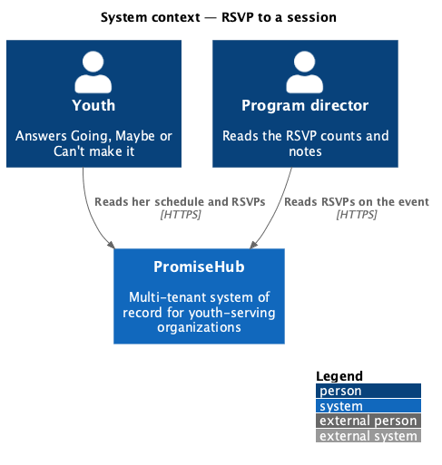
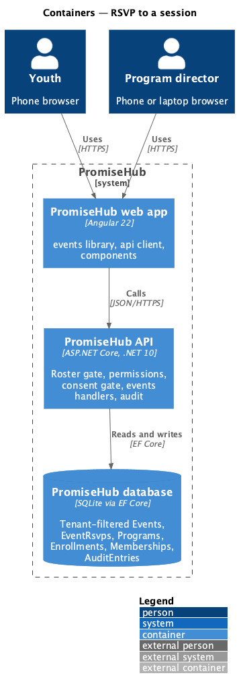
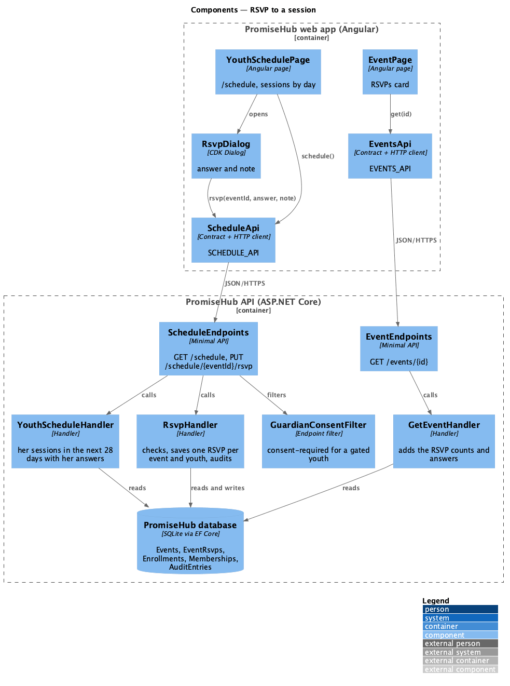
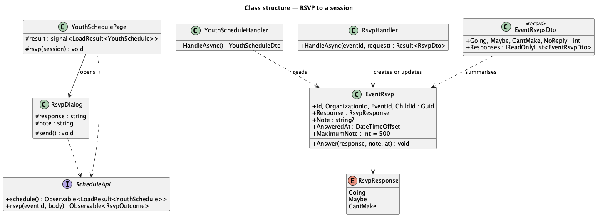
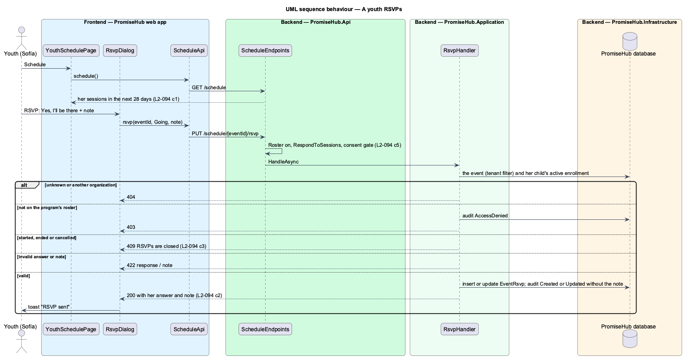
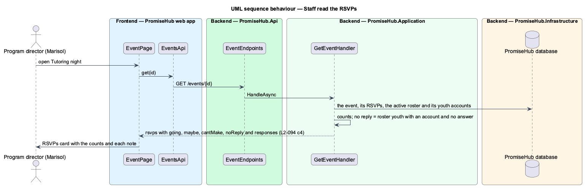

# RSVP to a session

## Overview

Staff plan a session better when they know who is coming. **RSVP to a session** gives a youth who signs in a schedule of her upcoming sessions and lets her answer Going, Maybe or Can't make it, with an optional note such as "Can I bring my inhaler on the bus?". The staff who run the session see how many are coming and read each note on the event page.

Terms used in this document:

- **youth** — a member with the Youth role whose membership links to a child record (ADR 0043)
- **her sessions** — events of programs her child has an active enrollment in that have not started and start within the next 28 days
- **RSVP** — one `EventRsvp` row per event and child: the answer (`RsvpResponse` `Going`, `Maybe`, `CantMake`), an optional note of at most 500 characters and when it was answered
- **no reply** — children on the program's active roster who have a youth account and have not answered

Ported from Waypoint `engagement/rsvp-to-session` (`L2-ENGAGE-005` criteria 1 and 2), with tenancy, the Roster gate, the guardian consent gate and PromiseHub's events. Waypoint's reminder before the session is deferred to near-real-time notifications (prompt 75). Decisions are recorded in ADR 0064.

## Description

Frontend (`frontend/projects/events/`):

- **`YouthSchedulePage`** (mock `youth-schedule`, route `/schedule`, exported as `scheduleRoutes` and mounted under Roster) — `ph-page-header` "Your schedule", one heading per calendar day and a `ph-list` of `ph-list-item`s: the session, its time, place and program as meta, her note as the text variant, a trailing `ph-badge` (success Going, info Maybe, warning Can’t make it, neutral Not replied, danger Cancelled) and RSVP (primary) or Change RSVP; a cancelled session offers none. Empty, error and loading states; after a send, the toast "RSVP sent" with the session and the answer.
- **`RsvpDialog`** (mock `rsvp`) — CDK Dialog through `PhDialogs`: `ph-description-list` (session, when, where), `ph-radio-group` Will you be there? (Yes, I’ll be there; Maybe; Can’t make it) with hints, `ph-textarea` Note for staff (optional, counter to 500), `ph-error-summary` and the 422 errors beside each field, busy and failed states, and the 409 "RSVPs are closed for this session" warning; it closes with her answer.
- **`EventPage`** (mock `event`) — an RSVPs `ph-card` with four `ph-stat`s (Going, Maybe, Can’t make it, No reply) and each answer as a `ph-list-item` (avatar, name, when answered, the note as the text variant, the answer's badge), newest first; with none, a sentence saying who can RSVP.
- **Navigation** — a Schedule section for the Youth role while Roster is on (`shell/navigation.ts`).

API client (`frontend/projects/api/`): `SCHEDULE_API` (`ScheduleApi`, `HttpScheduleApi`) with `schedule()` answering `LoadResult<YouthSchedule>` and `rsvp(eventId, { response, note })` answering `RsvpOutcome` (a `WriteOutcome` or `closed` for 409); `EventDetail.rsvps: EventRsvps`.

Backend:

- **`EventRsvp`** and **`RsvpResponse`** (`PromiseHub.Domain/Events/`) — tenant-owned; `MaximumNote` 500; `Answer(response, note, at)`.
- **`YouthScheduleHandler`** (`PromiseHub.Application/Events/`) — the child of the caller's membership, the programs she has an active enrollment in (not archived), their events with `StartsAt` after now and before now plus 28 days, soonest first, with the calendar day, the status and her RSVP.
- **`RsvpHandler`** — 404 for an unknown event or another organization's; 403 audited as AccessDenied on `Event` when her child has no active enrollment in its program; 409 when it has started, ended or been cancelled; 422 `response` "Choose whether you’re going." and `note` "Keep it to 500 characters."; inserts or updates the row and audits Created or Updated on `EventRsvp` with the event and the answer, never the note; answers 200 with the answer and note.
- **`GetEventHandler`** — `EventDto.Rsvps` (`EventRsvpsDto`: going, maybe, can't make it, no reply and `EventRsvpDto` per answer with child id and name, answer, note and when), newest first.
- **Endpoints** — `ScheduleEndpoints`: `GET /schedule` and `PUT /schedule/{eventId}/rsvp` with Roster, `RespondToSessions` (Youth only) and `RequireGuardianConsent()`.
- **Persistence** — `EventRsvps` with the tenant query filter and a unique index on organization, event and child; migration `EventSeriesAndRsvps`.

Open questions: none. Deferred: a reminder before the session, telling staff when a note arrives, and a guardian answering for a younger child.

## Requirements

| L2 ID | Refines (L1) | Requirement |
|-------|--------------|-------------|
| `L2-094` | `L1-005` | A youth sees her upcoming sessions and answers Going, Maybe or Can't make it with an optional note; staff see the counts and the notes on the event. |
| `L2-093` | `L1-005` | Staff schedule a cohort's sessions as events, a session that repeats every week in one go, and browse every program's sessions on a month calendar. |
| `L2-056` | `L1-023` | The guardian consent gate (cross-referenced, not repeated). |
| `L2-032` | `L1-017` | Audit trail (cross-referenced, not repeated). |
| `L2-007` | `L1-003` | Role-based authorization on the server (cross-referenced, not repeated). |

## Diagrams

### System context

Youth answer for their sessions; staff read the answers.

### Containers

### Components

The schedule and the dialog use the schedule API; the event page reads the RSVPs with the event.

### Class structure

### Behaviour — a youth RSVPs

The gates answer first; the handler checks the organization, her enrollment and whether RSVPs are still open, then saves and audits without the note.

### Behaviour — staff read the RSVPs

