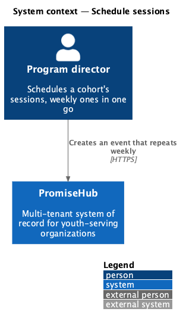
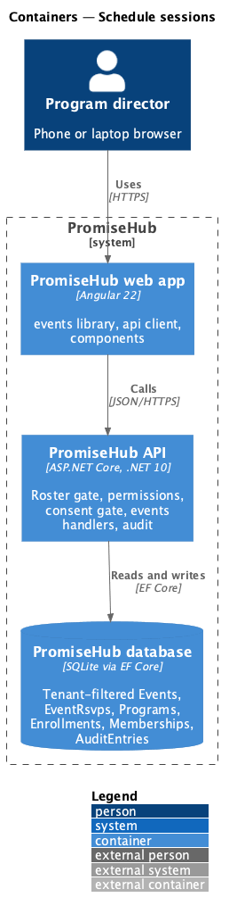
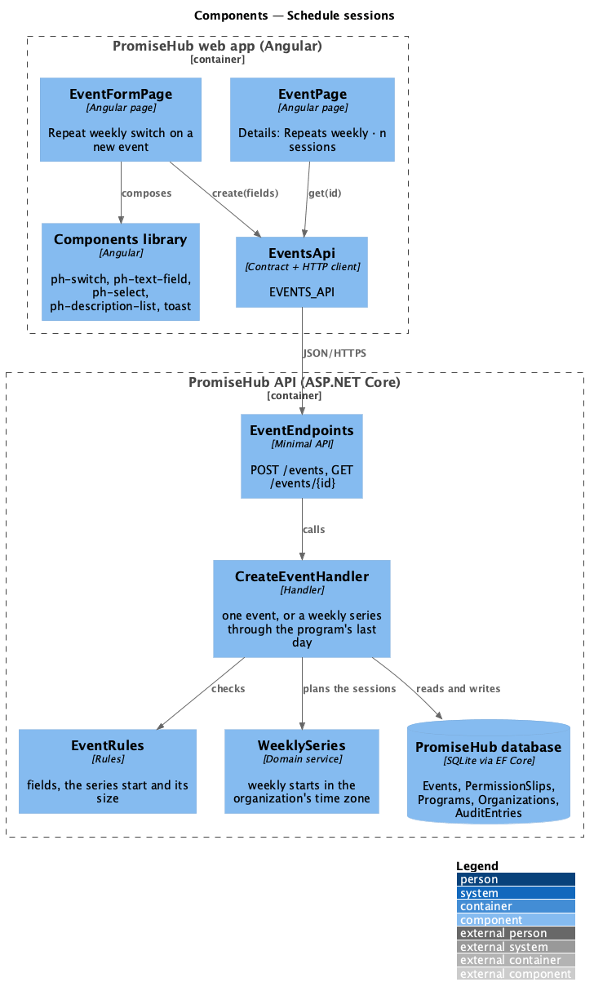
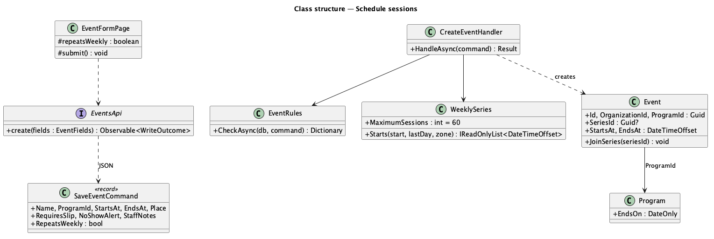
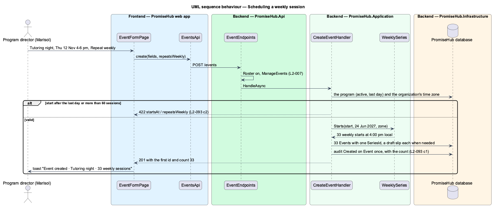

# Schedule sessions

## Overview

A cohort meets on a rhythm: After‑School Tutoring holds Tutoring night every Thursday from September to June. Before this feature a program director created each of those nights by hand. **Schedule sessions** lets her create a session once and have it repeat every week, at the same local time, through the program's last day. Each week becomes an ordinary event (`manage-events`), so check-in, slips, no-show alerts and reports treat it like any other.

Terms used in this document:

- **session** — an event of a program (ADR 0043: Waypoint's session is PromiseHub's event)
- **weekly series** — the events created together by Repeat weekly; they share a `SeriesId`
- **the program's last day** — `Program.EndsOn`, Waypoint's cohort term end
- **local time** — the wall-clock time in the organization's time zone (`Organization.TimeZone`), so a 4:00 pm session stays at 4:00 pm across a daylight-saving change

Ported from Waypoint `engagement/schedule-sessions` (`L2-ENGAGE-001` criteria 1 and 2), with tenancy, the Roster gate and PromiseHub's events. Waypoint's mentor field is not carried over: a cohort's mentors are assigned to the program (`L2-062`). Decisions are recorded in ADR 0064.

## Description

Frontend (`frontend/projects/events/`):

- **`EventFormPage`** (mock `event-form`) — on a new event only, a **Repeat weekly** `ph-switch` under Starts and Ends, with a description that names the weekday and says it repeats until the program ends (`event-form/weekly`). The server's 422 on `startsAt` or `repeatsWeekly` shows beside the field (`event-form/weekly-invalid`). After a weekly create, the toast reads "Event created" with "Tutoring night · 33 weekly sessions" and the first session opens (`event-form/weekly-created`).
- **`EventPage`** (mock `event`) — for a session of a series, Details add "Repeats: Weekly · n sessions".

API client (`frontend/projects/api/`): `EventFields.repeatsWeekly`; `EVENTS_API.create()` answers `WriteOutcome` whose `saved` variant carries the server's `count`; `EventDetail.seriesSize` (null for a single event).

Backend:

- **`Event`** (`PromiseHub.Domain/Events/`) — gains `SeriesId` (Guid, null for a single event) and `JoinSeries(seriesId)`.
- **`WeeklySeries`** (`PromiseHub.Domain/Events/`) — `Starts(start, lastDay, zone)` answers the start of every week from `start` while its local date is on or before `lastDay`, converting through the time zone each week; `MaximumSessions` is 60.
- **`SaveEventCommand`** — gains `RepeatsWeekly` (default false; ignored on update).
- **`EventRules.CheckAsync`** — with `RepeatsWeekly`, a start whose local date is after the program's last day answers `startsAt` "Start on or before the program’s last day, Thu 24 Jun 2027."; more than 60 sessions answers `repeatsWeekly` "A weekly series can have at most 60 sessions."
- **`CreateEventHandler`** — a single event as before; with `RepeatsWeekly`, one `Event` per weekly start with the same duration and one new `SeriesId`, a draft `PermissionSlip` for each when a slip is needed, one audit entry (Created on `Event`, the first session's id, "Tutoring night (33 weekly sessions)"), and answers 201 with the first id and the count.
- **`GetEventHandler`** — `EventDto.SeriesSize`: how many events share the series.
- **Persistence** — `Events.SeriesId` (nullable, indexed); migration `EventSeriesAndRsvps` (shared with `rsvp-to-session`).

Open questions: none. Deferred: editing or cancelling a whole series, other repeat rules (every two weeks, several weekdays), and an end date other than the program's last day.

## Requirements

| L2 ID | Refines (L1) | Requirement |
|-------|--------------|-------------|
| `L2-093` | `L1-005` | Staff schedule a cohort's sessions as events, a session that repeats every week in one go, and browse every program's sessions on a month calendar. |
| `L2-012` | `L1-005` | Programs hold events; both have schedules, locations, capacity and staff; archiving hides without deleting (cross-referenced, not repeated). |
| `L2-007` | `L1-003` | Role-based authorization on the server (cross-referenced, not repeated). |
| `L2-001` | `L1-001` | Every tenant-owned table carries the organization id and every query filters by it (cross-referenced, not repeated). |

## Diagrams

### System context

A program director schedules a weekly session in PromiseHub.

### Containers

### Components

The form posts the event with Repeat weekly; the handler plans the weekly starts and saves the series in one unit of work.

### Class structure

### Behaviour — scheduling a weekly session

The gates answer first; the rules check the series, then one event per week is saved with its draft slip and the series is audited once.

