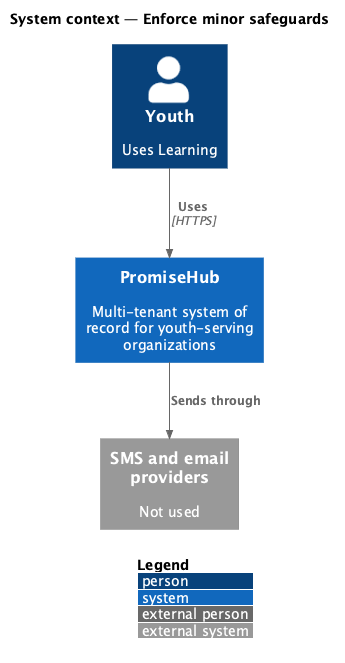
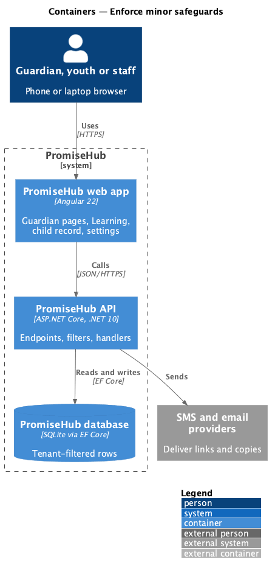
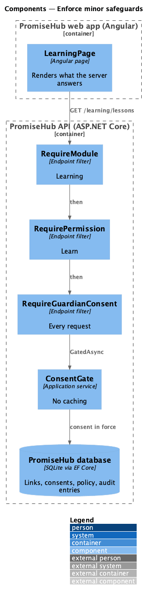
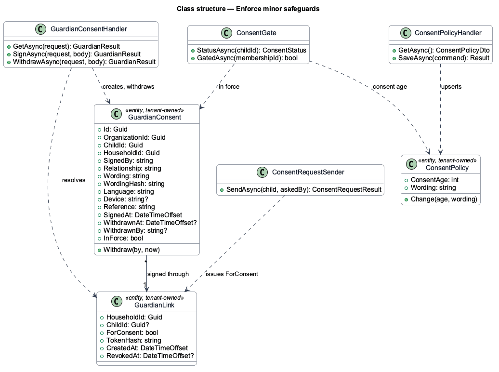
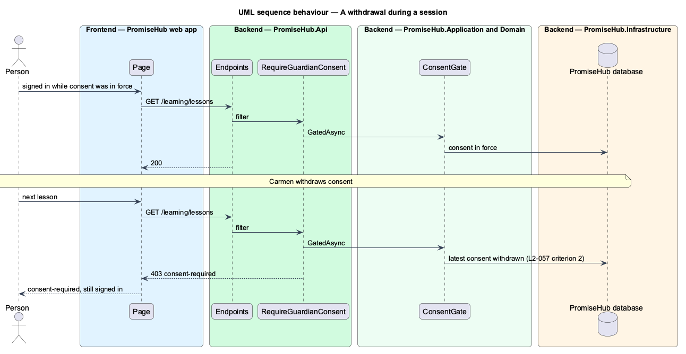

# Enforce minor safeguards

## Overview

PromiseHub serves minors, so consent is a safeguard enforced by the server, not a screen. This feature fixes where the check runs and what it protects: every protected youth request, evaluated each time, with withdrawal effective at once and the record kept.

Terms used in this document:

- **protected youth request** — a call by a Youth membership to an endpoint that returns youth work; it carries `RequireGuardianConsent()`
- **explanatory endpoints** — `GET /learning/me` and `POST /learning/consent-request`, which stay open so the gate can explain itself and ask for consent

Role scoping does the rest: staff endpoints stay closed to participant roles by the fallback policy (ADR 0043), and the youth endpoints answer 403 to staff, mentors and volunteers through `RequirePermission(Learn)`.

Ported from Waypoint `consent-and-safeguarding/enforce-minor-safeguards`, with tenancy, the Roster and Learning module gates and PromiseHub types (ADR 0043, ADR 0046).

## Description

Frontend:

- No screen of its own. The Learning page shows `consent-required` only because the server answered 403; hiding a link is never the gate.

Backend:

- **`RequireGuardianConsent()`** — applied per endpoint, after the module and permission checks, so an off module still answers 404 and a staff caller 403.
- **`ConsentGate.GatedAsync`** — no caching: each request reads the consent in force, so a session that began before a withdrawal is gated on its next request.
- **`GuardianConsent.Withdraw`** — sets `WithdrawnAt` and `WithdrawnBy`; no row is deleted.

Every row is tenant-owned and filtered by the organization (ADR 0002); a guardian link puts the request in its own organization (ADR 0015).

## Built so far

Prompt 52 delivered everything above. Acceptance tests: `backend/tests/PromiseHub.Api.Tests/ConsentWithdrawalTests.cs` (a withdrawal gates the next request, the record stays), `YouthConsentGateTests.cs` (staff and mentors refused, Learning off).

## Requirements

| L2 ID | Refines (L1) | Requirement |
|-------|--------------|-------------|
| `L2-057` | `L1-015` | Consent is a server-side safeguard evaluated on every protected youth request, never only at sign-in or in the page, and a withdrawal takes effect at once. |
| `L2-056` | `L1-023` | A youth whose linked child record is under the organization's consent age cannot use Learning until a guardian has consented. Admins set the age and the wording; the youth can ask a guardian for consent from the gate. |

## Diagrams

### System context

Who uses this slice and which outside systems PromiseHub talks to.

### Containers

The web app calls the API; the API owns the database and the providers.

### Components

The page, its API client, and the endpoints, filters and handlers behind them.

### Class structure

The consent record, the consent link, the policy and the services that read and write them.

### Behaviour — a withdrawal during a session

The steps in order, with the requirement each enforces.

