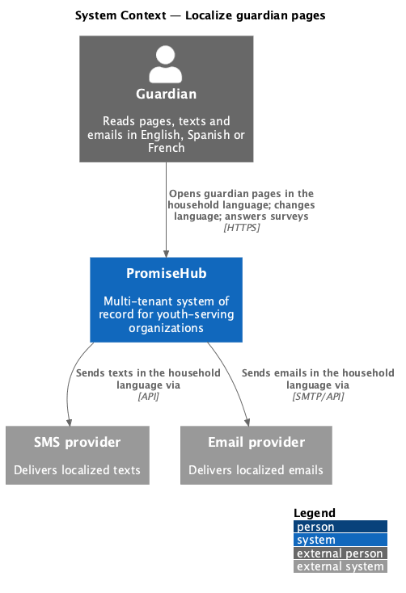
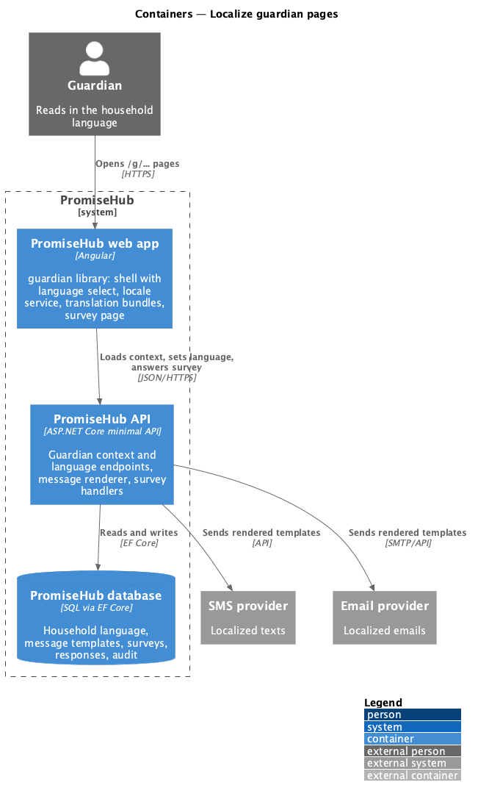
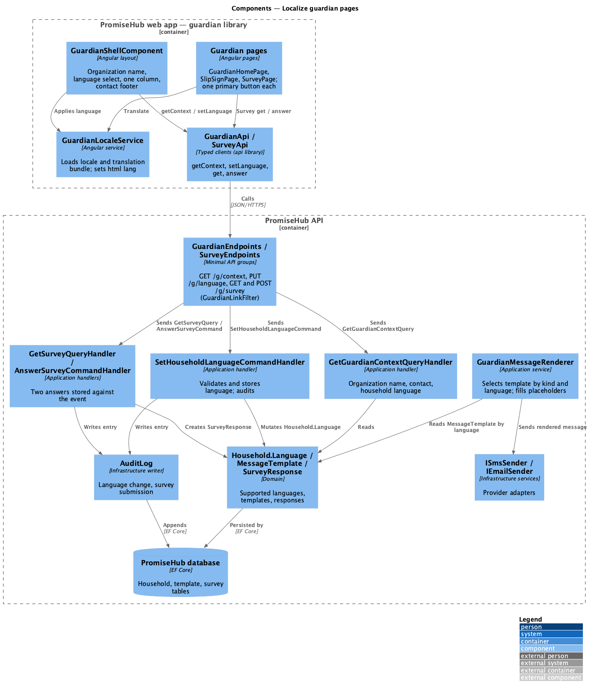
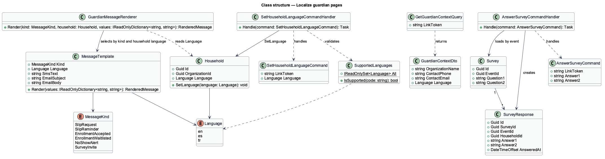
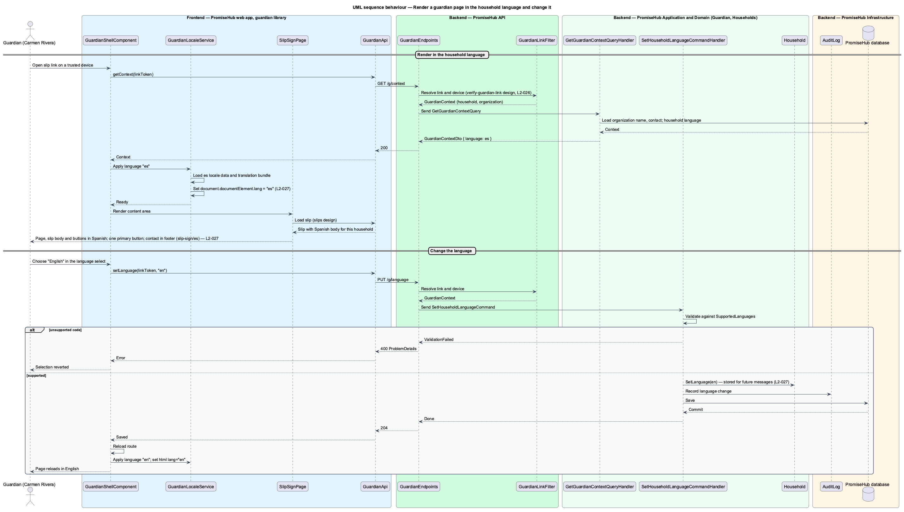
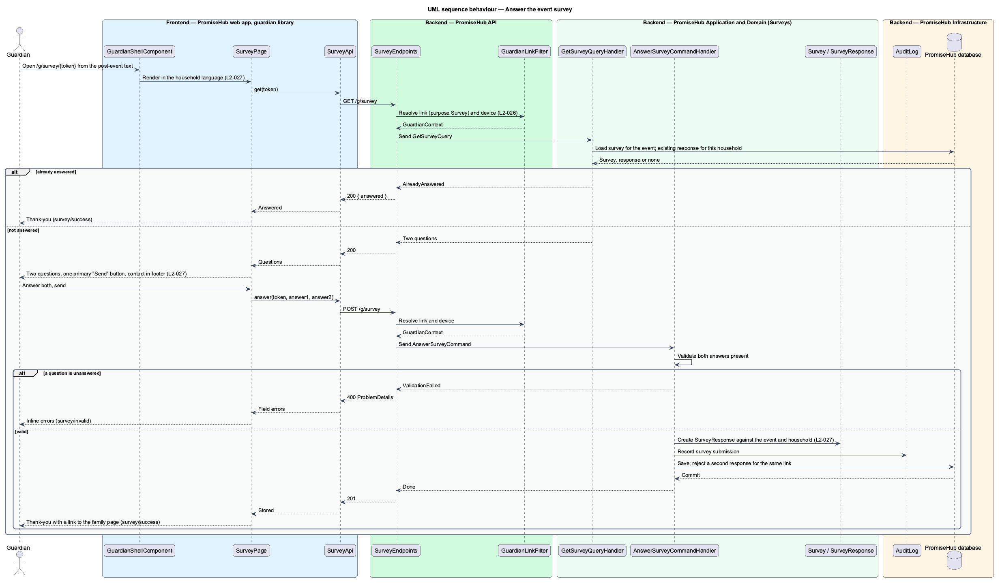

# Localize guardian pages

## Overview

Guardians read PromiseHub in English, Spanish or French, as their household chose. Every guardian page, text and email is rendered in that language, each page has exactly one primary action, and the organization's contact sits in the footer. This feature covers how the household's language is stored and changed, how a guardian page is rendered in it with the matching `html lang` attribute, how the single-primary-action rule is kept, and the two-question event survey (`survey`) that follows an event.

When Carmen Rivera, whose household language is Spanish, opens any guardian link, the page, the slip body and the buttons are in Spanish and the document carries `html lang="es"` (`slip-sign/es`). When a guardian changes the language selector in the thin guardian bar, the page reloads in the new language and the choice is stored on the household for future messages. The `guardian-home` landing page and every other guardian page contain one primary button. After an event, a survey link leads to two questions whose answers are stored against the event, followed by a thank-you.

Terms used in this document:

- **household language** — one of `en`, `es` or `fr` stored on the household and used for every guardian page, text and email
- **guardian shell** — thin bar with the organization's name and a language select, one column of content, and a footer with the organization's contact
- **primary action** — the single `primary` button on a guardian page that completes the page's purpose
- **message template** — localized text for one kind of guardian message, such as a slip request, with placeholders filled per household
- **event survey** — two-question form sent to guardians after an event, stored against that event

## Built so far

Slice 38 added the survey page (`GuardianSurveyPage`, `survey-text.ts`) on the same verified links and language rules as the slip and home pages (ADR 0032).

Slice 12 delivered the English, Spanish and French strings of the slip page, `html lang` from the household language, `ph-guardian-shell` with the organization's contact in the footer and one primary action per state (ADR 0015). The language selector, translated message bodies and the other guardian pages are not built yet.

## Description

The feature lives in the `guardian` frontend library, the shared `components` library and the `Guardian`, `Surveys` and `Messaging` application folders.

Frontend:

- **`GuardianShellComponent`** — layout in `frontend/projects/guardian/` that renders the organization name, the language select, the single-column content area and the contact footer. On language change it calls `GuardianApi.setLanguage` and reloads the route.
- **`GuardianLocaleService`** — service in `frontend/projects/guardian/` that loads the Angular locale data and translation bundle for the household language returned by the API, sets `document.documentElement.lang`, and provides the translation pipe. Translation files live at `frontend/projects/guardian/src/i18n/{en,es,fr}.json`.
- **`GuardianHomePage`**, **`SlipSignPage`**, **`SurveyPage`** and the other guardian pages compose only from `frontend/projects/components/`. Each page template declares one button with the `primary` variant; an ESLint rule in the guardian library flags a template with more than one `<ph-button variant="primary">`.
- **`SurveyPage`** — page for `/g/survey/:token` with states `default`, `invalid`, `submitting`, `success` and `error`.
- **`GuardianApi`** — typed client in `frontend/projects/api/` behind `GUARDIAN_API` with `getContext(linkToken)` (organization name, contact, household language) and `setLanguage(linkToken, language)`.
- **`SurveyApi`** — typed client behind `SURVEY_API` with `get(token)` and `answer(token, answers)`.

Backend:

- **`GuardianEndpoints`** — anonymous group under the `GuardianLinkFilter` from the verify-guardian-link design: `GET /g/context`, `PUT /g/language`.
- **`SurveyEndpoints`** — `GET /g/survey`, `POST /g/survey` under the same filter.
- **`SetHouseholdLanguageCommand` / `SetHouseholdLanguageCommandHandler`** — validates the language against the supported set, applies `Household.SetLanguage`, writes an audit entry.
- **`GetGuardianContextQuery` / `GetGuardianContextQueryHandler`** — returns the organization's display name and contact, and the household language, so the shell can render before any page content.
- **`GuardianMessageRenderer`** — application service in `PromiseHub.Application/Messaging/` that selects the `MessageTemplate` for the household language and fills placeholders. The slips, enrollment and messaging designs call it for every outbound text and email, and the slip body is stored per language by the slip author `<TO SUPPLY: whether staff write the slip body in each language or one language with a translation step>`.
- **`GetSurveyQuery`**, **`AnswerSurveyCommand`** and handlers in `PromiseHub.Application/Surveys/`. The answer handler validates both questions, stores a `SurveyResponse` against the event and household, and rejects a second response for the same link. The two question texts are `<TO SUPPLY>`.
- **`Household.Language`**, **`SupportedLanguages`**, **`MessageTemplate`**, **`Survey`**, **`SurveyResponse`** — domain types in `PromiseHub.Domain/Households/`, `PromiseHub.Domain/Messaging/` and `PromiseHub.Domain/Surveys/`.
- **`AuditLog`** — records language changes and survey submissions.

### Consent page (prompt 52)

`GuardianConsentPage` reads its strings from `consent-text.ts` in English, Spanish and French and sets `html lang` like the slip page. The consent wording is shown as the organization wrote it; the Spanish and French pages say the English wording is the one signed. The consent link text is sent in the household language.

## Requirements

The feature realizes the following level-2 (L2) requirements. Each L2 requirement refines a level-1 (L1) requirement, cited by identifier.

| L2 ID | Refines (L1) | Requirement |
|-------|--------------|-------------|
| `L2-027` | `L1-013` | Guardian pages, texts and emails are in English, Spanish or French as the household chose; every page has one primary action. |
| `L2-026` | `L1-013` | Guardian pages are reached by links tied to a phone number or email; a six-digit code verifies the device; no password exists. |

## Diagrams

### System context

A guardian reads PromiseHub pages, texts and emails in the household's language; the SMS and email providers deliver the localized messages.

### Containers

The guardian library of the PromiseHub web app loads the household language from the PromiseHub API, which stores it and renders outbound messages from localized templates.

### Components

`GuardianShellComponent` and `GuardianLocaleService` render the page in the household language; `SetHouseholdLanguageCommandHandler` stores a change; `GuardianMessageRenderer` localizes texts and emails; the survey handlers store two answers per event.

### Class structure

`Household` holds `Language`; `MessageTemplate` is keyed by kind and language; `SurveyResponse` links an event, a household and two answers.

### Behaviour — render a guardian page in the household language and change it

The shell loads the context, sets `html lang` and renders in Spanish; a selector change stores the new language on the household and reloads (`L2-027`).

### Behaviour — answer the event survey

The guardian answers two questions on a page with one primary action; the answers are stored against the event and a thank-you is shown (`L2-027`).

