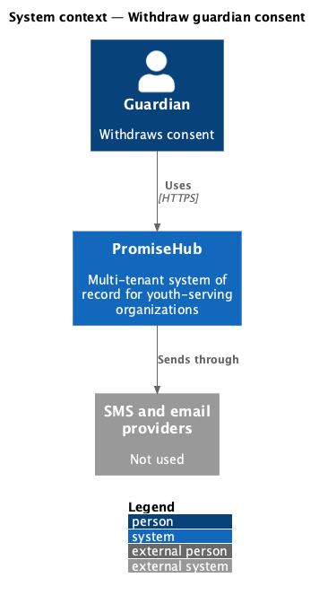
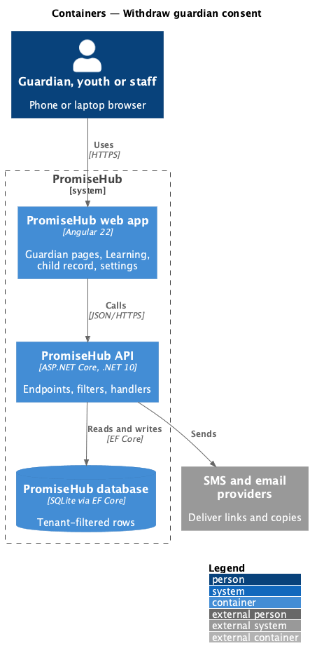
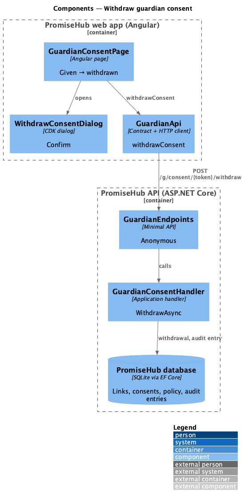
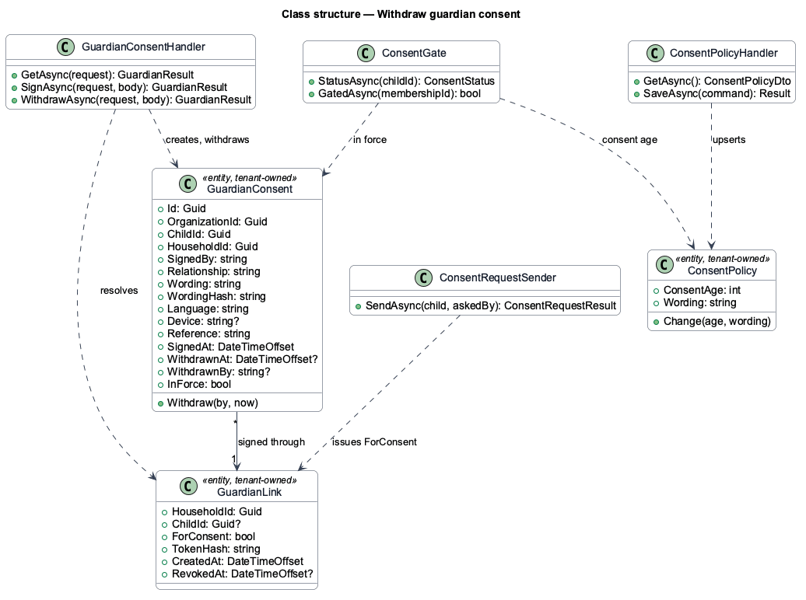
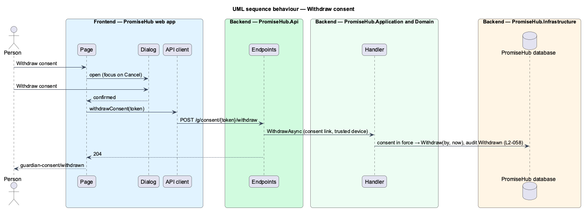

# Withdraw guardian consent

## Overview

A guardian may change their mind. Waypoint's consent settings page let a signed-in guardian change media consent and contact details; in PromiseHub contact details are edited on the family page (`L2-011`) and media consent is deferred (prompt 73), so what remains is withdrawing participation consent from the consent link.

Terms used in this document:

- **withdrawal** — `WithdrawnAt` and `WithdrawnBy` on the consent in force; the record stays
- **consent again** — after a withdrawal, the same link offers the sign form; a new consent is a new row

Ported from Waypoint `guardian-portal/manage-consent-settings`, with tenancy, the Roster and Learning module gates and PromiseHub types (ADR 0043, ADR 0046).

## Description

Frontend:

- **`WithdrawConsentDialog`** (`frontend/projects/guardian/`) — a CDK dialog through `PhDialogs`, danger button, focus on Cancel; strings in three languages.
- **`GuardianConsentPage`** — opens the dialog from `given` and `signed`; after a withdrawal renders `withdrawn` with the form.
- **`GuardianApi.withdrawConsent`** — `POST /g/consent/{token}/withdraw`.

Backend:

- **`GuardianConsentHandler.WithdrawAsync`** — same link checks as signing; no consent in force answers 409; records the withdrawal with the matching guardian's name (or the primary guardian's) and audits it as Withdrawn.

Every row is tenant-owned and filtered by the organization (ADR 0002); a guardian link puts the request in its own organization (ADR 0015).

## Built so far

Nothing yet; prompt 52 builds this design.

## Requirements

| L2 ID | Refines (L1) | Requirement |
|-------|--------------|-------------|
| `L2-058` | `L1-013` | A guardian sees the consent record from the same link and can withdraw it; staff see the status on the child record and can send a consent link. |
| `L2-057` | `L1-015` | Consent is a server-side safeguard evaluated on every protected youth request, never only at sign-in or in the page, and a withdrawal takes effect at once. |
| `L2-032` | `L1-017` | Every sensitive action is audited with who, what and when, in its organization only. |

## Diagrams

### System context

Who uses this slice and which outside systems PromiseHub talks to.

### Containers

The web app calls the API; the API owns the database and the providers.

### Components

The page, its API client, and the endpoints, filters and handlers behind them.

### Class structure

The consent record, the consent link, the policy and the services that read and write them.

### Behaviour — withdraw consent

The steps in order, with the requirement each enforces.

