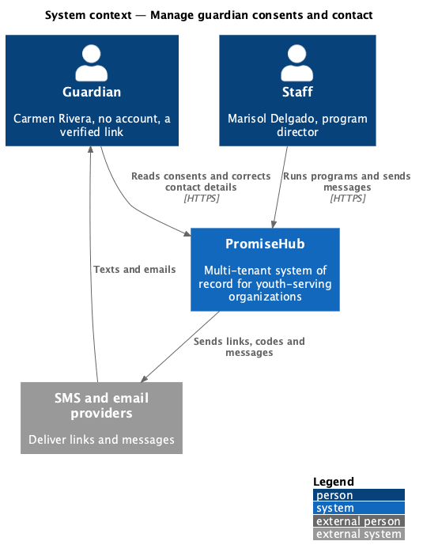
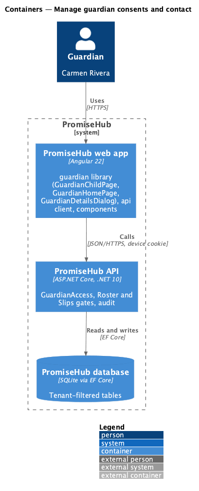
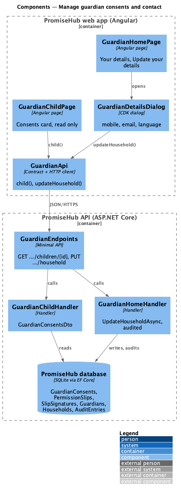
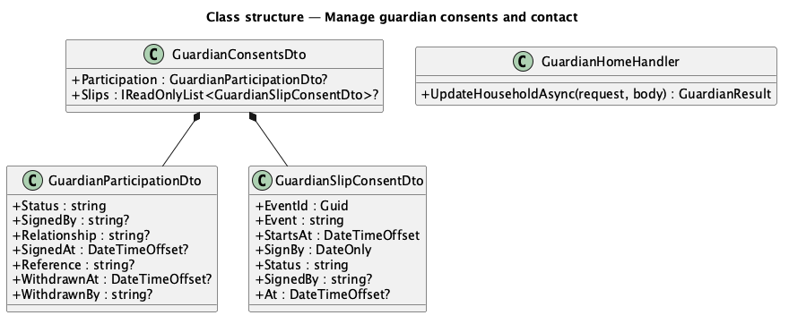
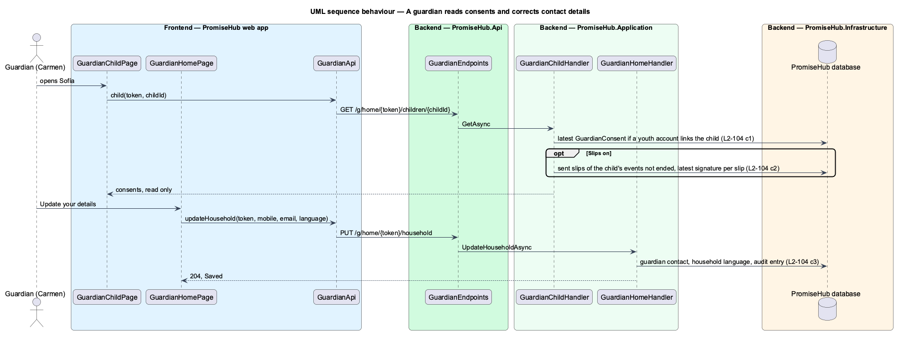

# Manage guardian consents and contact

## Overview

A guardian is responsible for what the organization has on record about their children: the consents given and the way staff reach the family. **Manage guardian consents and contact** shows, on each child's page, the consents on record read only — participation consent for a child with a youth account and the permission slips of the child's coming events — and keeps contact details current through the family page's Update your details.

Terms used in this document:

- **participation consent** — a `GuardianConsent` for a youth (L2-055): Given, Withdrawn or Needed, given and withdrawn from its own consent link
- **slip consent** — the child's latest `SlipSignature` on a sent `PermissionSlip`: Signed, Declined, or Not signed yet

Ported from Waypoint `guardian-portal/manage-contact-details` (`L2-GUARDIAN-003`). Waypoint's media consent options and emailing a copy of the e-sign record are deferred (ADR 0067); contact editing already exists from prompt 28 and is reused, not rebuilt.

## Description

Frontend (`frontend/projects/guardian/`):

- **`GuardianChildPage`** — a Consents card: a `ph-list-item` per consent with a `ph-badge` (success Given or Signed, warning Not signed yet or Needed, danger Declined or Withdrawn) and who signed when, or when to sign by; "Nothing to sign right now." when empty. No control on the page writes anything.
- **`GuardianHomePage`** and **`GuardianDetailsDialog`** — unchanged from prompt 28: Your details with Update your details (mobile, email, language).

Backend:

- **`GuardianChildHandler`** — `GuardianConsentsDto`: `Participation` from the child's latest `GuardianConsent` when an active Youth membership links the child (null otherwise); `Slips` while Slips is on: each `PermissionSlip` with status Sent for an event of the child's active programs that has not ended, with the child's latest non-superseded signature.
- **`GuardianHomeHandler.UpdateHouseholdAsync`** — validates and saves the primary guardian's mobile, email and the household's language, audited, revoking links when the mobile changes (L2-011 criterion 7, L2-026 criterion 4).

Open questions: none. Deferred: Waypoint's media consent options and emailing the e-sign record.

## Built so far

Not started.

## Requirements

| L2 ID | Refines (L1) | Requirement |
|-------|--------------|-------------|
| `L2-104` | `L1-013` | A guardian sees, on each child's page, the consents on record for the child, read only, and keeps their own contact details current from the family page. |
| `L2-055` | `L1-013` | Guardian consent for a youth (cross-referenced, not repeated). |
| `L2-015` | `L1-006` | Permission slips signed from the slip link (cross-referenced, not repeated). |

## Diagrams

### System context

The guardian reaches PromiseHub only through links the organization texts or emails; staff produce what the guardian reads.

### Containers

The web app calls the API with the household link's token and the HttpOnly device cookie; the API resolves the tenant from the link.

### Components

### Class structure

### Behaviour — a guardian reads consents and corrects contact details

Consents are read; the only write is the family page's contact update, which is audited.

