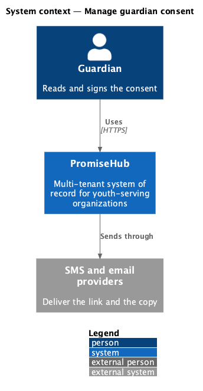
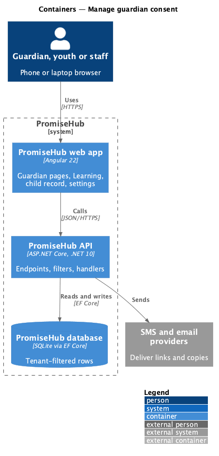
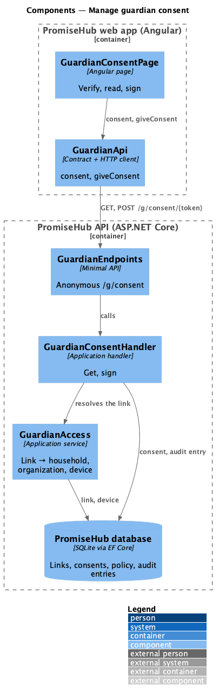
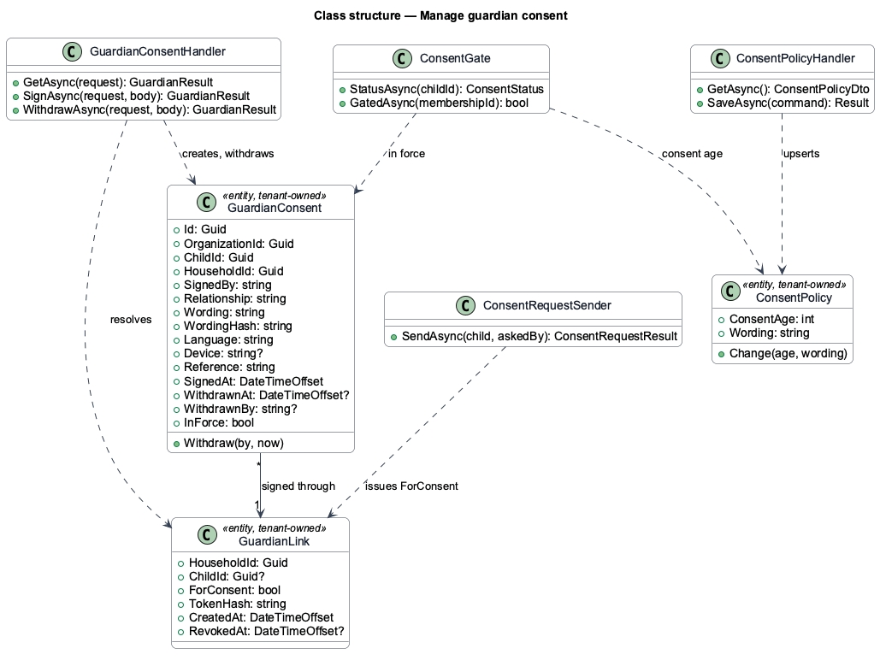
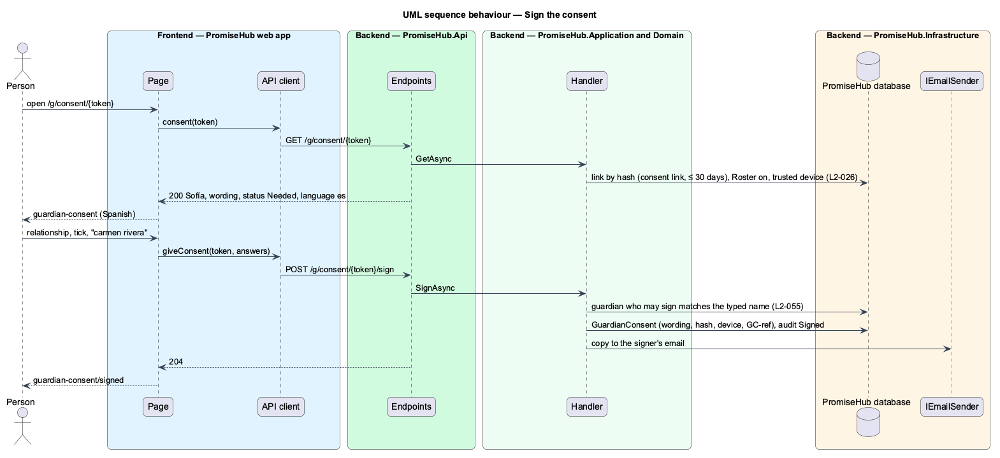

# Manage guardian consent

## Overview

A youth under the organization's **consent age** may not use Learning until a guardian agrees. Waypoint asked a signed-in guardian account to fill a form; PromiseHub has no guardian accounts (`L1-013`), so the guardian reaches a **consent page** through a **consent link** texted or emailed to the household, verifies the device with a six-digit code (ADR 0015), reads the organization's wording and signs with a typed name.

Terms used in this document:

- **consent age** — the age under which a youth needs consent; part of the organization's consent policy (`configure-consent-policy`)
- **consent link** — a `GuardianLink` with `ForConsent` set, naming one household and one child, valid 30 days (ADR 0046)
- **consent in force** — the child's latest `GuardianConsent` that has not been withdrawn

The page follows the household's language (English, Spanish or French); the English wording is the one signed, as for slips (`L2-027`).

Ported from Waypoint `consent-and-safeguarding/manage-guardian-consent`, with tenancy, the Roster and Learning module gates and PromiseHub types (ADR 0043, ADR 0046).

## Description

Frontend:

- **`GuardianConsentPage`** (`frontend/projects/guardian/`, route `/g/consent/:token`) — verify step (contact, code, locked), then the wording card, the About card, and the Sign card with `ph-select` (relationship), `ph-checkbox` (consent) and `ph-text-field` (typed name); `signed`, `given`, `withdrawn`, `expired` and `not-found` states. Strings come from `consent-text.ts` in three languages.
- **`GuardianApi.consent`, `GuardianApi.giveConsent`** (`frontend/projects/api/`) — `GET /g/consent/{token}` and `POST /g/consent/{token}/sign`.

Backend:

- **`GuardianConsentHandler.GetAsync` / `SignAsync`** (`Application/Guardian/`) — resolves the link through `GuardianAccess`, refuses links that are not consent links or are older than 30 days (410), checks Roster (404), requires a trusted device (401), validates relationship, the consent box and the typed name against guardians who may sign (422), refuses a second consent in force (409), stores `GuardianConsent` with the wording and its SHA-256, audits it as Signed and emails a copy to the signer.
- **`GuardianEndpoints`** — anonymous `GET /g/consent/{token}` and `POST /g/consent/{token}/sign`.
- **`GuardianConsent`** (`Domain/Guardian/`) — the record; `GuardianLink.ForConsent` marks the link's purpose.

Every row is tenant-owned and filtered by the organization (ADR 0002); a guardian link puts the request in its own organization (ADR 0015).

## Built so far

Prompt 52 delivered everything above: `GuardianConsentPage`, `GuardianApi.consent` and `giveConsent`, `GuardianConsentHandler.GetAsync` and `SignAsync`, `GuardianConsent` with its migration and `GuardianLink.ForConsent`. Acceptance tests: `backend/tests/PromiseHub.Api.Tests/GuardianConsentTests.cs`, `e2e/tests/guardian/give-consent.spec.ts`.

## Requirements

| L2 ID | Refines (L1) | Requirement |
|-------|--------------|-------------|
| `L2-055` | `L1-013` | A guardian consents for a youth under the organization's consent age through a verified link, with no account: they read the organization's wording, say how they are related, tick the consent box and type their name. |
| `L2-026` | `L1-013` | Guardian links carry a hashed token and a six-digit code trusts the device; the link chooses the tenant. |
| `L2-032` | `L1-017` | Every sensitive action is audited with who, what and when, in its organization only. |

## Diagrams

### System context

Who uses this slice and which outside systems PromiseHub talks to.

### Containers

The web app calls the API; the API owns the database and the providers.

### Components

The page, its API client, and the endpoints, filters and handlers behind them.

### Class structure

The consent record, the consent link, the policy and the services that read and write them.

### Behaviour — sign the consent

The steps in order, with the requirement each enforces.

