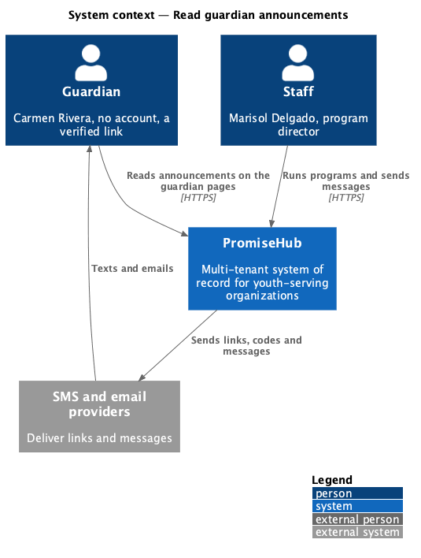
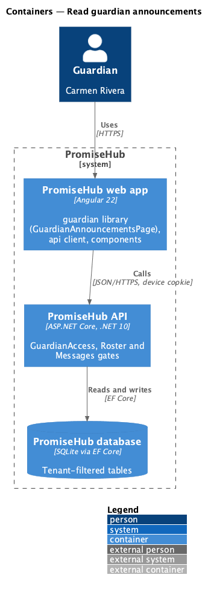
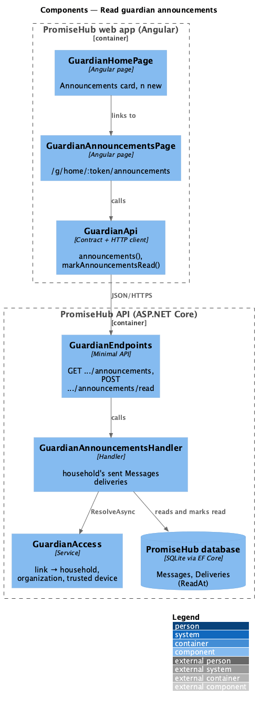
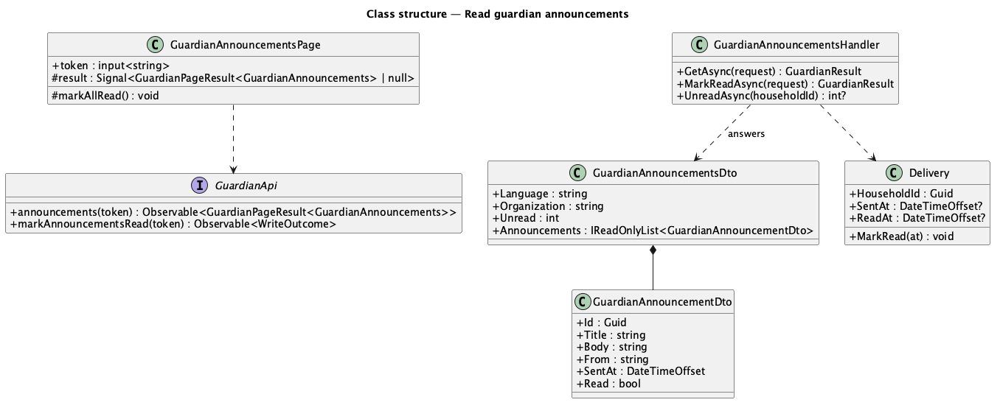
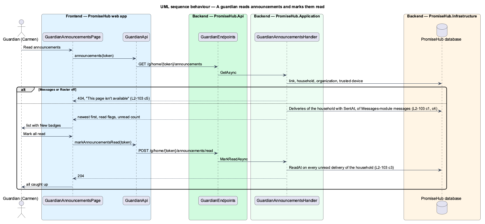

# Read guardian announcements

## Overview

Staff send announcements to families from Messages (L2-019): a cancelled session, a room change, a trip reminder. A text is easy to lose, so **Read guardian announcements** lists, on the guardian pages of a verified household link, every Messages-module message that reached the household, marks the ones the family has not read as New, and lets the guardian mark them all read.

Terms used in this document:

- **announcement** — a `Message` with `Source = Messages` and a `Delivery` to the household that was sent (`SentAt` set); slip, no-show, enrollment, pickup and survey texts are other sources and never listed
- **read** — `Delivery.ReadAt`, set for every delivery of the household when the guardian marks all read

Ported from Waypoint `guardian-portal/read-announcements` (`L2-GUARDIAN-002`). Waypoint's announcements and per-user reads become the Messages module's messages and per-household deliveries (ADR 0043, ADR 0067).

## Description

Frontend (`frontend/projects/guardian/`):

- **`GuardianHomePage`** — an Announcements card while `announcements` is not null: "n new from {organization}." or "No new announcements." and Read announcements (primary while any is new) to the announcements page (mock `guardian-home` portal, portal-read, messages-off).
- **`GuardianAnnouncementsPage`** (`/g/home/:token/announcements`, mock `guardian-announcements`) — the back link, Mark all read (busy while sending, hidden when nothing is unread), a `ph-list` of `ph-list-item` text rows (title, who and when, the body) with an info `ph-badge` New; success and failed `ph-alert`s; empty, loading, error, expired and not-found states.

API client: `GuardianApi.announcements(token)`, `GuardianApi.markAnnouncementsRead(token)`; `GuardianHome.announcements: number | null`.

Backend:

- **`Delivery.ReadAt`** and `MarkRead(at)` (`PromiseHub.Domain/Messaging/`), with the migration `GuardianAnnouncementReads`.
- **`GuardianAnnouncementsHandler`** (`PromiseHub.Application/Guardian/`) — resolves the link, checks Roster and Messages, and answers the household's sent deliveries of Messages-module messages, newest first, with the message's title, the delivery's text (or the message body), the sender and the read flag; `MarkReadAsync` sets `ReadAt` on each unread delivery of the household (idempotent); `UnreadAsync` gives the family page its count, or null while Messages is off. Reading is not audited: it changes no record a person relies on.
- **`GET /g/home/{token}/announcements`** and **`POST /g/home/{token}/announcements/read`** (`GuardianEndpoints`).

Open questions: none. Deferred: Waypoint's per-announcement read on open and cohort-targeted announcements beyond Messages' audiences.

## Built so far

Prompt 73 delivered everything above: `Delivery.ReadAt` with the migration `GuardianAnnouncementReads`, `GuardianAnnouncementsHandler` (`GuardianAnnouncementsDto`, `GuardianAnnouncementDto`), `GET /g/home/{token}/announcements`, `POST /g/home/{token}/announcements/read`, the family page's `announcements` count and card, `GuardianApi.announcements()` and `markAnnouncementsRead()`, and `GuardianAnnouncementsPage`. Acceptance tests: `backend/tests/PromiseHub.Api.Tests/GuardianAnnouncementsTests.cs` and `e2e/tests/guardian/portal.spec.ts` (Read guardian announcements).

## Requirements

| L2 ID | Refines (L1) | Requirement |
|-------|--------------|-------------|
| `L2-103` | `L1-010` | A guardian reads the announcements sent to the household, sees which are new, and marks them all read. |
| `L2-019` | `L1-010` | Messages to guardians (cross-referenced, not repeated). |
| `L2-026` | `L1-013` | Guardian links and code verification (cross-referenced, not repeated). |

## Diagrams

### System context

The guardian reaches PromiseHub only through links the organization texts or emails; staff produce what the guardian reads.

### Containers

The web app calls the API with the household link's token and the HttpOnly device cookie; the API resolves the tenant from the link.

### Components

### Class structure

### Behaviour — a guardian reads announcements and marks them read

Only deliveries to the link's household are read or marked; nothing in the request names a household.

