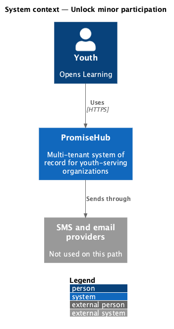
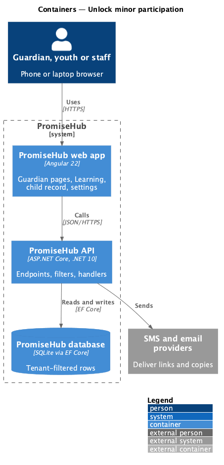
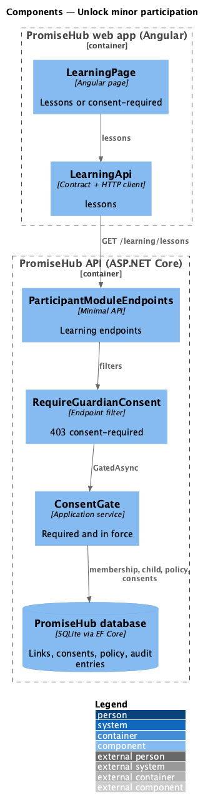
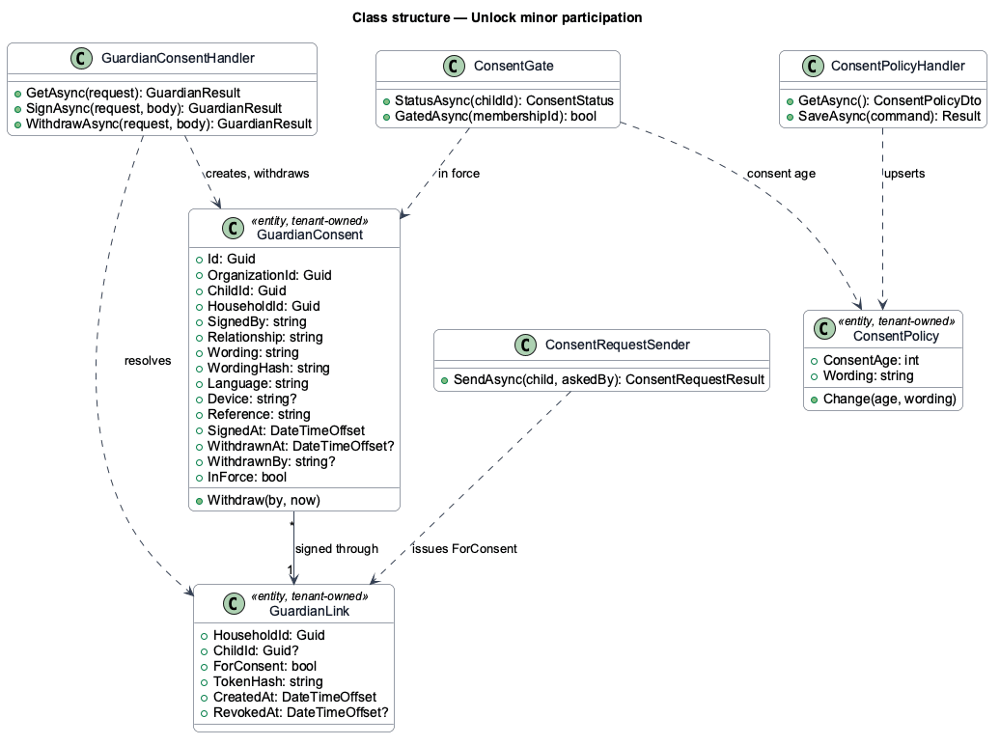
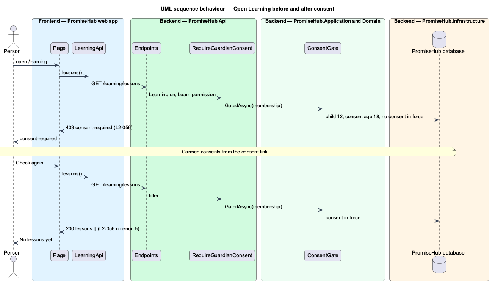

# Unlock minor participation

## Overview

Once a guardian consents, the youth's Learning opens with no staff step. Before that, every Learning call that returns youth work answers 403 `consent-required`. This feature is the **consent gate**: the server-side check that decides, on each request, whether a youth needs consent and has it.

Terms used in this document:

- **consent gate** — `ConsentGate` plus the endpoint filter `RequireGuardianConsent()` (ADR 0046)
- **required** — the child has an active youth account and is under the consent age, or has no date of birth recorded
- **youth work** — any Learning endpoint returning lessons, quizzes, assignments or reflections; the first is the placeholder `GET /learning/lessons`

The gate reads the policy, the child and the consents on every request, so a new consent, a withdrawal, a changed consent age or a corrected birthday takes effect on the youth's next request.

Ported from Waypoint `consent-and-safeguarding/unlock-minor-participation`, with tenancy, the Roster and Learning module gates and PromiseHub types (ADR 0043, ADR 0046).

## Description

Frontend:

- **`LearningPage`** (`frontend/projects/learning/`) — reads `LearningApi.lessons()`; a 403 `consent-required` renders the `consent-required` state, a 200 the lessons (none yet: "No lessons yet").
- **`LearningApi.lessons`** (`frontend/projects/api/`) — maps 403 `consent-required` to a `consent-required` result.

Backend:

- **`ConsentGate`** (`Application/Guardian/`) — `GatedAsync(membershipId)`: loads the caller's linked child, the consent policy (`ConsentPolicy` or its defaults) and the child's consent in force; `StatusAsync(childId)` answers required, the status and the last record for staff.
- **`RequireGuardianConsent()`** (`Api/Authorization/`) — endpoint filter that calls `ConsentGate` for Youth memberships and answers 403 `{ code: "consent-required" }`.
- **`ParticipantModuleEndpoints`** — `GET /learning/lessons` with `RequireModule(Learning)`, `RequirePermission(Learn)` and `RequireGuardianConsent()`.

Every row is tenant-owned and filtered by the organization (ADR 0002); a guardian link puts the request in its own organization (ADR 0015).

## Built so far

Prompt 52 delivered everything above: `ConsentGate`, `GuardianConsentFilter` with `RequireGuardianConsent()`, the placeholder `GET /learning/lessons` and the consent-required state of `LearningPage`. Acceptance tests: `backend/tests/PromiseHub.Api.Tests/YouthConsentGateTests.cs`, `e2e/tests/learning/consent-required.spec.ts`, `e2e/tests/learning/learning.spec.ts`.

## Requirements

| L2 ID | Refines (L1) | Requirement |
|-------|--------------|-------------|
| `L2-056` | `L1-023` | A youth whose linked child record is under the organization's consent age cannot use Learning until a guardian has consented. Admins set the age and the wording; the youth can ask a guardian for consent from the gate. |
| `L2-057` | `L1-015` | Consent is a server-side safeguard evaluated on every protected youth request, never only at sign-in or in the page, and a withdrawal takes effect at once. |
| `L2-055` | `L1-013` | A guardian consents for a youth under the organization's consent age through a verified link, with no account: they read the organization's wording, say how they are related, tick the consent box and type their name. |

## Diagrams

### System context

Who uses this slice and which outside systems PromiseHub talks to.

### Containers

The web app calls the API; the API owns the database and the providers.

### Components

The page, its API client, and the endpoints, filters and handlers behind them.

### Class structure

The consent record, the consent link, the policy and the services that read and write them.

### Behaviour — open learning before and after consent

The steps in order, with the requirement each enforces.

