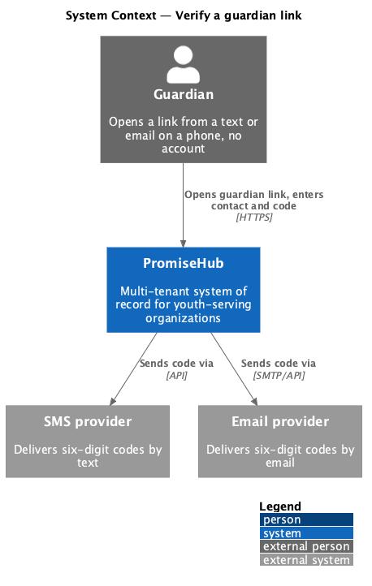
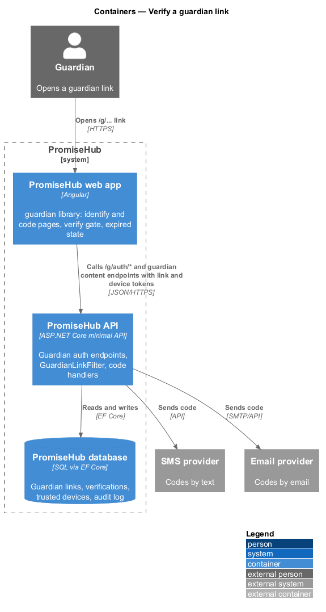
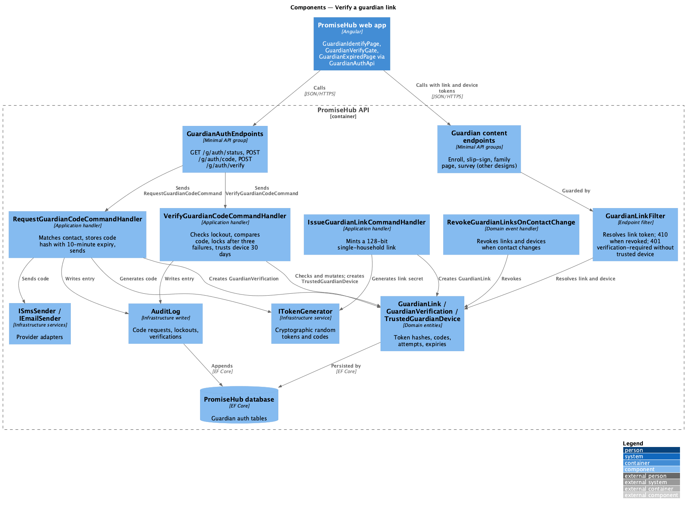
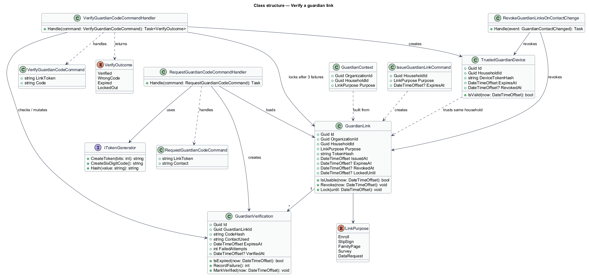
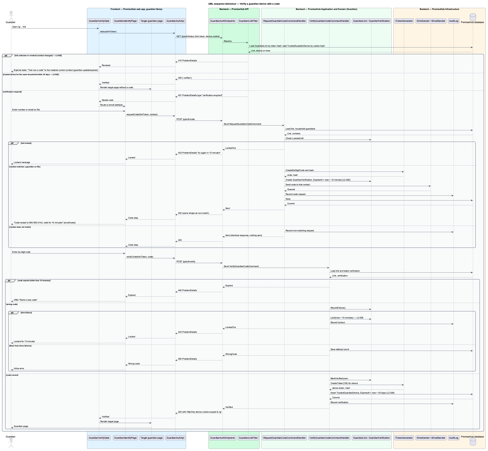

# Verify a guardian link

## Overview

Guardians never install an app or create an account on PromiseHub. Every guardian page is reached through a link in a text or an email, and that link is tied to the phone number or email on file for one household. This feature covers how PromiseHub confirms that the person holding the link is the guardian: a six-digit code sent to the contact on file, a trusted device that skips the code for 30 days, and the link token rules that keep a link single-household and revocable.

When a guardian link is opened on a new device, the `enroll` identify page asks for the number or email on file and PromiseHub sends a six-digit code that expires in 10 minutes. After three wrong codes, a fourth attempt locks the link for 15 minutes. A device that completed verification is trusted for 30 days, and any other link for the same household opens without a code during that time. A link token carries at least 128 bits of entropy, belongs to one household, and is revoked when the household's contact details change; the `guardian-update/expired` state then asks for a fresh code at the new contact.

Terms used in this document:

- **guardian link** — URL under `/g/` that carries a link token and leads to one household's pages
- **link token** — unguessable secret of at least 128 bits bound to one household and one purpose, stored as a hash
- **verification code** — six-digit code sent to the contact on file that proves possession of that phone or mailbox for 10 minutes
- **trusted device** — browser that holds a device token issued after verification, valid for 30 days for one household
- **link lockout** — 15-minute refusal of further codes for one link after three wrong codes

## Built so far

Slice 73 adds the guardian portal's pages under the household link, `/g/home/{token}/children/{childId}` and `/g/home/{token}/announcements` (ADR 0067): each resolves the link through `GuardianAccess` exactly like the family page (401 until the device verifies, 410 for a revoked link), and the child id only selects among the link's household's children, so another household's or organization's child answers 404.

Slice 28 reuses the code check for the family page's corrections; a mobile changed by the guardian revokes the household's links and devices.

Slice 15 added the enrollment identify flow: a code to the contact the guardian types, the same 10-minute expiry and 15-minute lock, and an HttpOnly cookie per program's enrollment session (ADR 0018).

Slice 12 delivered `GuardianLink`, `GuardianVerification`, `TrustedGuardianDevice`, `GuardianAccess` (the link picks the tenant), `POST /g/auth/code` and `/g/auth/verify` with the 10-minute code, the 15-minute lock after three wrong codes, the 30-day HttpOnly device cookie, and revocation when a guardian's mobile changes (ADR 0015). The `enroll` identify page and links for other purposes are not built yet.

## Description

The feature lives in the `guardian` frontend library and the `Guardian` application folder, and supplies a filter that every other guardian endpoint uses.

Frontend, in `frontend/projects/guardian/`:

- **`GuardianIdentifyPage`** — the `enroll` page's `default` and `code` states, reused by every guardian flow when a device is not trusted. It asks for the contact on file, then for the code, and offers "Send a new code" and "Use a different number".
- **`GuardianVerifyGate`** — route guard in the guardian library. It calls `GuardianAuthApi.status(token)` and routes to `GuardianIdentifyPage` when the server answers that verification is needed; otherwise it lets the target page render.
- **`GuardianExpiredPage`** — the `guardian-update/expired` state shown when the token is revoked; its one action requests a code at the masked current contact.
- **`GuardianAuthApi`** — typed client in `frontend/projects/api/` behind `GUARDIAN_AUTH_API` with `status(linkToken)`, `requestCode(linkToken, contact)`, `verifyCode(linkToken, code)`. The device token lives in an `HttpOnly` cookie scoped to `/g/`; the page never reads it.

Backend:

- **`GuardianAuthEndpoints`** — anonymous group in `PromiseHub.Api`: `GET /g/auth/status`, `POST /g/auth/code`, `POST /g/auth/verify`.
- **`GuardianLinkFilter`** — endpoint filter applied to every `/g/*` content endpoint. It resolves the link token to a `GuardianLink`, rejects revoked or unknown tokens with 410, checks for a valid `TrustedGuardianDevice` cookie for the same household, and answers 401 with the `verification-required` problem type when none exists. It sets a `GuardianContext` with the household and organization for the handlers.
- **`RequestGuardianCodeCommand` / `RequestGuardianCodeCommandHandler`** — matches the entered contact against the household's guardians, generates a six-digit code, stores its hash with a 10-minute expiry on a `GuardianVerification`, and sends it through the SMS or email provider. A contact that does not match answers with the same response as a match so the link does not leak which contacts are on file.
- **`VerifyGuardianCodeCommand` / `VerifyGuardianCodeCommandHandler`** — checks the link lockout, compares the code hash, counts failures, locks the link after the third wrong code for 15 minutes, and on success issues a `TrustedGuardianDevice` token valid for 30 days.
- **`IssueGuardianLinkCommand` / `IssueGuardianLinkCommandHandler`** — used by the slips, enrollment, messaging and survey designs to mint a link for one household and purpose; it calls `ITokenGenerator` for at least 128 bits and stores the hash.
- **`RevokeGuardianLinksOnContactChange`** — domain event handler in `PromiseHub.Application/Guardian/` that revokes every link and trusted device of a household when a `GuardianContactChanged` event is raised by the household aggregate.
- **`GuardianLink`**, **`GuardianVerification`**, **`TrustedGuardianDevice`** — domain entities in `PromiseHub.Domain/Guardian/`.
- **`ITokenGenerator`**, **`ISmsSender`**, **`IEmailSender`**, **`AuditLog`** — infrastructure services. Code requests, lockouts and verifications are audited.

### Consent links (prompt 52)

A link can also carry guardian consent (`GuardianLink.ForConsent`, ADR 0046): it names a household and a child, lives 30 days and is replaced by the next consent link for that child. Code verification and device trust are unchanged; the home, slip and survey handlers refuse consent links and the consent handler refuses every other link (410). See `manage-guardian-consent`.

## Requirements

The feature realizes the following level-2 (L2) requirements. Each L2 requirement refines a level-1 (L1) requirement, cited by identifier.

| L2 ID | Refines (L1) | Requirement |
|-------|--------------|-------------|
| `L2-026` | `L1-013` | Guardian pages are reached by links tied to a phone number or email; a six-digit code verifies the device; no password exists. |
| `L2-031` | `L1-016` | TLS everywhere, encryption at rest, OWASP Top 10 defences, secrets outside the repository. |

## Diagrams

### System context

A guardian opens a link from a text or email; PromiseHub sends a code through the SMS or email provider and verifies the device.

### Containers

The guardian library of the PromiseHub web app calls the PromiseHub API's guardian auth endpoints; the API stores links, verifications and trusted devices and sends codes.

### Components

`GuardianLinkFilter` guards every guardian endpoint; the code handlers issue and verify codes; the contact-change handler revokes links.

### Class structure

`GuardianLink` binds a token hash to one household and purpose; `GuardianVerification` holds the code and attempts; `TrustedGuardianDevice` holds the 30-day device token.

### Behaviour — verify a device with a code

A new device is asked for the contact on file and a code; three wrong codes lock the link; a trusted device skips the code; a revoked token shows the expired state (`L2-026`).

