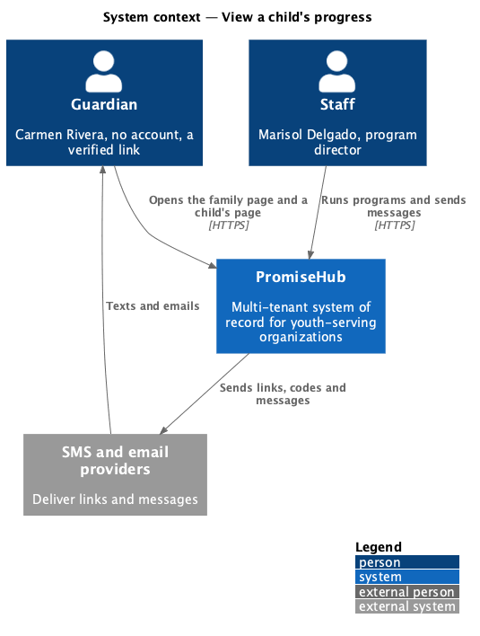
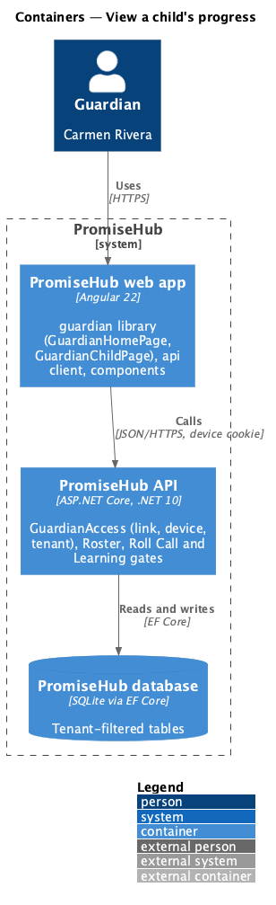
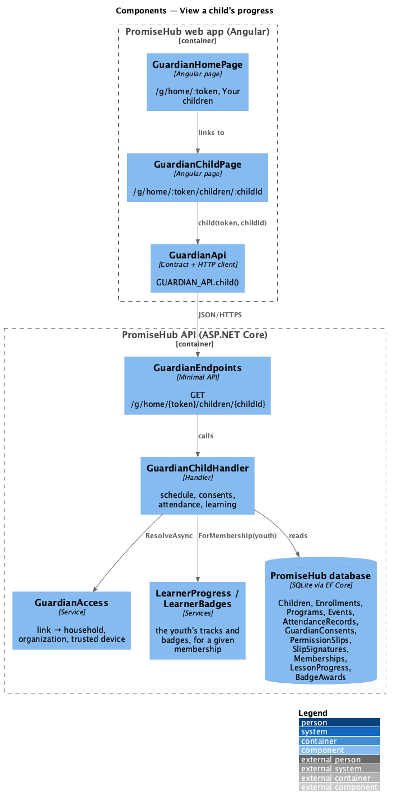
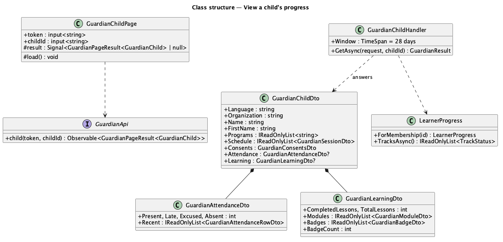
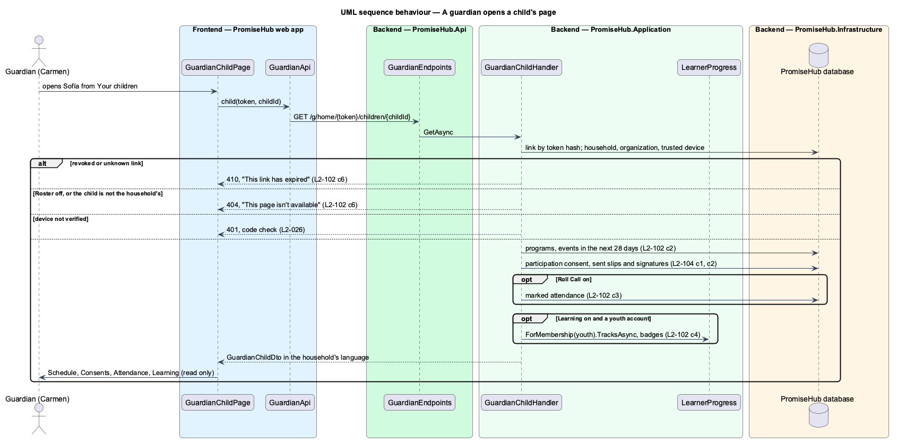

# View a child's progress

## Overview

Guardians want to know how their children are doing without an account or an app. **View a child's progress** gives each child of the household a read-only page reached from the family page of a verified household link: the child's schedule for the next four weeks, the consents on record, attendance and, while Learning is on and the child has a youth account, Learning progress.

Terms used in this document:

- **household link** — a guardian link minted for the household's home page (`GuardianLinkIssuer.IssueHome`), verified on a device by a six-digit code (L2-026)
- **family page** — the guardian home at `/g/home/{token}` (`guardian-home`)
- **youth account** — a Youth membership linked to the child (`Membership.ChildId`, ADR 0043)

Ported from Waypoint `guardian-portal/view-child-progress` (`L2-GUARDIAN-001`). Waypoint's signed-in guardian and `GuardianUserId` become the household link: the household comes from the link's token, never from the URL's other parts, and the tenant from the link (ADR 0015, ADR 0067).

## Description

Frontend (`frontend/projects/guardian/`):

- **`GuardianHomePage`** (`/g/home/:token`, mock `guardian-home` states portal, portal-es, portal-fr) — adds a Your children card: a `ph-list-item` per child with an avatar, the child's active programs as meta, linking to the child page.
- **`GuardianChildPage`** (`/g/home/:token/children/:childId`, mock `guardian-child`) — the back link, the child's first name and programs, then Schedule, Consents, Attendance and Learning cards composed from `ph-card`, `ph-list-item`, `ph-badge`, `ph-stat`, `ph-progress-bar` and `ph-achievement-badges`; `ph-skeleton` while loading; the verify, expired, not-found and error states shared with the other guardian pages. Strings in English, Spanish and French (`portal-text.ts`).

API client (`frontend/projects/api/`): `GuardianApi.child(token, childId): Observable<GuardianPageResult<GuardianChild>>`; `GuardianHome.children[].programs`.

Backend:

- **`GuardianChildHandler`** (`PromiseHub.Application/Guardian/`) — resolves the link through `GuardianAccess` (household, organization, trusted device; the tenant is set from the link), checks Roster, finds the child in the household (404 otherwise), and answers `GuardianChildDto`: programs and the 28-day schedule from the active programs the child is enrolled in; `GuardianConsentsDto` (see manage-contact-details); `GuardianAttendanceDto` from `AttendanceRecords` while Roll Call is on (late and excused from the record's flags); `GuardianLearningDto` while Learning is on and an active Youth membership links the child, reading `LearnerProgress.ForMembership` and `LearnerBadges.ForMembership` so the numbers equal what the youth sees. The DTO has no field for lesson bodies, quiz questions or answers, reflections or mentor notes.
- **`GET /g/home/{token}/children/{childId}`** (`GuardianEndpoints`) — anonymous like every guardian page; 401 until the device verifies, 410 for a revoked link, 404 for Roster off or a child outside the household.
- **`GuardianHomeHandler`** — each child of the family page also carries `programs`.

Open questions: none. Deferred: Waypoint's shared mentor check-ins, quiz history and competencies on the guardian page.

## Built so far

Not started.

## Requirements

| L2 ID | Refines (L1) | Requirement |
|-------|--------------|-------------|
| `L2-102` | `L1-013` | From the family page a guardian opens each of their children and sees, read only, the child's schedule, consents, attendance and, while Learning is on, Learning progress, never lesson content, answers, reflections or mentor notes. |
| `L2-026` | `L1-013` | Guardian links and code verification (cross-referenced, not repeated). |
| `L2-027` | `L1-013` | Guardian pages in the household's language (cross-referenced, not repeated). |
| `L2-088` | `L1-023` | A youth's own progress, which the guardian's numbers equal (cross-referenced, not repeated). |

## Diagrams

### System context

The guardian reaches PromiseHub only through links the organization texts or emails; staff produce what the guardian reads.

### Containers

The web app calls the API with the household link's token and the HttpOnly device cookie; the API resolves the tenant from the link.

### Components

### Class structure

### Behaviour — a guardian opens a child's page

The handler starts from the link's household; the child id in the address only selects among that household's children.

