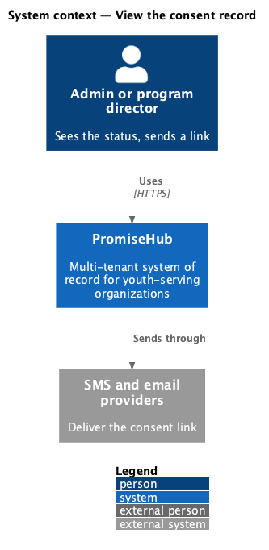
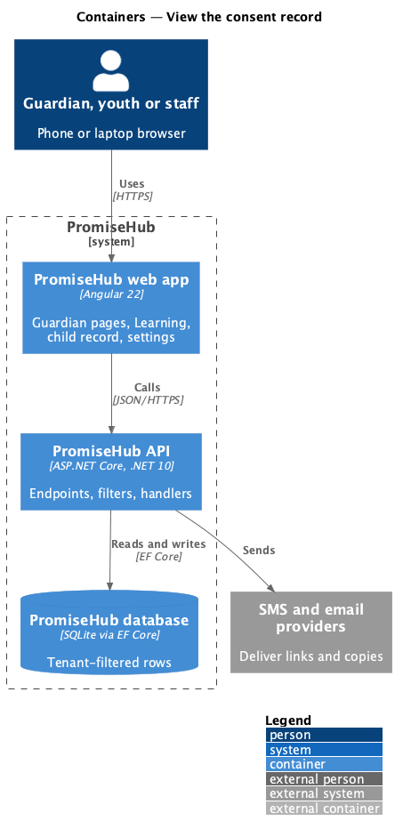
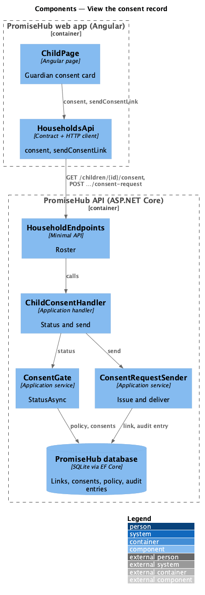
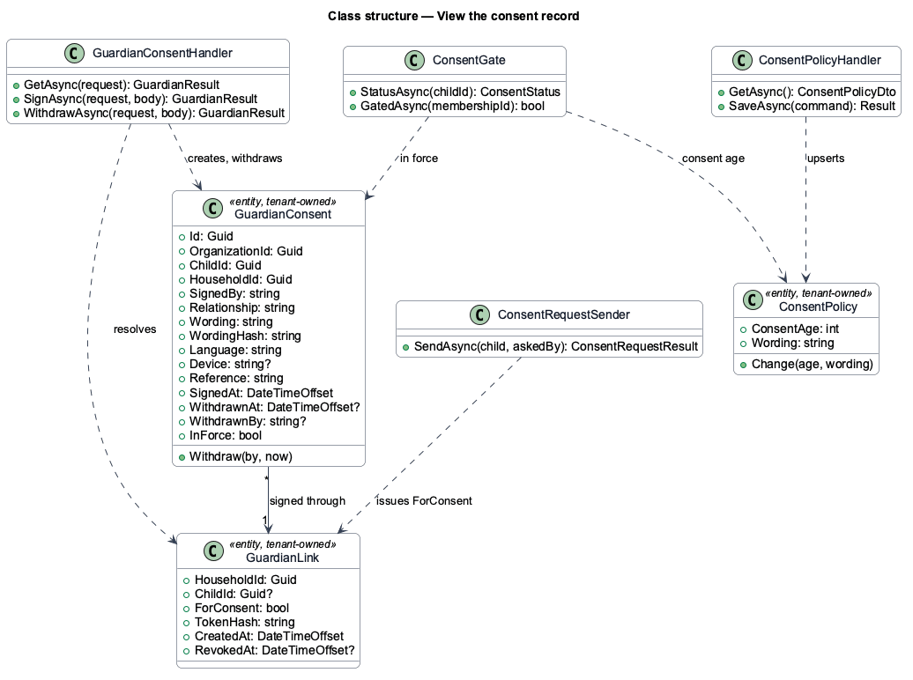
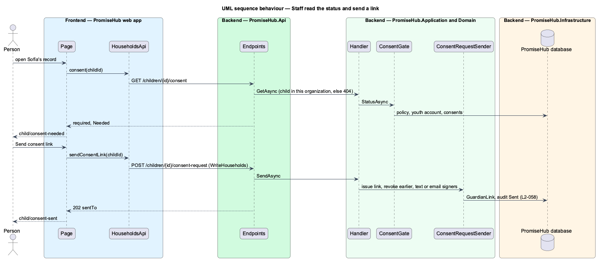

# View the consent record

## Overview

After consenting, the guardian and the staff each need to see what was agreed. The guardian opens the same consent link and sees the record read-only; staff see the status on the child record. Waypoint's "View e-sign record" dialog becomes the record card on the guardian page.

Terms used in this document:

- **consent record** — signer, relationship, date and time, method "Typed signature" and the reference `GC-XXXXXX`
- **consent status** — Needed (required, nothing in force), Given or Withdrawn; Not required when the child is at or over the consent age or has no youth account

Ported from Waypoint `guardian-portal/view-consent-record`, with tenancy, the Roster and Learning module gates and PromiseHub types (ADR 0043, ADR 0046).

## Description

Frontend:

- **`GuardianConsentPage`** — `given` and `signed` states render the record with `ph-description-list` and a Withdraw consent button.
- **`ChildPage`** (`frontend/projects/households/`) — the Guardian consent card (`ph-card`, `ph-list-item`, `ph-badge`) when consent is required; Send consent link for admins and program directors.
- **`HouseholdsApi.consent`, `HouseholdsApi.sendConsentLink`** (`frontend/projects/api/`).

Backend:

- **`ChildConsentHandler`** (`Application/Guardian/`) — `GetAsync(childId)` answers required, consent age, status, the last record and when a link was last sent; `SendAsync(childId)` issues and delivers a consent link through `ConsentRequestSender`.
- **`HouseholdEndpoints`** — `GET /children/{id}/consent` (Roster) and `POST /children/{id}/consent-request` (Roster, `WriteHouseholds`); another organization's child answers 404.

Every row is tenant-owned and filtered by the organization (ADR 0002); a guardian link puts the request in its own organization (ADR 0015).

## Built so far

Prompt 52 delivered everything above: the record on `GuardianConsentPage`, the Guardian consent card on `ChildPage`, `HouseholdsApi.consent` and `sendConsentLink`, `ChildConsentHandler` and the two Roster endpoints. Acceptance tests: `backend/tests/PromiseHub.Api.Tests/GuardianConsentTests.cs`, `e2e/tests/households/child-consent.spec.ts`.

## Requirements

| L2 ID | Refines (L1) | Requirement |
|-------|--------------|-------------|
| `L2-058` | `L1-013` | A guardian sees the consent record from the same link and can withdraw it; staff see the status on the child record and can send a consent link. |
| `L2-055` | `L1-013` | A guardian consents for a youth under the organization's consent age through a verified link, with no account: they read the organization's wording, say how they are related, tick the consent box and type their name. |
| `L2-032` | `L1-017` | Every sensitive action is audited with who, what and when, in its organization only. |

## Diagrams

### System context

Who uses this slice and which outside systems PromiseHub talks to.

### Containers

The web app calls the API; the API owns the database and the providers.

### Components

The page, its API client, and the endpoints, filters and handlers behind them.

### Class structure

The consent record, the consent link, the policy and the services that read and write them.

### Behaviour — staff read the status and send a link

The steps in order, with the requirement each enforces.

