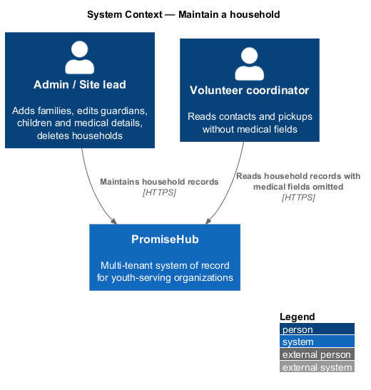
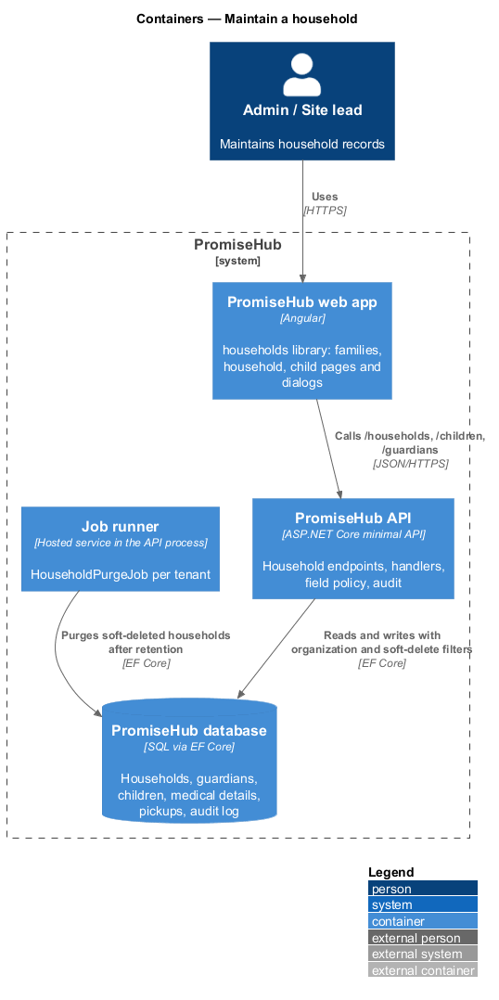
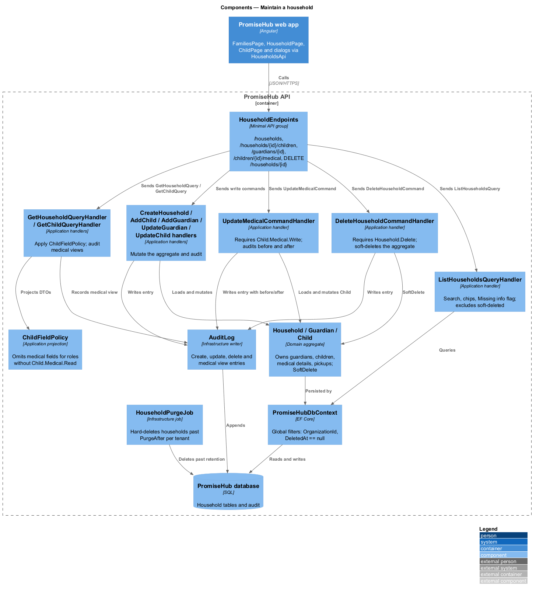
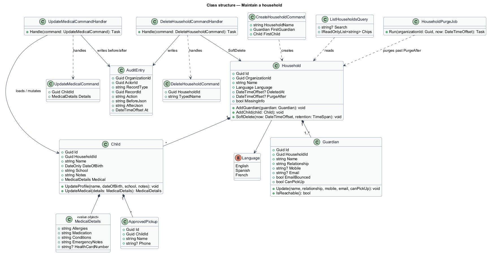
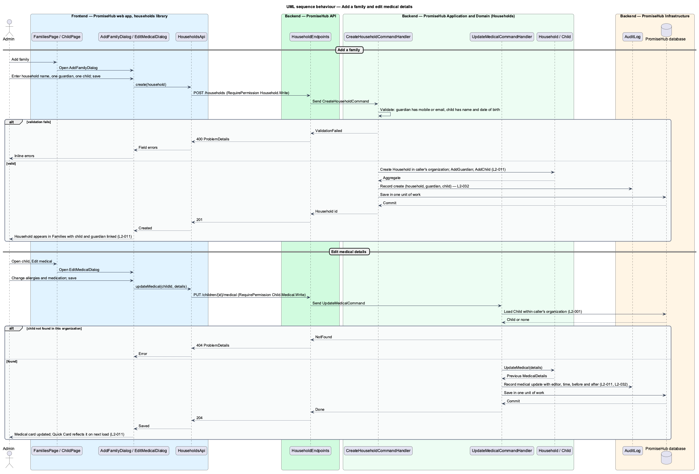
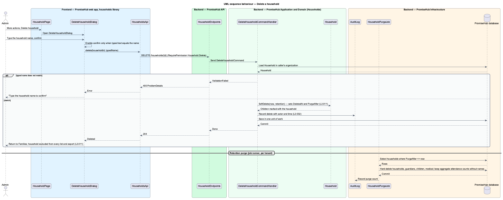

# Maintain a household

## Overview

PromiseHub keeps one household record per family and reuses it for every registration, slip, check-in and Quick Card. A household holds guardians and children; each child carries medical details, school, language, notes and approved pickups. This feature covers how staff create and maintain those records: the Families list (`families`), the household page (`household`), the child profile (`child`), and the dialogs to add a family (`add-family`), add a child (`add-child`), add or edit a guardian (`add-guardian`, `edit-guardian`), edit a child (`edit-child`), edit medical information (`edit-medical`) and delete a household (`delete-household`).

Every change is audited. A medical edit records the editor and the time and is reflected on the Quick Card on the next page load. A household whose guardian has a bounced email and no mobile carries the "Missing info" flag and is reachable through the matching filter chip. Deleting a household is a soft delete confirmed by typing the household name; the household and its children disappear from every list and export and are purged after the organization's retention period. Volunteers see contacts and pickups but not medical fields; that field policy belongs to the authorize-request design and is cited here where it applies.

Terms used in this document:

- **household** — tenant-owned record that groups guardians, children and shared preferences such as language
- **guardian** — adult in a household who may sign slips, be contacted and, when approved, pick up children
- **child** — young person in a household with a date of birth, school, medical details and approved pickups
- **medical details** — allergies, medication, conditions and emergency notes of one child, readable only with `Child.Medical.Read`
- **missing info flag** — derived marker on a household with no reachable guardian contact
- **soft delete** — state in which a record is excluded from every query and export but kept until the retention purge

## Description

The feature lives in the `households` frontend library and the `Households` application folder.

Frontend, in `frontend/projects/households/`:

- **`FamiliesPage`** — list of households with search, filter chips (including "Missing info"), the `Import CSV` link and the `Add family` action. States: `default`, `loading`, `empty`, `no-results`, `error`, `edge`.
- **`HouseholdPage`** — guardians card, children card, consent and preferences, and the actions menu. Shows the `forbidden` variant without medical flags.
- **`ChildPage`** — profile with the medical and emergency card (footer "Edit medical · views logged"), programs and pickups, and a `Quick Card` action. The `edge` state renders five children and the longest names at 360 px without clipping.
- **`AddFamilyDialog`**, **`AddChildDialog`**, **`AddGuardianDialog`**, **`EditGuardianDialog`**, **`EditChildDialog`**, **`EditMedicalDialog`**, **`DeleteHouseholdDialog`** — CDK dialogs. `DeleteHouseholdDialog` enables its confirm button only when the typed text equals the household name.
- **`HouseholdsApi`** — typed client in `frontend/projects/api/` behind `HOUSEHOLDS_API` with `list`, `get`, `create`, `addChild`, `addGuardian`, `updateGuardian`, `updateChild`, `updateMedical`, `delete` and `getChild`.

Backend:

- **`HouseholdEndpoints`** — minimal-API group in `PromiseHub.Api`: `GET /households`, `GET /households/{id}`, `POST /households`, `POST /households/{id}/children`, `POST /households/{id}/guardians`, `PUT /guardians/{id}`, `PUT /children/{id}`, `PUT /children/{id}/medical`, `DELETE /households/{id}`, `GET /children/{id}`. Read endpoints require `Household.Read`; writes require `Household.Write`; the medical endpoint requires `Child.Medical.Write`; delete requires `Household.Delete` (admin).
- **`ListHouseholdsQuery` / `ListHouseholdsQueryHandler`** — filters by organization, search text and chips; computes `MissingInfo` from guardian contact state and excludes soft-deleted rows.
- **`GetHouseholdQuery`**, **`GetChildQuery`** and handlers — apply `ChildFieldPolicy` from the authorize-request design and record a medical view in the audit log when medical fields are returned.
- **`CreateHouseholdCommand`**, **`AddChildCommand`**, **`AddGuardianCommand`**, **`UpdateGuardianCommand`**, **`UpdateChildCommand`**, **`UpdateMedicalCommand`**, **`DeleteHouseholdCommand`** and their handlers in `PromiseHub.Application/Households/`. Each write handler loads the aggregate within the caller's organization, applies the change on the entity, writes an audit entry with before and after values and saves in one unit of work.
- **`Household`**, **`Guardian`**, **`Child`**, **`MedicalDetails`**, **`ApprovedPickup`** — domain entities and value objects in `PromiseHub.Domain/Households/`. `Household.SoftDelete(now)` sets `DeletedAt` and `PurgeAfter`; `Child.UpdateMedical(details)` returns the previous value for the audit entry.
- **`PromiseHubDbContext`** — applies a global query filter on `OrganizationId` and on `DeletedAt == null` for `Household`, `Guardian` and `Child`.
- **`HouseholdPurgeJob`** — job in `PromiseHub.Infrastructure/Jobs/` run by the job runner per tenant; it hard-deletes households whose `PurgeAfter` has passed and keeps aggregate attendance counts without names. The retention period comes from the organization's privacy settings; the purge for a guardian data request is 30 days (`L2-030`), and the default for an admin-initiated delete is 30 days (ADR 0007).
- **`AuditLog`** — infrastructure writer used for every create, update, delete and medical view.

## Built so far

Slice 28 added the guardian's own corrections on the family page: contact details and language, and each child's allergies and medication, audited as made by the guardian (ADR 0020).

Slice 04 delivered `FamiliesPage` (default, empty, no-results and error), `HouseholdPage` (default, restricted and not-found), `ChildPage` (medical card or the restricted note), the add-family, add-child, add-guardian, edit-guardian, edit-child, edit-medical, household-actions and delete-household dialogs, `HOUSEHOLDS_API`, every endpoint above under the Roster module, the handlers with audit entries, `Guardian`, the child's medical fields and the soft delete (ADR 0007). Read permissions are any staff role; writes need `WriteHouseholds`, medical edits `WriteMedical` and deletion `DeleteHouseholds`; medical fields are omitted without `ReadMedical`, and each medical read writes a `Viewed` entry. Approved pickups, the child's programs, slips and attendance, the household's consent and audit cards, sending the enrollment link and `HouseholdPurgeJob` arrive with their features.

## Requirements

The feature realizes the following level-2 (L2) requirements. Each L2 requirement refines a level-1 (L1) requirement, cited by identifier.

| L2 ID | Refines (L1) | Requirement |
|-------|--------------|-------------|
| `L2-011` | `L1-005` | A household holds guardians and children; each child carries medical details, school, language, notes and approved pickups; everything has an audit trail. |
| `L2-032` | `L1-017` | Every change and every sensitive view is recorded and searchable by admins. |
| `L2-001` | `L1-001` | Every tenant-owned table carries the organization id and every query filters by it on the server. |

## Diagrams

### System context

Admins and site leads maintain household records in PromiseHub; volunteers read them without medical fields.

### Containers

The `households` library of the PromiseHub web app calls the PromiseHub API, which stores households, guardians, children and audit entries and runs the purge job.

### Components

`HouseholdEndpoints` dispatches queries and commands to the household handlers; `ChildFieldPolicy` filters medical fields; `AuditLog` records every change and medical view; `HouseholdPurgeJob` removes soft-deleted households after retention.

### Class structure

`Household` owns `Guardian` and `Child`; `Child` owns `MedicalDetails` and `ApprovedPickup` entries. Command handlers mutate the aggregate and write `AuditEntry` rows.

### Behaviour — add a family and edit medical details

Creating a household links the first guardian and child; a medical edit is validated, applied on the child, audited with before and after values, and visible on the Quick Card on the next load (`L2-011`, `L2-032`).

### Behaviour — delete a household

The admin confirms by typing the household name; the handler soft-deletes the aggregate, audits it and the purge job removes it after the retention period (`L2-011`).

