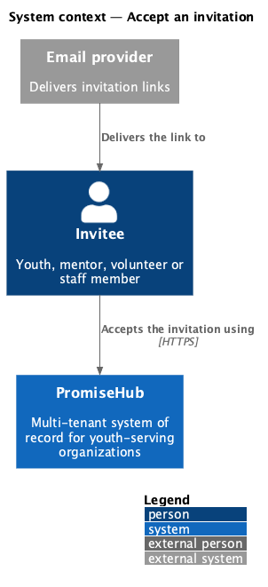
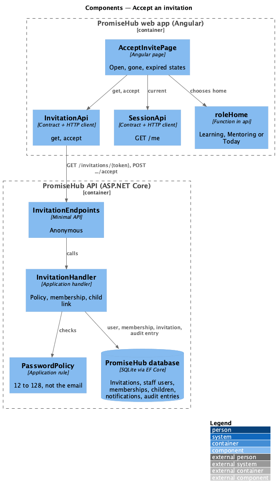
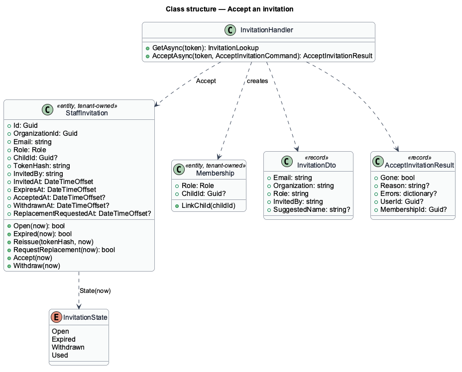
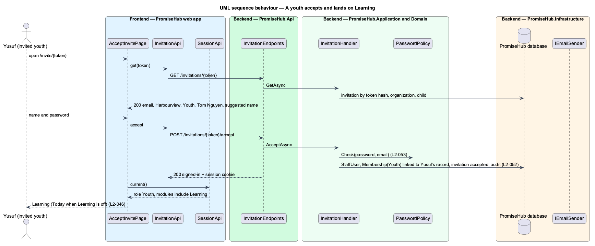

# Accept an invitation

## Overview

The invitee opens the emailed link, sees who invited them to which organization and as what, chooses a name and a password and is signed in. Prompt 30 built this for staff: they continue to the phone step (`L2-009`). This feature completes it for the participant roles: a youth's new membership links to the child record named on the invitation, and a youth or mentor lands on the home of their role (`roleHome`, ADR 0044) instead of the staff phone step, which participant roles may not call.

A link that was accepted or withdrawn answers 410 with its reason and the page says it can't be used; an expired link has its own page (`replace-expired-invitation`). Passwords follow one policy (`set-secure-password`).

Terms used in this document:

- **suggested name** — the child's full name, offered as the name on a youth invitation
- **gone reason** — why a link no longer works: `expired`, `withdrawn` or `used` (an unknown token answers `used`, so a guessed token reveals nothing)

Ported from Waypoint `authentication/accept-invitation` (`L2-AUTH-004`). Waypoint's community-guidelines checkbox and youth onboarding wizard (`welcome-setup`) are deferred to prompt 53.

## Description

Frontend:

- **`AcceptInvitePage`** (`frontend/projects/account/`, `/invite/:token`) — reads `InvitationApi.get(token)`. Open: the email read-only, the organization, the role and inviter in the subtitle, the name prefilled with `suggestedName`, a password field with Show password and the policy as help. After `accept` it navigates to `/welcome/phone` for staff roles and to `roleHome(session)` for Youth, Mentor and Volunteer. Gone with reason `expired` renders the expired state; `withdrawn` or `used` render "This invitation can’t be used" with Sign in.
- **`InvitationApi`** (`frontend/projects/api/`) — `InvitationResult` gone carries `reason`; `Invitation` carries `suggestedName`.

Backend:

- **`InvitationHandler.GetAsync(token)`** — finds the invitation by token hash across tenants (the token is the only key), answers the `InvitationDto` with `SuggestedName` for a youth invitation, or the gone reason.
- **`InvitationHandler.AcceptAsync(token, command)`** — validates the name and the password (`PasswordPolicy`, or the existing account's password), resolves the tenant from the invitation, creates the `StaffUser` when new and a `Membership` with the invited role, calls `Membership.LinkChild` for a youth invitation, marks the invitation accepted, audits, and the endpoint issues the session cookie.
- **`InvitationEndpoints`** — anonymous `GET /invitations/{token}` and `POST /invitations/{token}/accept`, answering 410 with `{ reason, invitedBy, organization }`.

## Built so far

Prompt 51 delivered everything above: the suggested name, the youth subtitle and "Join and start Learning", the role home after joining, the child link on acceptance and the gone reasons. Acceptance tests: `backend/tests/PromiseHub.Api.Tests/YouthInvitationTests.cs`, `PendingInvitationTests.cs`, `e2e/tests/account/accept-invitation-as-youth-or-mentor.spec.ts`, `e2e/tests/account/accept-invite.spec.ts`.

## Requirements

| L2 ID | Refines (L1) | Requirement |
|-------|--------------|-------------|
| `L2-052` | `L1-003` | The invitee sets a name and a password and is signed in with the role the invitation carries, a youth account linked to its child record. Admins resend a fresh link or withdraw one, and a link that was used, withdrawn or replaced never works again. |
| `L2-053` | `L1-016` | One password rule applies wherever a password is set, and passwords are stored only as adaptive hashes. |
| `L2-046` | `L1-003` | Youth land on Learning, mentors on Mentoring, everyone else on Today. |
| `L2-009` | `L1-004` | An invited staff member accepts the invitation, then completes three steps: phone, sessions, ready. |

## Diagrams

### System context

The invitee follows the emailed link to PromiseHub and joins one organization.

### Components

`AcceptInvitePage` uses `InvitationApi` and, after joining, `SessionApi` with `roleHome`; `InvitationEndpoints` delegate to `InvitationHandler`.

### Class structure

Accepting turns a `StaffInvitation` into a `Membership`, linked to the child for a youth.

### Behaviour — a youth accepts and lands on Learning

The membership links to Yusuf's record, the session starts and the role home is Learning (`L2-052`, `L2-046`).

