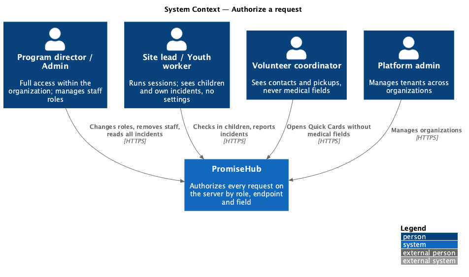
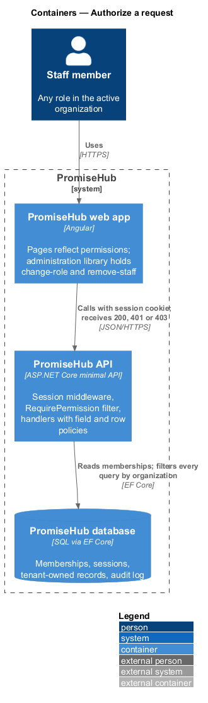
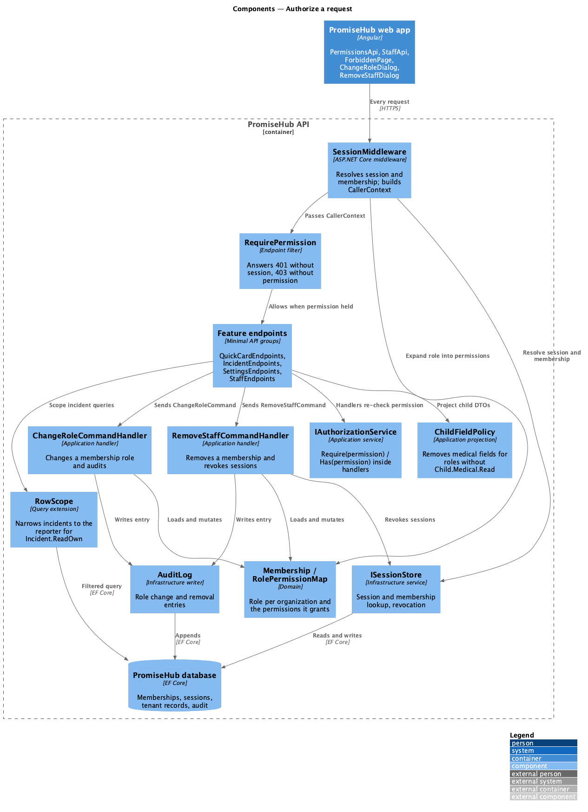
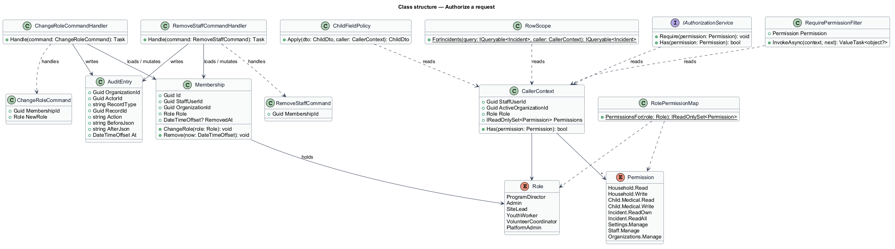
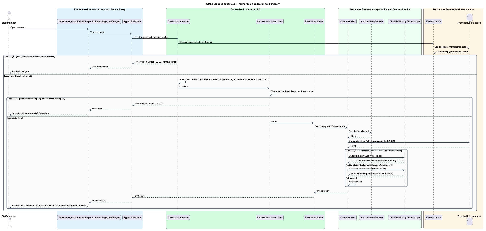
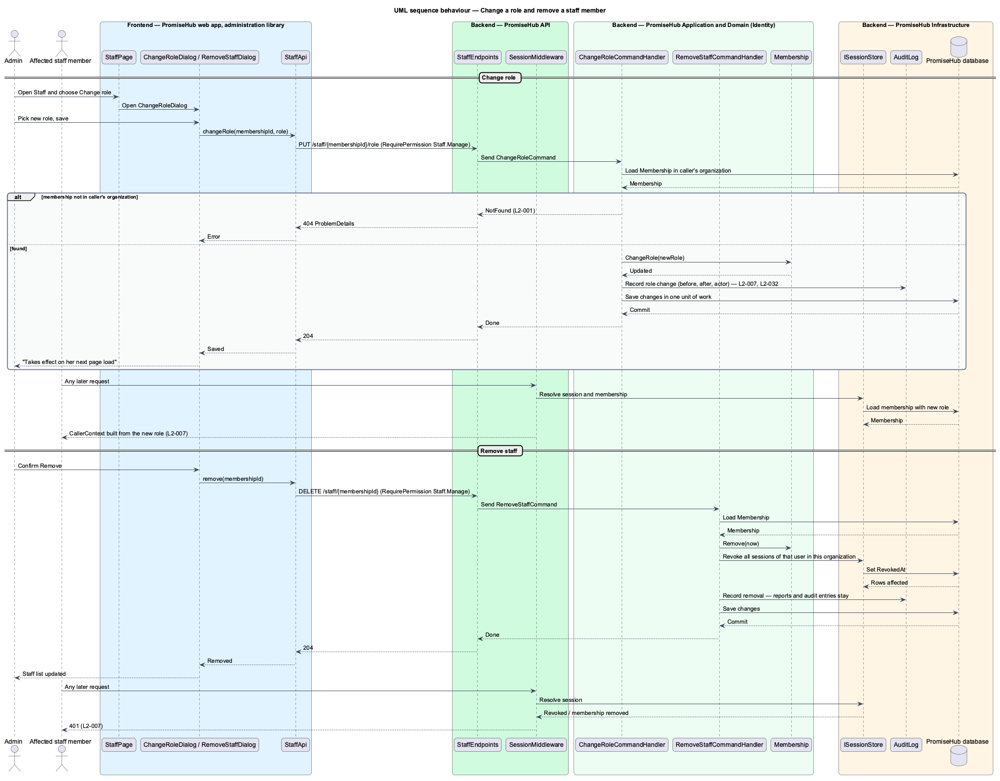
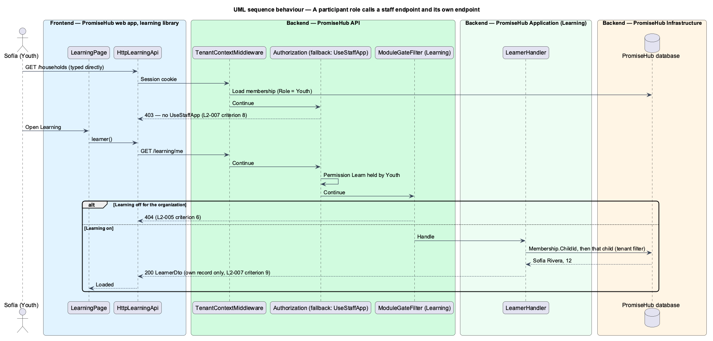

# Authorize a request

## Overview

PromiseHub serves all of its organizations from one deployment, and inside each organization staff hold one of six roles: program director, admin, site lead, youth worker, volunteer coordinator and platform admin. Child, medical and incident data are visible only to roles that need them. This feature covers how the server decides, on every request, whether the caller may reach an endpoint and which fields of a record the caller may see.

Authorization is a server-side decision. The Angular pages reflect the decision by hiding actions and showing restricted states, but a hidden button never substitutes for a server check. A volunteer coordinator who requests a child's Quick Card receives the record with the medical fields omitted and sees the restricted state (`quick-card/forbidden`). A youth worker who requests the incident list receives only the incidents they reported. A site lead who calls any `/settings/*` endpoint receives 403 and the page shows the forbidden state (`staff/forbidden`). When an admin changes a person's role (`change-role`), the new permissions apply on that person's next request and the change is audited. When an admin removes a staff member (`remove-staff`), every subsequent request from that person answers 401.

Terms used in this document:

- **membership** — record that binds one staff user to one organization with one role
- **role** — named bundle of permissions held by a membership: `ProgramDirector`, `Admin`, `SiteLead`, `YouthWorker`, `VolunteerCoordinator` or `PlatformAdmin`
- **permission** — named capability checked by an endpoint or a handler, such as `Household.Read`, `Child.Medical.Read`, `Incident.ReadAll`, `Settings.Manage`
- **field policy** — rule that removes or masks fields of a response for roles without the matching permission
- **row scope** — rule that narrows a query to the rows a role may see, such as incidents reported by the caller

## Description

The feature is a cross-cutting slice: one authorization pipeline in the backend, one restricted-state pattern in the frontend, and two staff dialogs that change memberships.

Frontend:

- **`StaffPage`**, **`ChangeRoleDialog`**, **`RemoveStaffDialog`** — page and CDK dialogs in `frontend/projects/administration/` for `staff`, `change-role` and `remove-staff`. The dialogs call `StaffApi` and show the `forbidden` state when the server answers 403.
- **`ForbiddenPage`** — page in the `promisehub` shell for route `/403`, rendered when a lazy-loaded route answers 403 before any content loads.
- **`PermissionsApi`** — typed client in `frontend/projects/api/` behind the `PERMISSIONS_API` token. It exposes the caller's role and permission set for the active organization, loaded once per session, so pages hide actions the caller lacks. Pages still handle 403 and omitted fields from every response.
- **`StaffApi`** — typed client behind `STAFF_API` with `changeRole` and `remove`.
- **`QuickCardPage`** in `frontend/projects/attendance/` renders the restricted medical card when the response omits medical fields; **`IncidentsPage`** in `frontend/projects/incidents/` renders whatever rows the server returns. Those pages belong to their own designs and are cited here only as consumers of the field policy and row scope.

Backend:

- **`RequirePermission(Permission)`** — endpoint filter in `PromiseHub.Api` applied through an extension on every route group. Anonymous endpoints opt out explicitly. The filter answers 401 when no active session exists and 403 when the membership lacks the permission. It contains no business logic beyond reading the resolved `CallerContext`.
- **`CallerContext`** — per-request object built by `SessionMiddleware` from the session: `StaffUserId`, `ActiveOrganizationId`, `Role` and the set of `Permission` values from `RolePermissionMap`. The organization comes from the membership, never from the URL or the body.
- **`RolePermissionMap`** — static map in `PromiseHub.Domain/Identity/` from `Role` to permissions. Platform admins hold tenant-management permissions and, by default, no child data permissions inside a tenant `<TO SUPPLY>`.
- **`IAuthorizationService`** — application service in `PromiseHub.Application/Identity/` with `Require(permission)` and `Has(permission)`. Handlers call it before reading or writing state so that authorization holds even when a handler is reused by a job.
- **`FieldPolicy<T>`** and **`ChildFieldPolicy`** — application-layer projections that remove `MedicalDetails`, `HealthCardNumber` and related fields from `ChildDto` when the caller lacks `Child.Medical.Read`. The endpoint returns the same DTO shape with those properties null and a `restricted` marker so the Quick Card can show who to ask.
- **`RowScope`** — query extension used by `ListIncidentsQueryHandler`: for `Incident.ReadAll` the query returns all rows of the organization; for `Incident.ReadOwn` it adds `ReportedBy == caller`.
- **`ChangeRoleCommand` / `ChangeRoleCommandHandler`** — requires `Staff.Manage`, loads the `Membership`, applies `ChangeRole`, writes an audit entry with the before and after role. Because `CallerContext` is rebuilt from the membership on every request, the change takes effect on the person's next request without touching their session.
- **`RemoveStaffCommand` / `RemoveStaffCommandHandler`** — requires `Staff.Manage`, marks the `Membership` removed, revokes every session of that user for the organization through `ISessionStore`, and writes an audit entry. `SessionMiddleware` answers 401 for a session whose membership is removed.
- **`Membership`**, **`Role`**, **`Permission`** — domain types in `PromiseHub.Domain/Identity/`.
- **`AuditLog`** — infrastructure writer for role changes, removals and each 403 on a sensitive endpoint `<TO SUPPLY: whether denied requests are audited>`.

Every integration test for an endpoint includes a role matrix case and a cross-tenant case, in line with `AGENTS.md`.

## Built so far

Slice 32 added the first field policy beyond medical, `ReadDateOfBirth`, and a roster row scope: `RosterAccess` limits youth workers to the children of their sessions, with 403 and an `AccessDenied` audit entry for anything else (ADR 0026).

Slice 29 made the per-request membership check honour removed access (`Membership.RemovedAt`) and added `ManageStaff` (ADR 0025).

Slice 02 delivered `Permission`, `RolePermissions` (in `PromiseHub.Application/Identity/`, ADR 0003) and a `RequirePermission` extension backed by an ASP.NET Core authorization requirement that reads the role of the membership resolved for the request; `/settings/*` answers 403 for roles without `ManageSettings`. Slice 09 added the first row scope: `RunAnySession` and `SessionAccess` limit youth workers to the sessions they are assigned to (`SessionStaff`), with `ResultStatus.Forbidden` written as 403 (ADR 0012). Field policies, other row scopes, role changes and removals arrive with their features.

## Participant roles (prompt 49)

ADR 0043 adds the roles **Youth**, **Mentor** and **Volunteer** to `Role`.

- **Staff roles and participant roles.** The new `Permission.UseStaffApp` is held by the five staff roles only. `AuthorizationSetup` makes the fallback policy require it, so every existing endpoint that declares no permission answers 403 to a participant role (`L2-007` criterion 8). `AllowAnyMember()` opts an endpoint back in for every signed-in member: `/me` and its children, `/notifications` and `/auth/sign-out`.
- **`AnyPermissionRequirement`.** `RequireAnyPermission(params Permission[])` passes when the role holds one of them. `/sessions/today` and `/sessions/{id}/roster` require `UseStaffApp` or `RunSessions`, so a volunteer, who holds `RunSessions` without `RunAnySession`, reaches them and `SessionAccess` limits him to his assigned sessions (criterion 11).
- **New permissions.** `Learn` (Youth), `MentorYouth` (Mentor) and `AuthorCurriculum` (Admin, Program director). `LearnerHandler` answers `GET /learning/me` with the child linked to the caller's own membership (criterion 9); `MentoringHandler` answers `GET /mentoring/youth` with the youth assigned to the caller, which is an empty list until assignments exist (criterion 10).
- **Linking a youth account.** `Membership.ChildId` holds the linked child. `LinkYouthHandler` serves `PUT /staff/{membershipId}/child` with `ManageStaff`: the membership and the child are read through the tenant query filter (another organization's answers 404), the membership must be a Youth one and the child must have no other youth account (422 otherwise), and `AuditAction.YouthLinked` records the link (`L2-045`).

## Session endings (prompt 50)

`TenantContextMiddleware` answers each way a session ends with its own code (ADR 0044): a removed membership with no other current one answers 401 "account-deactivated" and the app shows `account-deactivated`; a session id recorded at sign-out (`EndedSession`) answers 401 with no code; an older session version answers 401 as before. See `handle-deactivated-account` and `end-user-session`.

## Requirements

The feature realizes the following level-2 (L2) requirements. Each L2 requirement refines a level-1 (L1) requirement, cited by identifier.

| L2 ID | Refines (L1) | Requirement |
|-------|--------------|-------------|
| `L2-007` | `L1-003` | Permissions are enforced per endpoint and per field by role; the UI reflects them but never substitutes for them. |
| `L2-045` | `L1-003` | A youth signs in with a membership whose role is Youth, and that membership links to exactly one child record in the same organization, so every youth-facing page reads that child's data and no other. |
| `L2-001` | `L1-001` | Every tenant-owned table carries the organization id and every query filters by it on the server. |
| `L2-032` | `L1-017` | Every change and every sensitive view is recorded and searchable by admins. |

## Diagrams

### System context

Each staff role interacts with PromiseHub, and the system decides per request what that role may do and see.

### Containers

Every call from the PromiseHub web app passes through the API's authorization pipeline before any handler reads the database.

### Components

`SessionMiddleware` builds the `CallerContext`; `RequirePermission` guards the endpoint; handlers re-check through `IAuthorizationService`, apply `FieldPolicy` and `RowScope`, and write audit entries for membership changes.

### Class structure

`Membership` binds a `StaffUser` to an organization with a `Role`; `RolePermissionMap` expands the role into permissions held by `CallerContext`.

### Behaviour — authorize an endpoint and apply field and row policies

A volunteer coordinator's Quick Card request returns the record without medical fields; a youth worker's incident list is row-scoped; a site lead's settings request answers 403 (`L2-007`).

### Behaviour — change a role and remove a staff member

The admin's change is audited and takes effect on the affected person's next request; removal revokes sessions so the next request answers 401 (`L2-007`).

### Behaviour — a participant role calls a staff endpoint and its own endpoint

The fallback policy refuses a staff endpoint to a youth; the youth's own endpoint passes its permission and module gate and returns only the linked child (`L2-007` criteria 8 and 9).

