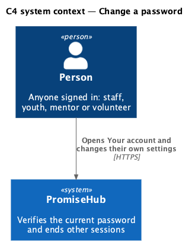
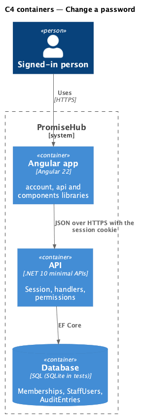
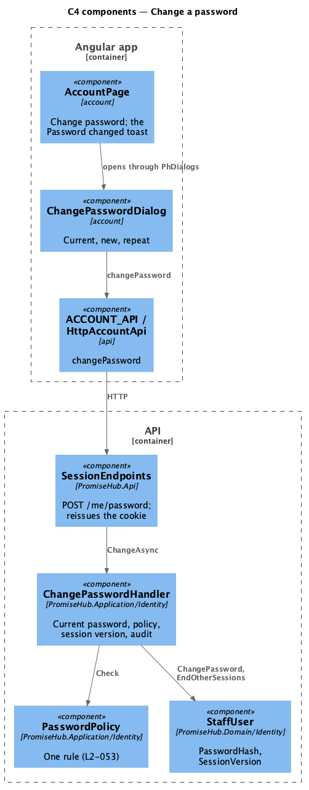
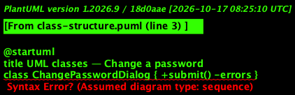
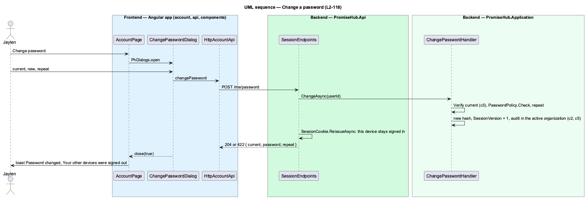

# Change a password

## Overview

Anyone signed in to PromiseHub can change their password from Your account without signing out. A password belongs to the **person** (`StaffUser`), not to a membership, so it is the same in every organization they belong to. Proving the current password stops someone who finds an unlocked phone from taking the account over; ending every other session means a password changed after a lost phone also signs that phone out.

Jaylen chooses Change password on Your account. The `change-password` dialog asks for his current password, the new one and the new one again. When the current one is right and the new one meets the one policy (`L2-053`), the dialog closes and Your account says "Password changed — Your other devices were signed out."; this device stays signed in.

Terms used in this document:

- **session version** — a number on `StaffUser` that every session cookie carries; raising it makes every older cookie invalid (ADR 0039)
- **reissue** — writing a new cookie for this device with the new session version, so only this session survives

Ported from Waypoint `platform-services/change-password` (`L2-PLATFORM-002` criterion 4). Deferred by ADR 0071 and built here (ADR 0072).

## Description

Frontend:

- **`AccountPage`** — the Password card with Change password (`aria-haspopup="dialog"`); on a `true` close it shows the toast.
- **`ChangePasswordDialog`** — `frontend/projects/account/`; three `ph-text-field`s of type password (`current-password`, `new-password` ×2) with Show password; the help "At least 12 characters, and not your email."; a 422 maps `current`, `password` and `repeat` to their fields, any other failure shows "That didn’t go through — Your password is unchanged. Try again."; Change password is busy while saving.
- **`ACCOUNT_API.changePassword(current, password, repeat)`** — `POST /me/password`.

Backend:

- **`SessionEndpoints`** — `POST /me/password` for any member; on success calls `SessionCookie.ReissueAsync` with the active membership and answers 204.
- **`ChangePasswordHandler.ChangeAsync(userId, request)`** — finds the `StaffUser`; a wrong current password answers 422 `current` "That isn’t your current password."; then `PasswordPolicy.Check(password, email)` (`password`) and the repeat (`repeat`, "The two passwords don’t match."); then `ChangePassword(hasher.Hash(password))`, `EndOtherSessions()` and the audit entry "Changed their password" (`AuditAction.Updated`, `StaffUser`) in the active organization only. The password never reaches the log or the audit entry.

## Built so far

Prompt 78 delivered everything above. Acceptance tests: `backend/tests/PromiseHub.Api.Tests/ChangePasswordTests.cs`, `e2e/tests/account/change-password.spec.ts`.

Deferred (ADR 0072): counting wrong current passwords toward the sign-in lock.

## Requirements

| L2 ID | Refines (L1) | Requirement |
|-------|--------------|-------------|
| `L2-118` | `L1-016` | Anyone signed in changes their password by proving the current one; every other session of theirs ends and this one carries on. |
| `L2-053` | `L1-016` | One password rule applies wherever a password is set, and passwords are stored only as adaptive hashes. |

## Diagrams

The person changes their own password in PromiseHub.

The API updates the person's row and the audit log and writes a new cookie.

The dialog calls `ACCOUNT_API`; the handler applies the policy and the session version.

`ChangePasswordHandler` uses the hasher and the policy and changes `StaffUser`.

The current password is checked first; only then does the new one replace it and other sessions end.

