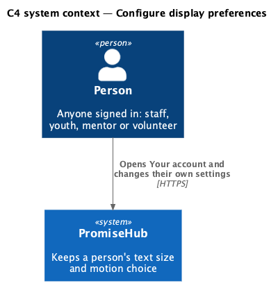
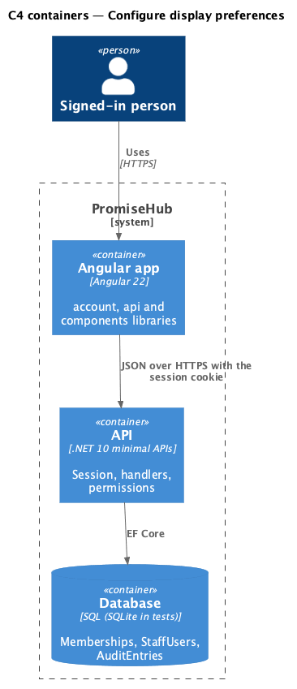
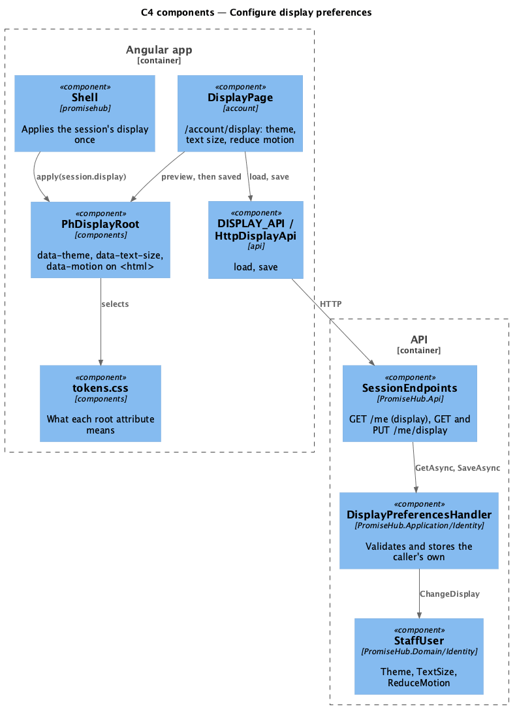
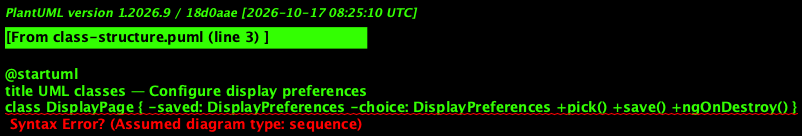
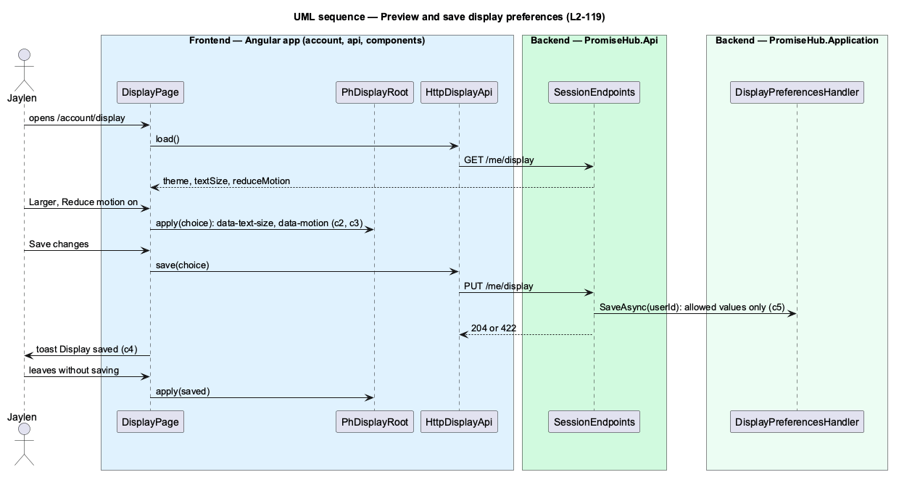

# Configure display preferences

## Overview

Some people read PromiseHub more easily with bigger text, and some are made unwell by moving interfaces. The device can say so, but a shared tablet or a work laptop often does not. This feature lets each person choose a **text size** (Default, Large or Larger) and whether to **reduce motion**, keeps the choice with their account, and applies it to every page they open, on any device.

Jaylen chooses Change display on Your account. On `/account/display` picking Larger grows every page's text by a quarter at once, and Reduce motion stops animations at once: a **preview**. Save changes keeps the choice; leaving or Cancel puts the saved one back.

Terms used in this document:

- **display preferences** — theme, text size and reduce motion, held on the person (`StaffUser`), not on a membership, so they follow the person to every organization (ADR 0072)
- **root attribute** — `data-text-size` and `data-motion` on `<html>`; the tokens scale the root size (112.5%, 125%) and zero the motion durations under them

Ported from Waypoint `platform-services/configure-display` (`L2-PLATFORM-004`). Waypoint's high contrast, underline links and reading font are deferred; the device's contrast setting still applies. The theme is the sibling feature [Switch theme](../switch-theme/README.md).

## Description

Frontend:

- **`DisplayPage`** — `frontend/projects/account/`, `/account/display`. Loads `DISPLAY_API.load()`; Theme and Text size are `ph-radio-group`s with hints, Reduce motion a `ph-switch` with a description. Every change calls `PhDisplayRoot.apply` with the choice. Save changes calls `save`; success shows the toast "Display saved" and becomes the saved choice; failure keeps the preview and shows the failed alert. Cancel and leaving (`ngOnDestroy`) apply the saved choice again. After saving it resets the session so the next `/me` carries it.
- **`DISPLAY_API`** (`frontend/projects/api/`) — `load()` (`GET /me/display`) and `save(prefs)` (`PUT /me/display`); `DisplayPreferences` is `{ theme, textSize, reduceMotion }`. `Session` gains `display`.
- **`PhDisplayRoot`** (`frontend/projects/components/`) — sets or removes the three root attributes; `reset()` removes them all. It knows nothing of HTTP.
- **`Shell`** (`frontend/projects/promisehub/`) — applies `session.display` when the session loads and resets the root on sign-out.

Backend:

- **`SessionEndpoints`** — `GET /me/display`, `PUT /me/display` for any member; `GET /me` carries `display`.
- **`DisplayPreferencesHandler`** — reads and writes only the signed-in person's `StaffUser`; a theme outside `DisplayOptions.Themes` or a size outside `DisplayOptions.TextSizes` answers 422 (`theme`, `textSize`). Not audited: display choices are not sensitive.
- **`StaffUser`** — gains `Theme` (default `system`), `TextSize` (default `default`) and `ReduceMotion`, with `ChangeDisplay`. Migration `DisplayPreferences`.

## Requirements

| L2 ID | Refines (L1) | Requirement |
|-------|--------------|-------------|
| `L2-119` | `L1-019` | Each person chooses a text size and whether to reduce motion; the choice is kept with their account and applies to every page they open. |
| `L2-035` | `L1-019` | WCAG 2.2 AA on every screen in both themes. |
| `L2-036` | `L1-019` | Layouts adapt at the design system's breakpoints of 640, 768, 1024 and 1280 pixels (its `--layout-breakpoint-*` tokens), from 360 pixel phones up to 1600 pixel screens. |

## Diagrams

The person keeps their own display choice in PromiseHub.

The choice is stored with the person and returned with the session.

The page and the shell both apply choices through `PhDisplayRoot`; the tokens give the attributes their meaning.

`DisplayPreferencesHandler` validates against `DisplayOptions` and changes `StaffUser`.

Picking previews at once; saving stores the choice; leaving unsaved restores the saved one.

