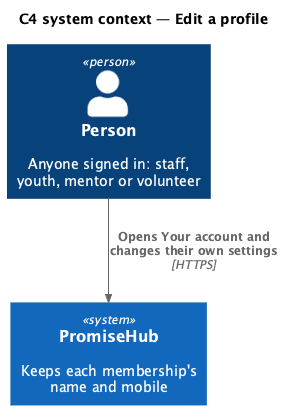
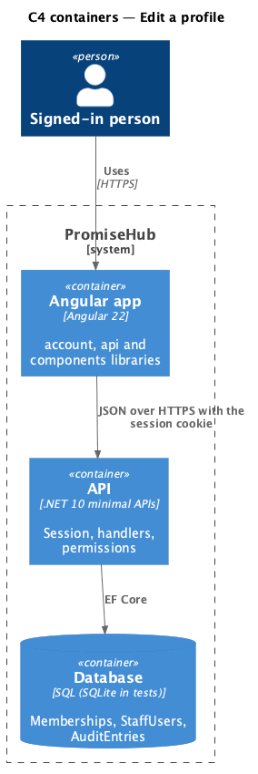
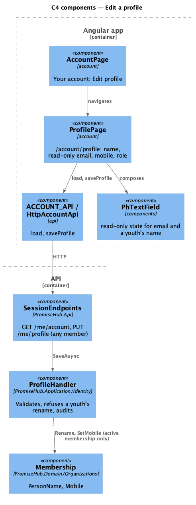
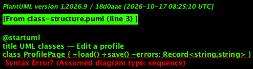
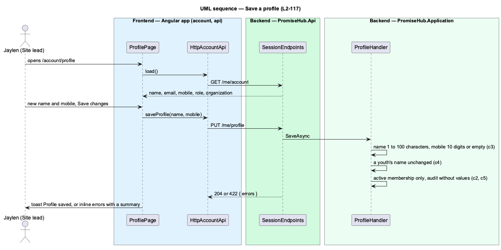

# Edit a profile

## Overview

PromiseHub is a multi-tenant, phone-first system of record for youth-serving organizations. A person signs in once and holds a **membership** in each organization they belong to, with a role and a name there. Your account (`account`) is the place where anyone signed in, staff, youth, mentor or volunteer, manages their own settings (ADR 0072). This feature lets them change how they appear in the organization they are signed in to: their name and their mobile.

Jaylen Okafor (Site lead) chooses Edit profile on Your account, changes his name and mobile on `/account/profile` and saves; the top bar shows the new name at once. His email is shown but not editable, because it is how he signs in to every organization. His role and organization are shown under "Set by Harbourview Youth". Sofía Rivera (Youth) sees her name read-only too: it comes from her child record, which staff keep.

Terms used in this document:

- **active membership** — the membership the session is signed in to; the tenant comes from it, never from the request
- **managed field** — a value shown on the profile that the organization, not the person, changes: role, organization, and a youth's name

Ported from Waypoint `platform-services/edit-profile` (`L2-PLATFORM-002`). Waypoint's photo and pronouns are deferred (ADR 0072). Identity is not a module and is always on.

## Description

Frontend, in `frontend/projects/account/`:

- **`AccountPage`** — Your account; its Profile card shows email, mobile and role with Edit profile, a link to `/account/profile`.
- **`ProfilePage`** — `/account/profile`. Loads `ACCOUNT_API.load()`; the Name field is read-only for a Youth, Email always; Mobile is optional (`tel`). Save changes calls `saveProfile`; a 422 shows the errors inline and in `ph-error-summary`, any other failure the failed `ph-alert`, success the toast "Profile saved". After saving it resets the session (`SESSION_API.reset()`) so the shell shows the new name. States: loading, error, default, invalid, submitting, success, failed.
- **`ACCOUNT_API`** (`frontend/projects/api/`) — gains `saveProfile(name, mobile)`.
- **`PhTextField`** (`frontend/projects/components/`) — gains the design system's read-only state.

Backend:

- **`SessionEndpoints`** — `PUT /me/profile` for any member (`AllowAnyMember`), 204 or 422.
- **`ProfileHandler.SaveAsync`** — trims the name (required, at most 100 characters) and the mobile (empty clears it, otherwise ten digits); refuses a changed name from a Youth; changes only the active membership (`tenant.MembershipId`); records `AuditAction.Updated` on `Membership` with "Updated their profile", without values.
- **`Membership`** — gains `Rename(name)`; `SetMobile` accepts null. No migration.

The fake API overlays a saved name and mobile per membership and answers `/me` and `/me/account` from it.

## Built so far

Prompt 78 delivered everything above: `PUT /me/profile` with `ProfileHandler`, `Membership.Rename`, `ProfilePage` with the read-only email, role and youth name, and the read-only state of `PhTextField`; the session refreshes after a save so the top bar shows the new name. Acceptance tests: `backend/tests/PromiseHub.Api.Tests/ProfileTests.cs`, `e2e/tests/account/edit-profile.spec.ts`.

Deferred (ADR 0072): the profile photo, pronouns and changing the email through a verified flow.

## Requirements

| L2 ID | Refines (L1) | Requirement |
|-------|--------------|-------------|
| `L2-117` | `L1-003` | Everyone signed in, staff, youth and mentors alike, opens their own profile from Your account and changes how they appear in the organization they are signed in to; what the organization manages for them is shown but not editable. |
| `L2-001` | `L1-001` | Every tenant-owned table carries the organization id; every query, search, export and background job filters by the organization of the signed-in person's active membership, never by a value from the client. |
| `L2-032` | `L1-017` | Every change and every sensitive view is recorded and searchable by admins. |

## Diagrams

The person changes their own profile; no other system takes part.

The Angular app calls the API with the session cookie; the API writes the membership and the audit entry.

`ProfilePage` composes library fields and calls `ACCOUNT_API`; `ProfileHandler` changes the active membership only.

The handler depends on the tenant context for the membership and on the audit writer.

Saving validates the fields, keeps a youth's name, changes one membership and answers 204 or 422.

