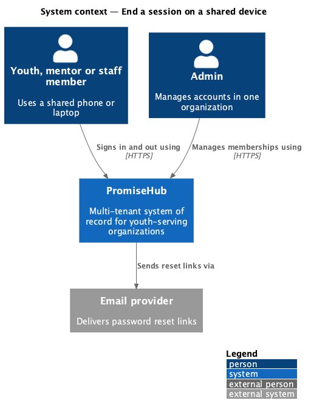
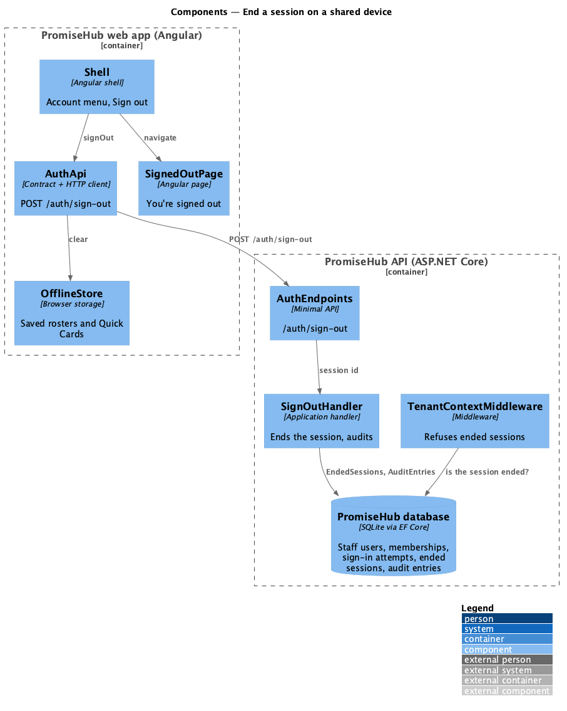
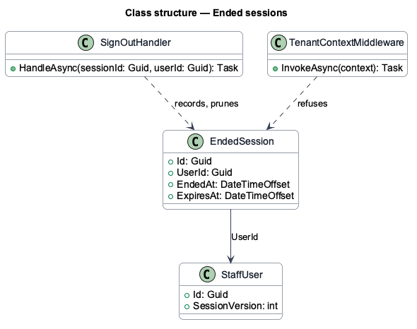
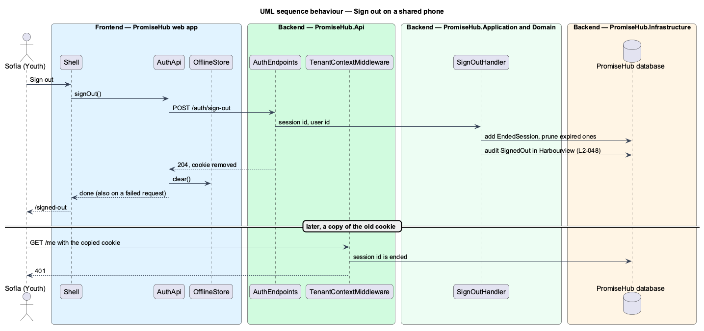

# End a session on a shared device

## Overview

PromiseHub is a multi-tenant, phone-first system of record for small youth-serving organizations. Youth and volunteers often sign in on a shared phone, a program laptop or a library computer. This feature makes Sign out final: the server ends that session so a copied cookie stops working, and the device forgets everything PromiseHub kept on it, so the next person cannot read the last person's data.

Sign out sits in the account menu of the top bar for every role. It ends on `signed-out`, which says the device no longer keeps the person's data and offers Sign in again. Going back, or opening any page of the shell, shows sign-in.

Terms used in this document:

- **session id** — random identifier carried as a claim in the session cookie; one per sign-in
- **ended session** — a session id recorded at sign-out; any request carrying it answers 401 until the cookie could no longer have lived (12 hours)
- **offline store** — the rosters, Quick Cards and queued check-ins saved in the browser for check-in without signal (`L2-028`)

Ported from Waypoint `authentication/end-user-session` (`L2-AUTH-007`). Waypoint revokes a refresh-token family; PromiseHub records the ended session id instead (ADR 0044).

## Description

Frontend:

- **`Shell.signOut()`** — calls `AuthApi.signOut()` and navigates to `/signed-out`.
- **`HttpAuthApi.signOut()`** — posts `/auth/sign-out`, then, whether or not the request succeeded, forgets the loaded session (`SessionApi.reset()`) and clears the offline store (`OfflineStore.clear()`).
- **`OfflineStore.clear()`** — removes every `promisehub.offline.*` key from `localStorage`.
- **`SignedOutPage`** — page at `/signed-out` in the `account` library, outside the shell, composed of the authentication card and a button.

Backend:

- **`AuthEndpoints`** — `POST /auth/sign-out` (`AllowAnyMember`) calls `SignOutHandler` with the session id and user from the cookie, then removes the cookie.
- **`SignOutHandler`** — in `PromiseHub.Application/Identity/`. Records an `EndedSession`, deletes ended sessions whose 12 hours are over, and audits `SignedOut` "Signed out" in the session's organization.
- **`EndedSession`** — entity in `PromiseHub.Domain/Identity/`: session id, user id, ended at, expires at. Not tenant-owned, like `StaffUser`.
- **`AuthenticationSetup.SessionPrincipal`** — adds the `session_id` claim; `SessionCookie.SignInAsync` creates a new id for every sign-in, and reissuing on an organization switch keeps it.
- **`TenantContextMiddleware`** — answers 401 when the cookie's session id is an ended session.

## Requirements

| L2 ID | Refines (L1) | Requirement |
|-------|--------------|-------------|
| `L2-048` | `L1-016` | Signing out on a shared phone or laptop ends the session on the server and leaves none of the person's data on the device. |
| `L2-028` | `L1-014` | Check-in and Quick Cards work offline from data cached on the device. |
| `L2-032` | `L1-017` | Every sensitive action is recorded in an append-only audit trail. |

## Diagrams

### System context

### Components

### Class structure

### Behaviour — sign out on a shared phone

The server records the ended session and audits it; the device forgets the session and its saved data, even when the request fails (`L2-048`).

