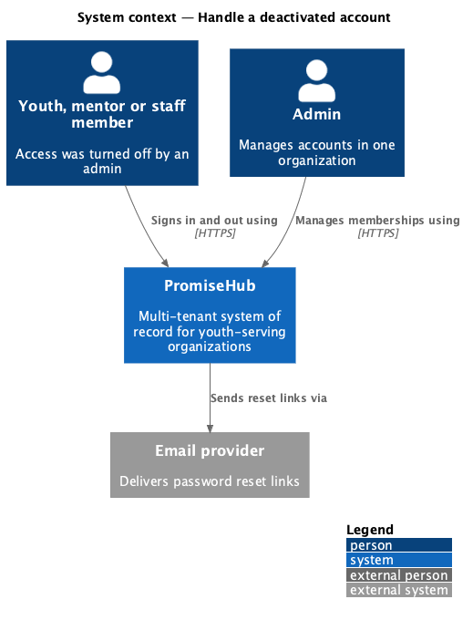
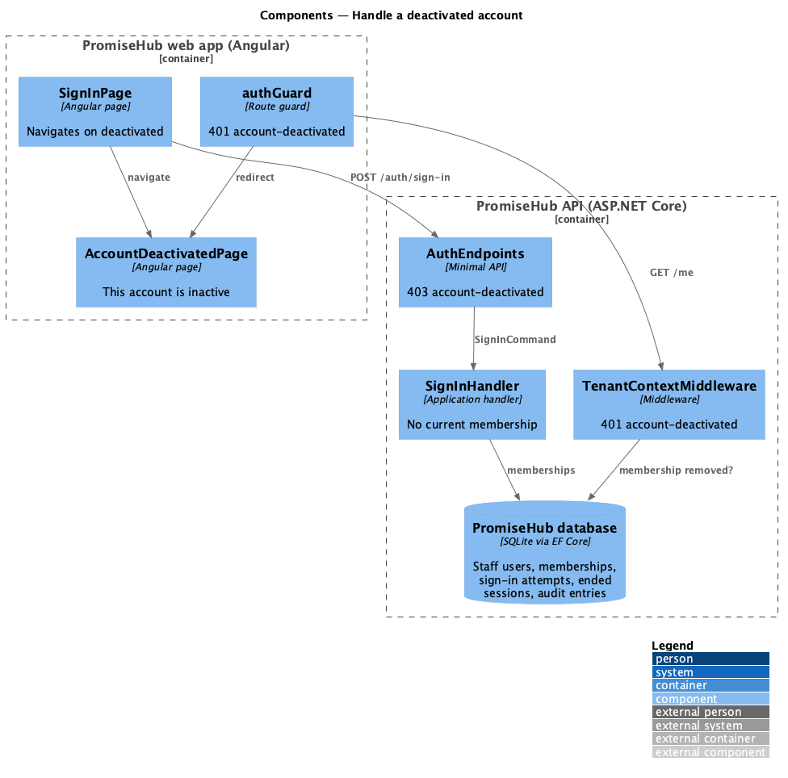
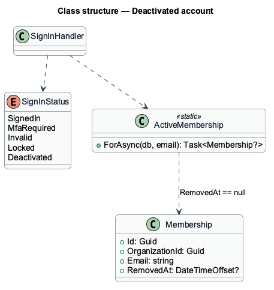
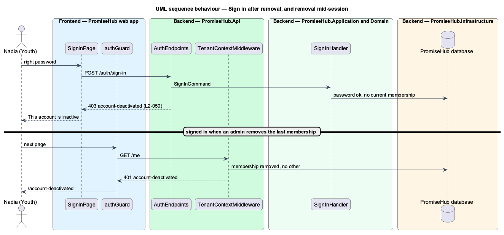

# Handle a deactivated account

## Overview

PromiseHub is a multi-tenant, phone-first system of record for small youth-serving organizations. An admin turns a person's access off by removing their membership (`remove-staff`); nothing about them is deleted. This feature covers what that person sees: an account-inactive page (`account-deactivated`) that says access was turned off and who can restore it, instead of a sign-in form that seems to have forgotten them.

The page shows in two cases. A person whose memberships are all removed signs in with the right password: the API answers 403 "account-deactivated" and no session starts. A wrong password still answers the generic 401, so the page never reveals whether an email has an account. A person already signed in whose last membership is removed gets 401 "account-deactivated" on their next request. A person removed from one organization but still a member of another simply continues in that one (`L2-002`).

Terms used in this document:

- **deactivated account** — a person with a password whose every membership is removed
- **current membership** — a membership that is not removed

Ported from Waypoint `platform-services/handle-deactivated-account` (`L2-PLATFORM-010`). Waypoint's "contact the director" link is not carried over: the page names the program director or admin, because an anonymous page cannot know the organization's contact (ADR 0044).

## Description

Backend:

- **`SignInHandler`** — after a correct password, when `ActiveMembership.ForAsync` finds no current membership, returns `SignInStatus.Deactivated`.
- **`AuthEndpoints`** — maps `Deactivated` to 403 `{ code: "account-deactivated" }`.
- **`TenantContextMiddleware`** — when the cookie's membership is removed and the person has no other current membership, answers 401 `{ code: "account-deactivated" }`.

Frontend:

- **`SignInOutcome`** — gains `{ status: 'deactivated' }`; `HttpAuthApi` maps the 403.
- **`SignInPage`** — navigates to `/account-deactivated` on that outcome.
- **`authGuard`** — redirects 401 "account-deactivated" to `/account-deactivated`.
- **`AccountDeactivatedPage`** — page at `/account-deactivated` in the `account` library, outside the shell: authentication card, Back to sign in.

## Built so far

Prompt 50 delivered everything above. Acceptance tests: `e2e/tests/account/account-states.spec.ts`, `backend/tests/PromiseHub.Api.Tests/DeactivatedAccountTests.cs`.

## Requirements

| L2 ID | Refines (L1) | Requirement |
|-------|--------------|-------------|
| `L2-050` | `L1-003` | A session that timed out and an account that was turned off each show their own state with the one way forward. |
| `L2-007` | `L1-003` | Permissions are enforced per endpoint and per field by role; the UI reflects them but never substitutes for them. |
| `L2-002` | `L1-001` | A person may belong to several organizations; the active one is explicit in every request. |

## Diagrams

### System context

### Components

### Class structure

### Behaviour — sign in after removal, and removal mid-session

